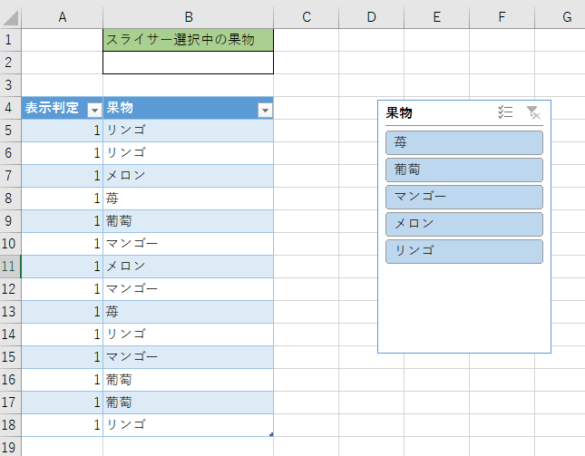
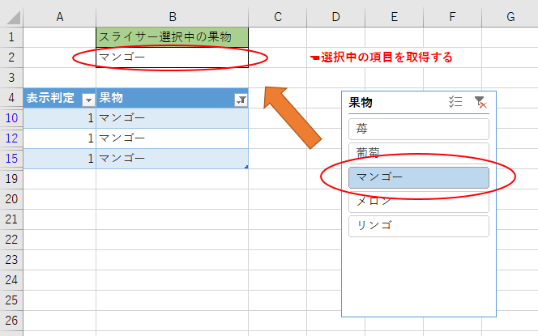
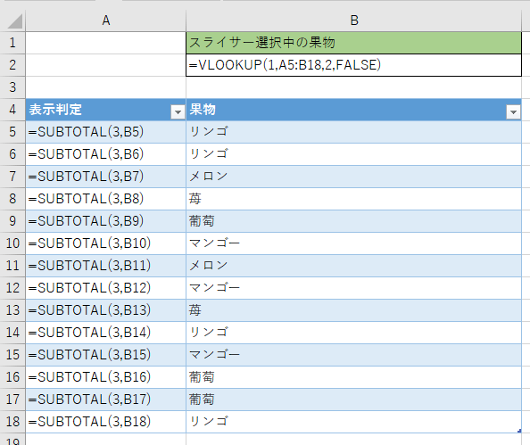
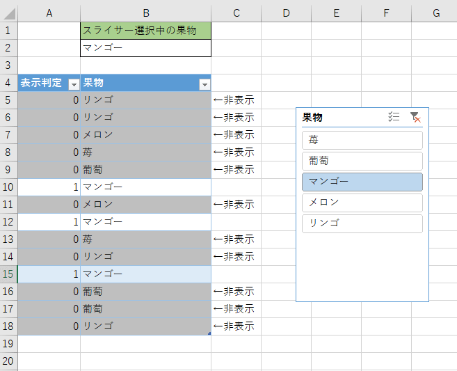

Excel2013以降ではテーブルでもスライサーが利用できるようになりました。  
フィルター機能を便利にするスライサーですが、スライサーで選択中の項目を取得したいケースがありますので共有します。  
フィルター中の項目を別のセルに展開することで、その値を他のセルで利用できるようになり様々な機能に応用できるようになります。

## 例

↓こんなテーブルとスライサーを作って

スライサーで単一選択すると選択中の項目をセルで取得できるようにします。

## やり方

判定用の作業列を1つ追加して、SUBTOTALとVLOOKUPを使用します。

**表の各行にSUBTOTAL(3,セル)を仕込み、VLOOKUPでA列をキーに「1」を検索します。**  
これでスライサーの選択項目を抽出できます。

## 解説

SUBTOTALは集計用の関数で、第1引数で集計方法を選択できます。  
今回は3を入れていますが、これはCOUNTAと同じようにデータの個数を集計するという意味です。  
また、第2引数で集計する範囲を指定します。1つのセルのみ指定していますので集計結果は0か1になります。空欄でない限りは必ず1になります。うまくいかない場合は3の代わりに103を入れてみてください。

このままでは、A列は何の意味も持ちませんが、スライサーでフィルターをすることでSUBTOTALの特徴が活きてきます。  
SUBTOTALは「**非表示の行は集計しない**」という特徴があります。

スライサーにより表がフィルターされると非表示となった行のSUBTOTALの結果は0になります。  
↓イメージ

表示されている行はそのまま1となりますのでVLOOKUPで「1」を検索すると、スライサーで選択中の項目が引っかかるというわけです。

Excel2016以降でXLOOKUPが使えるならXLOOKUPで代用しても問題ありません。

## 拡張

SUBTOTALを使って表示行を拾う方法ですが、FILTER関数が使えるようなら割と簡単に好きな行を持って来て加工できるようになります。

FILTER関数が無くても、表示判定列をROW()などで一意にしてPRIMARY KEYとして使えば少し手間ですが、FILTER関数と同様の処理を実現できるようになります。

Excelで伝票や帳票を作成するような業務で、スライサーの操作で中身を切り替えたりできるので個人的に重宝する技の1つです。

## そのほか

今回は単一選択時の取得方法でしたが、複数選択時も取得する方法はあります。  
若干複雑になるため別で扱いたいと思います。

https://papasensei365.com/excel-selected-slicer2/
