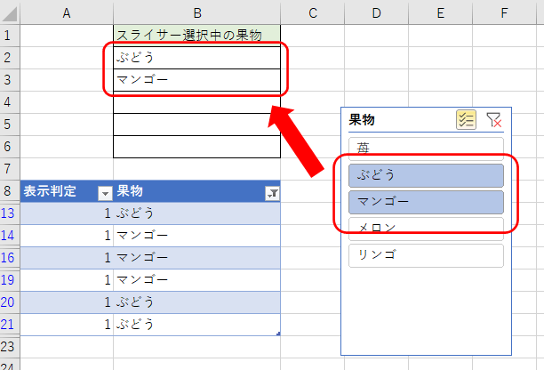
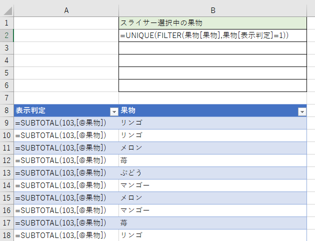
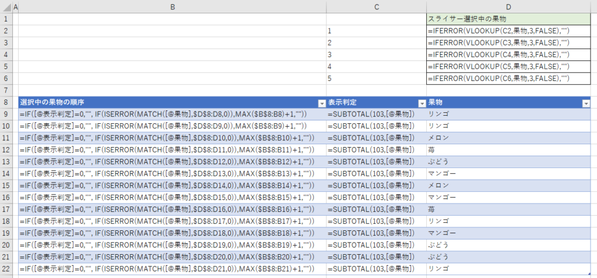
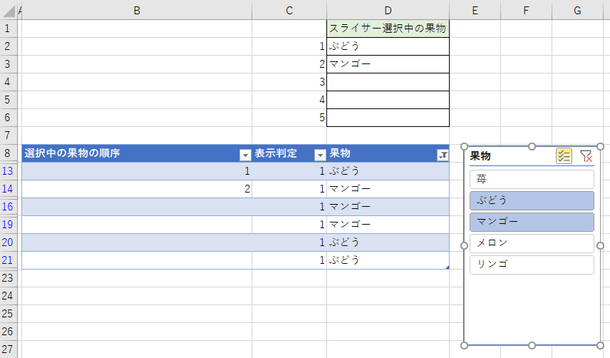

フィルター中の項目を取得する方法です。単一選択の場合は下記を参照してください。

https://tomikiya.github.io/excel-selected-slicer1/

複数選択の場合は単一選択より若干複雑です。

前提としてですが、本質以外の雑音を排除するためエラー回避等の関数を除いています。適宜読み替えてください。

## 例

複数の果物の情報を持つテーブルでスライサーを表示し、複数選択します。

その時に、スライサーで選択した果物をセル上に表示できるようにします。



## FILTER関数が使える場合

Excel2016以上でFILTER関数が使えるのでしたらシンプルにできます。



```
スライサー選択中の果物 = UNIQUE(FILTER(果物[果物],果物[表示判定]=1))
```

表示判定(A列)でSUBTOTALを使い表示行を判定する方法は単一選択の時と変りません。

それを抽出するときにFILTER関数とUNIQUE関数を使うだけです。

結果が可変なので余裕を持って範囲を用意しておきましょう。

## FILTER関数が使えない場合

Excelのバージョンが古かったりアップデートが出来ずにFILTERが使えない場合の対処です。

SUBTOTALを使う手順は単一選択の時と変わりません。  
そこに**選択中の果物の順序**を付与します。



### 解説

#### 表示判定(C列)

```
表示判定 = =SUBTOTAL(103,[@果物])
```

SUBTOTALを使うことでスライサーで絞り込んだ後に表示されている行を判定しています。その行が表示なら1、非表示なら0を返します。

#### 選択中の果物の順序(B列)

```
選択中の果物の順序 = IF([@表示判定]=0,"", IF(ISERROR(MATCH([@果物],$D$8:D8,0)),MAX($B$8:B8)+1,""))
```

表示判定が0(=非表示)なら空白を表示して順序付けの対象外とします。

そして上位の行に同じ果物名が無ければ順位をつけるようにします。MATCHの部分で上位の行を検索し、ISERRORでエラー判定（＝同じ果物名が無かった、つまり初登場と判定）し、MAX+1で順序を採番しています。

実際、絞り込むと結果はこのように表示されます。



#### スライサー選択中の果物(ヘッダー)

```
スライサー選択中の果物 = IFERROR(VLOOKUP(C2,果物,3,FALSE),"")
```

選択中の果物を1から順番にVLOOKUPで検索するだけです。今回は最大5件までとしていますが、想定する最大件数まで式を予め生成しておけば6件以上の表示も可能です。

### 補足

行が多くなればMATCHやMAXの計算量が多くなるので遅くなります。例えば1000行（適当）を超えるようならVBAとかPOWER QUERYとか別の方法を考えた方がよいかもしれません。

## とういことで

スライサーは非常に便利で使いやすいので、絞り込んだ値をVBA無しで取得できれば応用ができそうですね。
