Excelでゲームを作るといつもは使わない関数や機能に出会うことがあります。  
コーヒーブレイクとして挑戦してみると面白いかもしれません。

## こんなのできました

> VBAを使わないExcelゲーム第2弾、3D迷路ができた。  
> 作った迷路が難しすぎて地図無しでゴールに辿り着けなかった🤔[#Excel](https://twitter.com/hashtag/Excel?src=hash&ref_src=twsrc%5Etfw) [#ExcelGame](https://twitter.com/hashtag/ExcelGame?src=hash&ref_src=twsrc%5Etfw) [#NoVBA](https://twitter.com/hashtag/NoVBA?src=hash&ref_src=twsrc%5Etfw) [pic.twitter.com/HtQYI6NJmT](https://t.co/HtQYI6NJmT)
>
> — パパセンセイ (@10mikiya) [February 29, 2020](https://twitter.com/10mikiya/status/1233788934800281600?ref_src=twsrc%5Etfw)

↑表示に不具合があったので修正したものがこちら↓

## VBAを使えないことでの制限

VBAが使えないということはSUMやIFといった関数と、図形や書式といった機能のみでゲームを作ることになります。  
ゲームに欠かせない以下の動作をどうやって実装できるかが肝になります。

- ボタンを押して何かしらのアクションを起こす
- 時間によって何かしらのアクションを起こす
- 状態を管理する
- 画面を描画する
- アニメーション

しかし、これら全てを関数と機能だけで実現する方法は見つけられませんでした。  
そのため、今回の迷路においては時間によるアクションとアニメーションは取り入れていません。  
「ボタン操作・状態管理・画面描画」に絞って作ります。  
※逆にいうとこの3つから作れるゲームから探したら3D迷路になったという感じです。

## ボタンを作る

ボタンを押してアクションを起こすには押した結果をどこかで取得しないといけません。VBAであれば図形にマクロを登録するだけでできますが、それが使えません。このため図形だけではボタンが作れません。  
そこで使うのがフォームコントロールです。

### フォームコントロールで値を取得できる

フォームコントロールは開発タブに含まれます。

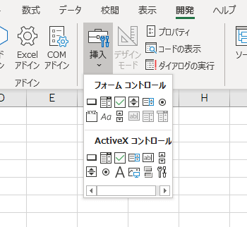

ボタンやリスト、チェックボックスなどのフォームを設置できる機能です。  
これらのフォームはマクロと紐づけて使ったりもしますが一部のフォームコントロールはセルと紐づけることができます。

例えばスピンボタンを設置して書式設定の「リンクするセル」を指定するとボタンを押すたびにセルに値が入ります。

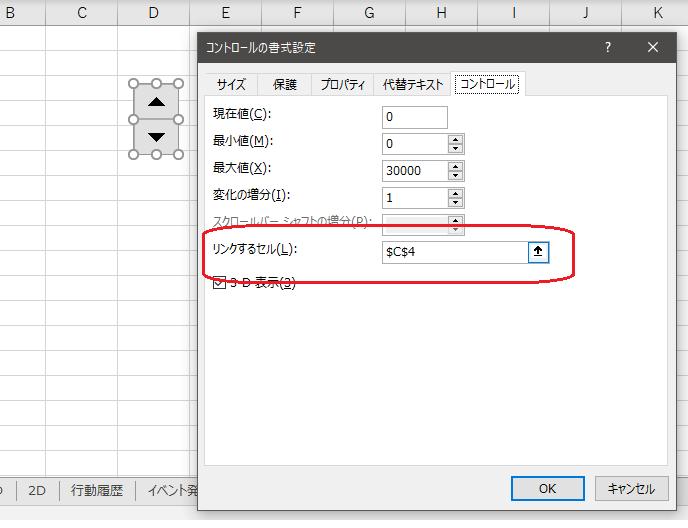

↓

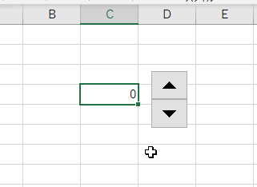

この値を使って関数で何かしらの計算をすれば様々なアクションに変換できるようになります。

### 図形の上に透明になるように配置する

フォームコントロールをそのまま使うとゲームのボタンのように見えないので図形と重ねて使います。  
ただフォームコントロールは透明にできません。透明にできないのでなるべく透明なフォームコントロールを選びます。  
今回はチェックボックスにします。

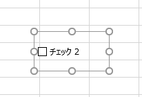

オプションボタンでもよいのですがグループボックスと合わせて制御しなければならず複雑化してしまうのでお勧めしません。

チェックボックスと矢印を組み合わせます。

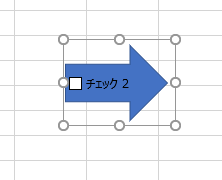

残念なことにフォームコントロールのテキストは色を変えたりフォントサイズを変更したりできません。またチェックボックスの四角も消せません。このため文字は消しますが四角のチェックボックスは矢印の外に出るように配置します。

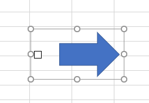

そしてチェックボックスを隠すように背景色と同じ色の図形をかぶせます。

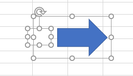

これで矢印を押そうとするとチェックボックスが反応するようになります。

### チェックボックスが一瞬見えてしまう場合の回避策

あまり気にしないのであればこの手順は不要です。

チェックボックスが反応したときに隠していた四角が一瞬見えてしまいます。これを回避する方法です。

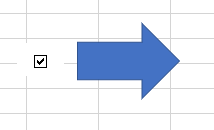

チェックボックスを見えない位置に移動してしまえばよいです。  
なるべくシート全体の左側にボタンを配置して、チェックボックスの四角だけA列に入るように調整します。

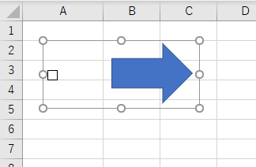

この状態でシート全体を右へスクロールし、A列だけが隠れるようにします。そしてB列でウィンドウを固定します。  
すると列が固定化されてB列だけが固定で表示されるようになります。A列は隠れて固定されるのでマウスで左へスクロールしても表示されません。

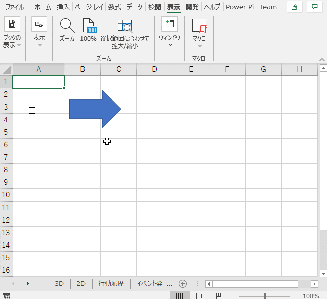

これでボタンの完成です。3D迷路のボタンが全て左に寄っているのはこのためです。  
【類似記事】  
[[Excel]セルをクリックしたときに他のセルの値を変える（VBA無し）](https://qiita.com/tomikiya/items/70d419f2448ad1f438e7)

## 状態を管理する

迷路で必要な状態をセルで管理します。

- どこにいるか
- どちらを向いているか

さらにボタンを押したときにその状態を更新します。

- 壁が無ければ前進する
- 壁があれば動かない
- 向きを変える

これらを前述したボタン操作で行えるようにします。

### ボタンの操作履歴をどうにかして取得する

状態を管理するにあたり必要になるのが操作履歴です。  
押した順番さえどこかに残っていれば状態の更新が容易になります。

例えば

- 座標(1,1)に下を向いて立っている状態
- ★「前進」が押された
- 壁が存在するか確認
- 壁がなかったので前進し座標(1,2）に状態を更新
- ★「左を向く」が押された
- 向きを右に状態を更新

のように、★の情報がどこかにあれば後は計算だけで今どのような状態か分かります。

#### 「リンクするセル」を上手に使う

チェックボックスは有効か無効（TRUE/FALSE）しかセルに返しません。また、通常通りの使い方では同じセルに上書きされるので操作の履歴を残すことができません。

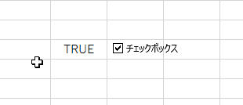

このため、状況に応じてリンクするセルの位置を変えます。変えるには関数が必要です。

#### 名前定義を経由してリンクするセルに式を入れる

リンクするセルには直接関数を使用できません。

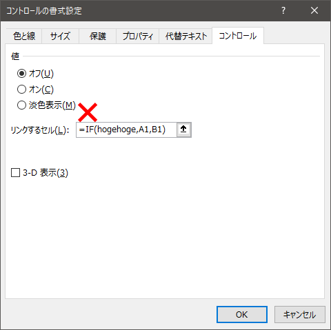

そこで名前定義を経由して登録します。

名前定義はセルを別名として使いたい場合や独自の関数を作りたいときに便利な機能です。

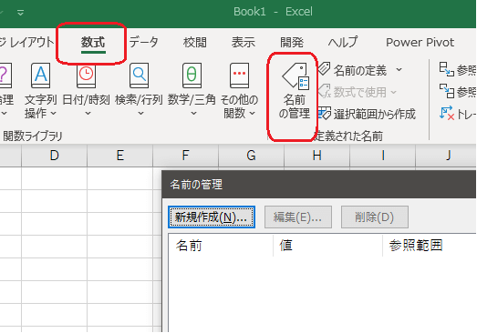

例えば以下のような名前を定義します。

```
=INDIRECT("Sheet1!$A$"&COUNTA($A:$A)+1)
```

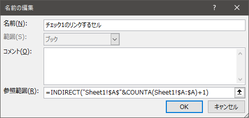

これで`=チェック1のリンクするセル`のように記述すると`=INDIRECT("Sheet1!$A$"&COUNTA($A:$A)+1)`と同じ効果が得られます。  
ちなみにこの式は、A1だけに文字が入っていればA2を返しますし、A2に文字が入っていればA3セルを返します。

これによりチェックボックスをクリックするたびにリンクするセルの位置が変わり上書を防げます。

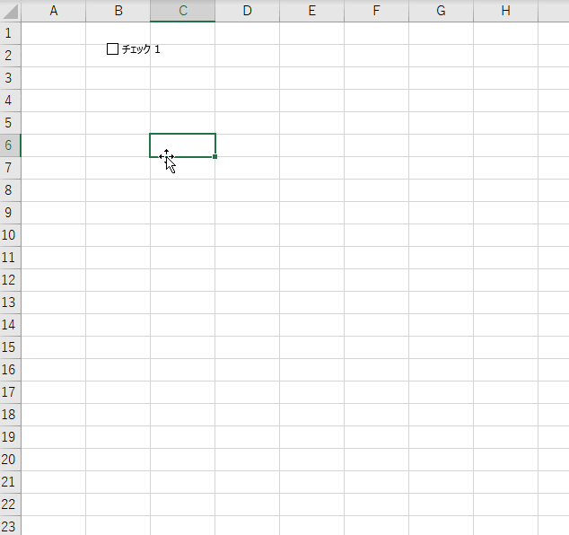

面白いことにTRUEしか返しませんね。リンクするセルの位置が変わるので毎回リセットされてしまうんでしょうね。  
でもこれで「押した」という情報が上書きされずに記録できました。

### 操作履歴に状態を計算する式をくっつけて行動履歴にする

話をシンプルにするため、ここでは1軸のみ考えることとし、更に壁が無い状態を想定してみます。つまり前進を押したら無条件で前に進むイメージです。  
行動履歴として必要な情報は「前回位置」「ボタンが押されたか（＝操作履歴）」「移動先」の3つです。

前回位置と移動先を操作履歴を絡めて求めます。計算式を予めセルに入力しておきます。

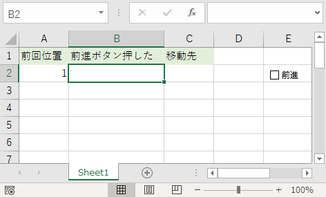

↓中身

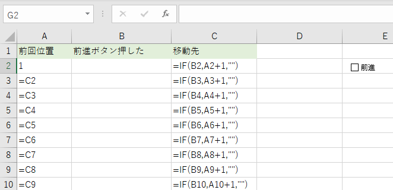

すると前進が押されるたびにレコードが増えていき移動先も+1されます。最後の移動先が「現在位置」になりますね。

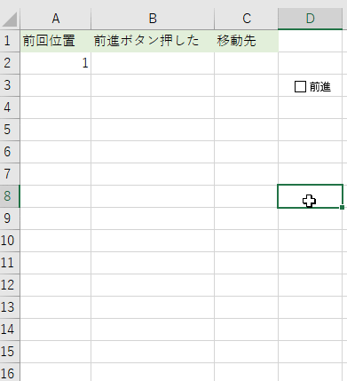

このように操作の履歴から現在位置までの行動の履歴を簡単に計算できますので、あとはこのデータに沿って迷路の中を動かすだけになります。

#### テーブル機能を使ってスッキリさせる

計算式を予め入れておくという話ですが、前述の方法だけだといつかは計算式の入っていない行まで行き着くことは明白です。  
また計算式を大量に入れることで処理速度の低下やファイルサイズの肥大化につながります。  
そうならないようにテーブル機能を使って書き換えます。

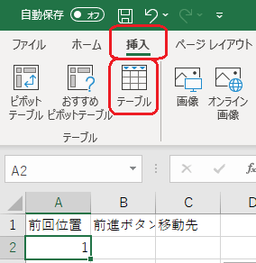

↓中身

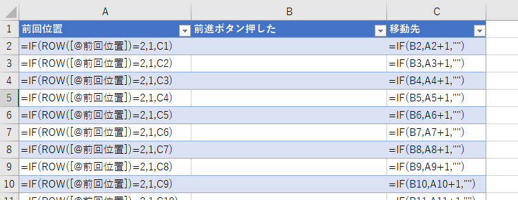

これで前進するたびに計算式が補完されます。

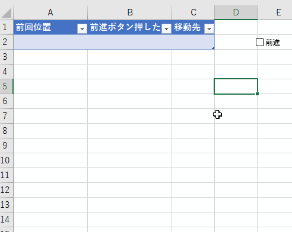

**注意:テーブルのいずれかのセルがアクティブになった状態でボタンを押さないでください。**ボタンを押すと不規則な位置に「TRUE」の文字が刻み込まれることがあります。おそらく仕様です。

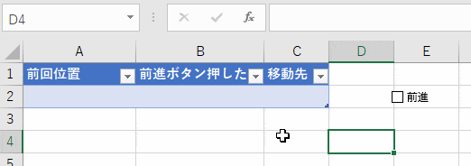

#### PowerQueryを経由するとテストが楽になる。

ここの話はテストが少し楽になるだけなので飛ばしても構いません。

テストでボタンを押しすぎてテーブルのレコードを全て消したいとなった時、全体を選択して行削除すればよいのですが、個人的に面倒だったのでPowerQueryを経由してレコードを空にする処理をいれました。

```
let
    ソース = #table({"前進ボタン押した"},{})
in
    ソース
```

これで空のテーブルが作られますので、ここに前回位置と移動先をExcel側で列追加しておくと、「右クリック→更新」でテーブルをリセットできます。

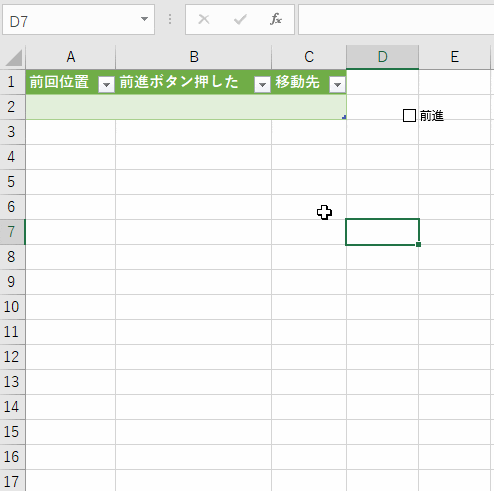

#### 実際の行動履歴を作る

ここまでの説明ではシンプルな条件で行動履歴を計算していましたが3D迷路では2軸と方向の履歴が必要になります。  
また、壁判定の計算も必要になります。概要と式を示します。  
↓行動履歴テーブル

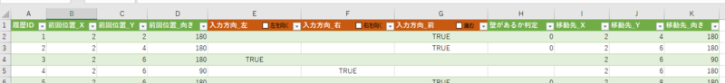

##### 行動履歴テーブルの詳細

| 列名 | 説明 |
| --- | --- |
| 履歴ID | 1番から採番する |
| 前回位置\_X | 履歴IDが1なら初期位置のX座標、それ以外は1つ上のレコードの移動先\_Xとする |
| 前回位置\_Y | 履歴IDが1なら初期位置のY座標、それ以外は1つ上のレコードの移動先\_Yとする |
| 前回位置\_向き | 履歴IDが1なら初期位置の向き、それ以外は1つ上のレコードの移動先\_向きとする |
| 入力方向\_左 | 空欄。左矢印を押した時にTRUEが登録される |
| 入力方向\_右 | 空欄。右矢印を押した時にTRUEが登録される |
| 入力方向\_前 | 空欄。前進矢印を押した時にTRUEが登録される |
| 壁があるか判定 | 壁がある場合1、無い場合0となる。迷路データから参照する。（詳細は後述） |
| 移動先\_X | 入力方向が前で且つ壁が無い場合、前回位置\_Xから±2移動する |
| 移動先\_Y | 入力方向が前で且つ壁が無い場合、前回位置\_Yから±2移動する |
| 移動先\_向き | 入力方向が左または右の場合、前回位置\_向きから±90度回転する |

```
// 初期位置は別途定義
履歴ID =ROW()-1
前回位置_X =IF([@履歴ID]=1,初期位置_X,I1)
前回位置_Y =IF([@履歴ID]=1,初期位置_Y,J1)
前回位置_向き =IF([@履歴ID]=1,初期位置_向き,K1)
入力方向_左: (空欄)
入力方向_右: (空欄)
入力方向_前: (空欄)
壁があるか判定: 【後述】
移動先_X =[@[前回位置_X]]+([@壁があるか判定]=0)*ROUND(SIN([@[前回位置_向き]]*PI()/180),0)*2
移動先_Y =[@[前回位置_Y]]+([@壁があるか判定]=0)*ROUND(-COS([@[前回位置_向き]]*PI()/180),0)*2
移動先_向き =MOD([@[前回位置_向き]]+([@[入力方向_右]]-[@[入力方向_左]])*90,360)

//チェックボックスのリンクするセルに登録する名前定義
リンクするセル_入力方向_左 =INDIRECT("行動履歴!E"&現在履歴ID+2)
リンクするセル_入力方向_右 =INDIRECT("行動履歴!F"&現在履歴ID+2)
リンクするセル_入力方向_前 =INDIRECT("行動履歴!G"&現在履歴ID+2)
```

##### 壁判定は迷路データをもとに

壁判定には迷路のデータが必要ですので予め用意しておきます。壁がある所は1、通れるところは0としました。

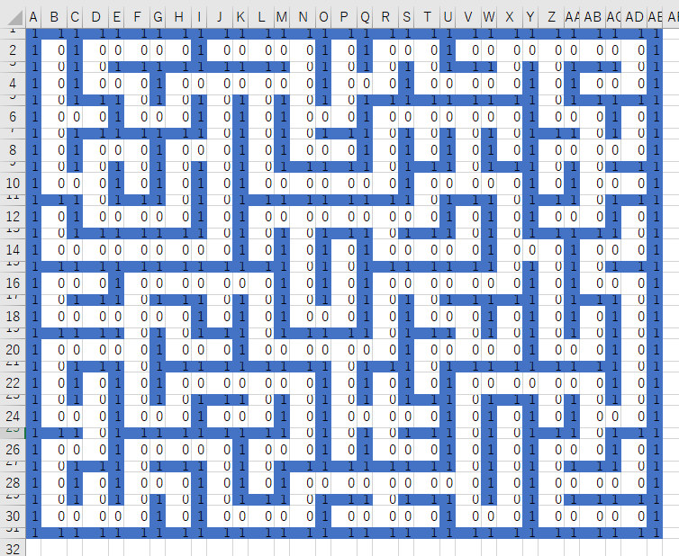

また、上方向を0度とし、右方向90度、下方向180度、左方向270度と定義しています。  
（上方向を0度として設計したことを後で後悔しましたがそれは別のお話。）

さて、現在位置と向きを元に壁のデータを取得します。取得は前進したときのみとしています。

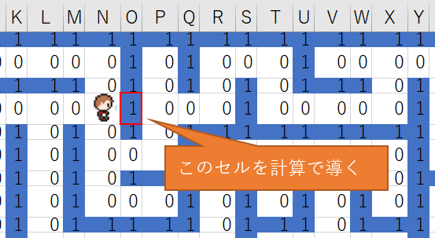

以下の式で取れます。

```
壁があるか判定
=IF([@[入力方向_前]],OFFSET(迷路データ始点,[@[前回位置_Y]]-ROUND(COS([@[前回位置_向き]]*PI()/180),0)-1,[@[前回位置_X]]+ROUND(SIN([@[前回位置_向き]]*PI()/180)-1,0)),"")
```

以上で行動履歴の完成です。

## 画面を描画する 2D編

### 地図の表示

地図用に2Dの迷路と現在位置を表示する機能を作ります。まずは2D地図専用のシートを追加します。  
そして迷路データをもとに条件付き書式にてセルを色分けします。壁にあたるセルの高さと幅は通路より小さくしています。まるでネ申エクセルのようです。でもこれだけで2D迷路が出来上がります。

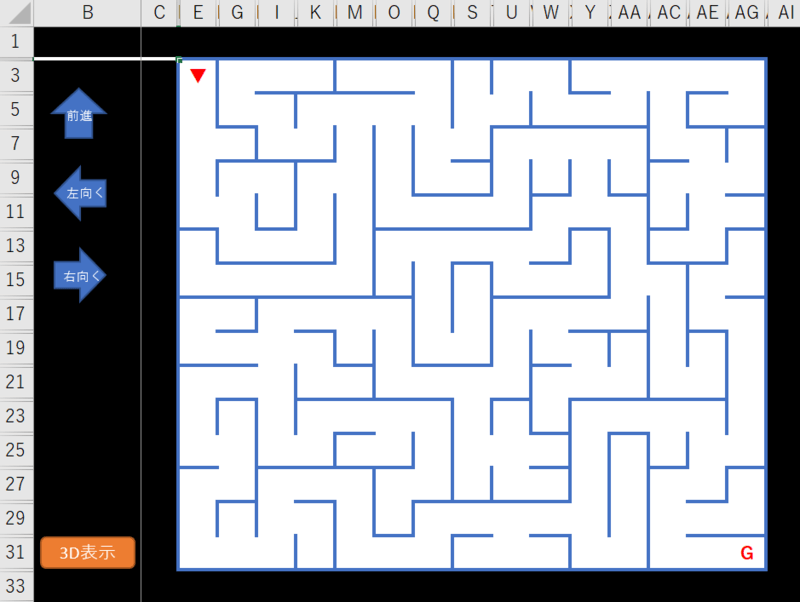

↓条件付き書式

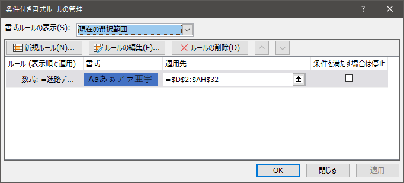

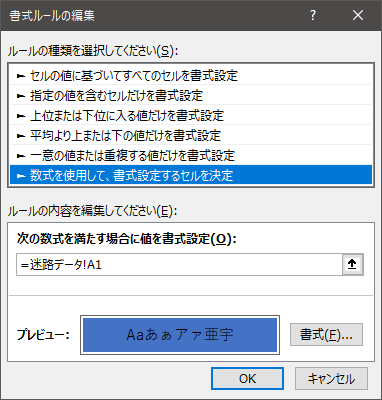

### 現在位置の表示

通路にあたるセルに式をいれます。  
行動履歴から現在位置を取得し、現在位置と同じセルなら三角を表示します。また向きによって三角を変更します。

```
=IF((COLUMN()-COLUMN($C$1)=現在位置_X)*(ROW()-ROW($C$1)=現在位置_Y),CHOOSE(現在位置_向き/90+1,"▲","▶","▼","◀"),"")
```

あとはスタートとゴールだけ、SとGを表示します。

ちなみにかなり頑張れば現在位置を画像でも表現ができます。この記事のおまけとして最後に記載します。

### 地図をワイプで表示する

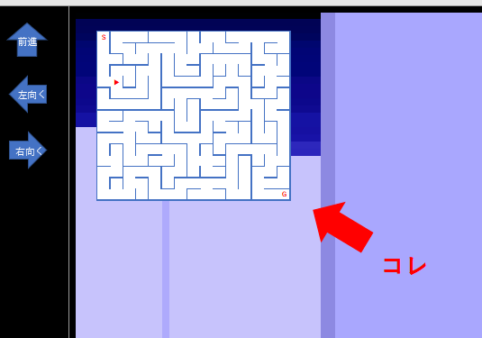

地図を小さくしてリアルタイムに更新しながら表示します。  
そうです、これは「リンクされた図」として貼り付けているだけです。

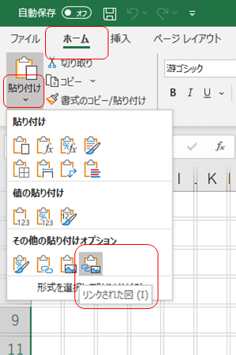

### 地図の表示非表示

地図ボタンを押したときにワイプの表示を切り替えていますが、これはリンクされた図の参照先を変更して実現しています。  
どういうことかというと、リンクされた図というのは式を見ると参照範囲が記述されているのが分かります。

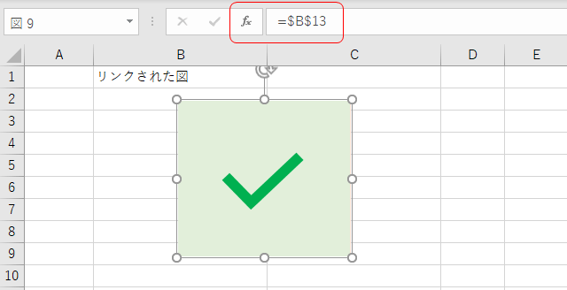

実はここを変更すると中身が変わる仕様になっています。

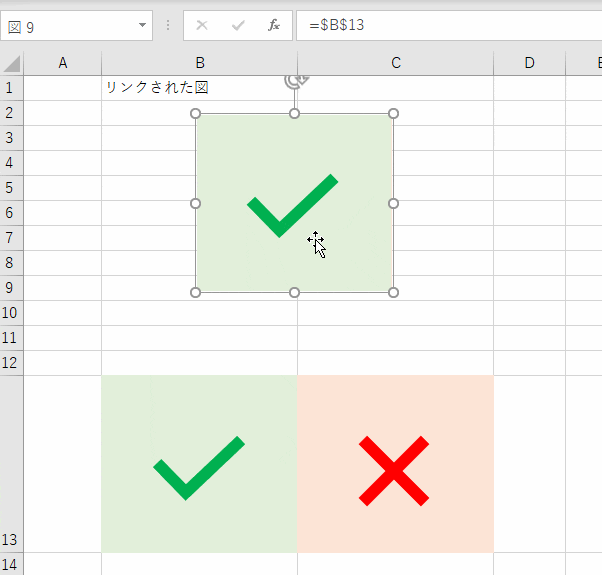

つまり地図ボタンのフラグを見ながら表示する内容を変えればよいということになります。  
ただしフォームコントロールの「リンクするセル」と同様、ここでも式を直接埋め込むことができませんので名前定義を経由します。

↓地図表示がTRUEなら地図を表示、それ以外は適当なブランクのセルを表示

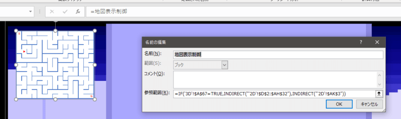

ここまでの実装で2Dによる迷路と地図が完成します。

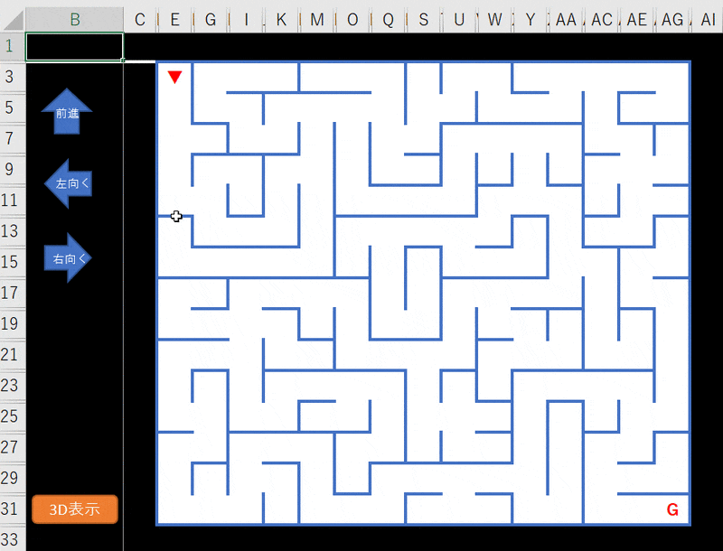

## 画面を描画する 3D編

迷路データをもとに3D表示を行います。まずは必要な情報を取得します。

### 描画に使うデータのみ取得して加工する

2D迷路とは異なり、3D迷路は「見えている範囲」のデータだけしか使いません。現在位置と向きから表示するだけのデータを取得します。  
必要な情報のイメージはこんな感じです。赤い部分のデータを使います。

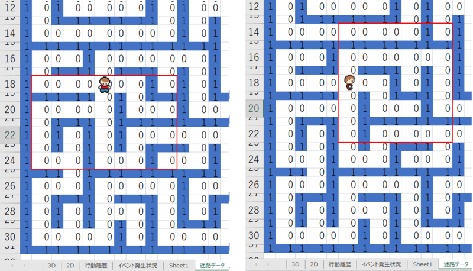

データを扱いやすくするため常に上方向を見ているように変換します。例えば下方向を見ている場合は180度回転、右方向を見ている場合は左へ90度回転させたデータに変換します。これは単純な座標の回転になるので[回転行列](https://ja.wikipedia.org/wiki/%E5%9B%9E%E8%BB%A2%E8%A1%8C%E5%88%97)を使って計算できます。  
↓

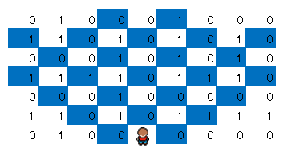

青いセルが壁のためのデータになります。

こちらの式で求められます。

```
=OFFSET(迷路データ始点,
現在位置_Y-1+ROUND(SIN(現在位置_向き*PI()/180),0)*(COLUMN()-COLUMN(現在位置セル))+ROUND(COS(現在位置_向き*PI()/180),0)*(ROW()-ROW(現在位置セル)),
現在位置_X-1+ROUND(COS(現在位置_向き*PI()/180),0)*(COLUMN()-COLUMN(現在位置セル))-ROUND(SIN(現在位置_向き*PI()/180),0)*(ROW()-ROW(現在位置セル))
)
```

### 条件付き書式をふんだんに使って壁を描画する

壁は図形や画像ではありません。セルの幅と高さを小さくしてドットに見立てて色を塗っているだけです。  
先述した壁データをもとに条件付き書式を各セルに設定して壁のように見せかけています。

データを書き換えると壁が消えたり表示されたりしているのがわかります。

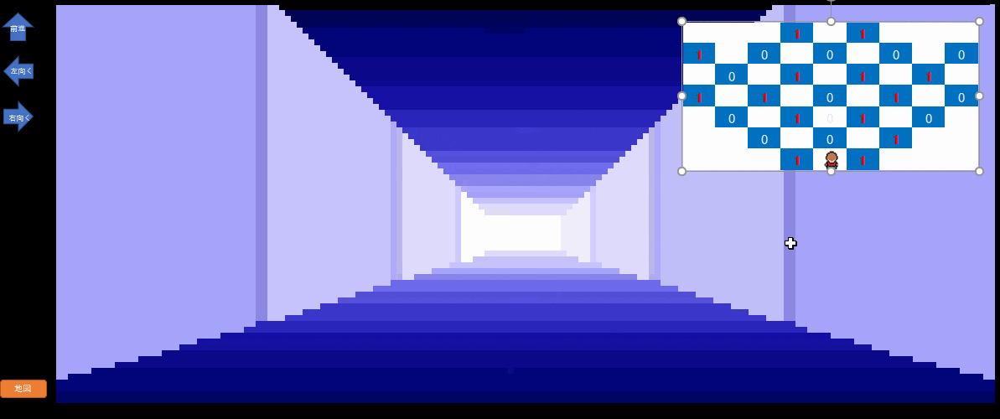

条件付き書式は数が多いだけで複雑ではないです。1か0を見ればよいです。

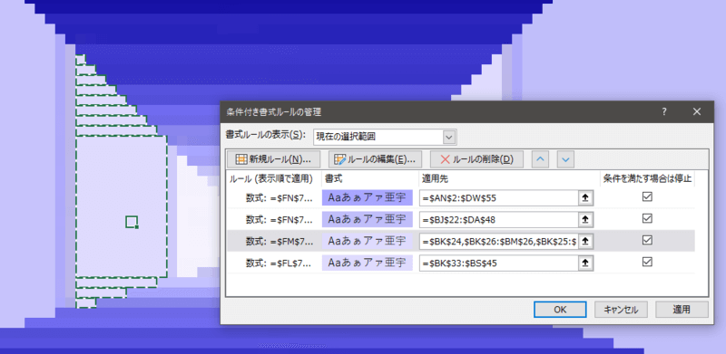

以上で3D迷路を描画できます。そしてゲームが完成です。  
関数と機能の組み合わせだけでここまでできてしまうなんてExcelは面白いですね。

## おまけ：地図上で画像を動かす

おまけが一番大変だったりします。

### 向きを変える方法

地図の表示非表示を切り替えたときと同じ手法を使います。

リンクされた図を向きによって切り替えます。

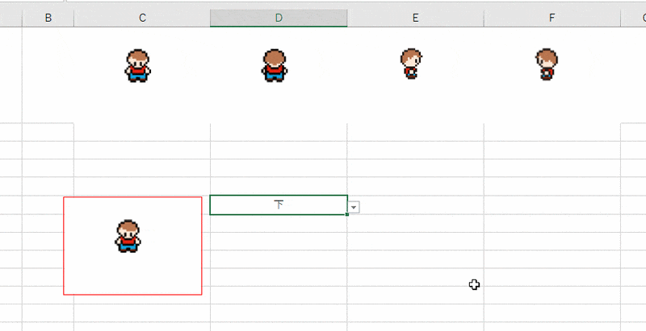

### 移動させる方法

リンクされた図をVBA無しで動かす方法がまだわかりません。このため動いているように見せる形になります。

#### 問題はあるけど理解しやすい作り方

セルごとにリンクされた図を張り付けて表示します。  
↓こんな感じ

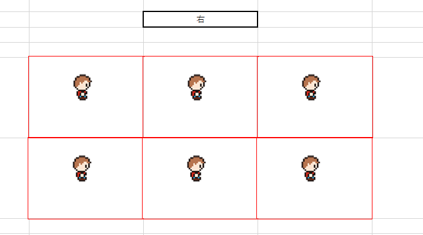

そして現在位置と同じ位置のセルだけ表示すればアイコンが移動したように見えます。

この手法を使ったゲームがこちらです。

> バズったぽいけど宣伝するものがないからこれ見てください～。
>
> ゲームウォッチ風のゲームをExcelで作ってみました。  
> VBAは使ってなくて関数と機能だけで動いています。  
> こんなアホなことやってるんでどうぞよろしく～。 [pic.twitter.com/lANAGR6Uxy](https://t.co/lANAGR6Uxy)
>
> — パパセンセイ (@10mikiya) [October 28, 2018](https://twitter.com/10mikiya/status/1056435280872239105?ref_src=twsrc%5Etfw)

移動する位置全てにリンクされた図が置かれているのが分かります。

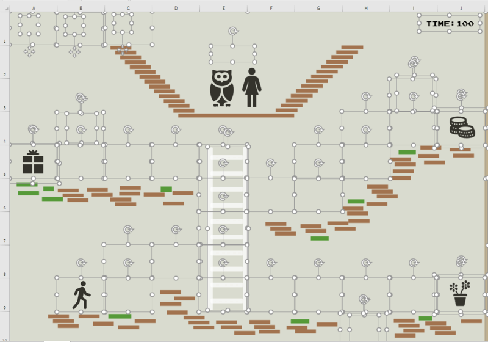

#### 問題とは？

リンクされた図は多用するとExcel自体が非常に重くなります。PCの性能にもよりますが私のPCの場合、50個を超えると重くて動かなくなりました。  
なるべく使わない設計が必要です。

#### どうする？

セルごとにリンクされた図を作るのはやめて迷路全体を覆う大きめのリンクされた図で制御します。

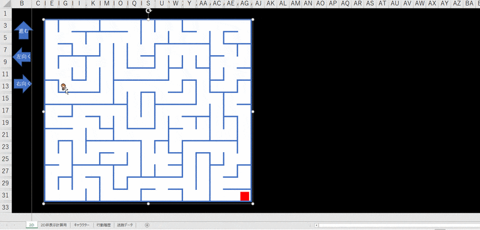

表示用と非表示用の2枚のリンクされた図で動きます。ただこれでもかなり重くて1秒くらい反応が遅いです。  
画像を背景として登録すると軽くなりますが表示位置の調整が難しいです。  
画像を動かすようなゲームは今のところ厳しいかもしれません。素直にVBAを使いましょう。

**2020/03/03 16:30 追記**  
リンクされた図を1枚にして軽量化できました。  
米粒みたいに小さいですが、迷路と同じ大きさだけスペースを空けて上下左右の画像を設置します。

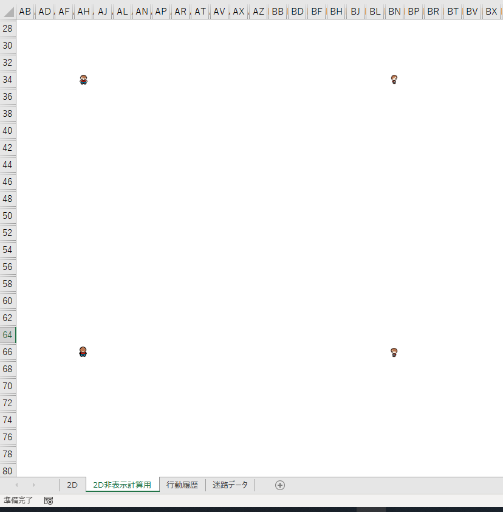

そしてリンクされる範囲をOFFSET関数で都度変更して現在位置と良い感じに合わせるとうまくいきます。

処理スピードも悪くないです。

## ファイルを公開しました

GitHubにファイルを置きました。  
複数のバージョンで確認できる環境ではないのでうまく動かない場合があるかもしれません。特にMac環境には不安しかありません。  
<https://github.com/tomikiya/excel_game_3d_maze>

記事には書かなかったゴールの表示や地図のマッピング機能が含まれています。是非遊んでみてください。

## 終わりに

まだ把握していない機能を使えばもっと簡単にできるかもしれませんね。精進します。

https://amzn.to/3k8umO3

【VBAを使わないゲームシリーズ】

https://papasensei365.com/excel-game-minesweeper/

https://papasensei365.com/excel-game-dq3/

https://papasensei365.com/excel-game-tetris/
