あるサイト上に投稿されたPDFファイルをダウンロードし自分のOne Driveに保存する流れをPower Automateで行います。
## Power Automateとは

Power AutomateはMicrosoftが提供するPower Platformの1つで、**発火条件（トリガー）とそれに続く動作（アクション）を定義したフローを作って様々なサービスを連携できるサービス**です。
例えば「定時になったらチャットに通知する。」「メールが届いたら添付ファイルを保存する。」や「特定のキーワードのツイートがあったらメールする。」などの設定が簡単にできます。
Power AutomateはOneNoteやOffice製品、SharePointのようなMicrosoft製品との連携に強かったり、ローコードでアプリを開発できるPower Appsとの相性が良いです。
[Microsoft Power Automate | Microsoft Power Platform](https://flow.microsoft.com/ja-jp/)
以前はMicrosoft Flowと呼ばれていましたが、RPAのような機能となる**UIフロー**が追加されて機能が強化されています。
技術情報を検索して見当たらない場合は「Microsoft Flow」で検索してみるのもよいでしょう。
類似サービスにIFTTTやZaiperがあります。

## PDFファイルを取得するサイトを確認する

サンプルとして以下のPDFファイルをPower Automateで取得してみます。
https://www.pref.niigata.lg.jp/sec/kenko/bukan-haien.html

- 【新潟県内の報告一覧表】
- センター相談件数一覧表
- 検査件数一覧表

他のサイトでも同様の手順でファイルを作れますので読み替えて試してみてください。またサイトの構造が変わっている可能性もあり以下の手順がそのまま適用できなくなっている可能性もあります。

## 全体の流れ

次のような流れのフローを作ります。

- PDFをダウンロードするサイトのHTMLファイルを取得する
- HTMLファイルからPDFのURLを取得する
- ファイルをダウンロードしてOneDriveに保存する

完成形は以下のようになります。


## ポータルサイトを開く

まずは[ポータルサイト](https://flow.microsoft.com/ja-jp/)を開きます。アカウントが無い場合は登録しておきましょう。


## フローを作る

今回は「定時になったら、PDFをダウンロードしてOneDriveに保存する」フローを作ります。
「＋作成」を選び「予定フローを作成」を選びます。
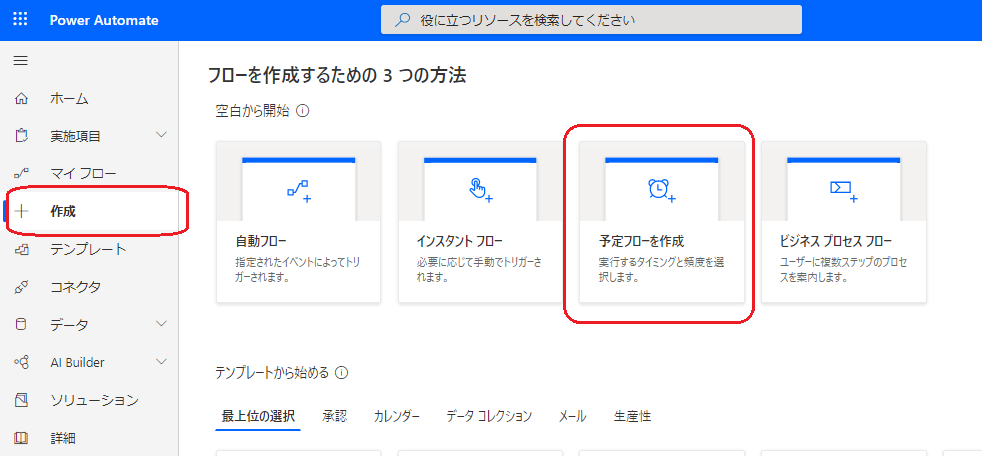
フロー名は後で見ても分かるようにしておきます。
今回は1日1回取得するようにしたいので繰り返し間隔を1日にします。
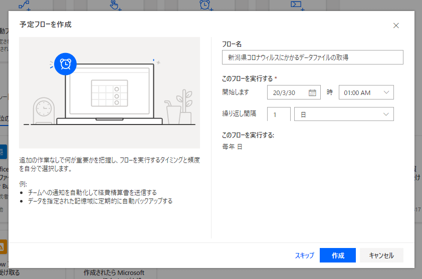

### サイトをスクレイピングしてファイル名を取得する

今回ターゲットにしているサイトではPDFファイルのアドレスが毎回変わるようなので都度スクレイピングしてファイル名を取得する必要があります。
このためまずはHTMLを取得して解析します。
「次のステップ」をクリックしてアクションを選びます。様々なアクションがありますので検索窓で「One Drive」を検索し絞り込みます。
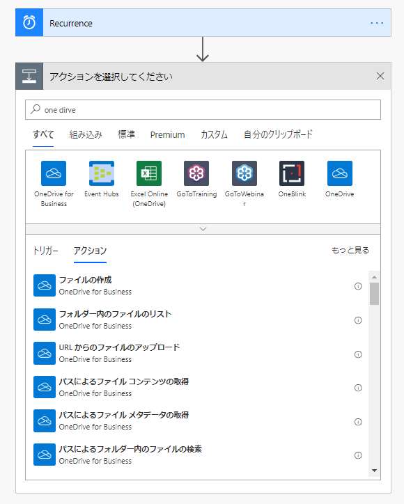
「URL からのファイルのアップロード」を選びます。
ソースURLにPDFがアップされているサイトのURLを指定し、対象のファイルパスに保存先のOneDriveを指定します。上書きは「はい」を指定します。
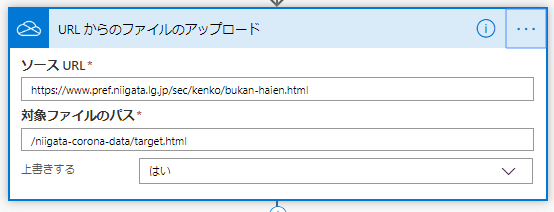
これでHTMLファイルがOneDriveに保存されます。
アクションの名前がデフォルトだと保守がつらくなるので名前を変更しておくと便利です。
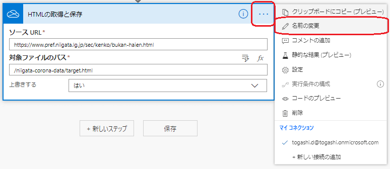
次にこのHTMLファイルを呼び出しPower Automateに取り込みます。
「新しいステップ」をクリックし「パスによるファイルコンテンツの取得」を選択します。
ファイルパスは先ほど指定した「対象ファイルのパス」にします。
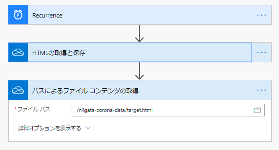
ここまでのアクションが正しく動いているか確認してみます。
「保存」を押してみましょう。

### テストしてみる

HTMLが取れているかフローをテストしてみます。
画面右上の「テスト」を押してます。
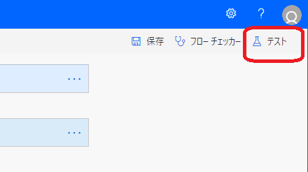
↓
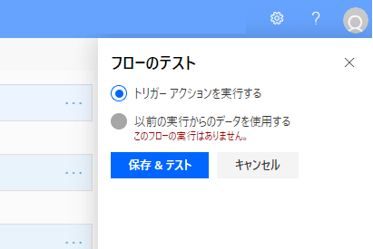
↓
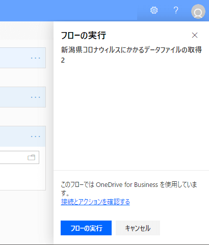
↓
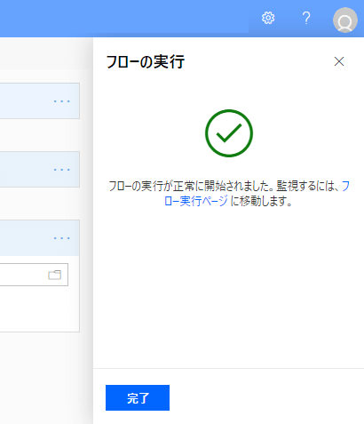
正常に完了するとHTMLテキストが取得できていることが分かります。
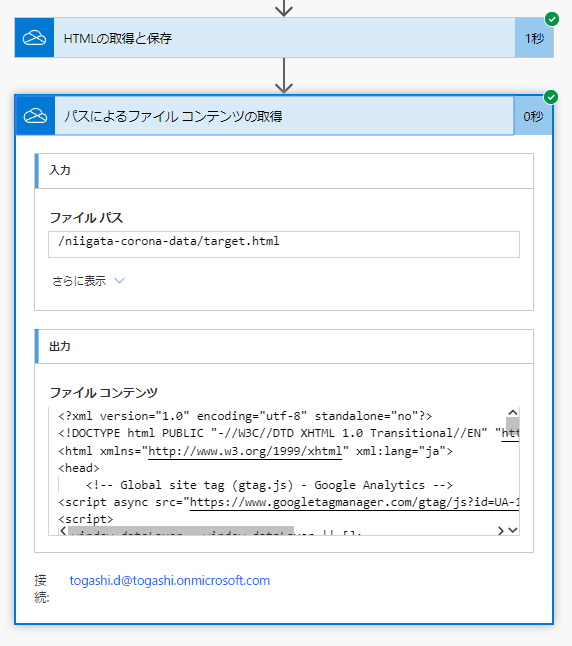
エラーが出たらエラー内容を読んで原因を解消しましょう。

### HTMLテキストを解析する

取得したいPDFのURLが確認できました。(一部抜粋)

```
<h3><strong>重要なお知らせ</strong></h3>
<p>・令和２年３月29日10時現在、新潟県内の報告数は31例です。</p>
<p><a href="/uploaded/attachment/211382.pdf">【新潟県内の報告一覧表】 [PDFファイル／30KB]</a></p>
<p><a href="/sec/kenko/corona1.html">新潟県報道発表（県内２例目）</a></p>
<p><a href="/sec/kenko/corona0321.html">新潟県報道発表（県内26例目）</a></p>
```

相対パスになっているので絶対パスを作らないといけません。
また記載されている場所を特定するため文字列操作が必要そうです。

### 変数を作る

「`https://www.pref.niigata.lg.jp`」を変数に入れておきます。
新しいアクションで「変数」を検索します。※英語版だと「variables」で検索します。
「変数を初期化する」アクションで変数を作れます。
**名前**： 変数名です。今回は`baseURL`とします。
**種類**： 型です。文字列を指定します。
**値**： 代入する値です。`https://www.pref.niigata.lg.jp`を指定します。
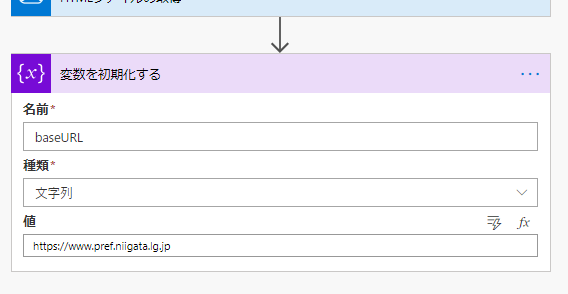

### 文字列を分割してURLを取得する

Power Automateでは文字列の分割が使えます。HTMLテキストを複数の文字列で切り取りながらURLだけを取得します。
詳しい手順はh-nagaoさんのこちらの記事をご確認ください。splitを使うことになります。
[qiita.com](https://qiita.com/h-nagao/items/fdbfcf4a7dae6373a224)
新潟県の報告一覧のPDFのURLだけを切り取るには以下の式で取れます。

```
split(split(split(body('HTMLファイルの取得'),'、新潟県内の報告数は')?[1],'">【新潟県内の報告一覧表】')?[0],'<a href="')?[1]
```

サイトの構成が変わればこのあたりの条件を変えないといけませんね。
さて、相対パスが取得できたので前述した変数baseURLと結合します。結合はconcatです。

```
// 新潟県内の報告一覧表
concat(variables('baseURL'), split(split(split(body('HTMLファイルの取得'),'、新潟県内の報告数は')?[1],'">【新潟県内の報告一覧表】')?[0],'<a href="')?[1])
```

この式を「変数の初期化する」のアクションを追加して値に格納します。
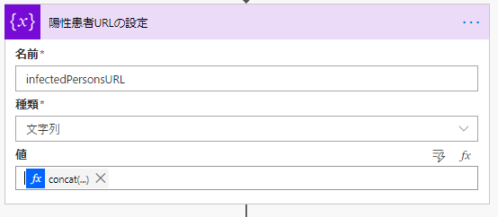
注意ですが、値の部分はコピペで直接入力すると正しく反映されないです。
別に表示される窓の中で「式」タブを選択してそこにコピペして更新ボタンを押してください。
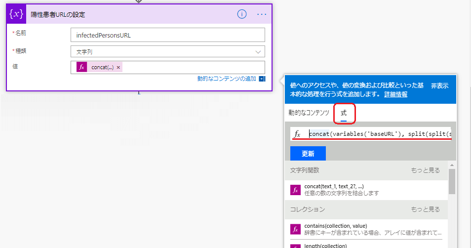
正しく更新されると値の部分に「fx | ....」と表示されるはずです。

### 他のPDFファイルのURLも取得する

PDFは全部で3種類ありますので同様にURLを残り2つ取得します。

```
// センター相談件数一覧表
concat(variables('baseURL'),split(split(split(body('HTMLファイルの取得'),'帰国者・接触者相談センターへの相談件数')?[1],'">センター相談件数一覧表')?[0],'<a href="')?[1])
```

```
// 検査件数一覧表
concat(variables('baseURL'), split(split(split(body('HTMLファイルの取得'),'（２）検査件数')?[1],'">検査件数一覧表')?[0],'<a href="')?[1])
```

ここまでの設定でアクションは以下のようになります。※変数の初期化の順序が説明の順序と異なっています、すいません。
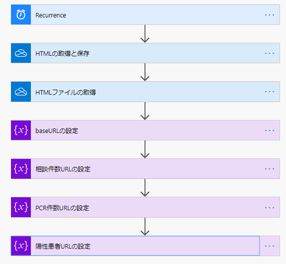

### URLを元にPDFファイルをダウンロードする

「URL からのファイルのアップロード」のアクションを追加して今ほど作った変数を指定します。
別窓の「動的なコンテンツ」の中から変数を探してクリックして追加できます。
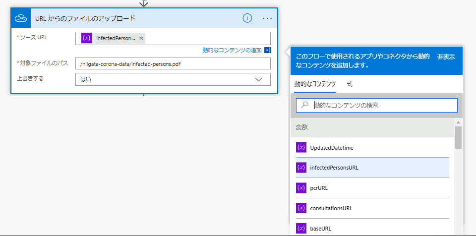
他の2つのPDFも同様のアクションでそれぞれ追加します。
以上で完成です。保存を忘れないようにしましょう。
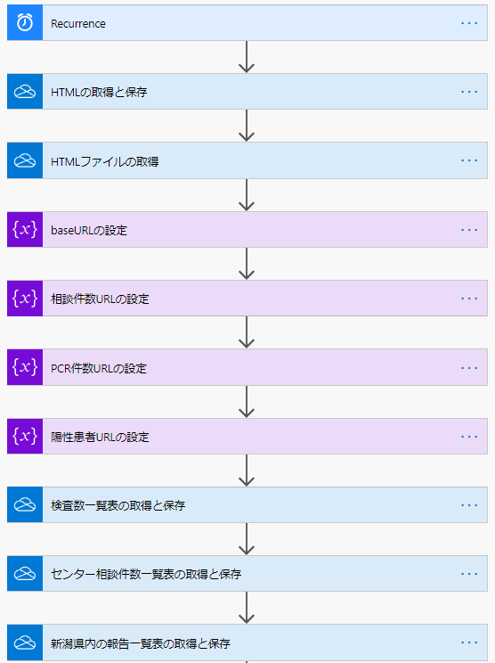

## フローを実行してOneDriveにPDFが保存されているか確認する

左ペインの「マイフロー」からフローを選択して詳細を確認します。
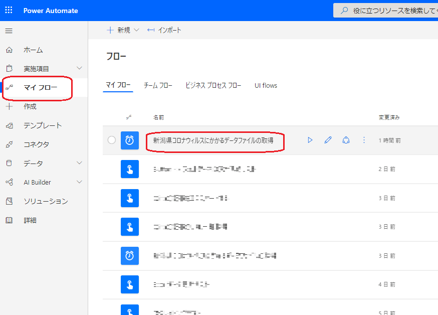
画面上部の再生ボタンでフローを実行できます。
結果は画面下部に表示されます。
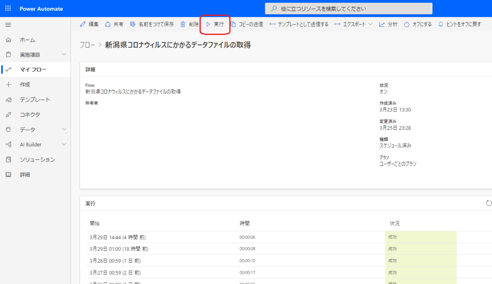
成功したかOneDriveを開いて確認してみてください。
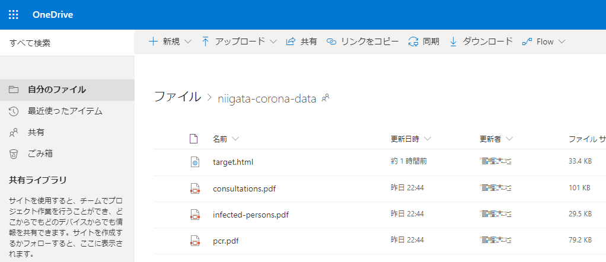
うまくできましたね。

## ということで

Power Automateを使うとコーディング無しで簡単にサービス連携をすることができます。
さまざまなフローのテンプレートがありますので見てみるだけでも面白いかもしれませんね。
https://flow.microsoft.com/ja-jp/templates/
