

PDFファイルで保管されたデータを集計して分析したい場合に有効です。  
今回はPower BIの機能を使ってPDFのデータを収集し、機能の一部であるPower Query にてデータの整形を行います。ビジュアライズの部分は別の記事で紹介します。

参考記事「[Power AutomateでPDFをダウンロードしOne Driveに保存する](https://papasensei365.com/download-pdf-by-power-automate/)」

## Power BIとは

Power BIはMicrosoftが提供するPower Platformの1つで、データの可視化と複雑な分析がシンプルに行えるビジネス分析ソリューションです。可視化されたデータを組織で共有でき、データの傾向を把握することで次へのアクションを直ちに行える材料を提供できます。

詳細はyugoes1021さんの記事をご覧ください。

<https://qiita.com/yugoes1021/items/091c1732ff4b6f108877>

## Power BI DesktopとPower BI サービスの違いは？

Power BIにはPower BI サービスとPower BI Desktopがあります。  
Power BIサービスはクラウドベースのサービスで、主には可視化したデータの共有や共同作業用として使用されます。  
Power BI DesktopはWindowsのローカルアプリで、主にはデータ分析とレポート作成を行います。Power BIサービスでも簡単なレポート作成が可能ですが、Desktopの方が作りやすい印象です。  
Power BI Desktopで作ったレポートはPower BI サービスに共有できますので、基本的には**Power BI Desktopでデータ分析とレポート作成を作ってPower BI サービスで共有する**流れになります。

【参考】  
<https://docs.microsoft.com/ja-jp/power-bi/fundamentals/service-service-vs-desktop>

## 無料版でできること

自分だけで使うのであれば有料版とほぼ変わらない機能が使えます。レポートを**限定的な範囲で共有をしたいときに有償版が必要**になります。  
全世界に公開する場合は無料でもOKです。今回のレポートは全世界に公開しているため無料の範囲です。

## Power BI Desktopをインストールして起動する

[Microsoft Store](https://aka.ms/pbidesktopstore)からダウンロードできます。

## OneDrive上のPDFファイルからデータを取得する

ローカルのPDFからの取得も可能ですが、せっかくですので[前回の記事](https://papasensei365.com/download-pdf-by-power-automate/)で取得した報告一覧表のPDFを取り込んでみます。  
まずはPDFファイルのURLを確認します。自分の[OneDrive](https://products.office.com/ja-jp/onedrive/online-cloud-storage)にアクセスして取り込みたいPDFを探しましょう。  
前回の記事でPDFファイルをOneDriveに保存していない場合は、以下からファイルをダウンロードしてOneDriveに直接保存しましょう。新潟県内の報告一覧表とセンター相談件数一覧表と検査件数一覧表の3つを使います。

<https://www.pref.niigata.lg.jp/sec/kenko/bukan-haien.html>

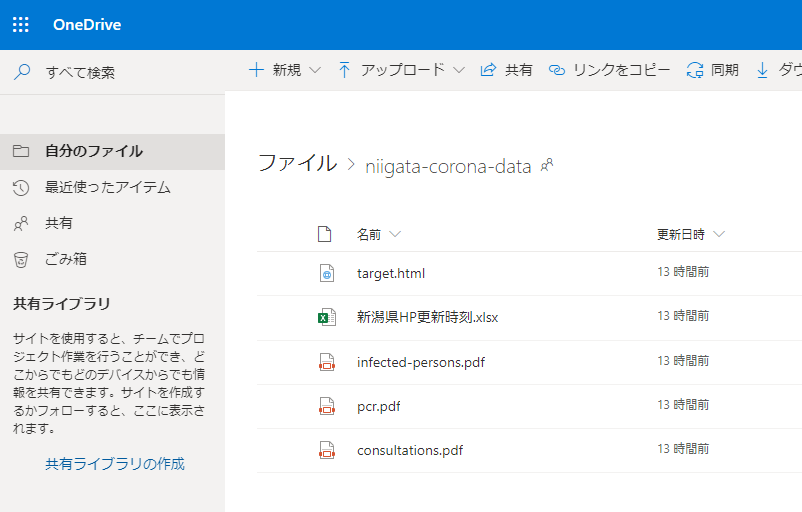

### URLを確認する。ただし「リンクのコピー」のURLでは接続できなかった。

いくつか試しましたが「リンクのコピー」で取得できるURLでは取り込みが出来ませんでした。「リンクを知っているべてのユーザ」に共有設定を変えてもダメでした。  
そのため、PDFファイルをプレビューして、さらに「開く」ボタンでブラウザで開いたときに表示されるURLを取得しました。

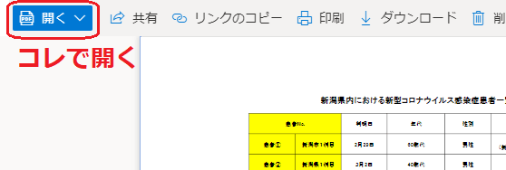

そうするとこんなURLを取得できます。

```
https://********.sharepoint.com/personal/*******************/Documents/niigata-corona-data/infected-persons.pdf
```

末尾がフォルダ名＋ファイ名のURLになるはずです。こちらのURLだとPower BI Desktopで読み込めます。

### Power BI Desktopでデータに接続する

Power BI Desktopを起動して[**データの取得**]-[**Web**]を選択します。

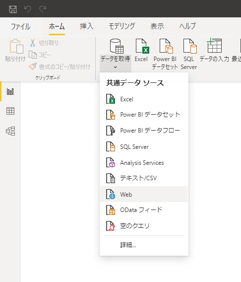

ちなみに[**データの取得**]の一覧に[**PDF**]があるかもしれませんが、これはローカルのPDFを選択するときに利用します。今回はOneDrive上のファイルを指定するので使いません。

さて、前述したPDFのURLを貼り付けてOKをクリックします。


するとPDFファイルへのアクセスで認証を求められます。求められなければそのまま次へ進んでください。  
認証が必要な場合はPDFを参照できる組織アカウントを指定してサインインしてください。

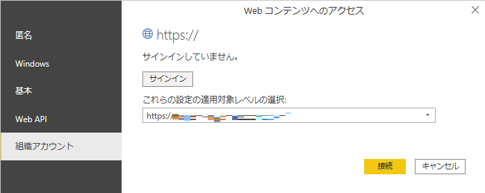

認証が通ればデータのプレビューが確認できます。  
Pageは見出しを含めた取り込み、Tableは表のみ取り込みしたいときにチェックします。  
今回はTableの方にチェックし、「データの変換」をクリックします。

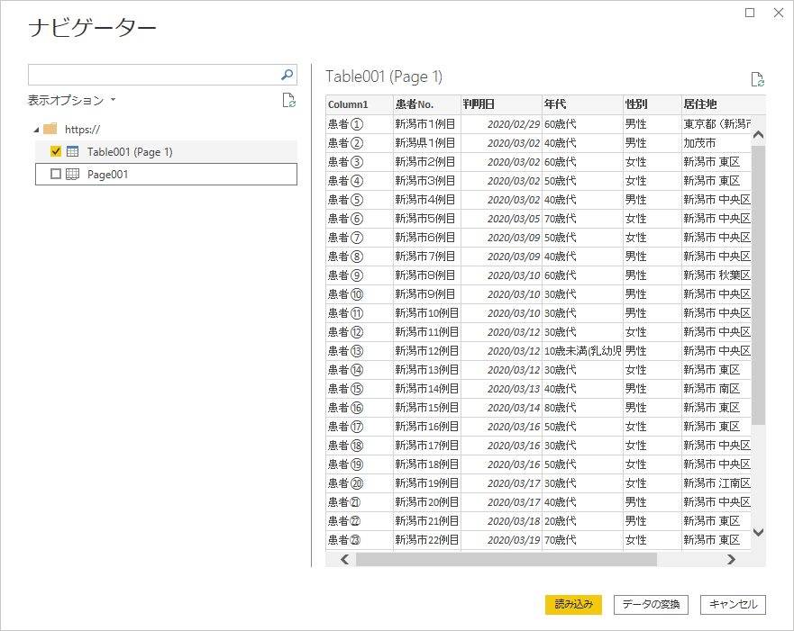

もし認証で失敗したのでやり直したい場合や組織アカウントを変えたい場合は[**ホーム**]-[**データの変換**]-[**データソース設定**]からアクセスの許可の編集または削除をしてみてください。

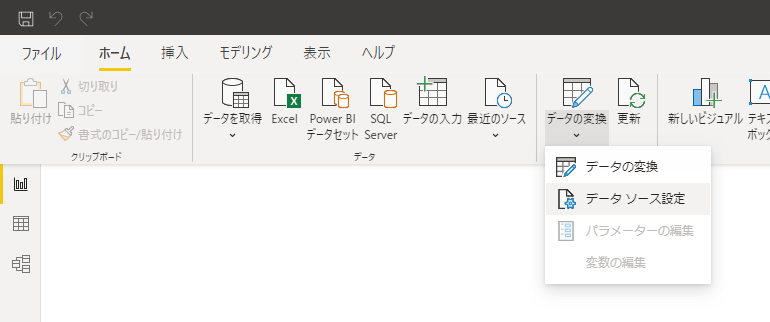

## Power Queryでデータを整形する

さきほどのナビゲーターで「データの変換」を選択するとクエリエディターが立ち上がったはずです。Power Queryはデータの取得と変換をGUI操作で簡単に行える機能です。取り込んだ表の一部を変更したり不要なデータを消したりできます。

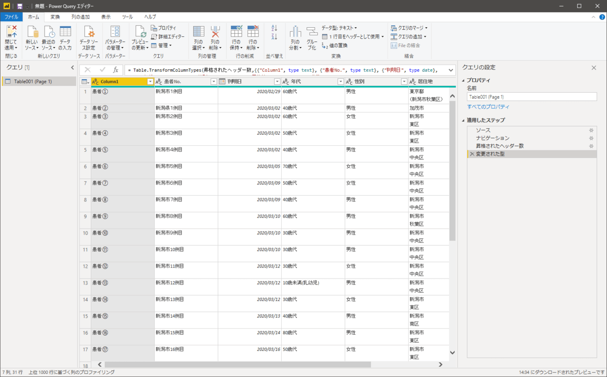

PDFの表が取り込まれていることが分かりますね。画面左側には取り込んだ表の名前が並びます。

また画面右の一覧には整形の順序が表示されます。すでに「ソース、ナビゲーション、昇格されたヘッダー数、変更された型」が入っていると思いますが、こちらはPower Queryが表を解析して自動的に整形してくれた結果になります。「ソース」をクリックすると取り込んだ直後の状態、「ナビゲーション」をクリックすると列名が入っていない状態、「昇格されたヘッダー数」をクリックすると列名が入った状態を画面中央のプレビューで確認できます。

**補足：** Excelでも同じ機能が使えますのでここで覚えておくとExcelでのデータ整形がぐんと楽になります。ただしExcel2016以上標準搭載ですがExcel2010,2013はアドインが必要でWindows版のみとなります。MacはInsider版でのみ利用できます。

### 数式バーを表示しておこう

クエリエディタ―で数式バーが表示されていない場合は[**表示**]-[**レイアウト**]-[**数式バー**]を有効にしてください。Excelのような数式の入力欄が表示されます。

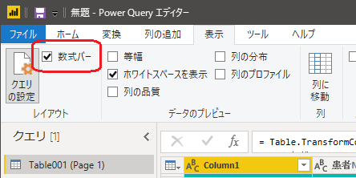

### どのような集計結果が欲しいか事前に設計しておこう

データを整形する前にどのような集計をしたいかあらかじめ考えておきましょう。目的によって見せ方も変わりますし、それに伴いデータの整形内容も変わります。  
今回は日ごとの集計と累計、地図上でのプロットを行います。

↓イメージ  
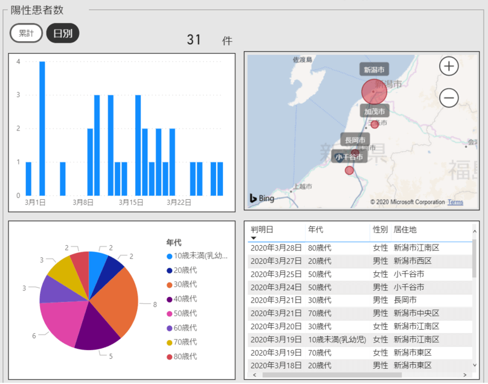

このため以下のように整形しようと思います。

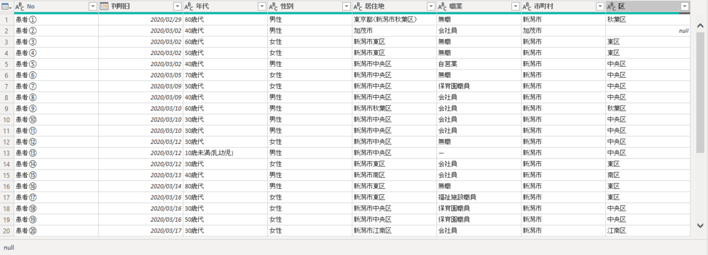

### 不要な列を削除する

不要な列を削除します。列の見出しをクリックし、[**ホーム**]-[**列の管理**]-[**列の削除**]を選択します。

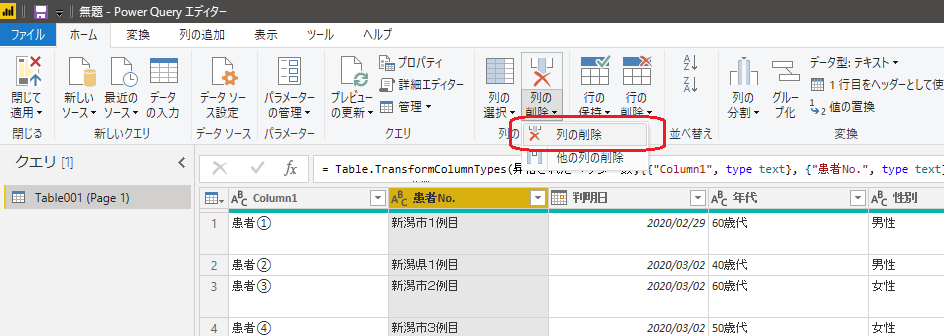

すると右の一覧に「削除された列」が追加され、プレビューからも消えます。

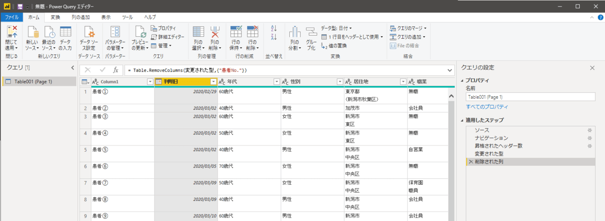

#### トピック：数式を確認しよう

先ほど表示した数式バーに数式が入っています。

「変更された型」の表の列をRemoveColumns(=列削除)する、という意味になります。「変更され型」というのは1つ前の手順の名前のことで、すなわち直前の手順で出来た表を意味します。

この式はGUI操作で自動的に登録されていきます。  
画面左のテーブル名を右クリックして詳細エディターを開くとこれまでの操作で作られたコードを一括で確認できます。

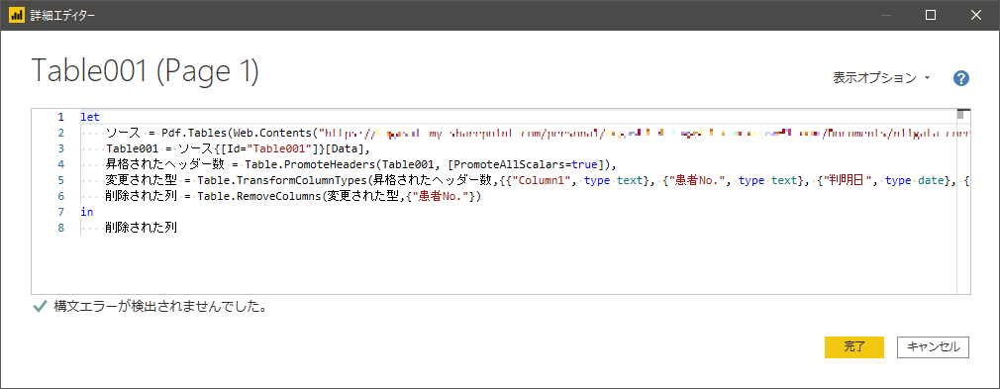

これはM言語になります。GUI操作にはできないデータ整形も可能なので操作に慣れたら直接M言語を記述する方法もお勧めします。

### 居住地の列をコピーする

「居住地」は文字列としてそのまま使いたいのですが、それとは他に市と区の情報が欲しいので列をコピーして加工用の列を作ります。

[**列の追加**]-[**全般**]-[**カスタム列**]をクリックします。

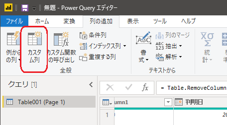

新しい列名に「居住地\_地図用」、カスタム列の式に`[居住地]`といれてOKとします。すると居住地コピーされて最後に追加されます。

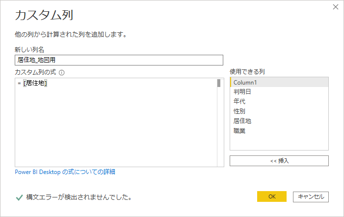

↓

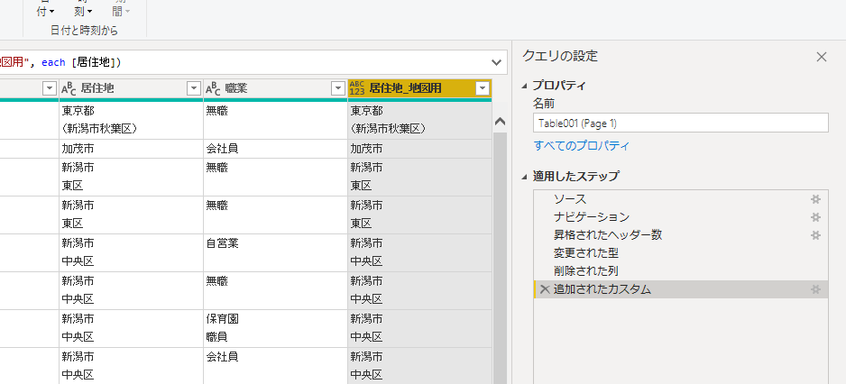

### 居住地\_地図用を市と区に分ける

居住地が改行を含めて1つのデータとして登録されています。地図上にプロットするために少なくとも市のデータが必要になります。  
そこで先ほどコピーした「居住地\_地図用」から市と区のデータ列をそれぞれ作り出します。

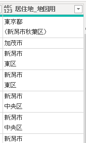

#### 例外な書式を個別に変更する

東京都のデータだけ括弧を含めて記載されていますので、これを他のデータの書式と合わせます。  
東京都と括弧を取り除き、市と区の間に改行コードを入れます。

「住居地\_地図用」の列を選択して[**変換**]-[**任意の列**]-[**値の置換**]を選択します。

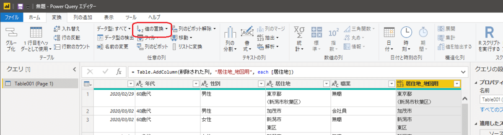

検索する値に `東京都#(lf)（新潟市秋葉区）` 、置換後の値に`新潟市#(lf)秋葉区`と入力してOKをクリックします。`#(lf)`が改行を表します。

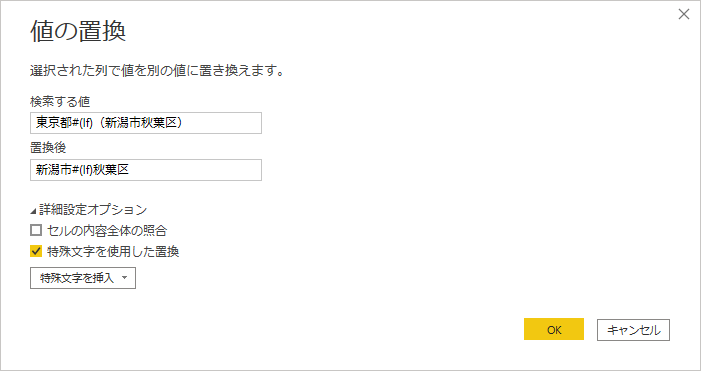

これで他のユーザの書式と一緒になります。

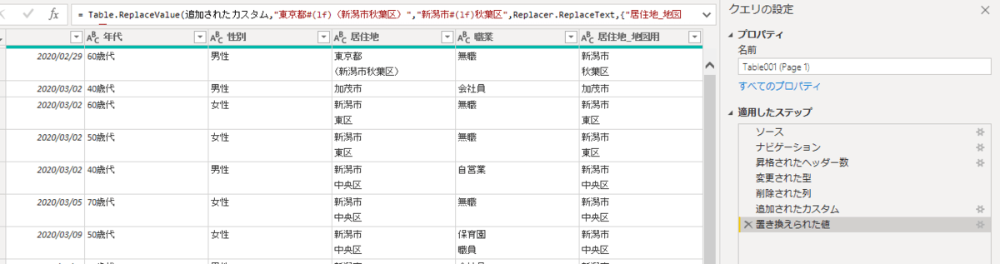

**補足：** もっと一般的な置換を考えた方が本当は良いのですが、今後どのような書式が出てくるか今の段階では見当がつかないため、変に推測した置換を作るよりはそのまま置換した方が無難だと考えこのような手順としました。

#### 改行コードで列を分割する

「居住地\_地図用」の列を選択して[**変換**]-[**テキストの列**]-[**列の分割**]-[**区切り記号による分割**]をクリックします。

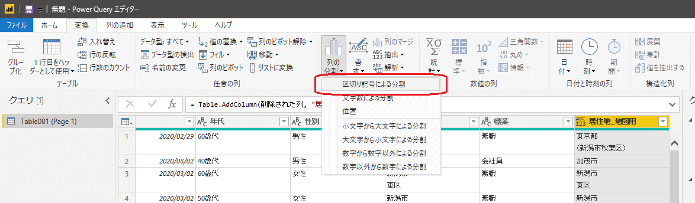

区切り記号でカスタムを選択し、`#(lf)`を入力してOKをクリックします。

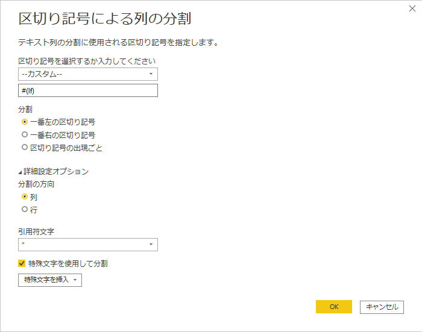

列が2つになりました。成功です。

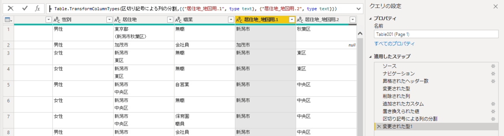

ただ、Power Queryが気を利かせて「変更された型1」も手順に追加していますね。正直要らないです。×で消しましょう。

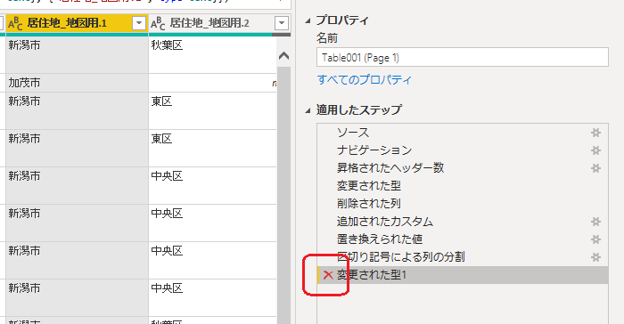

そして、列の見出しが変なので書き換えます。見出しをダブルクリックして書き換えてもよいのですが、数式バーから直した方が面白いので試してみましょう。

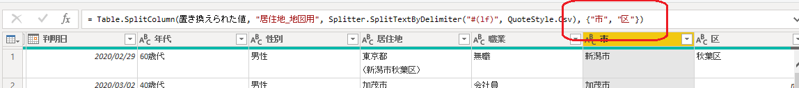

### 職業や住居地にも改行コードを含むデータがあるので置換する

同様に改行コードを消したいので置換操作で消します。これまでの説明の繰り返しになるので省略します。試してみましょう。

### 見出しを変更する

列の見出しが「Column1」になっている箇所があるので「No」に書き換えます。見出しをダブルクリックして変更します。

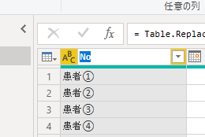

以上で表が完成します。

これまでの操作で作成されたコードは以下になります。忙しい方は1行目のURLを書き換えたうえで詳細エディタにコピペしてください。

```
let
ソース = Pdf.Tables(Web.Contents("https://*******************************/Documents/niigata-corona-data/infected-persons.pdf")),
Table001 = ソース{[Id="Table001"]}[Data],
昇格されたヘッダー数 = Table.PromoteHeaders(Table001, [PromoteAllScalars=true]),
変更された型 = Table.TransformColumnTypes(昇格されたヘッダー数,{{"Column1", type text}, {"〇〇No.", type text}, {"判明日", type date}, {"年代", type text}, {"性別", type text}, {"居住地", type text}, {"職業", type text}}),
削除された列 = Table.RemoveColumns(変更された型,{"〇〇No."}),
追加されたカスタム = Table.AddColumn(削除された列, "居住地_地図用", each [居住地]),
置き換えられた値 = Table.ReplaceValue(追加されたカスタム,"東京都#(lf)（新潟市秋葉区）","新潟市#(lf)秋葉区",Replacer.ReplaceText,{"居住地_地図用"}),
区切り記号による列の分割 = Table.SplitColumn(置き換えられた値, "居住地_地図用", Splitter.SplitTextByDelimiter("#(lf)", QuoteStyle.Csv), {"市", "区"}),
置き換えられた値1 = Table.ReplaceValue(区切り記号による列の分割,"#(lf)","",Replacer.ReplaceText,{"居住地"}),
置き換えられた値2 = Table.ReplaceValue(置き換えられた値1,"#(lf)","",Replacer.ReplaceText,{"職業"}),
#"名前が変更された列 " = Table.RenameColumns(置き換えられた値2,{{"Column1", "No"}})
in
#"名前が変更された列 "
```

※一部伏字をしています。〇〇の部分は適宜変更してください。

### 他の2ファイルも同じように取り込んで整形する

同じようにデータを変更して使いやすいように変更するだけなので詳細は省略します。

#### トピック：保守が辛くなるからステップ名は変更した方が良い

「変更された型」とか「置き換えられた値」と書かれていても何をしているか次第に読めなくなるのでステップ名は適宜書き換えるのが普通です。私はさぼりました、すいません。

## 可視化のためのデータができました

[**ホーム**]-[**閉じて適用**]でPower Queryエディタを閉じましょう。これで必要なデータがそろいました。

## ということで

PDFからデータの取得とデータの整形について順を追って見てみました。  
コーディングせずにここまで簡単にできてしまうので興味のある方は是非試してみましょう。

次のに読みたい「[Power BIでデータを可視化する](https://papasensei365.com/powerbi-visualize-covid19data/)」

