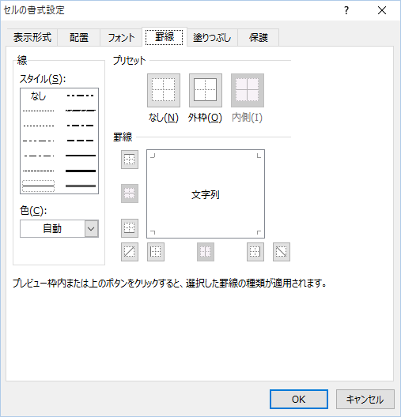

VBAで罫線を指定する場合は想定通りの罫線が出ない場合があります。  
仕様を把握して思い通りの罫線が引けるようにしましょう。

## 「セルの書式設定」での指定

なしを含めると14種類の選択が可能です。



## VBAでの設定

BordersプロパティのLineStyleとWeightの組み合わせで指定します。

### サンプル

よく見る実線の罫線の場合は以下のようになります。

```
Range("A1").Borders.LineStyle = xlContinuous
Range("A1").Borders.Weight = xlThin
```

### 設定値の種類

VBAで指定できる値はそれぞれ以下の通りです。

#### LineStyle

| 定数 | 値 | 罫線の種類 |
| --- | --- | --- |
| xlContinuous | 1 | 実線(細) |
| xlDash | -4115 | 破線 |
| xlDashDot | 4 | 一点鎖線 |
| xlDashDotDot | 5 | 二点鎖線 |
| xlDot | -4118 | 点線 |
| xlDouble | -4119 | 二重線 |
| xlSlantDashDot | 13 | 斜め斜線 |
| xlLineStyleNone | -4142 | 無し |

#### Weight

| 定数 | 値 | 罫線の種類 |
| --- | --- | --- |
| xlHairline | 1 | 極細 |
| xlThin | 2 | 細 |
| xlMedium | -4138 | 中 |
| xlThick | 4 | 太 |

LineStyleが8種、Weightが4種あります。  
ここから単純に考えると8\*4の32種類の指定が可能のように見えますが、実際は使用できない組み合わせがあります。

### 組み合わせ全パターン

以下のような仕様で補正されます。

- 使用できない組み合わせを指定すると内部的に自動補正されます。
- しかもLineStyleとWeightを指定する順序によって結果が変わります。
- 原則、後に指定するものが優先されるようです。
- 自動修正されない組み合わせは13種類となり、これが「セルの書式設定」で設定できる罫線の種類（なしを含まない）と同じになります。

全ての組み合わせは以下のようになります。

※１：修正値1はLineStyle→Weightの順に設定した場合の補正値

※２：修正値2はWeight→LineStyleの順に設定した場合の補正値

※３：修正値が空白は自動補正なし

| LineStyle値 | Weight値 | LineStyle修正値1 | Weight修正値1 | LineStyle修正値2 | Weight修正値2 |
| --- | --- | --- | --- | --- | --- |
| 1 | 1 |  |  |  |  |
| 1 | 2 |  |  |  |  |
| 1 | -4138 |  |  |  |  |
| 1 | 4 |  |  |  |  |
| -4115 | 1 | 1 | 1 | -4115 | 2 |
| -4115 | 2 |  |  |  |  |
| -4115 | -4138 |  |  |  |  |
| -4115 | 4 | 1 | 4 | -4115 | 2 |
| 4 | 1 | 1 | 1 | 4 | 2 |
| 4 | 2 |  |  |  |  |
| 4 | -4138 |  |  |  |  |
| 4 | 4 | 1 | 4 | 4 | 2 |
| 5 | 1 | 1 | 1 | 5 | 2 |
| 5 | 2 |  |  |  |  |
| 5 | -4138 |  |  |  |  |
| 5 | 4 | 1 | 4 | 5 | 2 |
| -4118 | 1 | 1 | 1 | -4118 | 2 |
| -4118 | 2 |  |  |  |  |
| -4118 | -4138 | 1 | -4138 | -4118 | 2 |
| -4118 | 4 | 1 | 4 | -4118 | 2 |
| -4119 | 1 | 1 | 1 | -4119 | 4 |
| -4119 | 2 | 1 | 2 | -4119 | 4 |
| -4119 | -4138 | 1 | -4138 | -4119 | 4 |
| -4119 | 4 |  |  |  |  |
| 13 | 1 | 1 | 1 | 13 | -4138 |
| 13 | 2 | 1 | 2 | 13 | -4138 |
| 13 | -4138 |  |  |  |  |
| 13 | 4 | 1 | 4 | 13 | -4138 |
| -4142 | 1 | 1 | 1 | -4142 | 2 |
| -4142 | 2 | 1 | 2 |  |  |
| -4142 | -4138 | 1 | -4138 | -4142 | 2 |
| -4142 | 4 | 1 | 4 | -4142 | 2 |

## つまり

GUI・VBAどちらにしても描ける罫線の種類は14種類となります。  
VBAで指定するときは正しい組み合わせを指定しないと意図した罫線が書けないことがありますのでマクロの記録で確かめながら指定しましょう。
