Power BIの話です。
整形したデータをもとに可視化してみます。また、クイックメジャーを使って累計も表示してみます。
データの取り込みと整形するための手順は前回の記事「[Power BI DesktopでPDFを読み込んでPower Queryでデータ整形する](https://tomikiya.github.io/powerbi-import-pdf/)」にてまとめてあります、ご参照ください。
## ゴールを確認

こんな感じの可視化を目指します。
※この記事ではすべてを作成しません。基本的な部分のみの手順になります。
<https://app.powerbi.com/view?r=eyJrIjoiYjQ1ZDc1NzAtY2M0Ny00NzU4LTlmZWEtOThjZmM0MzAxOWRmIiwidCI6IjUwNTMwNDkyLWZmMDUtNGMyOC04N2E0LTZiYjM4OTNmZDNlOSJ9>

## もとになるデータを確認

前の記事でデータを作っていない方はCSVをダウンロードして取り込んでみましょう。
[陽性患者数.csv](https://drive.google.com/file/d/1i22U3-O0xRz5XxiwNyBv6TMUgGDQhqn_/view)
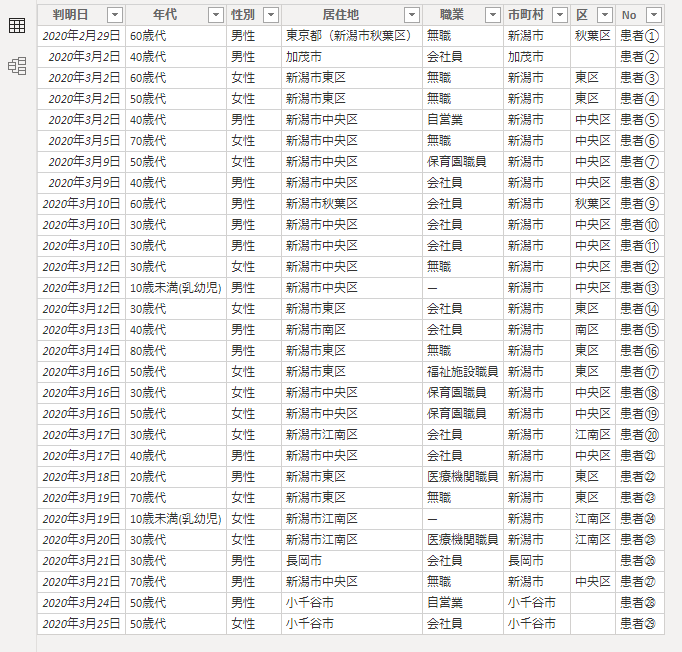
[PCR検査状況.csv](https://drive.google.com/file/d/19LQ5XG9DRCvLNp3DlCd3Ywah5X-YjxmH/view)
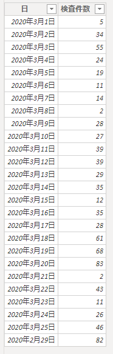
[対応状況.csv](https://drive.google.com/file/d/1LY4tbmllDjH9XF-A57maOs7TN-pxx3-L/view)
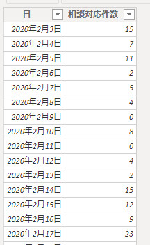

## 準備：カレンダーデータを用意しよう

日付を軸にするグラフを作ると「月ごとに集計したい」とか「年ごとにグラフにしたい」とか「曜日ごとに集計したい」などの要望が出てきます。
月ごとや年ごとの集計なら標準的な機能である「日付の階層」を使えばすぐにでも作れます。
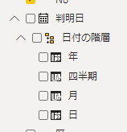
ただ、「曜日」のような標準で用意されていない集計単位にてまとめたい場合はカレンダーデータを作ってそのデータと集計するデータを関連付ける必要がでてきます。
また、PowerBIの仕様上、複数のデータを日付のような共通の項目で関連付けするには親のデータが必要です。親のデータをカレンダーとすることで複数のデータを関連付けできます。
関連付けしておくと異なるデータでグラフが作れるようになったり、フィルターを別のグラフに反映できるようになります。さらに言えば、DAXで独自な集計を作りたい場合に集計しやすくなります。
↓イメージ
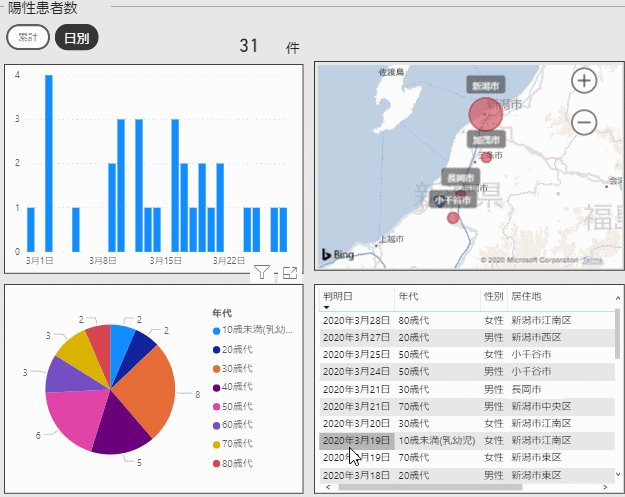
機能を拡張しやすいので折角ですしカレンダーを作ります。

### DAX式を使ってカレンダーデータを作る

そもそもカレンダーのデータが外部ソースにあるわけではありません。データを作り出すことになります。
作る方法は2種類あって、DAXによる生成かPower Queryでの生成になります。
まずはDAXで生成してみます。

#### DAXで生成してみる

[**テーブルツール**]-[**計算**]-[**新しいテーブル**]をクリックします。
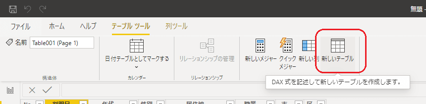
式を入力できますのでDAXで書かれた式を入れます。

```
カレンダー = CALENDAR("2019/1/1", TODAY())
```

データの更新を行うと2019/1/1から今日までのデータが生成されます。
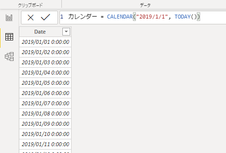
書式や列名を変えたい場合は列名をクリックすると「列ツール」タブが表示されるのでそこから変更しましょう。
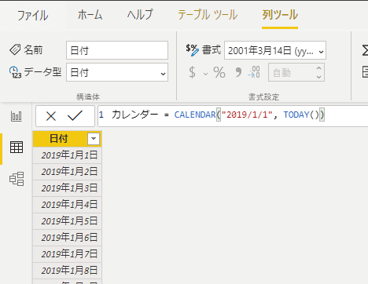

#### Power Queryでも生成してみる

[**ホーム**]-[**データ**]-[**データの取得**]-[**空のクエリ**]を選択してクエリエディターを起動します。
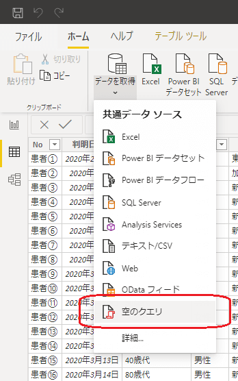
左ペインの「クエリ1」を右クリックして詳細エディタを開いて以下を貼り付けます。

```
let
StartDate = #date( 2019, 1, 1 ), EndDate = DateTime.Date(DateTime.LocalNow()),
DatesList = List.Dates(StartDate,Duration.Days( EndDate - StartDate ) + 1,#duration( 1, 0, 0, 0 )),
DatesTable = Table.FromList(DatesList, Splitter.SplitByNothing(), null, null, ExtraValues.Error)
in
DatesTable
```

適用してクエリエディターを閉じると同じカレンダーデータが出来ます。書式や列名の修正は忘れずに行いましょう。
DAXとPower Query、どちらで作成してもよいですが今回はDAXで作成したものを使います。

### カレンダーと各データを紐づける

異なるデータを紐づける設定は「モデル」で行います。
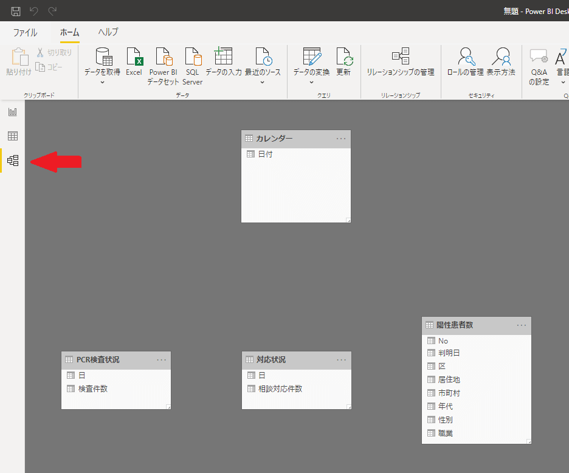
各データの日付を紐づけてみます。まずはPCR検査状況のデータからです。
カレンダーの「日付」をドラッグしてPCR検査状況の「日」にドロップします。操作が繊細なので気をつけましょう。
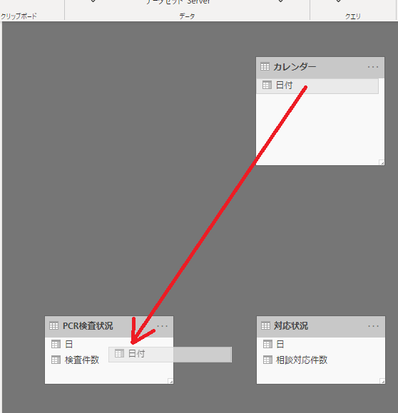
するとカレンダーとPCR検査状況が線で結ばれます。両方のデータの接続部分に「1」と出ていればうまくいっています。
「\*」が出ている場合は検査件数と日付が紐づいてしまっています。修正が必要です。
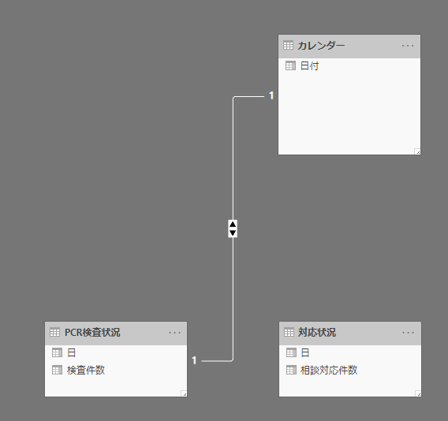
修正するときは線をダブルクリックしましょう。
各データの日付列をクリックして紐づけるデータを変更します。また**「クロスフィルターの方向」を「双方向」にしておきましょう**。フィルター時に他のグラフも連動してフィルターしてくれるようになります。
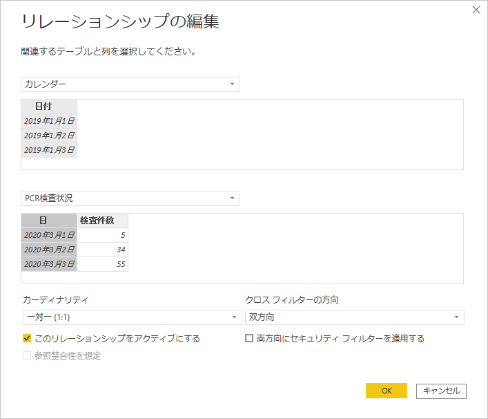
同様に対応状況と陽性患者数もカレンダーと紐づけます。
陽性患者数だけ紐づけが1対nになるので「\*」印が出ていますが問題ありません。ただしクロスフィルターの方向が単一になっているはずなので、線をダブルクリックして双方向に修正しておきましょう。
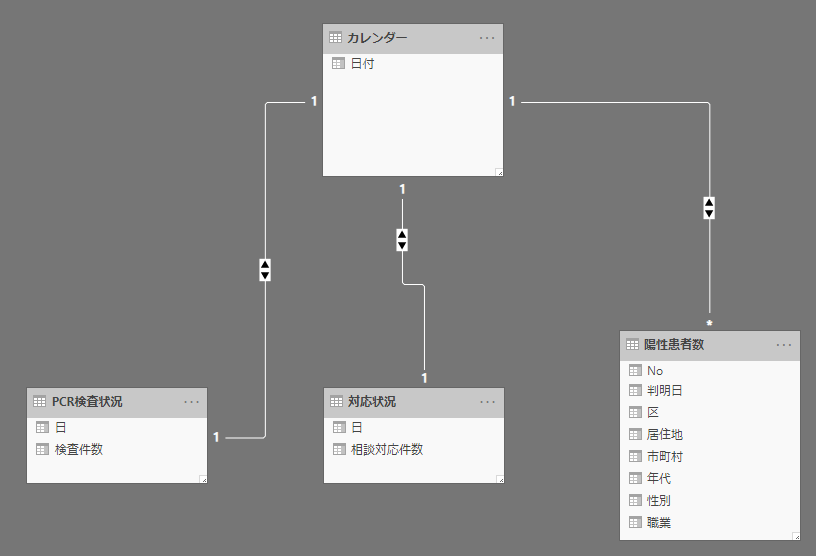
以上で紐づけが完了です。

## 相談件数のグラフを作る

それではいよいよ可視化をしてみます。
まずは相談件数の棒グラフです。

### 日別の相談件数をグラフにしてみる

レポートを開きます。
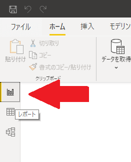
視覚化から積み上げ縦棒グラフを選んで配置します。
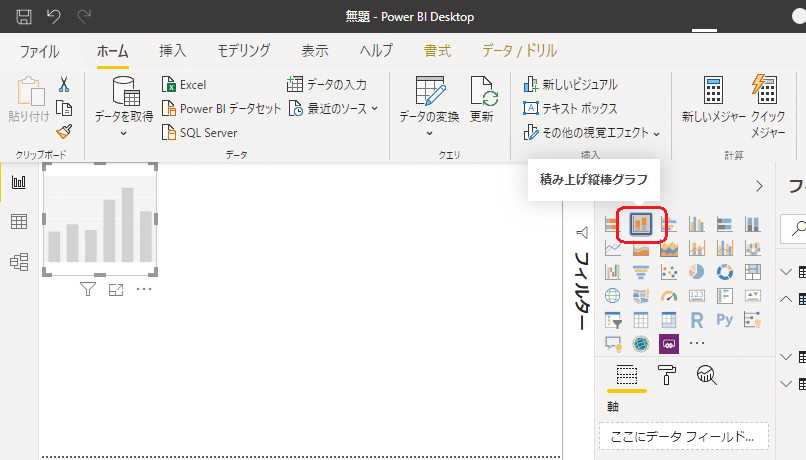
対応状況データの相談対応件数を値にドラッグ＆ドロップします。
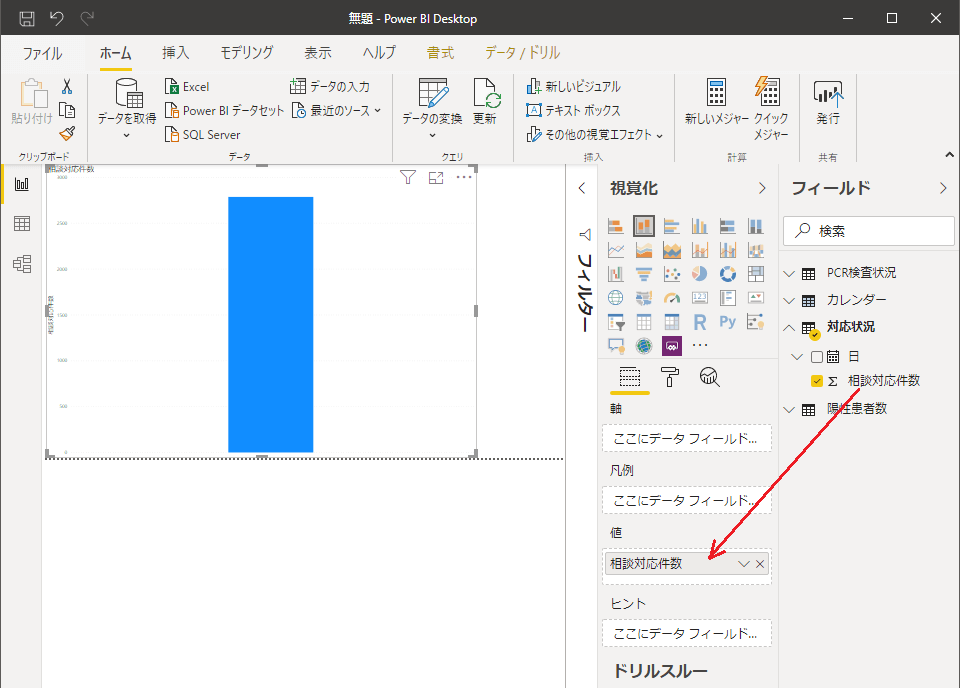
さらにカレンダーデータの日付を軸にドラッグ＆ドロップします。
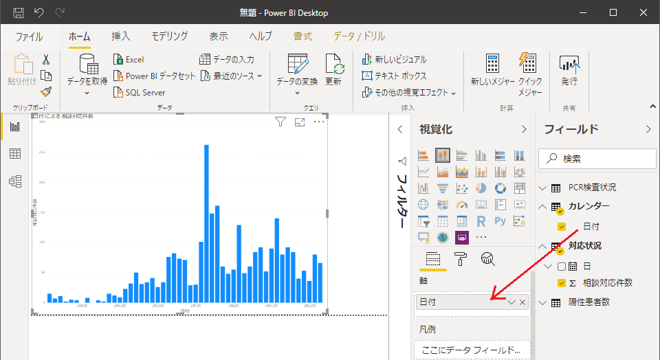
出来ました。簡単ですね。

## 日別の検査実施数と陽性患者数をグラフにしてみる

前述した手順を繰り返しグラフを作ります。グラフのコピペもで出来るので活用しましょう。
陽性患者数のグラフについて補足すると、値にはNoを入れてみましょう。データをカウントして集計してくれます。
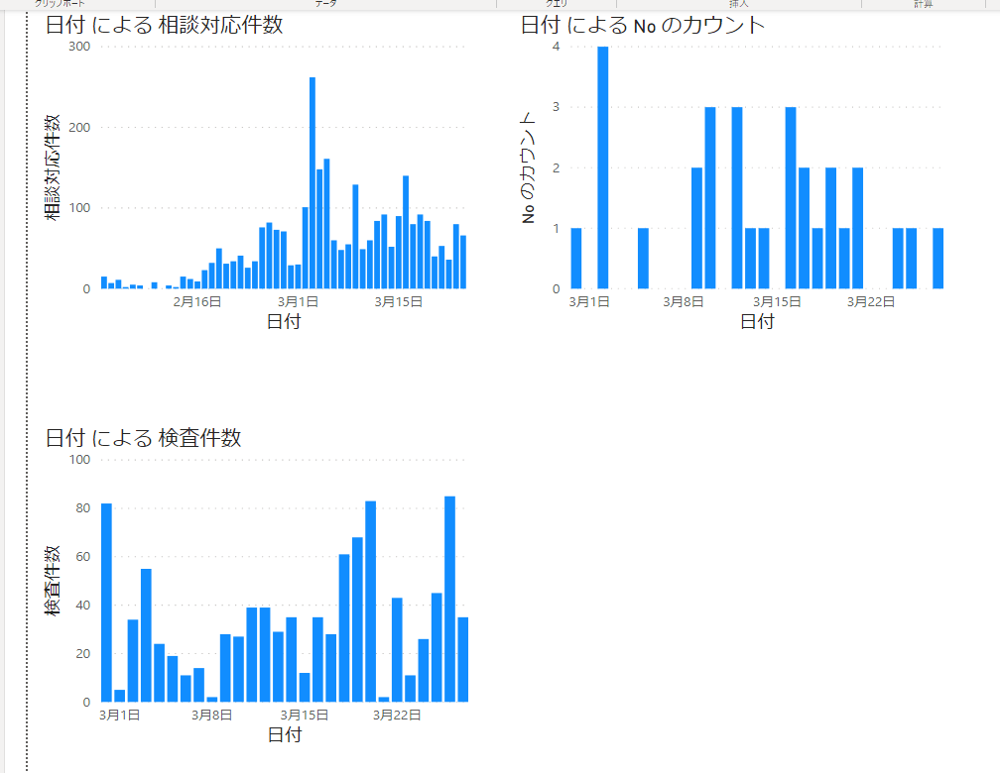
グラフのタイトルは[書式]の[タイトル]で変更できます。
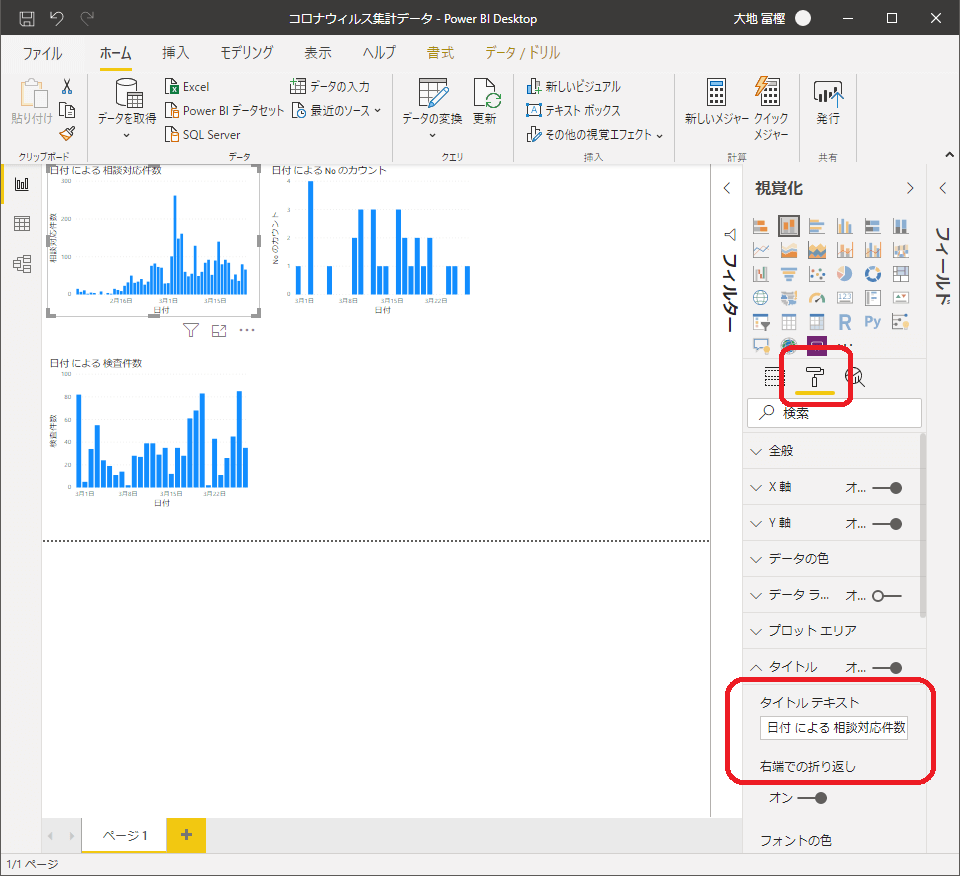
縦軸のタイトルは[**フィールド**]の[**値**]の欄を右クリックで変更できます。非表示にしたい場合は[**書式**]の[**Y軸**]の[**タイトル**]で切り替えられます。
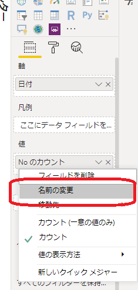

### フィルターの連携を調整する

ここまでの作業だけでフィルタが連動します。
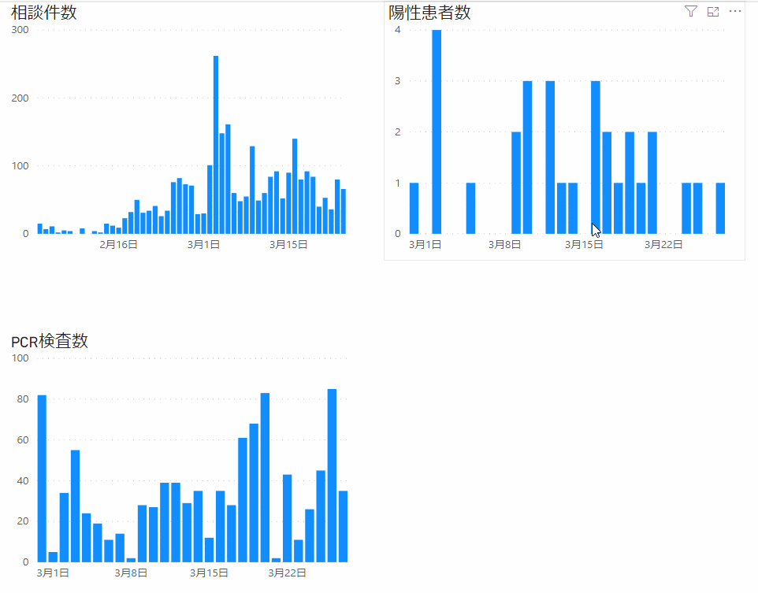
しかし、相談件数は他のグラフと関連するものではないのでフィルターの連動を止めます。
相談件数のグラフを選択状態にして[**書式**]-[**相互作用を編集**]を有効にします。すると各グラフの右上にアイコンが追加されます。そこで「なし」を選択します。
すると相談件数のグラフをタップしてフィルタしても他のグラフには影響しなくなります。
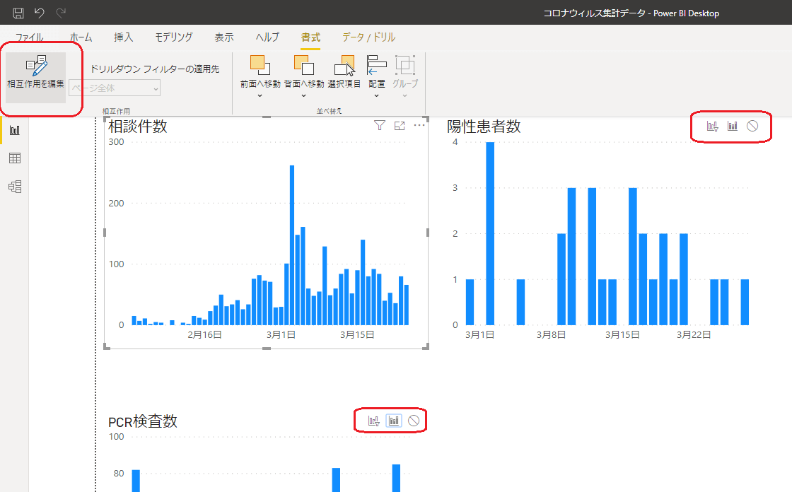
逆方向も設定しないといけないので、PCR検査数と陽性患者数のグラフを選択して相談件数への相互作用を「なし」にしましょう。
これで相談件数だけフィルタが相互作用しなくなります。
**補足：**  モデルで対応状況データとカレンダーデータの紐づけを解除してしまうのも有効ではあります。

## 円グラフ・地図・テーブルを入れる

陽性患者数で他の可視化を挿入します。円グラフ、マップ、テーブルの視覚化をそれぞれ挿入し陽性患者数データと関連付けましょう。
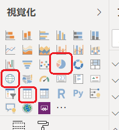
↓
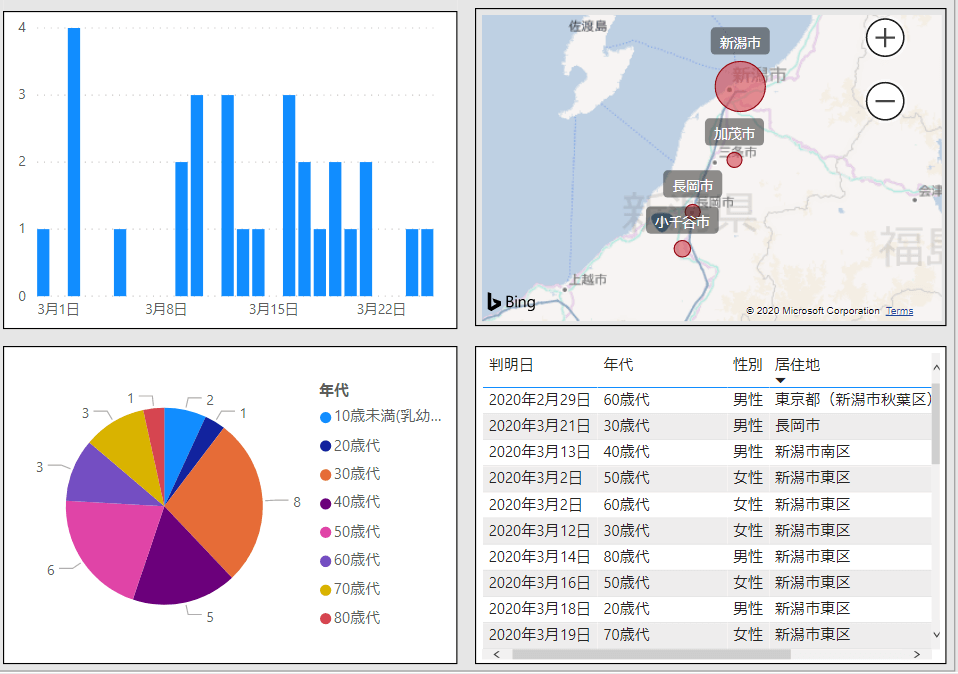
特に難しいところは無いので詳細な設定は省略します。

## グラフ枠外の数値はカードの視覚化を利用

枠上の数値はカードの視覚化を使用しています。
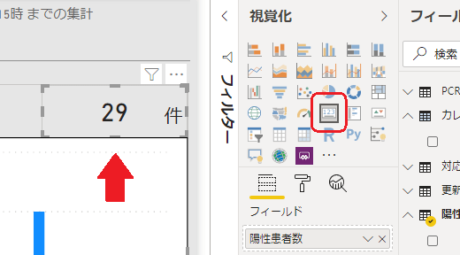

## 累計のグラフを作る

累計のグラフを表示してみます。日別と累計の切り替えの話は少し複雑になるのでここでは省きます。
もし興味がある場合はこちらの動画を参照してください。
[Power BI - Toggle Button and Bookmarks](https://www.youtube.com/watch?v=NorDWXgCE3E&t=462s)

### DAXで累計を作る

累計は、今あるデータでは表現できません。そこでDAXを使って累計用の項目を作ります。
DAXを1から書くにはある程度の知識が必要になりますが、運よく累計は「クイックメジャー」を使って自動的に作り出せます。
**右ペインの陽性患者数のデータを選択した状態で、[ホーム]-[計算]-[クイックメジャー]を選択してください。**
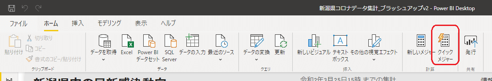
そしてクイックメジャーの入力項目として、

| 項目 | 入力値 |
| --- | --- |
| 計算 | 累計 |
| 基準値 | 陽性患者数のNo(カウント) |
| フィールド | カレンダーの日付 |
| 方向 | 昇順 |

とします。
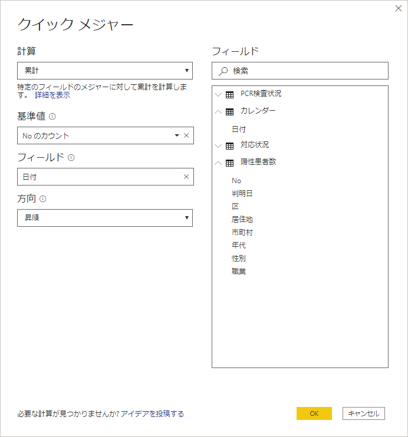
すると、陽性患者数のデータに「日付 の No のカウント に対する累積値」という項目が追加されます。
これがDAXによって作り出された新たなデータです。また数式バーにはDAX式が登録されています。今は細かいところまでは覚えなくて大丈夫です。
※陽性患者数データとは異なるデータに累計のメジャーが生成された人は、クイックメジャーを選択する前に陽性患者数データを選択していなかった可能性があります。そのままでも累計のグラフは作れますがモヤっとする場合は作り直しましょう。
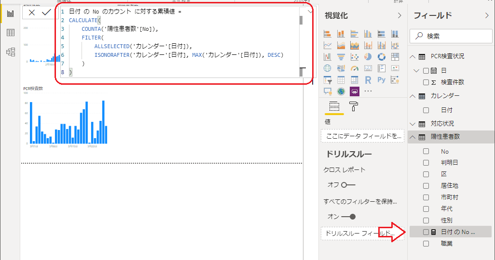
項目名が長いので名称を「陽性患者数累計」に変更しておきましょう。
ではこのデータを使って縦棒グラフを作ります。作り方は日別のグラフを作ったときと同じです。軸と値にそれぞれカレンダーの「日」と今作成した「陽性患者数累計」を入れます。
すると累計のグラフが出来上がります。
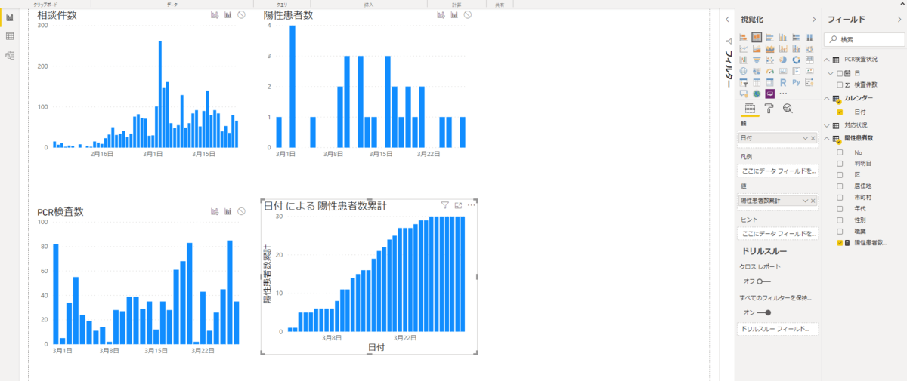

#### ちなみにカレンダーを作らないで累計を作ると・・・

DAXを使うならカレンダーは作っておいた方が良いと前述しました。実際、カレンダーを作らないで累計するとどうなるか試してみます。
カレンダーの日付ではなく、陽性患者数の判定日を軸にすると・・・、
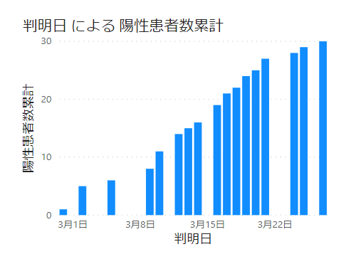
このように歯抜けになります。軸が連続でになってほしい場合は連続なデータを用意しましょう。

## ということで

データから可視化までの基本的な工程をまとめました。
データが整形されていれば可視化することはそれほど難しくありません。難しいのは「次のアクションが取れる可視化がされているか」です。見て終わりなグラフでは画面の賑やかしでしかないです。次につながる見せ方を身につけていきたいですね。
