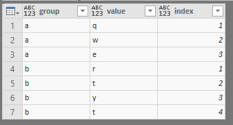
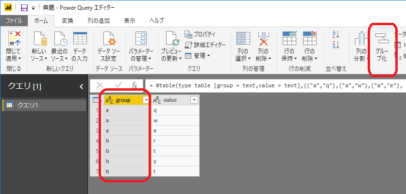
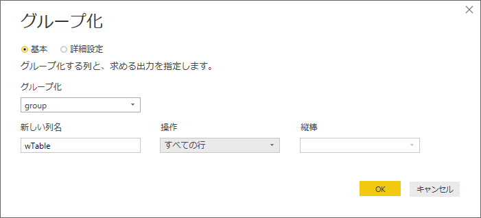
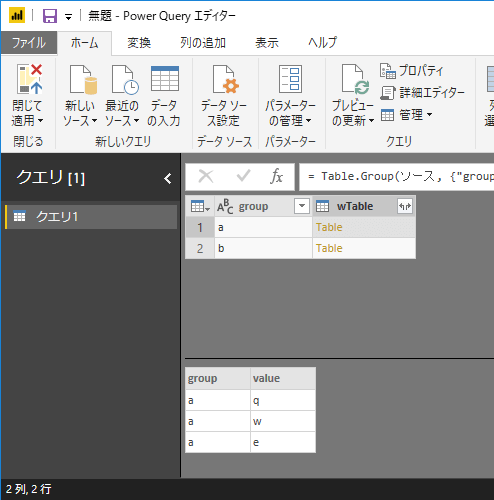
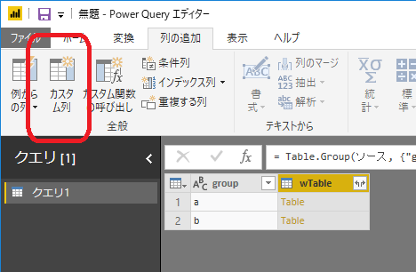
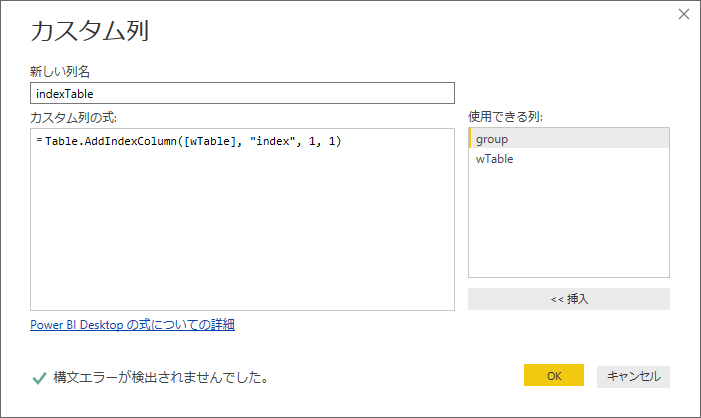
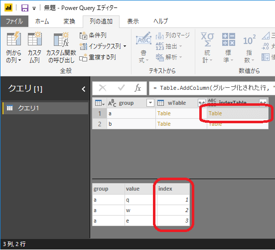
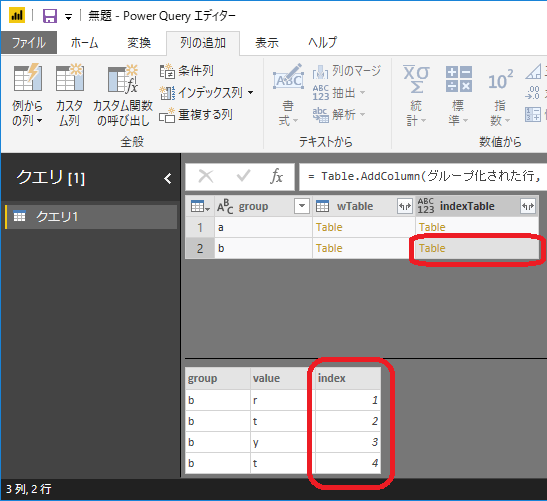



Power Queryにて、グループ単位でインデックスを付与する方法です。ボタンポチポチだけだとテーブル全体にインデックスを付ける方法しかないので覚えておくと便利かと思います。
以下のサイトを参考にしました。
https://www.excelguru.ca/blog/2018/06/27/number-rows-by-group-using-power-query/

スポンサーリンク

## やりたいこと

リボンにある**インデックス列**はテーブル全体に連番が振られますが、特定のグループの中で採番したいときがあります。
↓このようなインデックスを作ります。


## 流れ

- 一度グループ化
- グループ化されたテーブルの中でインデックスを追加する
- テーブルを展開する

## 詳細

group列でグループ化します。

列名は後で消すのでなんでもよいです。今回はwTableとしました。
操作は「**すべての行**」を選択します。

そうするとテーブルができます。

カスタム列の追加にてwTableにインデックスをつけた新たなテーブルを追加します。**wTable自体にインデックスを追加するわけではないことに留意です。**

↓

```
= Table.AddIndexColumn([wTable], "index", 1, 1)
```


すると各テーブルにインデックスが登録されます。


最後に、wTable列を削除してvalueとindexをテーブルから展開すれば完了です。
以下を詳細エディタに張り付ければ手順を確認できます。

```
let
ソース = #table(type table [group = text,value = text],{{"a","q"},{"a","w"},{"a","e"},{"b","r"},{"b","t"},{"b","y"},{"b","t"}}),
グループ化された行 = Table.Group(ソース, {"group"}, {{"wTable", each _, type table}}),
追加されたカスタム = Table.AddColumn(グループ化された行, "indexTable", each Table.AddIndexColumn([wTable], "index", 1, 1)),
削除された列 = Table.RemoveColumns(追加されたカスタム,{"wTable"}),
#"展開された indexTable" = Table.ExpandTableColumn(削除された列, "indexTable", {"value", "index"}, {"value", "index"})
in
#"展開された indexTable"
```

お試しください。

