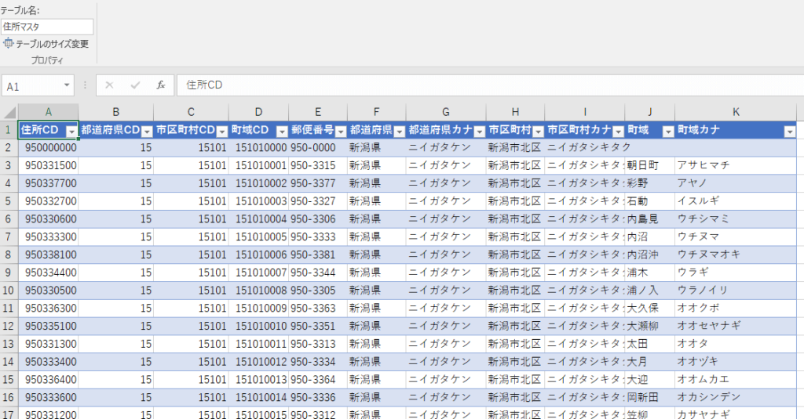
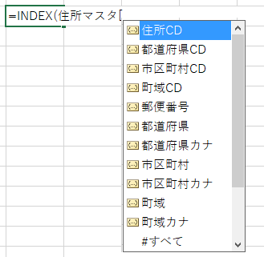

XLOOKUPが追加されたことで、これまでVLOOKUPを利用していた場面でXLOOKUPを使うようになるとは思いますが、下位互換の関係上どうしてもVLOOKUPで対応せざるを得ない場面があります。  
今回の話はVLOOKUPの弱い部分を補完しつつ下位のバージョンでも利用できる方法になります。

## VLOOKUPの課題

VLOOKUPには複数の課題があります。

- 一番左の列しか検索のキーにできない
- 列の順番が変わると式が崩れる
- そもそも、例えばA1:H100とか書かれてもどこを参照しているか分かりづらい
- VLOOKUPのセルを見直すたびに式を読み解く時間がもったいない

VLOOKUPをもっと保守しやすくします。

## サンプル

下記一覧から、町域ＣＤ「151010005」の町域を取得したいと思います。



## VLOOKUPだと

```
= VLOOKUP(151010005,D2:J10000,7,FALSE)
```

VLOOKUPを使いこなしている方であれば理解も早いですが、これを半年後に見たときに「7とは？」や「D列は何？」といった式の意味を思い出す苦労があります。  
さらに式が複雑になればなるほど辛くなります。  
また、列の順番を入れ替えたりすると式を見直さないといけません。  
そして、検索範囲を10000行としたので10000行より多いデータがあると検索できなくなります。

## INDEX + MATCH で少しすっきり

INDEX+MATCHで置き換える方法が有名です。

```
= INDEX(J2:J10000,MATCH(151010005,D2:D10000,0))
```

VLOOKUPと違い、検索キーを一番左の列にする制約がないため、検索キーより左の列の情報を取得できます。  
また、列の順番が変わっても同じ式が使えます。  
ただ、やはり半年後に見たときに「J列とは？D列とは」となる可能性があります。

## 構造化参照ですっきり

一覧がテーブルになっているのなら構造化参照を使いましょう。

```
=INDEX(住所マスタ[町域],MATCH(151010005,住所マスタ[町域CD],0))
```

何を検索キーにして何を表示しようとしているか見てわかります。半年後でもおそらくすぐに理解できるでしょう。  
またテーブルを利用しているのでデータが増えても検索範囲は自動的に適切な範囲になります。  
更にうれしいのは項目をサジェストしてくれことです。テーブルを見ながら式を考える必要がありません。  
別のシートにデータがある時に大活躍します。

↓



私としては、VLOOKUP+COLUMNで頑張ってみたりINDEX+MATCH+名前定義で頑張ってみたりしていましたが、今は構造化参照がお気に入りです。

## 使うときは慎重に

自分しか理解できない式はなかなか使えません。みんなが使うエクセルファイルならまだVLOOKUPになると思います。  
構造化参照を使う場合は教育も含め理解を得られてからの方が混乱も少ないですね。

構造化参照はもっと浸透してほしい機能ですね。
