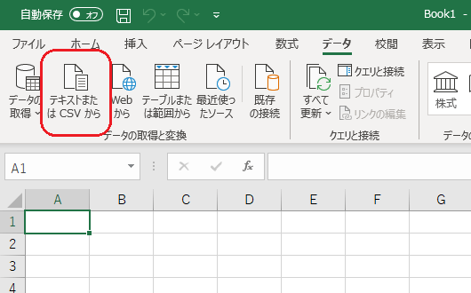
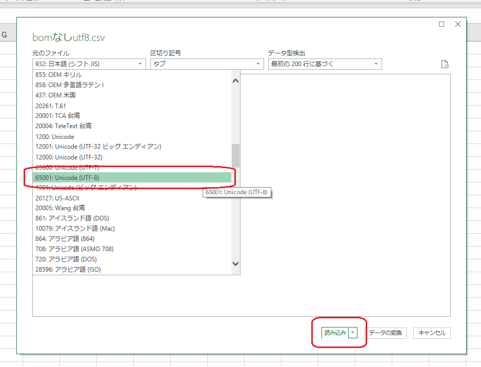
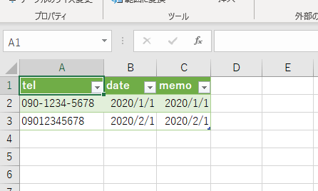
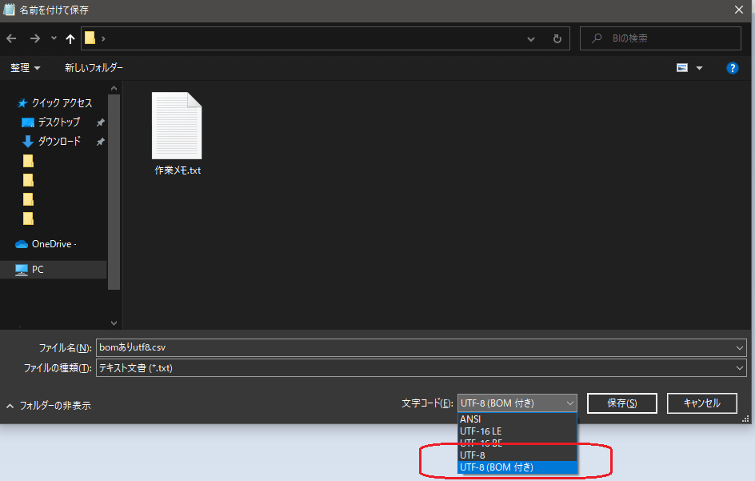
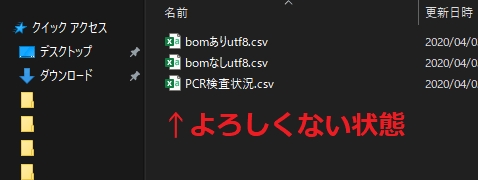
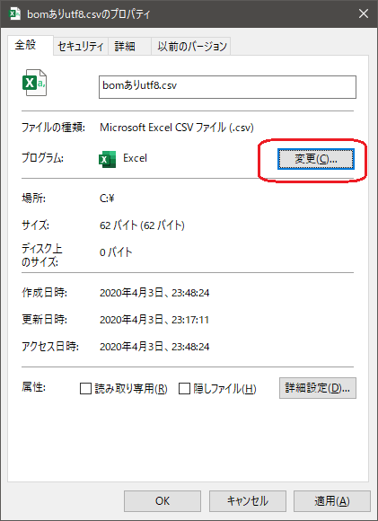

CSVをExcelで開いたときに文字化けする場合の対処になります。

## 文字化けする原因

**CSVファイルの文字コードがUTF-8で、しかもBOMなしだから**です。BOMには「このCSVファイルの文字コードはUTF-8ですよー」という情報が入っています。そのBOMが無いのでExcelはUTF-8と判断できずにデフォルトのshift-JISで開こうとして文字化けをしています。

## Power QueryならBOMなしのUTF-8でも開ける

そこでPower Queryを使います。Excel2016以上なら標準で使えます。また2010以上ならアドインを入れれば使えるようになります。今のところWindows限定の方法です。

[**データ**]-[**データの取得と置換**]-[**テキストまたはCSVから**]を選択します。

取り込みたいCSVを選択するとプレビュー画面が表示されます。  
元のファイルの文字コードにUTF-8を指定しましょう。そして読み込みを選択すれば取り込めます。

↓

ファイルの情報を変更しなくてもよいお手軽な手法ですね。

## メモ帳でBOMありのファイルに変更してしまう戦法も

Win10ではメモ帳が強化されています。もしファイルの変更に億劫でなければBOMありのCSVに変更してしまうのもアリです。  
該当のファイルをメモ帳で開き、文字コードを「UTF-8(BOM付き)」 に変更して保存してしまいましょう。

これでExcelで開いても文字化けしなくなります。  
このほか、同様にshift-JIS(=ANSI)にも変更できるのでANSIに変更してしまっても構いません。どちらが良いかは環境によるのでお任せします。  
Macユーザと共存する可能性があるのならUTF-8をお勧めします。

## CSVファイルをExcelで開く設定は解除しておこう

CSVファイルをExcelと関連付けしてしまうとCSVをダブルクリックしたときにExcelで開いてしまいます。この状態は悲劇を生みます。

今回のように文字化けするリスクがある他、先頭の0が消されたり「1-1」という文字が自動的に日付に置き換わって表示されたりするので情報を無意識に改ざんしてしまう可能性も出てきます。  
個人的にCSVをExcelで開くのは悪手だと思っています。CSVエディタで開くか、メモ帳のようなテキストエディタで開きましょう。どうしてもExcelを使いたい場合はPower Queryを経由して型を定義した上で取り込みましょう。

## 参考：CSVとExcelの関連付けを変更する方法

CSVとExcelの関連付けを変更する方法

CSVファイルを右クリックしてプロパティを開き、プログラムから他のアプリに変更できます。

## ということで

BOMなしUTF-8と上手に付き合っていきましょう。
