

Excelで簡単にスクレイピングする方法になります。  
PowerQueryを使ってなるべくボタン操作でスクレイピングしていきます。

今回は[気象庁のサイト](https://www.jma.go.jp/jma/index.html)から、2018年の新潟市の気象データを取得してみます。  
Excel2016で確認していますが、Excel2010以上であればPowerQueryのアドインをインストールすれば同様のことができます。  
2020年3月時点でWindows限定です。

※MacのユーザはOffice Insider ファーストに参加して入ればPower Queryを使用できますが、Webの接続はまだ実装されていないようです。

[参考](https://support.microsoft.com/ja-jp/office/get-transform-power-query-e9332067-8e49-46fc-97ff-f2e1bfa0cb16?ui=ja-jp&rs=ja-jp&ad=jp)

## スクレイピングするURLを確認

まずは1月のデータだけを取得してみます。URLは以下になります。

https://www.data.jma.go.jp/obd/stats/etrn/view/daily\_s1.php?prec\_no=54&block\_no=47604&year=2018&month=1&day=&view=

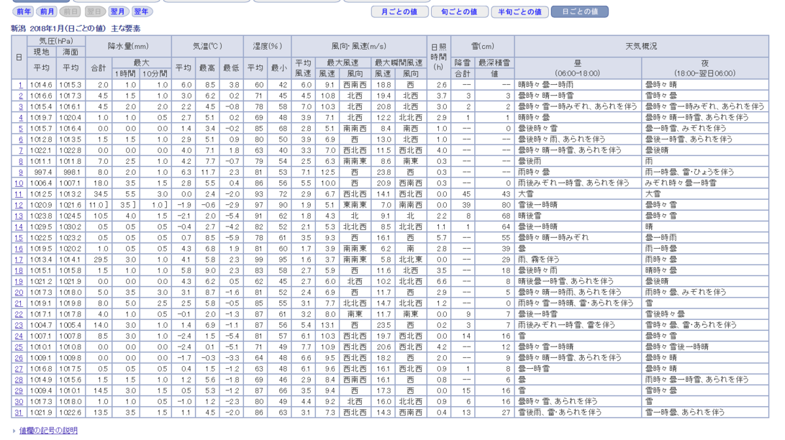

## PowerQueryでテーブルデータを取得

Excelを起動し[データ]-[Webから]を選択します。

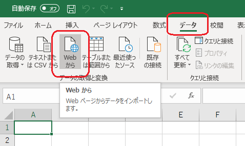

URL欄に先ほど確認したURLを張り付けてOKを押します。

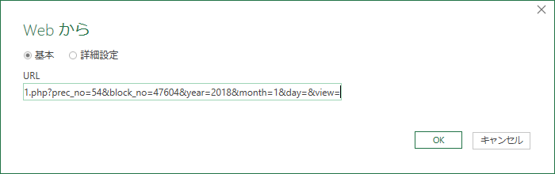

初回はアクセスの設定がでますがそのまま接続します。

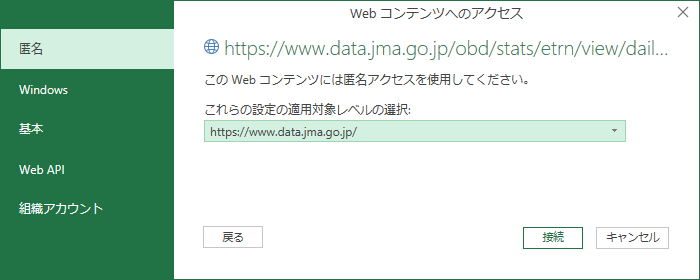

するとある程度自動で解析してくれるので、左のテーブル一覧から該当のテーブルを選択しデータの変換を選択します。

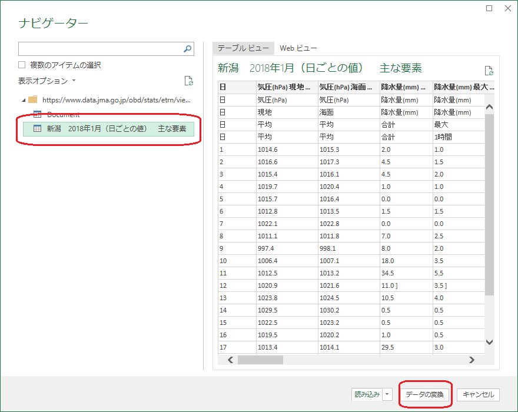

PowerQueryが起動しデータが取れたことを確認できました。

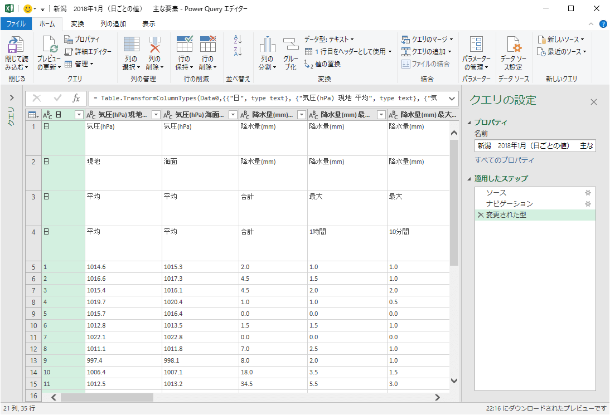

## データの整形

### 不要な列の削除

要らない情報は削除します。

列の見出しをクリックすると列を選択できます。複数選択はCtrl押しながらでできます。  
残したい列を選択状態にして[ホーム]-[列の削除]-[他の列の削除]を選択します。

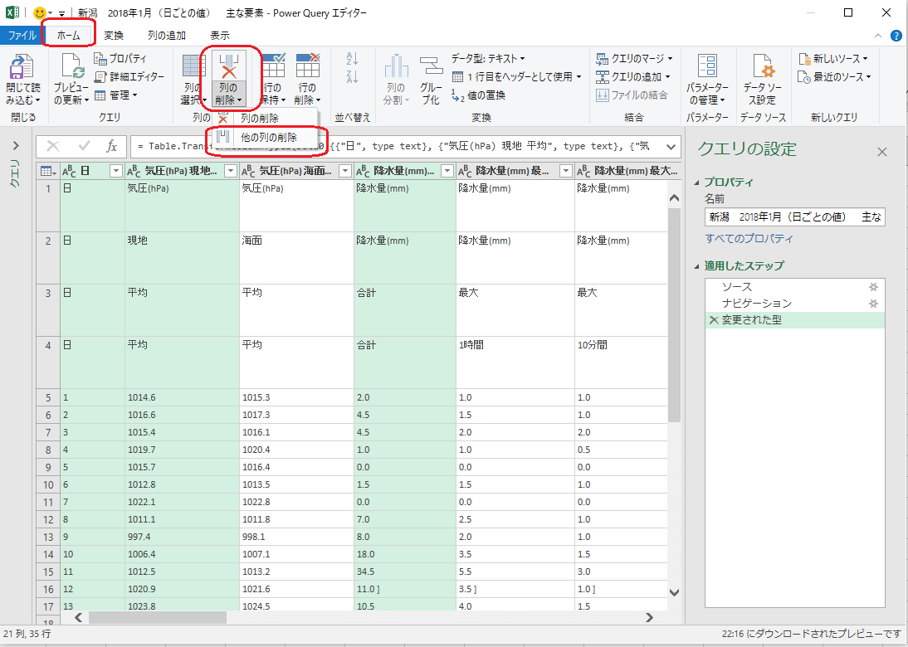

消えます。

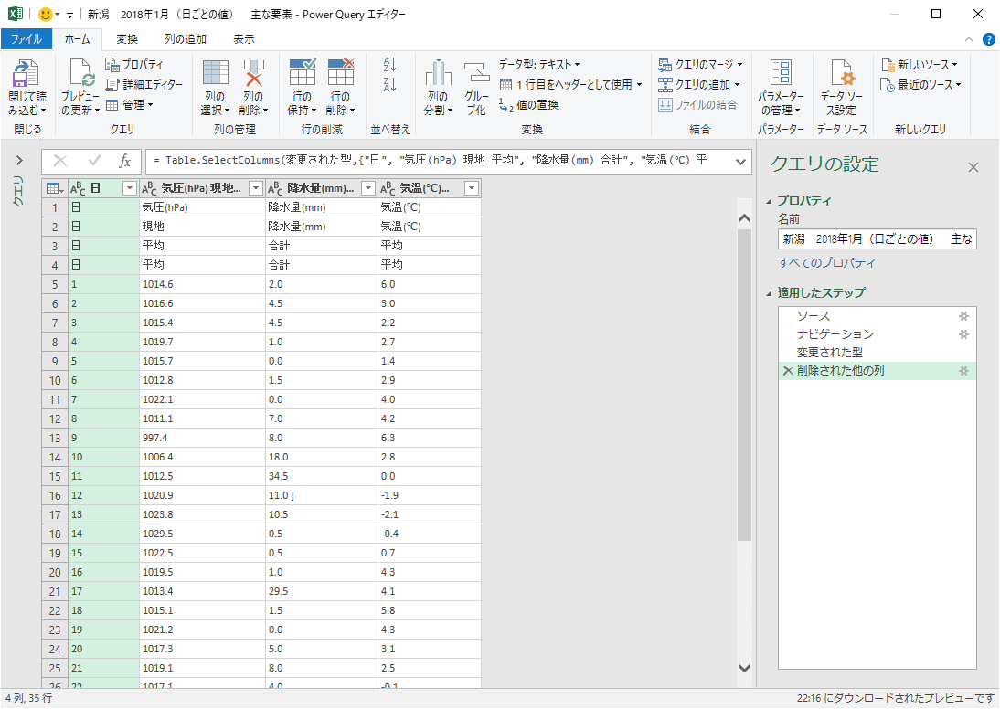

### 不要な行の削除

4行目までは見出しになるので行削除を行います。  
[ホーム]-[行の削除]-[上位の行の削除]を選択します。

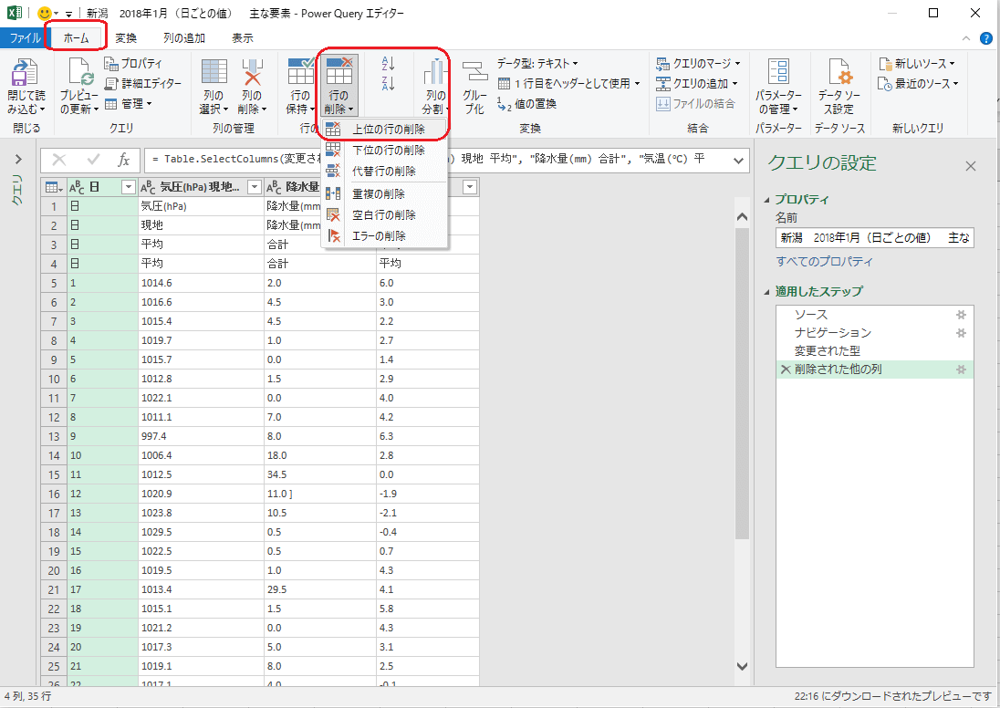

行数に4を入れてOKします。


綺麗になりました。

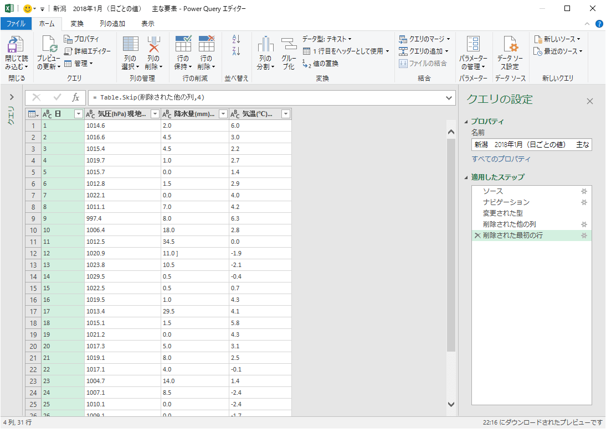

### 型を変更

基本、型は自動的に判定してくれます。が、正答率はあれなので手動で変更しておきます。  
見出しのアイコンをクリックすることで変更できます。

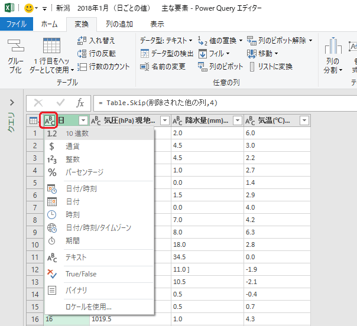

## Excelに張り付ける

整形したデータをExcelに読み込みます。  
[ホーム]-[閉じて読み込む]を選択します。

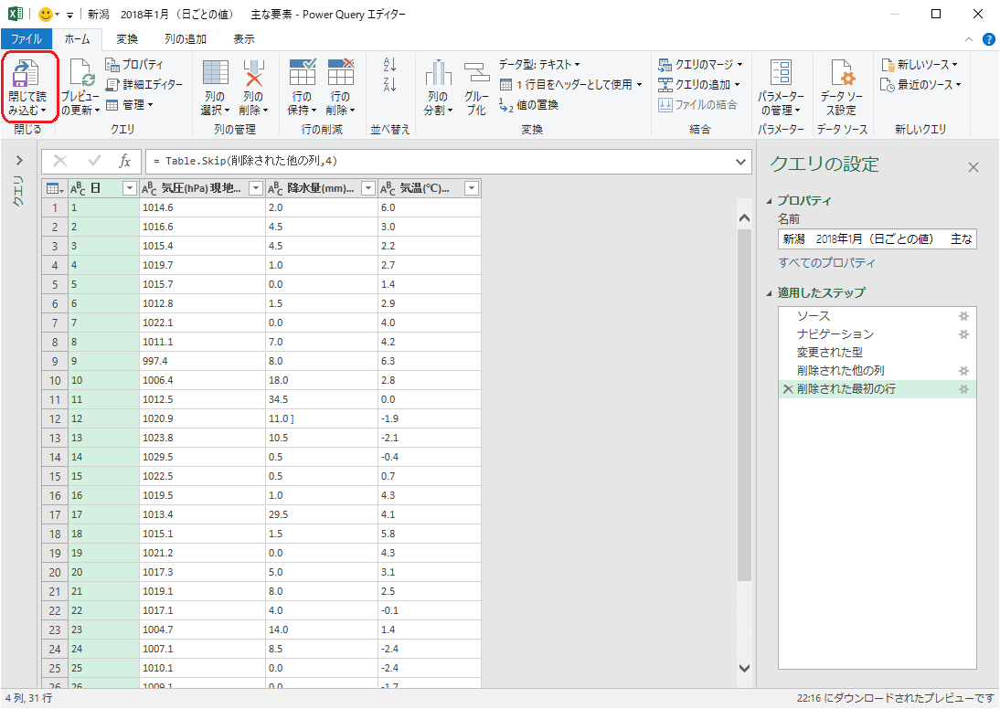

新たなシートが作成されて表示されました。簡単ですね！

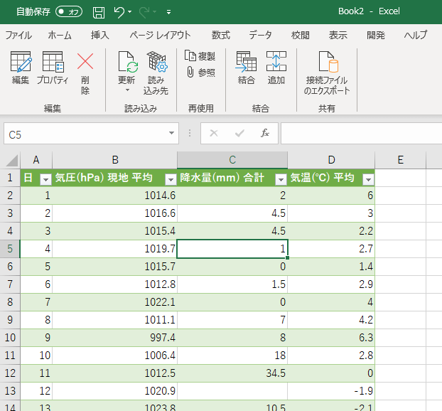

### データの再取得

データを更新するときは表を右クリックして「更新」を選択します。  
Excelの関数と異なり自動的には更新されないのでご注意ください。

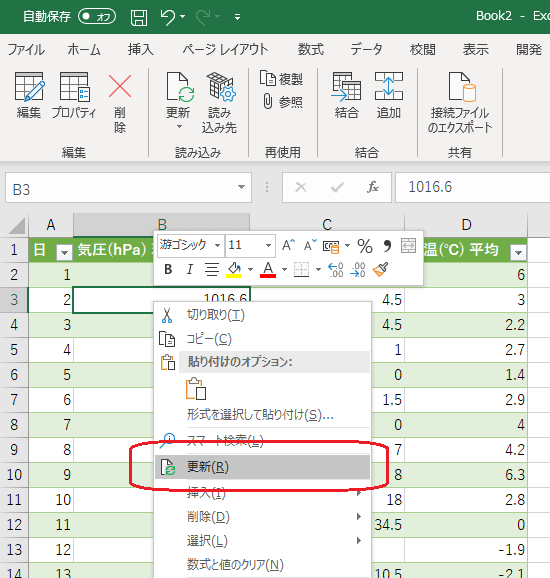

## 1月~12月のデータを一括取得

1月のデータだけ取得できましたので今度は12か月分のデータを一括で取得してみます。

### URLを解析する

URLのパラメータを見ると「month」があります。これを変更すると2月以降のデータも取得できそうです。

```
https://www.data.jma.go.jp/obd/stats/etrn/view/daily_s1.php?prec_no=54&block_no=47604&year=2018&month=1&day=&view=
```

### PowerQueryを起動

[データ]-[データの取得]-[Power Queryエディターの起動]を選択します。

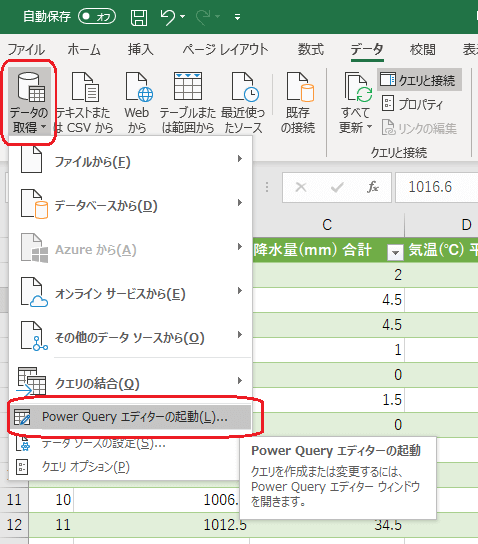

### 1月のデータを取得するクエリを関数に変更する

先ほど作成した1月のデータを取得するクエリを改良します。  
左ペインで選択し右クリックで詳細エディタ―を開きます。

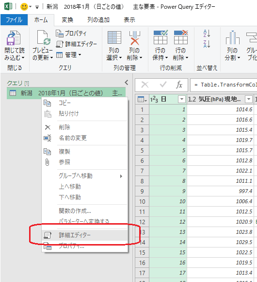

ボタンポチポチで作ったクエリが表示されます。マクロの記録で自動生成されたVBAみたいなものです。ただ、VBAでは書かれておらずM言語で書かれています。初めてだと少しとっつきにくいかもしれませんね。ここではあまり詳細に触れないでおきます。

```
let
    ソース = Web.Page(Web.Contents("https://www.data.jma.go.jp/obd/stats/etrn/view/daily_s1.php?prec_no=54&block_no=47604&year=2018&month=1&day=&view=")),
    Data0 = ソース{0}[Data],
    変更された型 = Table.TransformColumnTypes(Data0,{{"日", type text}, {"気圧(hPa) 現地 平均", type text}, {"気圧(hPa) 海面 平均", type text}, {"降水量(mm) 合計", type text}, {"降水量(mm) 最大 1時間", type text}, {"降水量(mm) 最大 10分間", type text}, {"気温(℃) 平均", type text}, {"気温(℃) 最高", type text}, {"気温(℃) 最低", type text}, {"湿度(％) 平均", type text}, {"湿度(％) 最小", type text}, {"風向・風速(m/s) 平均 風速", type text}, {"風向・風速(m/s) 最大風速 風速", type text}, {"風向・風速(m/s) 最大風速 風向", type text}, {"風向・風速(m/s) 最大瞬間風速 風速", type text}, {"風向・風速(m/s) 最大瞬間風速 風向", type text}, {"日照 時間 (h)", type text}, {"雪(cm) 降雪 合計", type text}, {"雪(cm) 最深積雪 値", type text}, {"天気概況 昼 (06:00-18:00)", type text}, {"天気概況 夜 (18:00-翌日06:00)", type text}}),
    削除された他の列 = Table.SelectColumns(変更された型,{"日", "気圧(hPa) 現地 平均", "降水量(mm) 合計", "気温(℃) 平均"}),
    削除された最初の行 = Table.Skip(削除された他の列,4),
    変更された型1 = Table.TransformColumnTypes(削除された最初の行,{{"日", Int64.Type}, {"気圧(hPa) 現地 平均", type number}, {"降水量(mm) 合計", type number}, {"気温(℃) 平均", type number}})
in
    変更された型1
```

このクエリを少し修正します。※ここだけは手作業にできませんでした。

先頭に`() =>`を入れることで関数にできます。またカッコ内に引数を設定できます。`(month as number) =>`みたいな形です。  
そして引数をURLの一部に入れるように変更します。`month=1`の1の部分に`Number.ToText(month)`を入れています。

```
(month as number) =>
let
    ソース = Web.Page(Web.Contents("https://www.data.jma.go.jp/obd/stats/etrn/view/daily_s1.php?prec_no=54&block_no=47604&year=2018&month=" & Number.ToText(month) & "&day=&view=")),
    Data0 = ソース{0}[Data],
    変更された型 = Table.TransformColumnTypes(Data0,{{"日", type text}, {"気圧(hPa) 現地 平均", type text}, {"気圧(hPa) 海面 平均", type text}, {"降水量(mm) 合計", type text}, {"降水量(mm) 最大 1時間", type text}, {"降水量(mm) 最大 10分間", type text}, {"気温(℃) 平均", type text}, {"気温(℃) 最高", type text}, {"気温(℃) 最低", type text}, {"湿度(％) 平均", type text}, {"湿度(％) 最小", type text}, {"風向・風速(m/s) 平均 風速", type text}, {"風向・風速(m/s) 最大風速 風速", type text}, {"風向・風速(m/s) 最大風速 風向", type text}, {"風向・風速(m/s) 最大瞬間風速 風速", type text}, {"風向・風速(m/s) 最大瞬間風速 風向", type text}, {"日照 時間 (h)", type text}, {"雪(cm) 降雪 合計", type text}, {"雪(cm) 最深積雪 値", type text}, {"天気概況 昼 (06:00-18:00)", type text}, {"天気概況 夜 (18:00-翌日06:00)", type text}}),
    削除された他の列 = Table.SelectColumns(変更された型,{"日", "気圧(hPa) 現地 平均", "降水量(mm) 合計", "気温(℃) 平均"}),
    削除された最初の行 = Table.Skip(削除された他の列,4),
    変更された型1 = Table.TransformColumnTypes(削除された最初の行,{{"日", Int64.Type}, {"気圧(hPa) 現地 平均", type number}, {"降水量(mm) 合計", type number}, {"気温(℃) 平均", type number}})
in
    変更された型1
```

変更したら完了を押します。

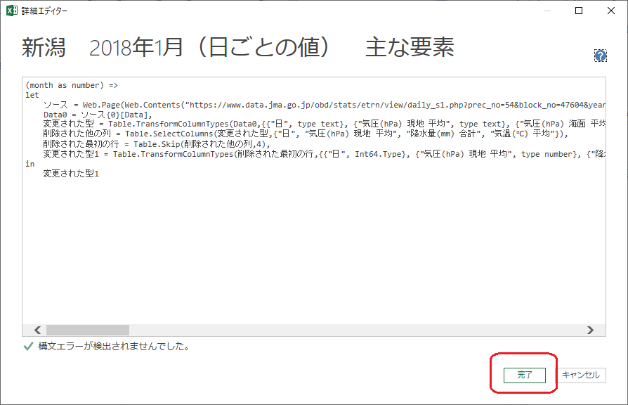

これで関数になります。

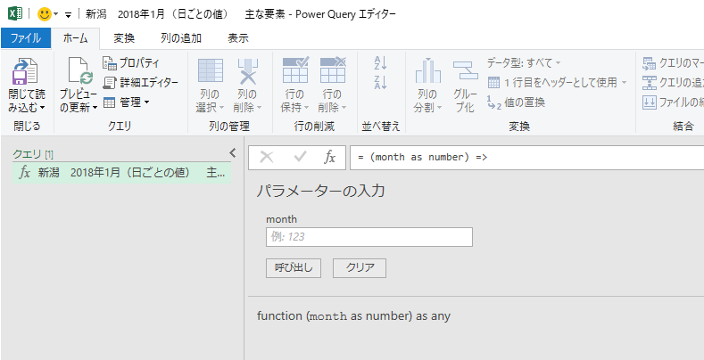

関数の名前がちょっと嫌なので変えておきます。  
ダブルクリックまたは右クリックの名前の変更で変えられます。

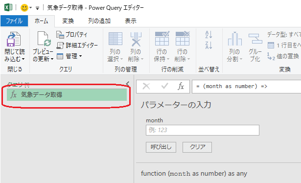

### 1から12のリストを作成する

左ペインを右クリックして[新しいクエリ]-[その他のソース]-[空のクエリ]から空のクエリを作成します。

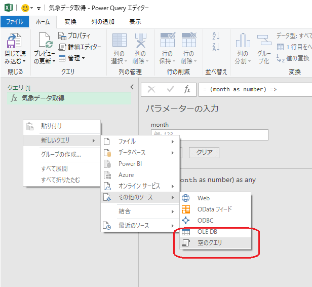

数式バーに`={1..12}`と入力すると1~12のリストが生成されます。

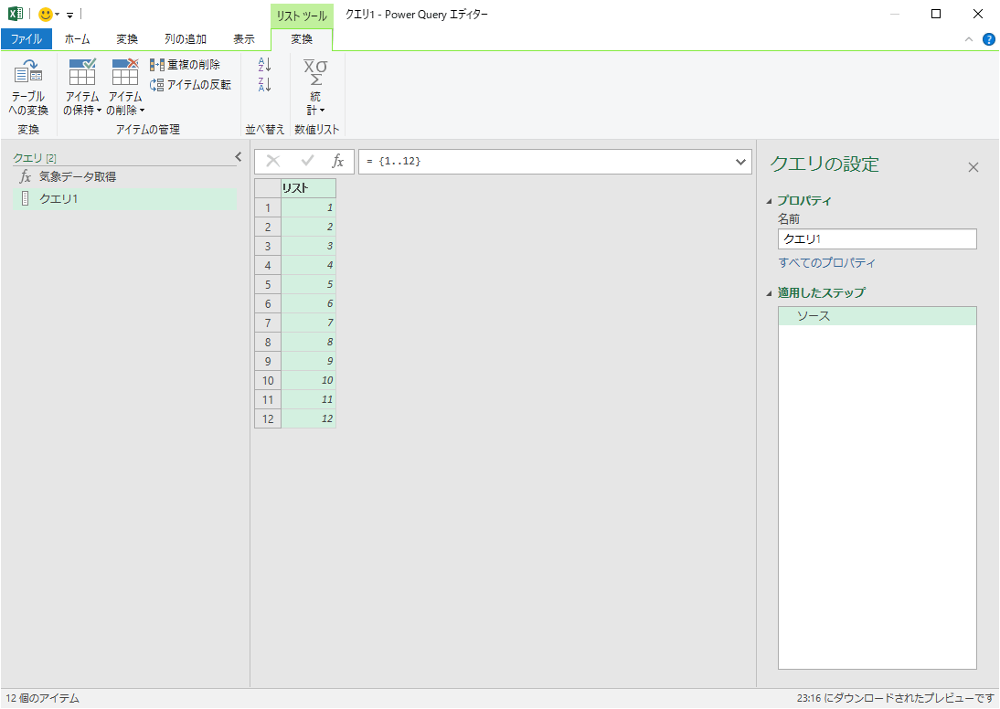

### リストをテーブルに変換する

[変換]-[テーブルへの変換]でリストからテーブルに変換しておきます。

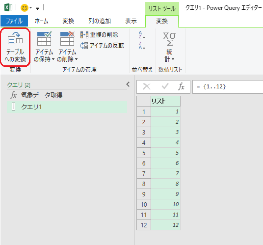

↓

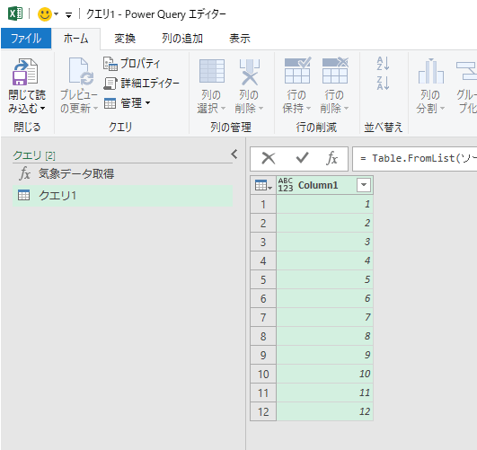

テーブルの名称を「2018年新潟市気象データ」にします。  
また、見出しのColumn1をクリックして列名も変更できます。「月」にしておきます。

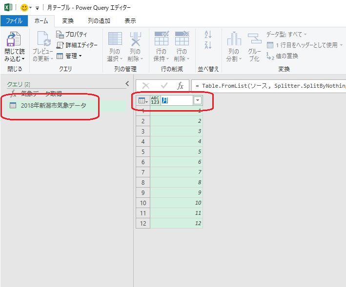

### 作成した関数を使う

先ほど作成した関数と月のテーブルを使って12か月分のデータを取得します。  
[列の追加]-[カスタム関数の呼び出し]を選択します。

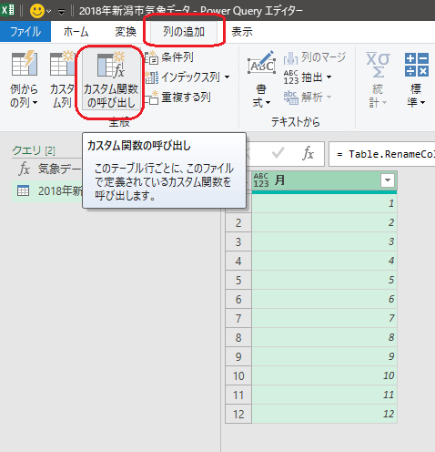

関数クエリに`気象データ取得`を選択します。パラメータは自動的に月になるはずです。

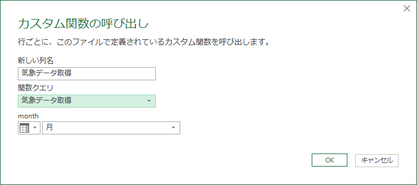

すると新たな列が追加されて各行に「Table」と表示されます。Tableと表示されたセルの空白部分をクリックするとその中身が下部に表示されます。うまく取得できているようです。

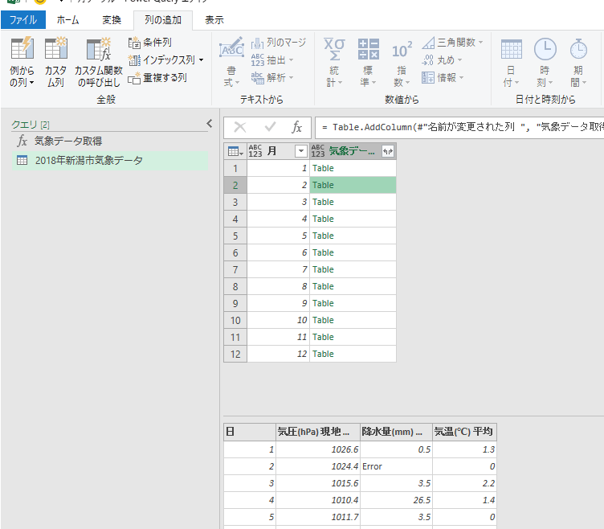

### Tableを展開する

気象データ列の見出しの右側にある展開ボタンを押してTableを展開します。  
今回は全ての列を展開するためチェックはそのままにします。「元の列名をプレフィックスとして使用します。」は無効にしておきます。  
有効にしてもよいですが列名が長くなります。

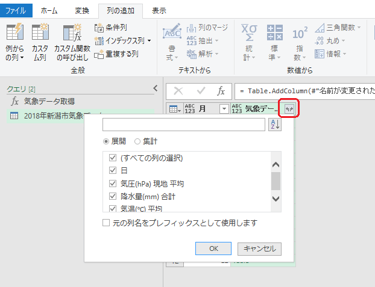

↓うまくいきましたね。

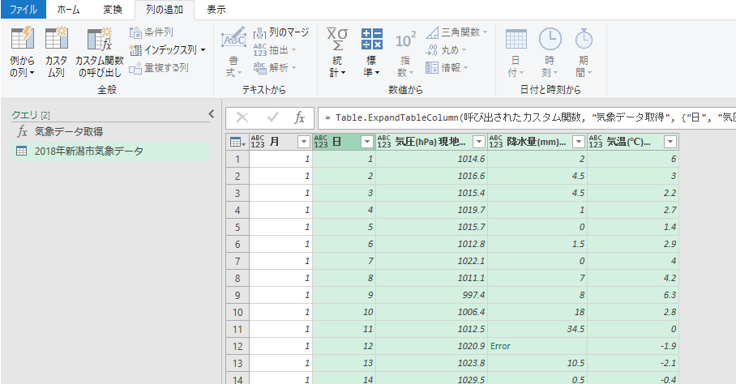

### Errorの修正

一部エラーが出ています。

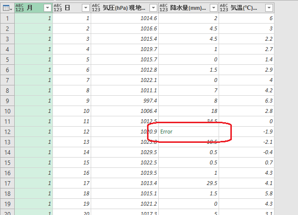

数値ではないデータがあったためです。

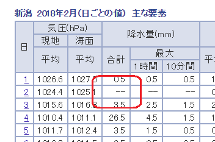

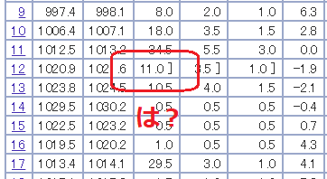

2つ目の例外はちょっと今回の話では対象外として・・・、Errorとなったところはnullにしてみます。  
エラーが出ている列を指定して[変換]-[値の置換]-[エラーの置換]を選択します。

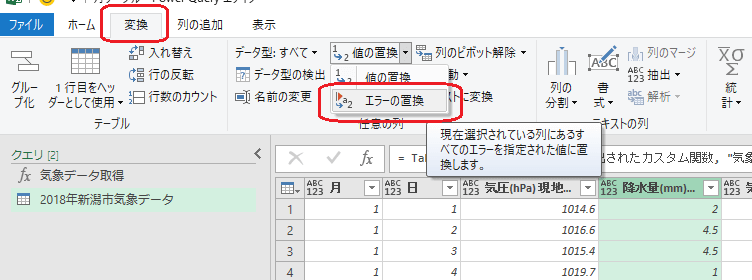

値をnullとします。

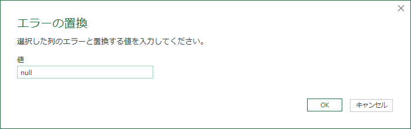

Errorがnullになりました。

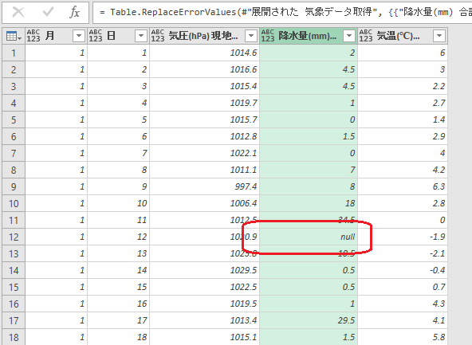

### Excelに張り付け

[閉じて読み込む]でExcelに貼り付けして出来上がりですー。

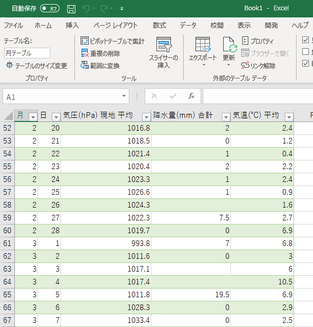

データを再取得したい場合は前述したように、表を右クリックして「更新」だけでOKです。

## ということで

ほとんどボタン操作だけでスクレイピングができてしまいましたね。  
データ整形をVBAで頑張らなくてもよいケースが増えそうで嬉しいですね。

## そのほか

- PowerQueryに慣れてきたらM言語を理解した方が効率は良いです。ボタン操作だけではできないデータ整形がいろいろできるようになります。
- スクレイピングする対象の画面数が多かったり更新頻度が多かったりすると知らぬ間に大量にアクセスすることもあります。十分注意しましょう。

