Custom Visionを勉強するために、植物の状態を判定するアプリを作ってみました。Power AppsとPower Automateのつなぎ方や、Custom Visionの使用方法まで基本的な方法が学べましたので共有します。

## こんなの作りました

植物の画像を取り込んで送信すると症状を判定してくれます。

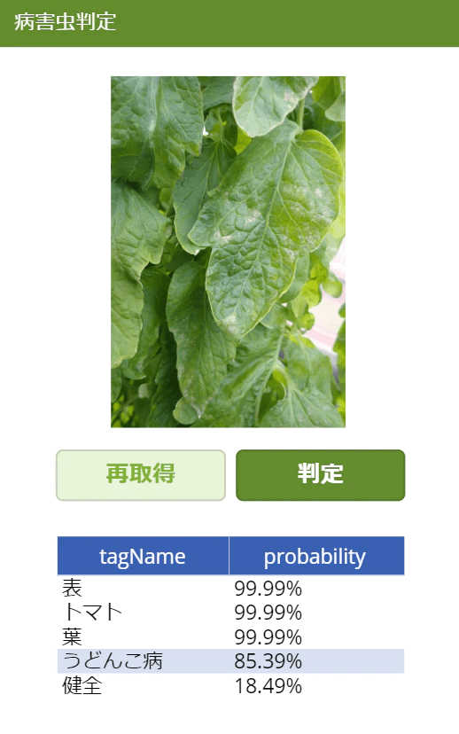

GIF

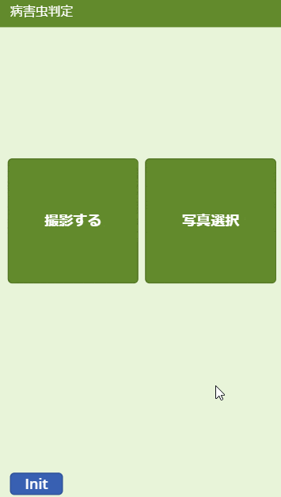

## 概要

画像選択用のアプリをPower Appsで作成し、画像の送信をPower Automateにまかせ、画像の判定をCustom Visionで行います。

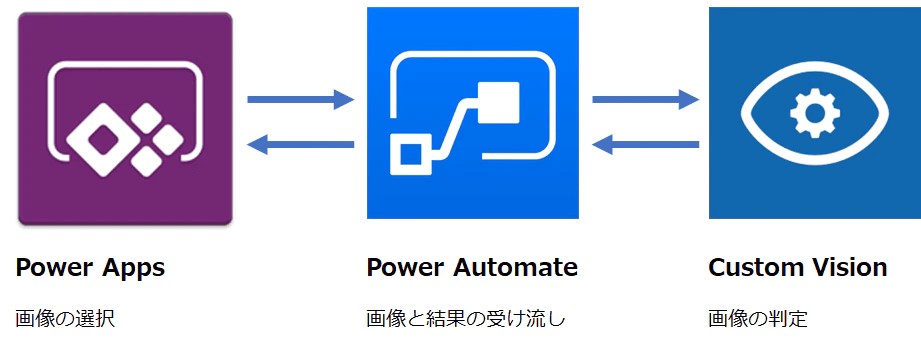

## 詳細

こちらを参考にしました。  
[Azure Custom Vision Serviceで「きのこの山」と「たけのこの里」を判別させてみる](https://azure-recipe.kc-cloud.jp/2017/12/custom_vision_2017adcal/)  
[PowerApps のカメラで撮った画像を、直接 Computer Vision API に連携する方法 (2018/8 時点)](https://blog.engineer-memo.com/2018/08/25/powerapps-%e3%81%ae%e3%82%ab%e3%83%a1%e3%83%a9%e3%81%a7%e6%92%ae%e3%81%a3%e3%81%9f%e7%94%bb%e5%83%8f%e3%82%92%e3%80%81%e7%9b%b4%e6%8e%a5-computer-vision-api-%e3%81%ab%e9%80%a3%e6%90%ba%e3%81%99/)

### Custom Visionの設定

#### 事前準備：リソースグループとリソースの作成

Azureが初めてという場合は[Portal](https://portal.azure.com/#home)でリソースグループとリソースの作成が必要になります。サブスクリプションも登録していない場合はサブスクリプションを追加してからになります。  
[Csutom Vision](https://www.customvision.ai/)のサイトからでも手順の中でリソースを作成することは出来ますが、その場合は公開するときにエラーが出る場合があります。私は出ました。そのため、**Portalからリソースグループを作成する手順をお勧めします。**

参考：[Custom Vision ProjectでエラーでPublishできないときの一つの対処法](https://protoout.studio/posts/custom-vision-project-publish-error)

まずは[Portal](https://portal.azure.com/#home)からリソースグループ一覧に遷移してグループを追加します。

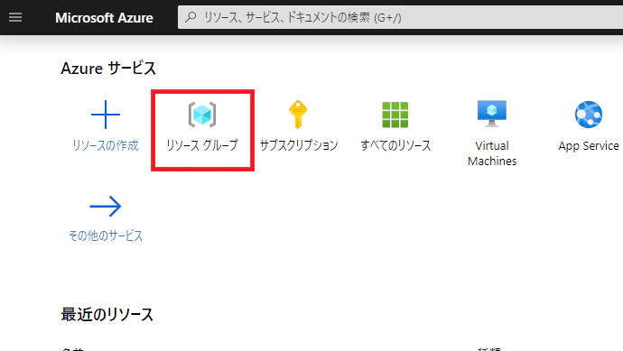

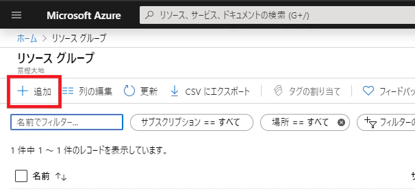

リソースグループは適宜決めます。

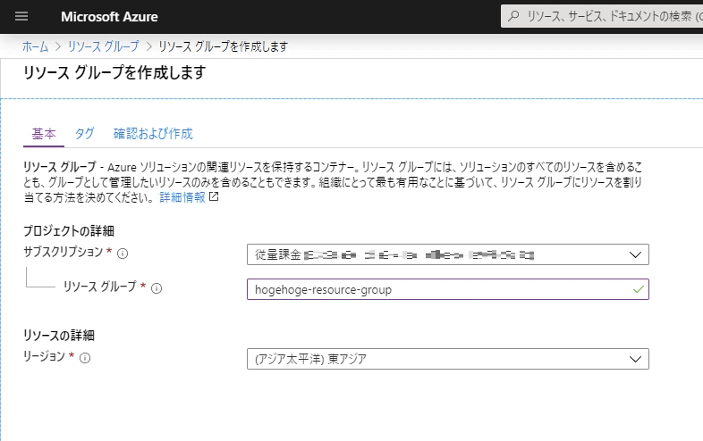

リソースグループを作ったらそのグループを選択してリソースを追加します。

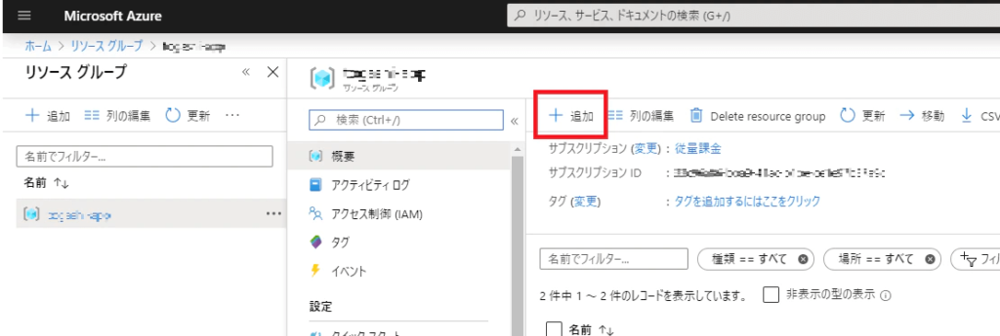

Custom Visionを検索して選択し、次ページで作成します。

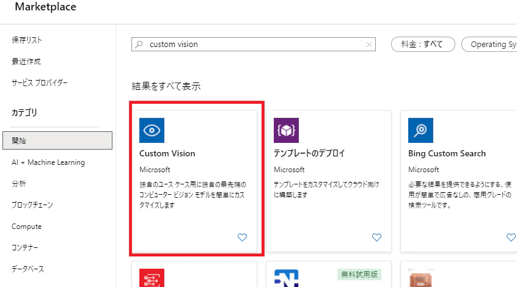

TrainingとPrediction両方作成します。Locationは揃えておきます。  
pricing tierはF0が無料プランでS0が有料プランになります。好きな方を選択します。

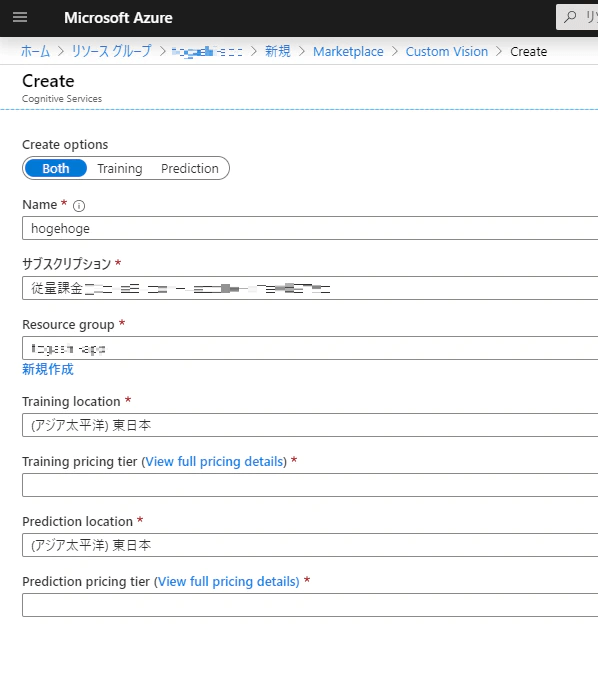

以上でリソースの準備が完了です。

#### Custom Visionに画像を登録しトレーニングする

[Csutom Vision](https://www.customvision.ai/)にて新規にプロジェクトを作成します。

Nameは適宜、Resourceには先ほど登録したリソースを指定します。  
画像全体を判定するためProject TypeはClassificationにしました。  
Domainsは適切なものが無かったのでGeneralにしました。食品の画像判定とかならFoodが良いのでしょうね。

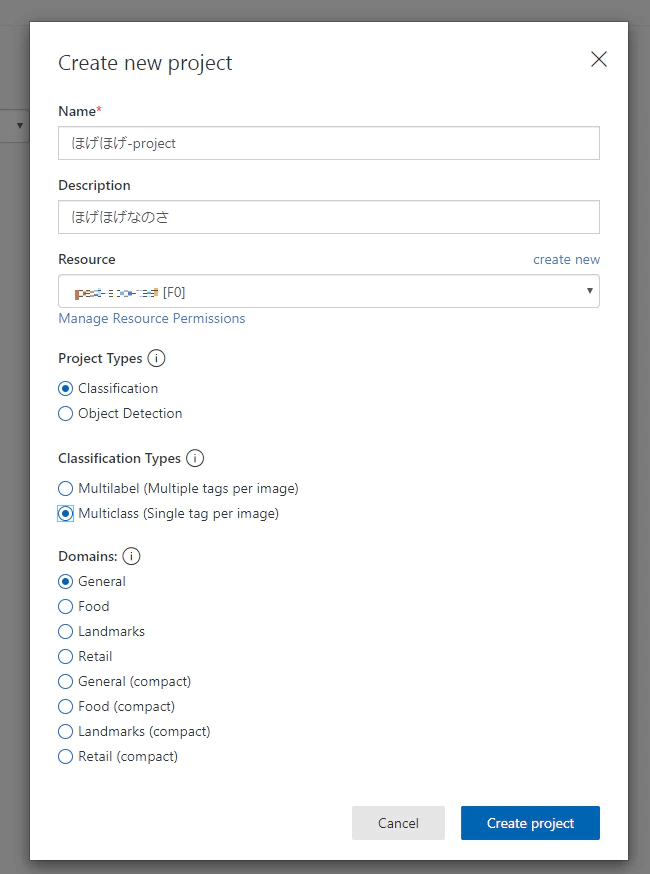

プロジェクトができたらトレーニング用の画像をどんどんアップロードします。  
その画像が何を意味するのかタグも付けていきます。

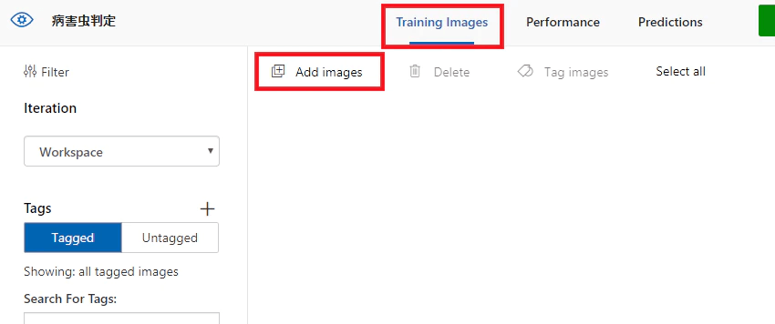

今回、画像は以下のサイトのものを利用しました。

[病害虫被害画像データベース](https://www.naro.affrc.go.jp/org/niaes/damage/#!index.md)

Trainで画像の分析を行います。

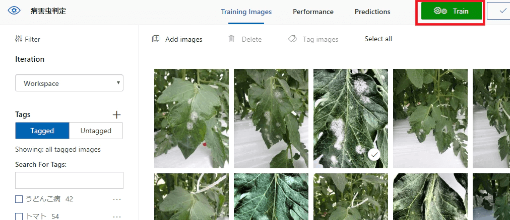

分析が完了するとPerformanceに結果が表示されます。この段階でQuick Testもできるので試してみるとよいでしょう。

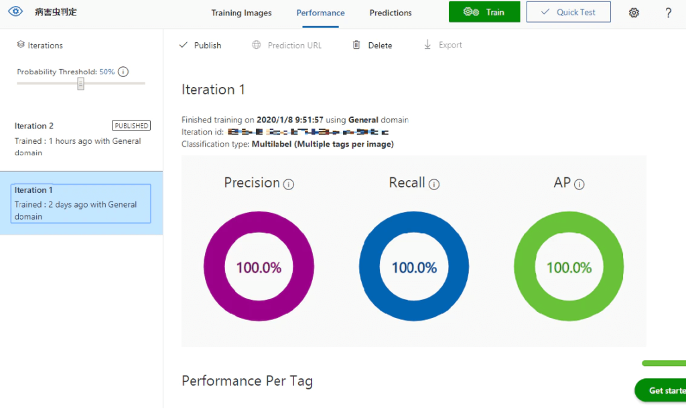

#### 公開する

最後にPublishで公開して完了です。

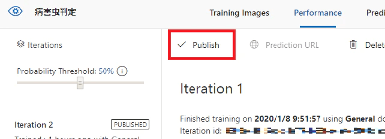

Prediction URLで情報を確認できます。  
**URLの一部とPrediction-Keyは後で使いますのでメモしておきます。**

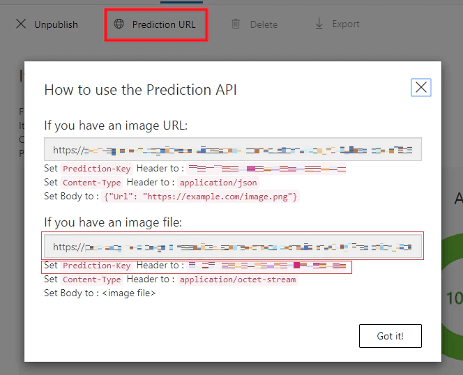

参考  
[Prediction API でモデルを使用する](https://docs.microsoft.com/ja-jp/azure/cognitive-services/custom-vision-service/use-prediction-api)

### Power Automateの設定

[Power Automate](https://japan.flow.microsoft.com/ja-jp/)にてフローを作成します。

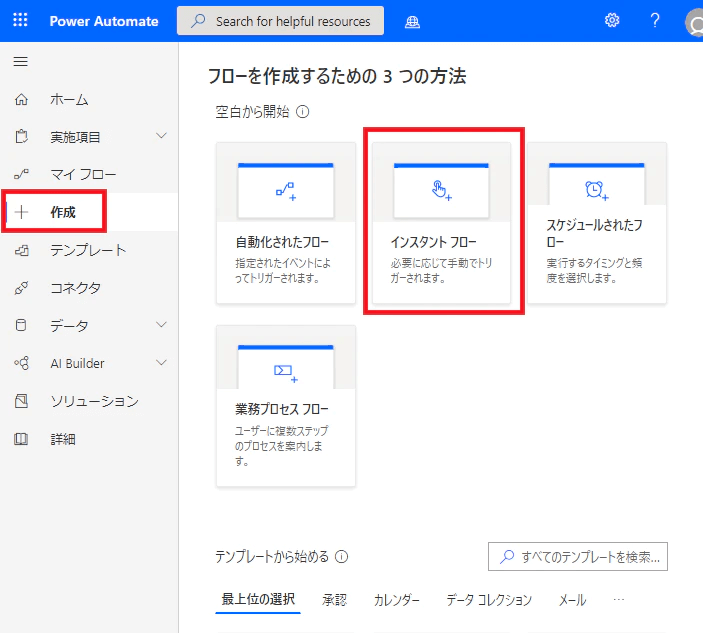

トリガーはPowerAppsとします。

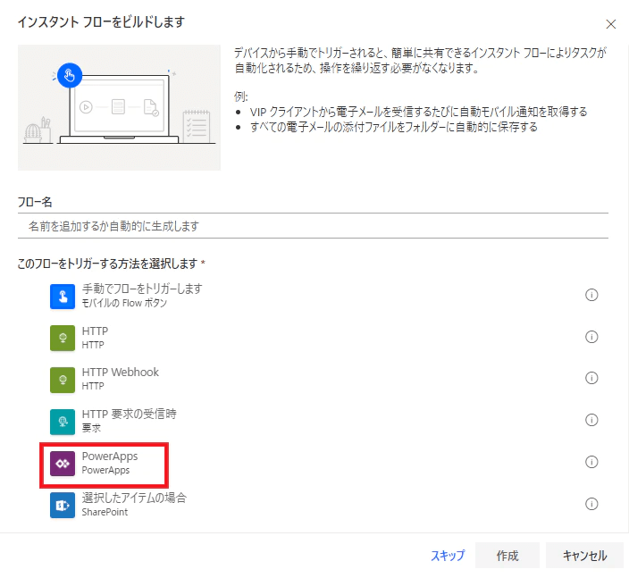

プレビュー版ではありますが、Custom Visionのアクションが用意されていますのでこれを使います。

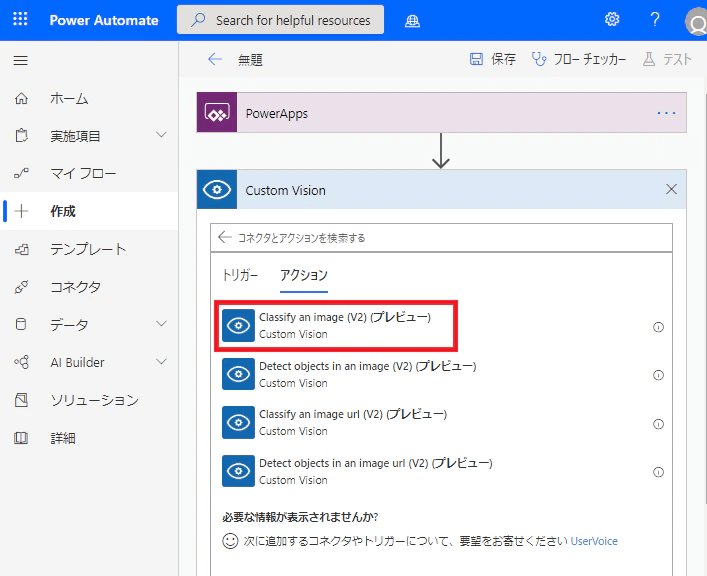

Custom Visionとの接続設定を行います。

| 項目 | 設定値 |
| --- | --- |
| **接続名** | 適当 |
| **Prediction Key** | メモしておいたKey |
| **Site URL** | メモしておいたURLのうち、`https://xxxxxxxx.cognitiveservices.azure.com/` まで |

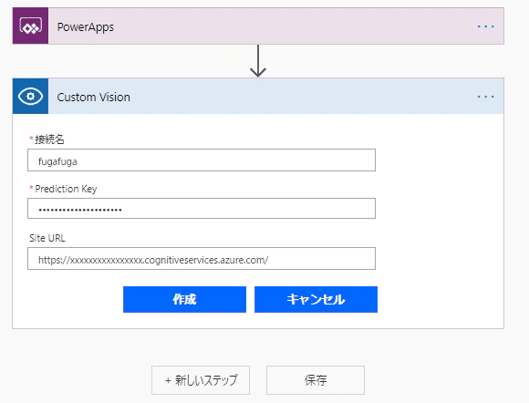

さらにProjectの設定を行います。

| 項目 | 設定値 |
| --- | --- |
| **Project ID** | メモしておいたURLのうち、Predictionの後の文字列 |
| **Published Name** | メモしておいたURLのうち、iterationsの後の文字列 |

↓URLから文字列を探してください。

```
https://xxxxx.cognitiveservices.azure.com/customvision/v3.0/Prediction/(Project Id)/classify/iterations/(Published Name)/image
```

Image Content に画像を指定するのですがPower Appsから送られてくるデータがUriになっているためBinaryに変換したものを設定します。

↓

```
dataUriToBinary(triggerBody()['Classifyanimage(V2)_ImageContent'])
```

↓こんな感じです。

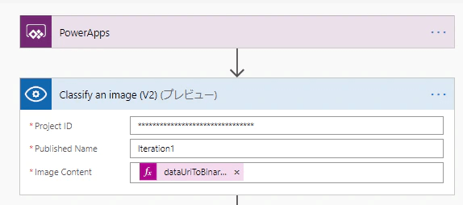

最後に応答を追加します。本文はPredictionsにします。

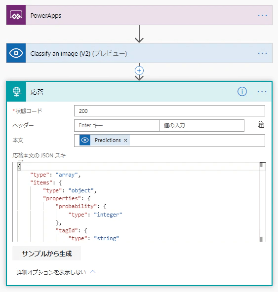

応答本文のJSONスキーマは[サンプルから生成]で簡単に入力できます、requiredの部分があると失敗するので消しておきます。

```
{
    "type": "array",
    "items": {
        "type": "object",
        "properties": {
            "probability": {
                "type": "integer"
            },
            "tagId": {
                "type": "string"
            },
            "tagName": {
                "type": "string"
            }
        }
    }
}
```

Power Automateの設定は以上です。

### Power Appsで画面作成

[Power Apps](https://powerapps.microsoft.com/ja-jp/)で画像を撮影または写真の中から選択してPower Automateに投げるところを作ります。

#### アプリを新規作成

キャンパスアプリで作ります。形式は電話にします。

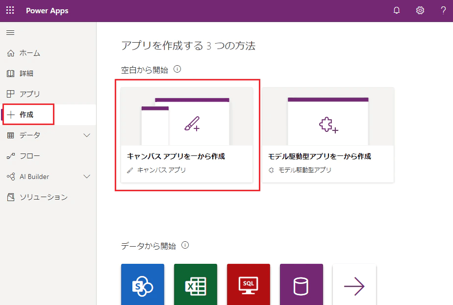

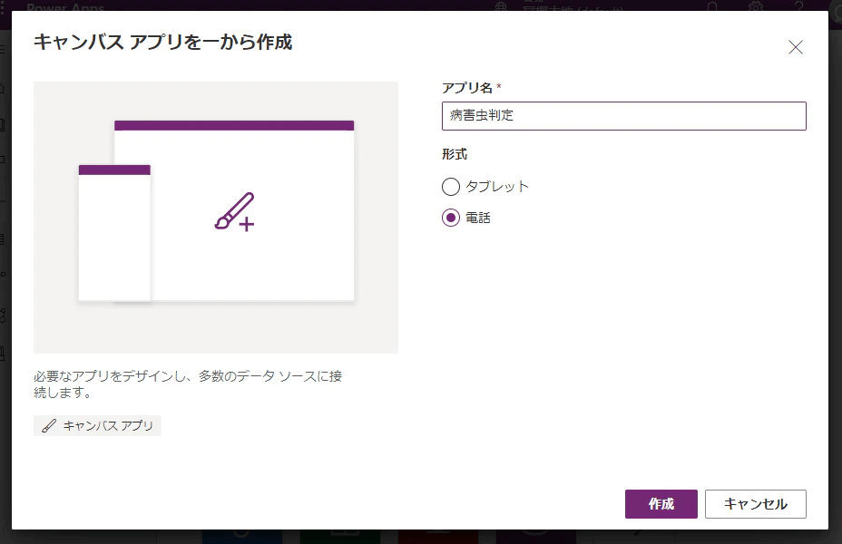

#### ボタンを配置

初期画面には撮影するためのボタンとローカルファイルを選択するためのボタンを配置します。ヘッダは省略しても問題ないです。  
[挿入]-[ボタン]から挿入できます。

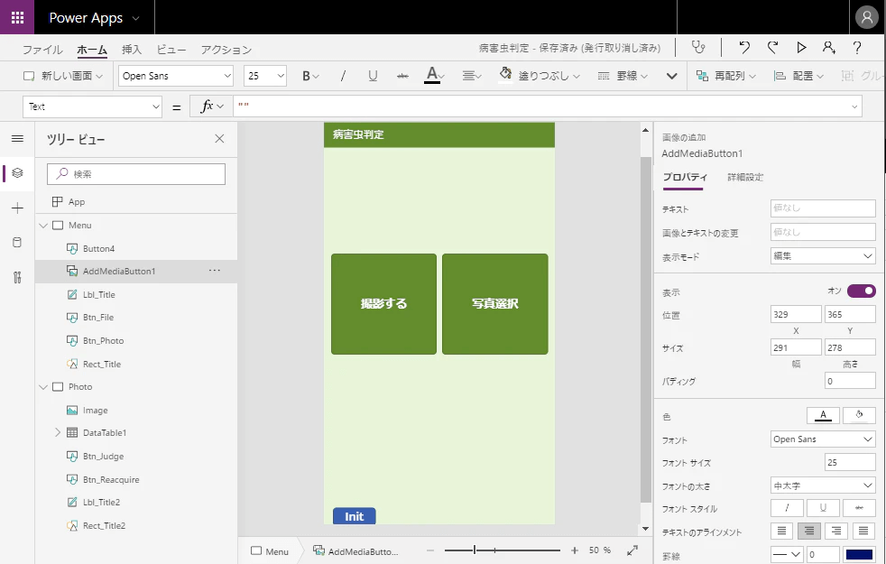

#### 写真選択ボタンの設定

ローカルファイルを選択するためのコントロールは[追加]-[メディア]-[画像の追加]で挿入できます。  
写真選択のボタンの上に重ねることでボタンのように見せかけることができます。  
[画像の追加]を挿入するとUploadImageも挿入されますが今回は不要なので削除しておきます。さらに「タップまたはクリックして画像を追加」の文字が邪魔なのでTextを空欄にします。

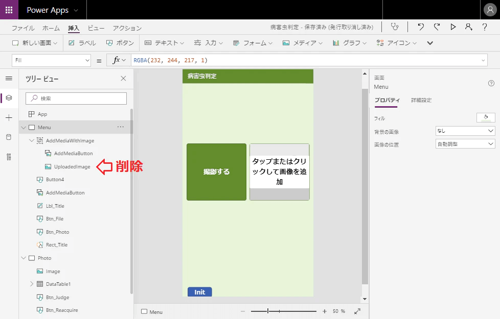

```
AddMediaButton.Text = ""
```

##### イベントの追加

写真選択後のイベントをOnChangeに指定します。  
選択した写真を一度コレクション(SelectedPic)に格納してから次画面(Photo)に遷移するようにします。

```
AddMediaButton.OnChange = ClearCollect(SelectedPic,AddMediaButton.Media);Navigate(Photo,ScreenTransition.None)
```

#### 選択画像を表示

次画面に画像を表示するコントロール(Image)を配置します。

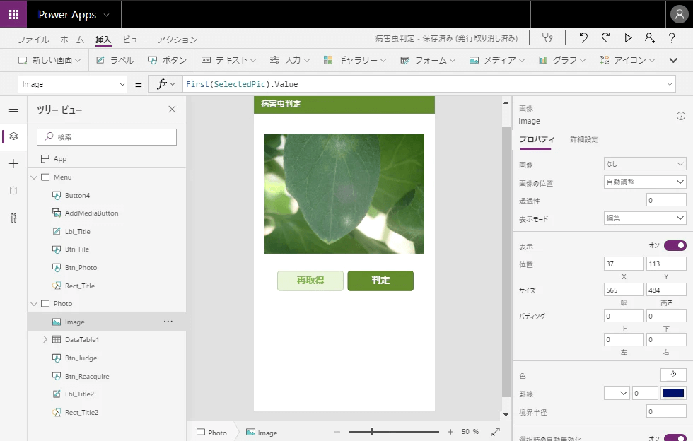

前画面で取得した画像をImageコントロールに表示させるためImageプロパティを指定します。

```
Image.Image = First(SelectedPic).Value
```

#### 判定ボタンの設置

判定用のボタン(Btn\_Judge)を配置し、OnSelectにPower Automateで作ったフローを設定します。  
[アクション]-[Power Automate]から登録できます。  
「画像の追加」で取得した画像をそのままAutomateに送ってしまうと`appres://blobmanager/`の文字列が送られてしまうため、画像そのものを送るようJSON関数をかまします。  
そして戻り値をresに格納します。

```
Btn_Judge.OnSelect = UpdateContext({imageUri:JSON(Image.Image,IncludeBinaryData)});
                     ClearCollect(res,'PowerApp->Classifyanimage(V2)'.Run(Substitute(imageUri,"""","")))
```

参考  
[#PowerApps + #PowerAutomate でSharePointライブラリへのドキュメントアップロード](https://qiita.com/h-nagao/items/c125439f78d17f8944d9)

#### 結果を表示

[挿入]-[データテーブル]で結果を表示するテーブルを追加します。

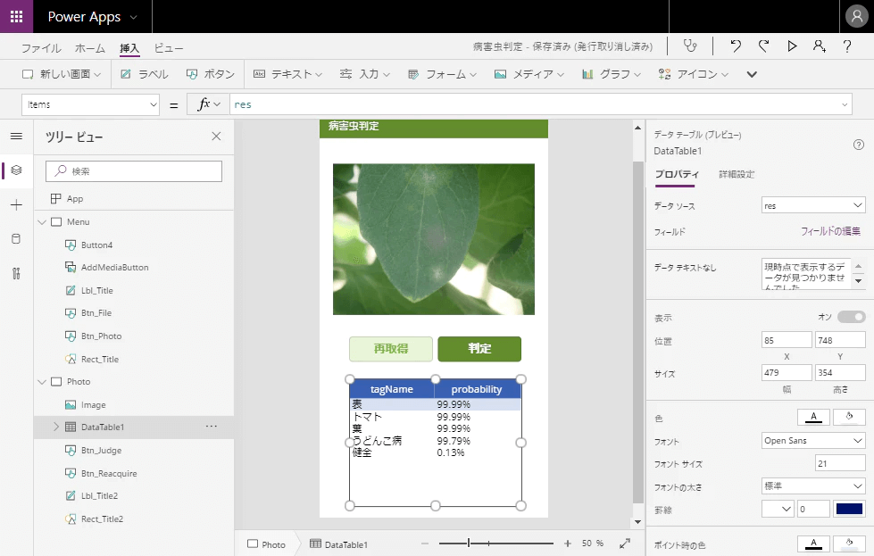

```
DataTable1.Items = res
```

**【補足】**  
判定ボタンを押した結果、「True」だけしか返ってこないケースがあります。その場合は一度Power Apps側でPower Automateとの紐づけを削除して再度登録してみてください。

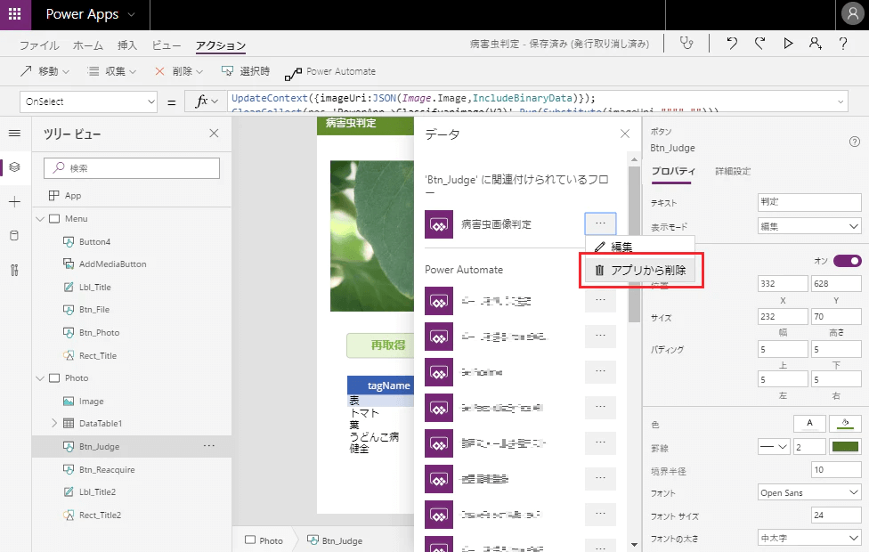

一通りの流れは以上になります。

#### 写真撮影のボタン

カメラを使って写真を撮る場合は[挿入]-[メディア]-[カメラ]を配置します。  
ここでは説明を省きますが、以下のサイトが参考になると思います。

[【PowerApps】アプリにカメラ機能を付ける。(画像の追加コントロール) | econoshift.com](https://econoshift.com/ja/powerapps-add-picture-control/)

## ということで

初めてAzureのCustom Visionに触れてみましたが、勉強しながらでも8時間程度でここまでできてしまいました。画像認識のロジックなど裏側がどうなっているか知らなくても直ぐに簡単に利用できるって素晴らしいですね。

https://amzn.to/36qXn2B
