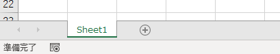
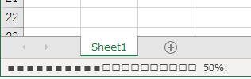

ExcelのVBAで自動的に処理を実行していると、Excelが固まったように見えて処理が動いているのか止まっているのか分からなくなることがあります。そういったときはプログレスバーを表示すると動いているかどうかすぐにわかります。
そこで簡易なものではありますがプログレスバーを表示できるクラスを作成したので公開しておきます。
https://github.com/tomikiya/excel\_progressbar\_class
Progressbar.clsをダウンロードしてインポートしてみてください。

# イメージ

ステータスバーに簡易的なプログレスバーを表示します。


# 使い方

インスタンスを生成して、ProgressValueを指定します。それだけでプログレスバーが表示されます。

```
Public Sub Sample1()
    Dim prg As Progressbar
    Set prg = New Progressbar
    
    prg.ProgressValue = 50
End Sub
```

↓実行結果

プログレスバーを動いているように見せたいときはProgressValueを少しずつ変化させてください。

```
Private Declare Sub Sleep Lib "kernel32" (ByVal ms As Long)

Public Sub RunProgressbar()
    Dim prg As Progressbar
    Set prg = New Progressbar
    
    Dim i As Long
    For i = 0 To 100
        prg.ProgressValue = i
        Sleep 20
    Next i

End Sub
```

↓実行結果


# 詳細

変数やメソッドの詳細です。

| 変数 メソッド | 説明 |
| --- | --- |
| Init | プログレスバーを初期化する。 |
| Comment | プログレスバーにコメントを表示する。 |
| ProgressLength | プログレスバーに見立てている四角の数を設定する。デフォルトは20。1～100を設定できる。 |
| ProgressMax | プログレスバーの最大値を設定する。デフォルトは100。0以上を設定できる。 |
| ProgressValue | プログレスバーの現在の値を設定する。デフォルトは0 |

ユーザフォームを使ってプログレスバーを作ってもよいですがそこまでせずもっとお手軽に使いたい時に重宝します。
お試しください。
