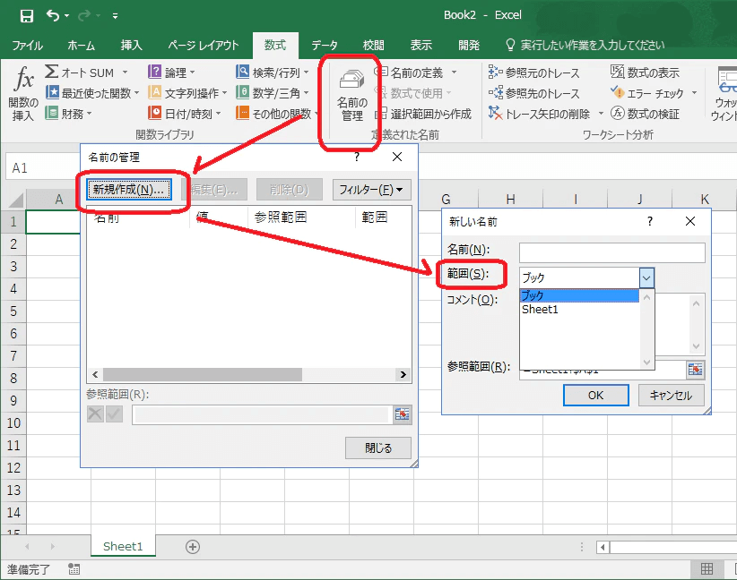
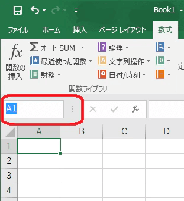
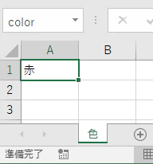
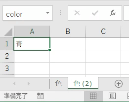
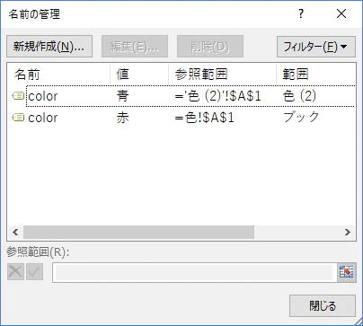
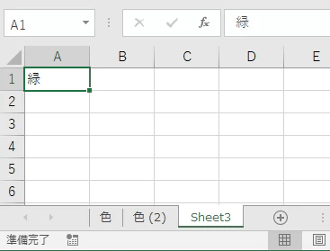

VBAでセルから値を取り出すときには名前定義が便利でよく使わせていただいております。  
ただ、名前定義には落とし穴がいくつかあるので知っている範囲で共有します。

### 名前定義とは

[Microsoft 数式で名前を定義し使用する](https://support.office.com/ja-jp/article/%E6%95%B0%E5%BC%8F%E3%81%A7%E5%90%8D%E5%89%8D%E3%82%92%E5%AE%9A%E7%BE%A9%E3%81%97%E4%BD%BF%E7%94%A8%E3%81%99%E3%82%8B-4d0f13ac-53b7-422e-afd2-abd7ff379c64)

簡単に言えば、セルに変数名をつける機能です。  
いつもは「=A1」のようにセル番地を指定していますが、名前を付けると「=タイトル」のような書き方もできるようになります。  
ライトユーザにはそれほど恩恵はありませんが、VBAを使う方にとっては重宝します。また名前定義には式も指定できるので複雑で長い式をコンパクトにすることができます。

```
'サンプル
'名前定義使わない書き方
msgbox Range("A1").value
'名前定義使う書き方
msgbox Range("empNo").value
```

何を取得しているか明確になることも大きいですが、一番の効果は「**列や行を追加・削除してもコードの修正が不要**」ではないでしょうか。  
A1と書いてしまうと列を増やした途端にB1などに毎回書き換えないといけないですよね。大変です。

### VBAでの使い方

今回は参照メインで書きます。  
名前定義で参照する方法は主に２つあります。

```
'サンプル
'取り出し方1: Rangeを使う
msgbox Range("hoge").value
'取り出し方2: Namesプロパティを使う
msgbox Names("hoge").RefersToRange.Value
```

ただ、この取り出し方ですが実はいろいろと罠が仕込まれています。  
ケースによっては思いもよらないものを持ってきます。

例を紹介する前に前提知識が必要です。

### 前提：「ブック」の名前定義と「シート」の名前定義がある

名前の管理で名前定義をつける時に「範囲」という項目があります。



ここでブックとシート名を選択するのですがこの指定によって参照できないケースが発生します。

「ブック」と「シート」の違いは、私の中では完全に「**Public変数とPrivate変数の違い**」として捉えています。  
「ブック」に指定するとどこからでも参照できますが、「シート」に指定すると厳密に指定しないと使えなくなります。  
上記に記述した[取り出し方1]のような記述だと「シート」に指定した名前定義を他のシートから使えなくなります。  
厳密に書かないといけません。

```
'範囲が「シート」の名前定義を使う例
'取り出し方3: Worksheetを指定する
msgbox Worksheets("Sheet1").Range("hoge").value
'取り出し方4: Worksheetをアクティブにする
Worksheets("Sheet1").select
msgbox Range("hoge").value
```

この前提があった上でエクセルの仕様に翻弄されることになります。

### 名前ボックスから登録すると範囲が「ブック」になる

名前ボックスは↓ここです。



ここに名前を入れてEnterすると範囲が「ブック」の名前定義として登録されます。

### 名前定義が登録されているワークシートをコピーすると、コピー先の名前定義は範囲が「シート」になる。

Public変数で同じ変数名が使用できないのと同様に、ワークシートをコピーすると名前が重複するわけですからそれを回避するため、コピー先は「シート」の名前定義として登録されます。

これが結構な曲者です。

ワークシートをコピーして使いまわすケースはよくありますが、コピー元だけ「ブック」として登録されているかもしれません。  
VBAの書き方が悪いとユーザの操作によってはエラーが起こります。

### 「シート」として登録された名前定義が優先される。

**例１**：

ワークシート「色」のA1にcolorという名前定義（範囲が「ブック」扱い）をつけます。値は赤にします。



ワークシートをコピーして「色(2)」を作ります。A1の値は青にします。



色(2)のA1に登録されているcolorは前述したとおり範囲が「シート」として登録されます。



ワークシート(Sheet3)を挿入します。A1の値は緑にします。名前定義は登録しません。



この状態での挙動は以下の通りとなります。

```
'取り出し方5: 「色」をアクティブにする
Worksheets("色").select
msgbox Range("color").value   ' = 赤
'取り出し方6: 「色(2)」をアクティブにする
Worksheets("色(2)").select
msgbox Range("color").value   ' = 青
'取り出し方7: 「Sheet3」をアクティブにする
Worksheets("Sheet3").select
msgbox Range("color").value   ' = 赤
```

範囲が「シート」の名前定義が登録されているワークシート「色(2)」をアクティブにした時のみ青が表示されました。「シート」の名前定義を優先して取得していることが分かります。  
また、１つのワークシートに「ブック」と「シート」の名前定義を同時に登録することもできますが、その時は「シート」の値を持ってきます。

### Namesプロパティでの参照は不明な動きをする。

**例２**：

例1と同じように3つのシートを作成します。ただしシートの順番を入れ替えて実験します。

- 例1と同じように3つのワークシートを作成する。
  - 色：　A1にブックの名前定義、値は「赤」
  - 色(2)：　A1にシートの名前定義、値は「青」
  - Sheet3：　名前定義なし、A1の値は「緑」
- 一番右のワークシートをアクティブにする
- ワークシートの順番を変更して下記を実行

```
msgbox Names("color").RefersToRange.Value
```

結果

| 順番 | 結果 |
| --- | --- |
| 色、色(2)、Sheet3 | 赤 |
| 色、Sheet3、色(2) | 赤 |
| 色(2)、色、Sheet3 | 青 |
| 色(2)、Sheet3、色 | 青 |
| Sheet3、色、色(2) | 赤 |
| Sheet3、色(2)、色 | 赤 |

Namesだと「シート」の名前定義のあるワークシート「色(2)」を選択しているかどうかに関わらず「ブック」の名前定義を持ってきています。しかし、一番左のワークシートに名前定義があったらそのワークシートの名前を見ている感じがします。  
正直、よくわかりません。

Rangeで取得した結果も並べてみました。Rangeの方が「アクティブになっているワークシートの名前定義」を参照しているのでまだ素直な気がします。

```
msgbox Range("color").Value
```

| ワークシートの順番 | Names | Range |
| --- | --- | --- |
| 色、色(2)、Sheet3 | 赤 | 赤 |
| 色、Sheet3、色(2) | 赤 | 青 |
| 色(2)、色、Sheet3 | 青 | 赤 |
| 色(2)、Sheet3、色 | 青 | 赤 |
| Sheet3、色、色(2) | 赤 | 青 |
| Sheet3、色(2)、色 | 赤 | 赤 |

### で、どうすればよいのか

名前定義があるワークシートをコピーする運用の場合は、基本的に「シート」の名前定義を使用し、参照時には**厳密にワークシートを指定してRangeで参照する**のがよいのではないでしょうか。（取り出し方3や4参照）

Namesはちょっと予測ができないので個人的には使用を控えたいところです。

### ということで

名前定義は非常に便利ですが何も考えず利用すると予想外の動きをする時があります。十分にテストを行いましょう。
