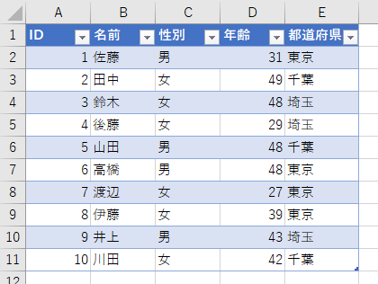
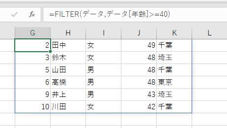
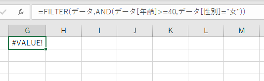
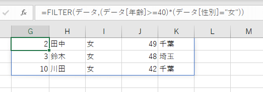
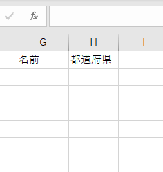
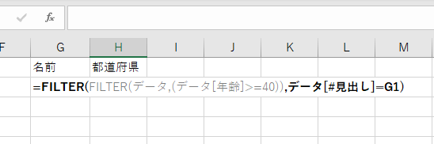
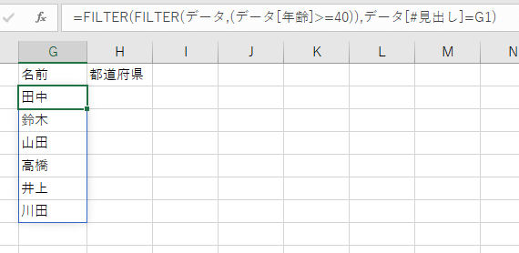
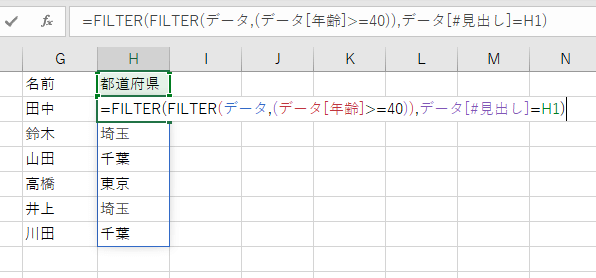

Office365ユーザに順次提供されている新関数の1つ[FILTER関数](https://support.office.com/ja-jp/article/filter-%E9%96%A2%E6%95%B0-f4f7cb66-82eb-4767-8f7c-4877ad80c759)の基本的な使い方を説明します。

## FILTER関数 とは

指定した条件を満たすデータをフィルタして表示します。VLOOKUPやXLOOKUPとは異なり、条件を満たすデータが複数あれば全て表示します。  
例えば下のデータをもとに「年齢が40歳以上のデータ」を抽出したい場合、



式を

```
= FILTER(データ,データ[年齢]>=40)
```

とすると40歳以上のデータを表示してくれます。

↓結果



## 条件を複数指定するには

複数の条件を指定したい場合は通常、AND関数やOR関数を使いますが、FILTER関数で使うと思い通りの結果にはなりません。エラーが表示されます。

↓年齢が40歳以上で性別が女性をフィルタしてみた結果



**そこで使うのが「+」と「\*」です。**「+」はORと同等、「\*」がANDと同等の判定をしてくれます。  
式は以下のように書き換えられます。

```
' ANDは「*」で書き換える
= AND(データ[年齢]>=40,データ[性別]="女")
↓
= (データ[年齢]>=40)*(データ[性別]="女")

' ORは「+」で書き換える
= OR(データ[都道府県]>="東京",データ[都道府県]="千葉")
↓
= (データ[都道府県]>="東京")+(データ[都道府県]="千葉")
```

先ほどANDでエラーが出ていた式を「\*」に書き換えたことで想定通りの結果が返ってきました。

```
'年齢が40歳以上で性別が女性を抽出する
=FILTER(データ,(データ[年齢]>=40)*(データ[性別]="女"))
```

↓



**注意点として、条件は必ず括弧でくくりましょう。**`条件1*条件2`という書き方だとエラーが出来ます。`(条件1)*(条件2)`と書きましょう。

## 指定した列だけ抽出するには

FILTER関数の特性上、すべての列のデータが抽出されます。しかし不要な情報を表示したくないケースは必ずあります。  
そこで指定した列のみ抽出してみます。

方針はこうです。

- まずはレコードをフィルターする
- さらに列名をフィルターする

ではやってみましょう。事前準備として抽出したい列名を書き込んでおきます。



そうしたら前述した式のようにレコードをフィルターし、その結果を更に見出しでフィルタします。つまり1つの式でFILTERを2回使います。



```
=FILTER(FILTER(データ,(データ[年齢]>=40)),データ[#見出し]=G1)
```

すると見出しに指定した列だけ表示されます。



今回の式は「名前」列だけ抽出する式になります。「都道府県」列までは抽出しません。

都道府県は式をコピペすれば表示されます。



## ということで

新しく追加されたFILTER関数、使う場面は今後増えてくると思います。基本的な方法を抑えてぜひ使ってみてください。もちろん、FILTERが使えないバージョンもありますので考慮しましょう。
