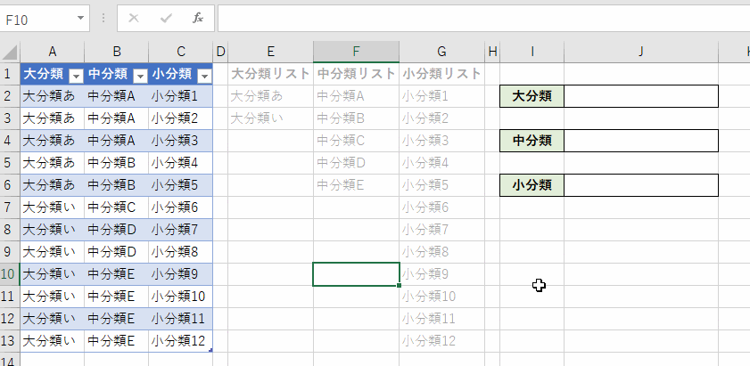
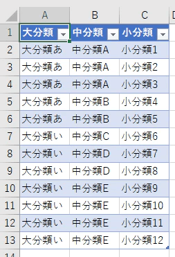
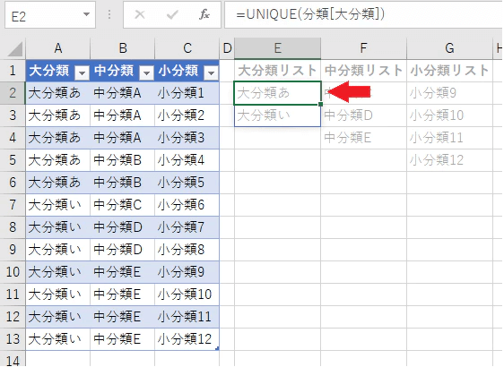
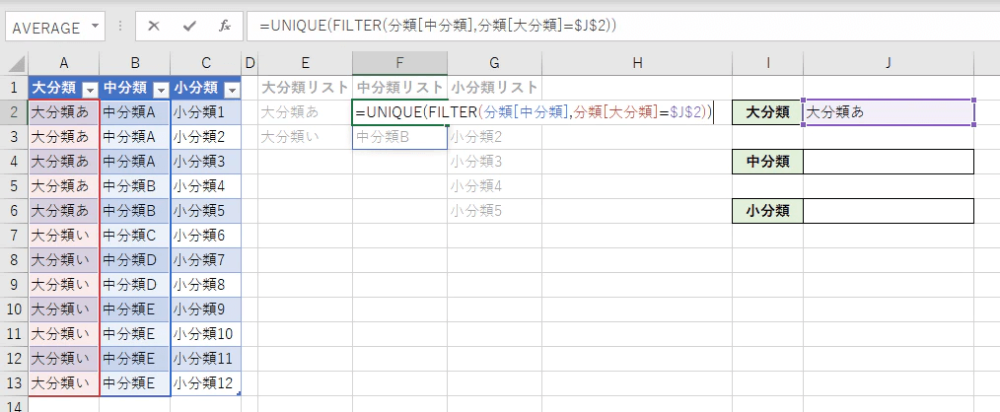
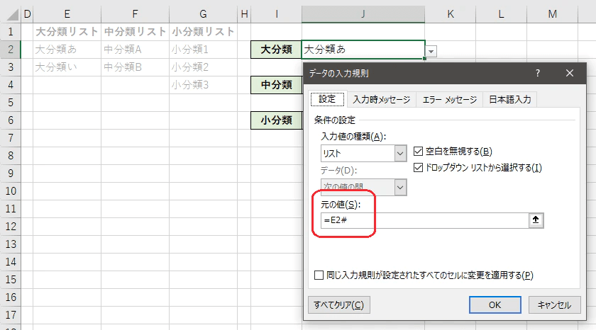

スピル機能を使用して動的なリストを生成する方法です。

スピル機能を使わないで連動させたい場合はこちらをご確認ください。

https://papasensei365.com/excel-linking-the-three-lists/?preview=true&\_thumbnail\_id=391

このようなリストを作れます。



## スピル機能とは

スプレッドシートでのARRAYFORMULA関数やQUERY関数に近い概念で、1つのセルの中で計算した結果において複数の値が返ってくると、隣接する他のセルに値が展開されて表示される機能です。Office 365 にて順次使えるようになっています。  
配列数式に近い概念ですが配列数式よりも使い勝手がよくなり応用が利くようになっていると感じています。  
詳しくは以下を参照してください。

[動的配列とスピル配列の動作](https://support.office.com/ja-jp/article/%E5%8B%95%E7%9A%84%E9%85%8D%E5%88%97%E3%81%A8%E3%82%B9%E3%83%94%E3%83%AB%E9%85%8D%E5%88%97%E3%81%AE%E5%8B%95%E4%BD%9C-205c6b06-03ba-4151-89a1-87a7eb36e531)

## 作り方

まずは元となるリストのデータを作成します。  
以下のようにデータ形式のテーブルを用意します。  
※テーブル名は分類にしています。



### UNIQUE関数で重複データを消す

[UNIQUE関数](https://support.office.com/ja-jp/article/unique-%E9%96%A2%E6%95%B0-c5ab87fd-30a3-4ce9-9d1a-40204fb85e1e)は重複データを削除してくれます。  
例えば、大分類のリストを作る時は、

```
大分類のリスト =UNIQUE(分類[大分類])
```

とするだけです。



### FILTER関数で絞り込み

中分類以降は上位の分類でリストを変動させたいので[FILTER関数](https://support.office.com/ja-jp/article/filter-%E9%96%A2%E6%95%B0-f4f7cb66-82eb-4767-8f7c-4877ad80c759)を使います。  
第1引数に表示したい列、第2引数に条件をいれます。  
最後にUNIQUEで囲って重複を消して出来上がりです。

```
中分類のリスト =UNIQUE(FILTER(分類[中分類],分類[大分類]=$J$2))
```



小分類も同様に中分類でFILTERを書けます。

```
小分類のリスト =UNIQUE(FILTER(分類[小分類],分類[中分類]=$J$4))
```

これで動的に変更するリストが出来上がります。  
今回は省略しましたが、FILTER関数は第3引数で条件に合わなかった場合の処理も書けます。エラー回避したい場合は設定しましょう。  
また、複雑にはなりますが小分類を先に指定すると大分類や中分類のリストが変わるような仕組みも作れます。

### 入力規則に登録

各分類のリストを入力規則の登録します。  
スピル機能で生成されたリストを参照する場合は**式の入ったセルを指定し最後に#を付けます**。

↓大分類のリストを指定する場合のイメージ



## そのほか

スピル機能はまだ一部のバージョンでしか使用できないので活用する場合は利用環境をよく確かめてくださいませ。

## ということで

スピル機能は出たばかりでまだまだ掘り下げられていないです。様々な利用シーンがありそうで楽しいですね。使える方は遊んでみてください。
