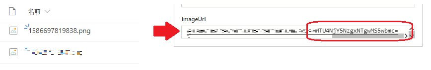
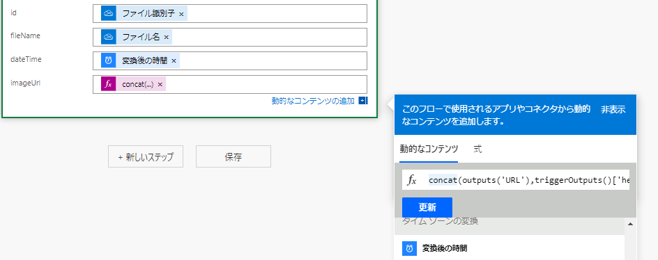
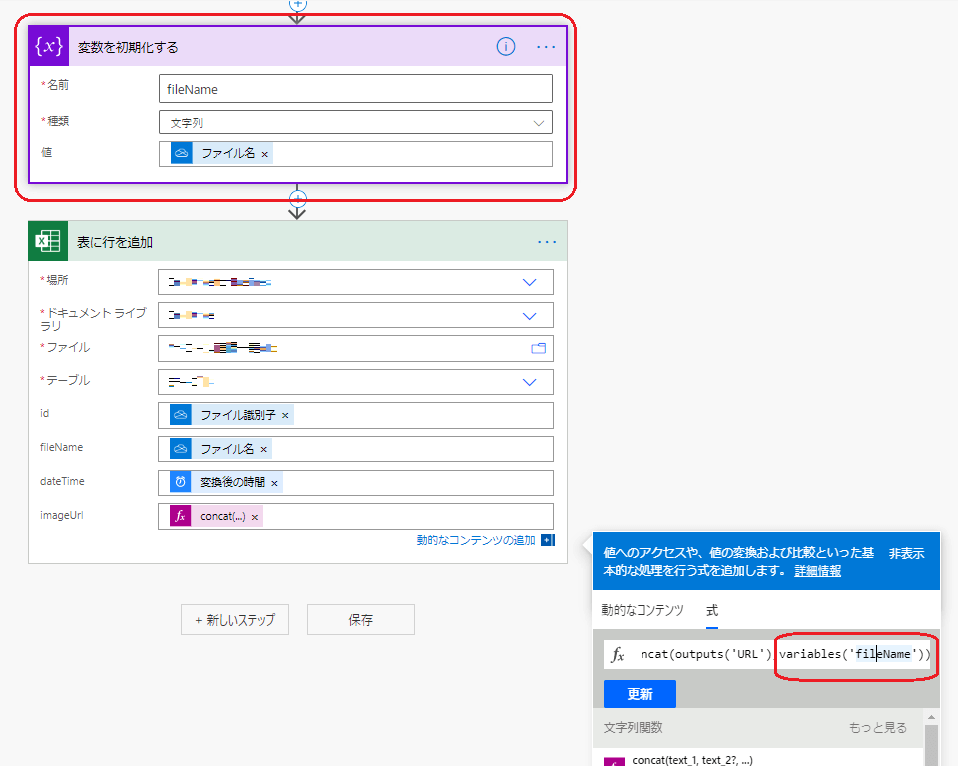
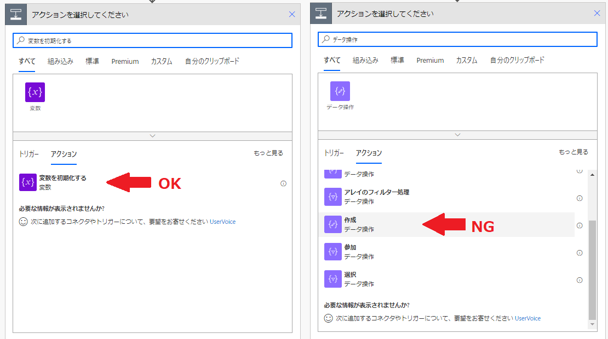

Power AutomateでOneDriveからファイルを取得してファイル名を利用するとき、なぜかファイル名が文字化けする現象があり解決しましたので共有します。
## どんなことが起こった？

OneDriveから取得したファイルのファイル名を取り出してURLを作ろうとしたのですが、出力結果が何故か文字化けを起こしていました。
↓こちらがイメージなのです。ファイル名が数字だけです。しかしファイル名をそのままURLにくっつけたはずが後半の文字列がファイル名でなく、ランダムな文字列になって出力されてしまいました。

実際どういったフローを書いたかというと、取得したファイルのファイル名とURLの固定文字列を結合したものを出力に指定していました。
↓これがimageURLの欄です。

画像だと式が途中で切れていますが、関数はこんな感じです。

```
concat(outputs('URL'),triggerOutputs()['headers']['x-ms-file-name-encoded'])
```

triggerOutputs移行がファイル名に当たる所です。
いろいろと試行錯誤して分かったのですが、concatしないと文字化けせず出力することを確認しました。
どうやら動的な式を介すると文字化けするようです。

## 回避するには変数を経由して指定しよう

URLを作り出す必要があるので動的な式を介入しないといけません。そこでまた試行錯誤してみました。そうしたら「直接ファイル名を指定せずに変数を経由すると文字化けしない」ようでした。
ひと手間増えますが、変数に代入するアクションを増やします。

途中に変数のアクションを追加して書き直した式はこんな感じです。
↓

```
concat(outputs('URL'),variables('fileName'))
```

これで文字化けせずにファイル名とURLを結合できました。

### 注意点

変数に代入するアクションは「変数を初期化する」を使ってください。データ操作の「作成」では解決せずやっぱり文字化けしてしまいます。


#### 「変数を初期化」と「データ操作の作成」の違いとは

「データ操作の作成」で生成される変数は固定値です。一度指定したら変更できません。「変数を初期化する」で生成した変数は中身を変更できる変数です。
今回のフローではファイル名を変更するシナリオはありませんが、「データ操作の作成」ではうまく回避できないので「変数を初期化する」を使います。

## ということで

これは仕様なの？と思った出来事でした。いつか修正されるかもしれませんがもし困っている方がいたら試してみてください。もしもっと良い方法があればアドバイスいただけますと幸いです。
