データを集計してほしいと言われてもらったものが表だった時にExcelでデータに変換する方法になります。  
これまでVBAでゴリゴリ頑張っていた部分がプログラミング無しで出来るのは非常にありがたいです。

## 方法

PowerQueryを使います。PowerQueryについては詳しく書いている方がいらっしゃったので省略します。  
[ExcelでPowerQueryを使ってデータ収集分析](https://qiita.com/mosugi/items/71df310b35db81722d1e)

## やりたいこと

以下のような表をもらったときに、

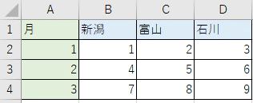

このようなデータを作りたいです。

## やり方

表を選択し、「データ」タブの「テーブルまたは範囲から」を選択します。

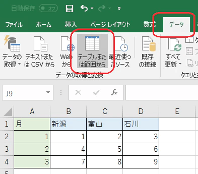

「テーブルの作成」のダイアログが出てくるので、データ範囲が間違っていないか確認しOKを選択します。

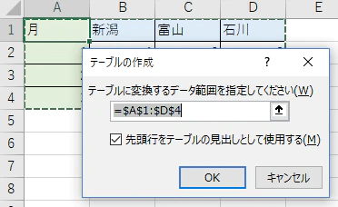

するとPowerQueryのクエリエディターが立ち上がります。

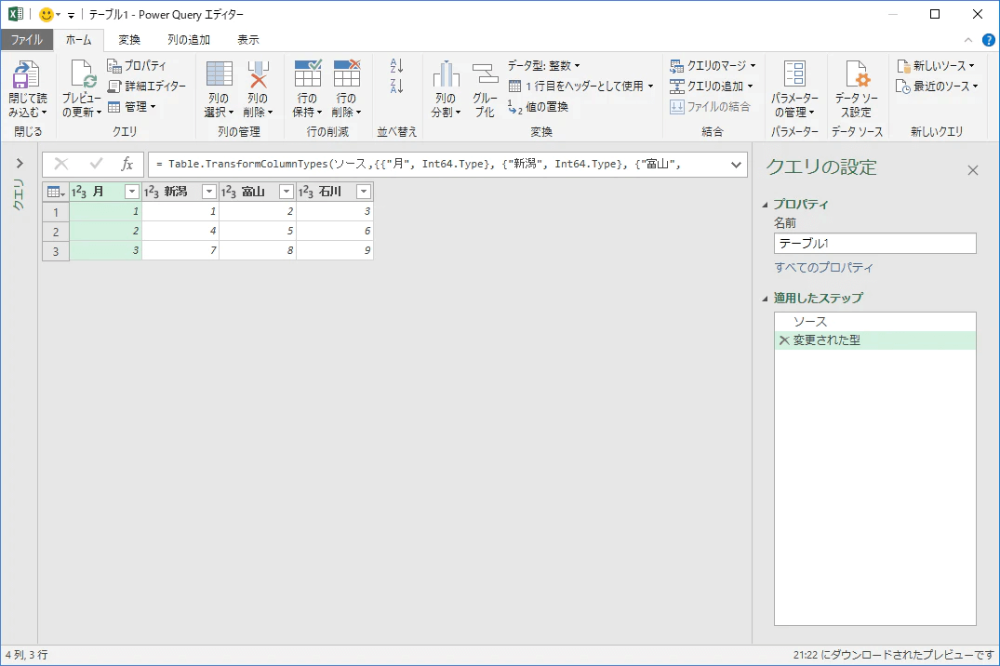

新潟、富山、石川の列を選択して「変換」タブの「列のピボット解除」を選択します。  
月の列を選択して「その他の列のピボット解除」でもOKです。

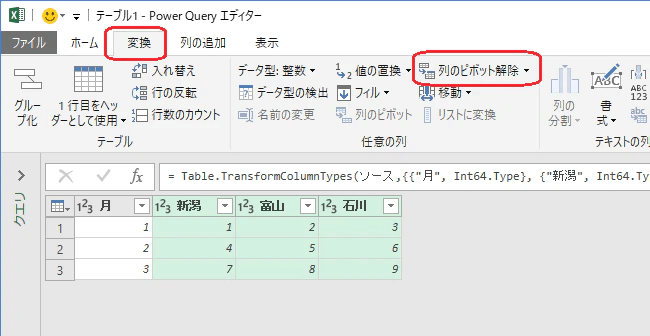

一瞬でほしいデータに代わりました。

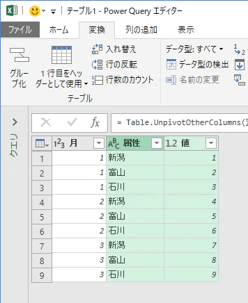

見出しをダブルクリックすると名称を変更できます。

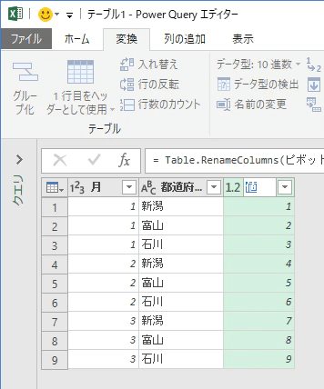

「ファイル」タブから「閉じて読み込む」を選択してクエリエディタを終了させます。

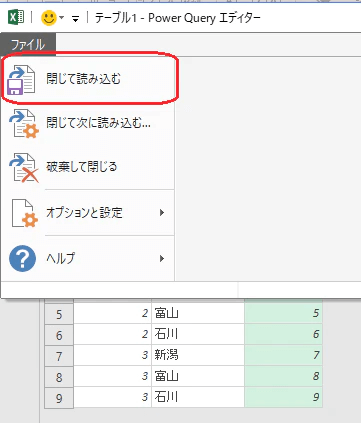

これで出来上がりです。

## 結合セルがあったらどうするの？

### 1.縦に結合したセルがあった場合

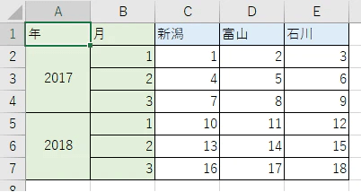

前述したようにまずはPowerQueryに取り込みます。

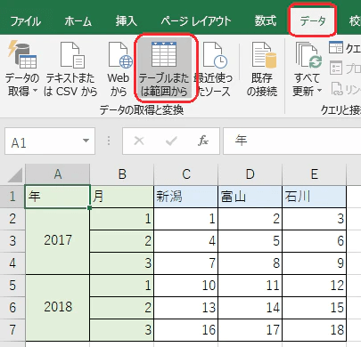

すると今度はこんな形になります。結合セルにnullが入っています。

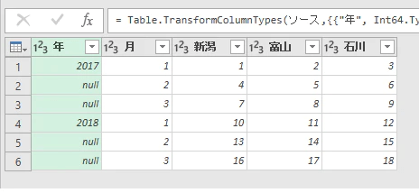

「変換」タブに「フィル」があるので下方向にフィルを行います。

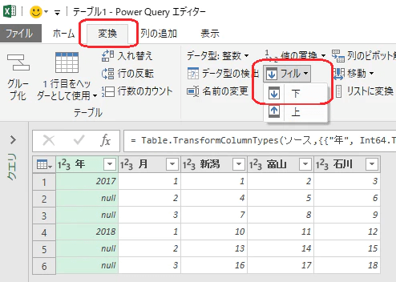

するとnullが埋まるので、あとの操作は同じです。  
新潟、富山、石川の列を選択した状態でピボットテーブルの解除を行い、見出しを整えてPowerQueryを終了させます。

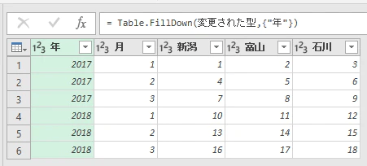

出来上がりです。

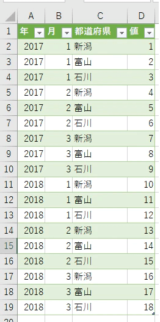

このあたりの操作はもっと詳しく書かれている方がいますので参考にされてみるとよいと思います。

[[Excel 取得と変換] Power Query でクロス集計表・マトリックス表を表形式・テーブル形式に変換する | Road to Cloud Office](https://road2cloudoffice.blogspot.jp/2016/05/power-query.html)

### 2.横に結合したセルがあった場合

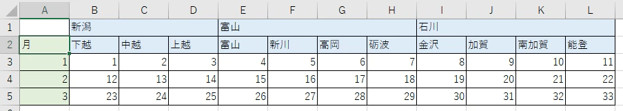

「先頭行をテーブルの見出しとして使用する」のチェックを外して取り込ます。

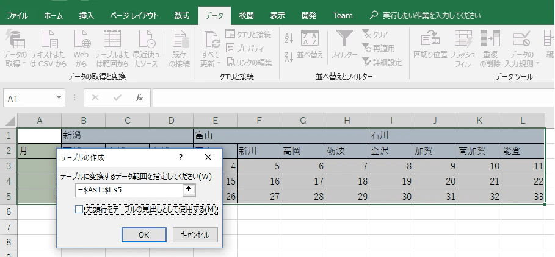

↓

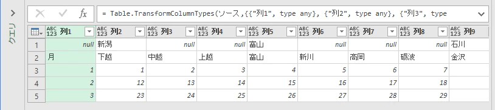

「横にフィル」というものがないので一旦表の行列を入れ替えます。  
「変換」タブの「入れ替え」を選択します。

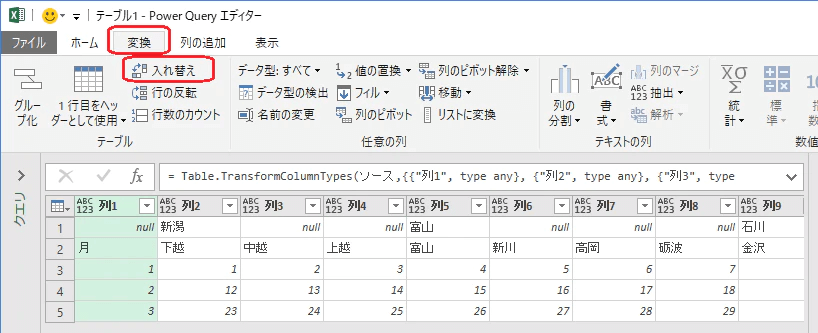

↓

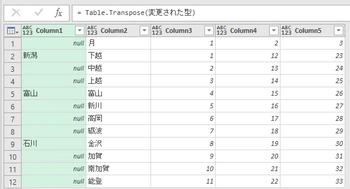

1列目で「下にフィル」を行います。

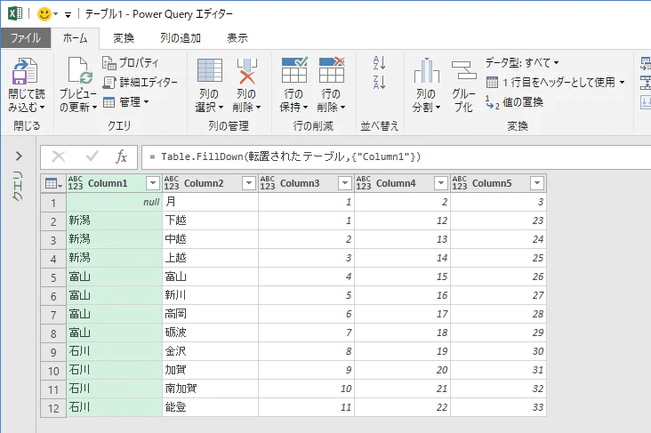

1月2月3月がレコードとして扱われてしまっていますので「ホーム」タブの「1行目をヘッダーとして使用」を選択します。

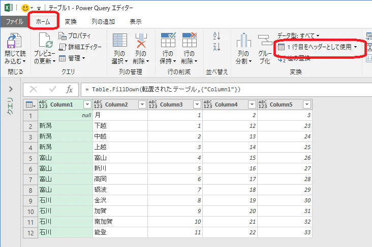

↓

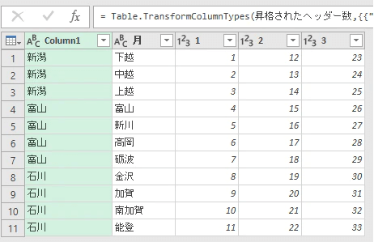

見出しを整えてピボット解除して出来上がりです。

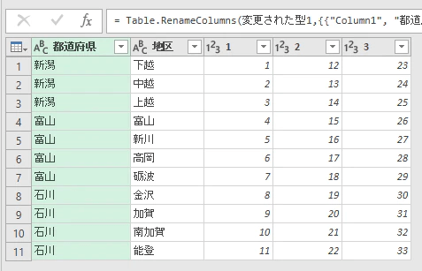

↓

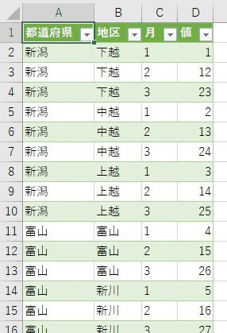

### 3.縦と横どちらにも結合したセルがあった場合

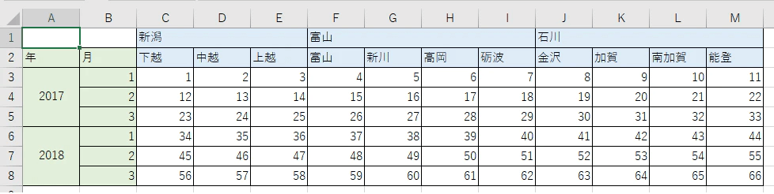

これまでのやり方＋αでできます。  
まずは取り込んで1列目を下にフィルします。

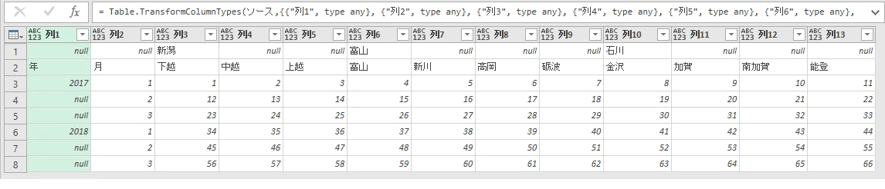

↓

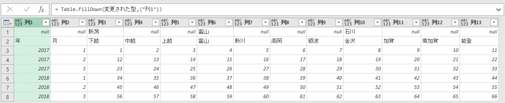

ここで少し工夫します。列1と列2を結合しておきます。そうすると後で行列を入れ替えたときに年と月の列を年月として見出しにできるようになります。

「変換」タブの「列のマージ」を選択します。

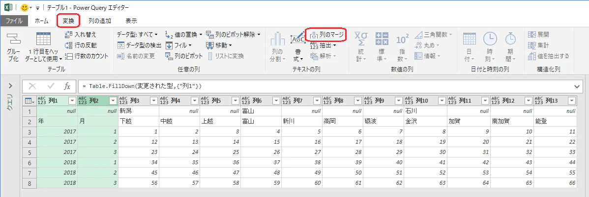

↓

区切り記号は何でもよいです。とりあえず大概のデータに被らなそうな「★」が個人的にはお気に入りです。

↓

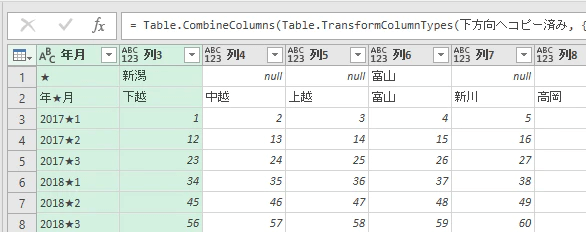

この状態で行列を入れ替えます。  

1列目を下にフィルします。また1行目を見出しとして使用します。さらに1列名2列目の見出しを適宜変更します。

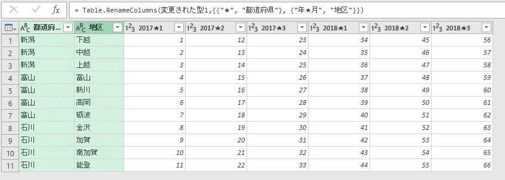

あともう少しです。「2017★1」から「2018★3」を選択してピボット解除します。

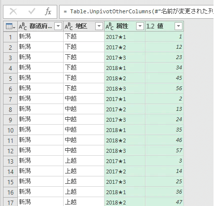

属性（＝年月）の列を選択して「変換」タブの「列の分割」を行い年と月に分割します。

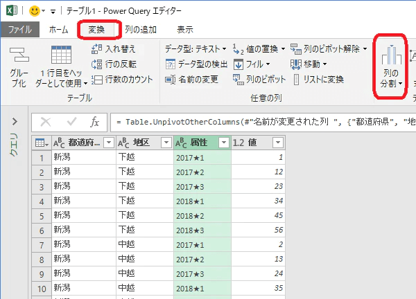

↓

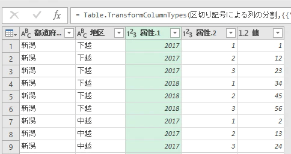

見出しを整えて出来上がりです。お疲れ様でした。

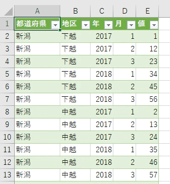

### おまけ

こんな表をもらったら。

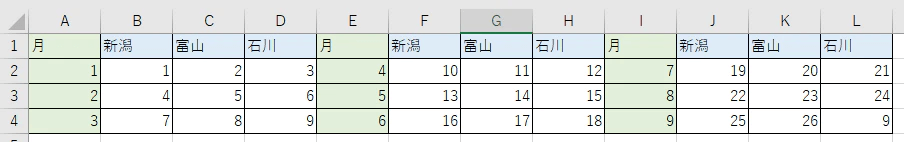

PowerQueryに取り込む範囲を分けます。まずはA列からD列を選択して取り込みます。

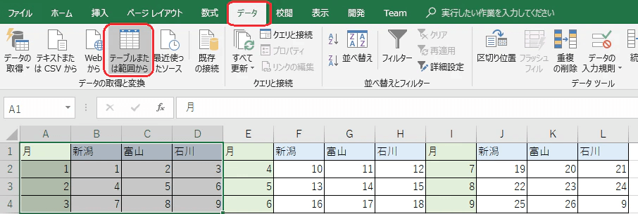

そのあとは何もしないで「ファイル」タブの「閉じて次に読み込む」を選択します。

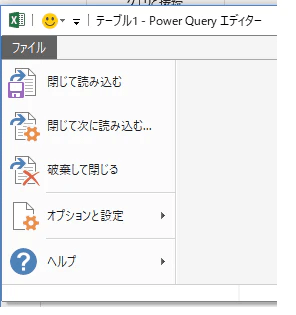

今はExcel側に出力したくないので「接続の作成のみ」を選択します。

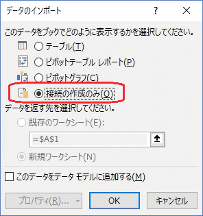

この作業をE列からH列、I列からL列にも行って3つのテーブルをPowerQueryに取り込みます。  
左ペインを開くと3つのテーブルが取り込まれているのが分かります。

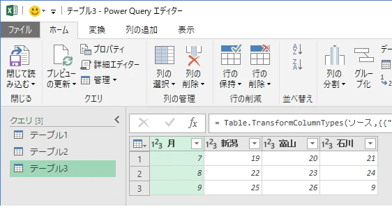

「ホーム」タブの「クエリの追加」-「クエリを新規クエリとして追加」を選択して3つのテーブルを結合します。

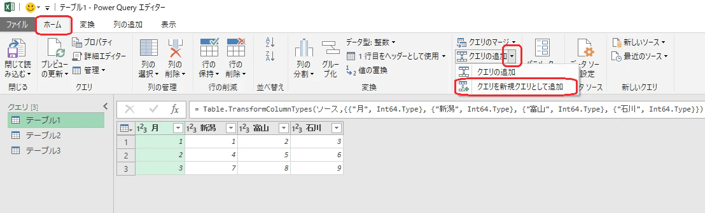

↓

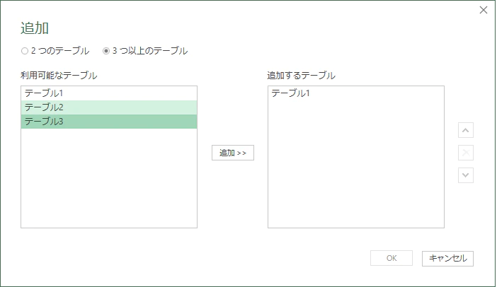

↓

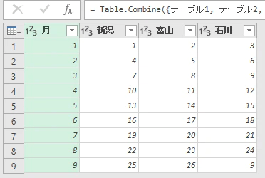

ピボットを解除して出来上がりです。

## ということで

変なデータを送られてきても、まあ何とかしてやろうかと思えるようになりますね。Power Queryを覚えると作業効率が格段に上がりますので是非活用してましょう。
