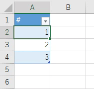
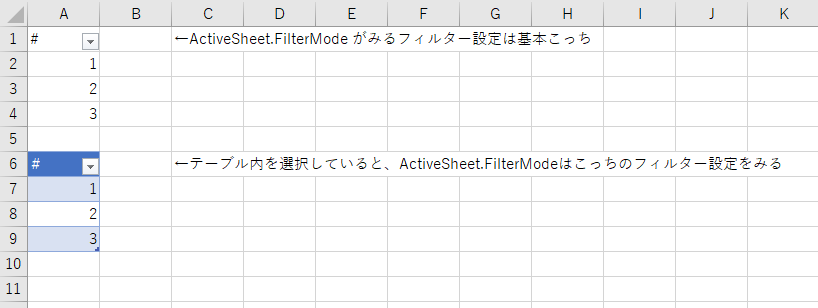

VBAからテーブルのフィルタをクリアするときはShowAllDataを使用します。その際、もしフィルタしていないとShowAllDataが見つからずエラーが出てしまいます。  
そこで通常、エラーを回避するため事前にFilterModeでフィルタされているか確認するような実装をします。

```
'FilterModeを確認してからShowAllDataを実行する
Sub Sample()
    With ActiveSheet
        If .FilterMode Then .ShowAllData
    End With
End Sub
```

しかしこのやり方でもエラーが起きるときがありました。  
今回はその原因と対処方法の話題になります。

## エラーが出てしまう例

簡単なテーブルを作って実行してみます。



↓

「1」でフィルターをかけてすぐに解除するVBAです。

```
Sub Sample()
    With ActiveSheet
        .ListObjects("テーブル1").Range.AutoFilter Field:=1, Criteria1:="1"
        If .FilterMode Then .ShowAllData
    End With
End Sub
```

これを実行すると実行時エラー1004が出る時がありました。「エラーが出る時がある」と書いたのは、出ないときもあったためです。（エラー91が出るパターンもあるようです。）

調査したところ、**エラーが起きるのはテーブルではないセルを選択している時**でした。テーブルを選択している時だとエラーは起きませんでした。

## 原因

FilterModeの仕様によるものかと思います。

## FilterModeについて

もともとテーブル機能が無い時代はシート1つに対しオートフィルターは1つしか作れませんでした。ですのでActiveSheet.FilterModeという書き方でもフィルターが一意に決まるため問題はありませんでした。しかしテーブル機能が登場し、1つのシートに複数のフィルターを作成できるようになったことでFilterModeも「どのフィルターを指すか」明確に指定しないといけなくなりました。

ActiveSheet.FilterModeは基本、選択しているセルの範囲がフィルターされている時のみTrueを返します。選択しているセルがテーブル内であればテーブルがフィルタされているかを返しますし、選択しているセルがテーブルの外ならシートに対してフィルタされているかを返します。



|  | テーブルをフィルターしている | テーブルをフィルターしていない |
| --- | --- | --- |
| テーブル内を選択 | True | False |
| テーブル外を選択 | False | False |

## ShowAllDataプロパティについて

ShowAllDataも同様に、選択しているセルによってみるフィルターが変わります。フィルタされていないとプロパティ自体が無いので実行しようとするとエラーが発生します。

|  | テーブルをフィルターしている | テーブルをフィルターしていない |
| --- | --- | --- |
| テーブル内を選択 | あり | なし |
| テーブル外を選択 | なし | なし |

FilterModeを確認してからShowAllDataを実行する、組み合わせとしては問題なさそうです。

しかし・・・。

## VBAでテーブルをフィルタするとFilterModeの挙動が変わる

なんとVBAでテーブルをフィルタした場合、FilterModeの一部の結果が変わることがわかりました。

テーブルを選択しない状態でもテーブルのフィルター設定を参照してTrueを返すようになります。

|  | テーブルをフィルターしている | テーブルをフィルターしていない |
| --- | --- | --- |
| テーブル内を選択中 | True | False |
| テーブル外を選択中 | **True** | False |

つまり、①VBAでフィルタしてから、②テーブル外のセルを選択して、③フィルターを解除しようとすると、FilterModeだけがTrueになり、ShowAllDataはプロパティが無い状態のためエラーとなります。

## 回避方法1

フィルタ解除するテーブルのセルを選択しておけば解決します。

```
Sub Sample()
    With ActiveSheet
        .Range("A1").Select '←テーブル内のセルを選択する
        .ListObjects("テーブル1").Range.AutoFilter Field:=1, Criteria1:="1"
        If .FilterMode Then .ShowAllData
    End With
End Sub
```

## 回避方法2

FilterModeとShowAllDataの適用先を明確に指定します。今回はテーブル1のフィルターに対する処理ですからActiveSheet.ListObjects("テーブル1").AutoFilter.FilterModeという書き方になります。ShowAllDataも同様です。

```
Sub Sample()
    With ActiveSheet.ListObjects("テーブル1")
        .Range.AutoFilter Field:=1, Criteria1:="1"
        If .AutoFilter.FilterMode Then .AutoFilter.ShowAllData
    End With
End Sub
```

# ということで

なかなかレアなケースかもしれませんが、エラーが出たら原因を探すのに苦労しそうな事象ですね。参考になれば幸いです。
