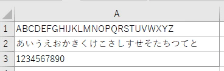

ExcelでPDF出力すると埋め込みフォントが付いてきます。  
複数種類のフォントを使用すると、その分PDFのサイズは大きくなります。  
ファイルサイズを小さくしたい場合、有償のAdobe PDFやPDFツールがあればファイルサイズを小さくしてPDF出力できますが、そういったツールを使えないなら埋め込みフォントのサイズが小さいものを選ぶとよいでしょう。

以下の一覧はフォントごとのPDFのサイズ一覧です。  
2016で標準になった游ゴシックは結構大きい部類なので意識しないと簡単なPDFでもファイルサイズが大きくなる傾向がありますね。フォントにこだわりがなければＭＳゴシックあたりがお手軽そうです。

## PDFにしたデータのサンプル

アルファベット・ひらがな・数字が含まれるPDFを作成しました。

↓

## ファイルサイズ詳細

| フォント | PDFのサイズ(KB) |
| --- | --- |
| 游明朝 Demibold | 388 |
| 游明朝 Light | 387 |
| 游明朝 | 380 |
| Gabriola | 324 |
| 游ゴシック Medium | 256 |
| Ebrima | 252 |
| Yu Gothic UI | 243 |
| Yu Gothic UI Light | 234 |
| Yu Gothic UI Semibold | 232 |
| 游ゴシック | 230 |
| 游ゴシック Light | 223 |
| Yu Gothic UI Semilight | 220 |
| Meiryo UI | 202 |
| メイリオ | 196 |
| Calibri Light | 192 |
| Calibri | 189 |
| Cambria Math | 164 |
| HoloLens MDL2 Assets | 153 |
| Segoe MDL2 Assets | 153 |
| Cambria | 153 |
| Nirmala UI | 137 |
| Nirmala UI Semilight | 136 |
| Segoe UI Semibold | 116 |
| HP Simplified | 116 |
| Segoe UI Light | 113 |
| Segoe UI Semilight | 113 |
| HP Simplified Light | 113 |
| Segoe Script | 110 |
| Segoe UI | 110 |
| Tahoma | 88 |
| Microsoft Sans Serif | 87 |
| Segoe UI Emoji | 87 |
| Parchment | 85 |
| Palatino Linotype | 83 |
| Constantia | 78 |
| Courier New | 77 |
| Impact | 71 |
| Comic Sans MS | 70 |
| Segoe UI Historic | 69 |
| Microsoft JhengHei UI | 66 |
| Trebuchet MS | 66 |
| Verdana | 66 |
| Corbel | 66 |
| Consolas | 65 |
| Microsoft JhengHei Light | 64 |
| Microsoft JhengHei UI Light | 64 |
| Georgia | 63 |
| Segoe UI Black | 62 |
| AR DARLING | 61 |
| Blackadder ITC | 61 |
| Segoe UI Symbol | 60 |
| Papyrus | 60 |
| Mongolian Baiti | 59 |
| Sitka Text | 59 |
| Sitka Small | 58 |
| Sitka Subheading | 58 |
| Myanmar Text | 58 |
| Sitka Heading | 58 |
| Sitka Display | 57 |
| PMingLiU-ExtB | 57 |
| MingLiU\_HKSCS-ExtB | 57 |
| MingLiU-ExtB | 57 |
| Gigi | 57 |
| Arial Black | 57 |
| Rage Italic | 57 |
| Leelawadee UI | 57 |
| Sitka Banner | 56 |
| SimSun-ExtB | 56 |
| Microsoft YaHei Light | 56 |
| Microsoft YaHei UI Light | 56 |
| Candara | 55 |
| Microsoft YaHei UI | 54 |
| Leelawadee UI Semilight | 54 |
| Microsoft YaHei | 54 |
| Dubai Medium | 54 |
| Dubai | 54 |
| AR BLANCA | 53 |
| Dubai Light | 53 |
| Old English Text MT | 53 |
| Arial Narrow | 52 |
| Garamond | 51 |
| Wingdings | 49 |
| Webdings | 49 |
| Microsoft Himalaya | 49 |
| Sylfaen | 49 |
| Javanese Text | 48 |
| Segoe Print | 48 |
| Bodoni MT Poster Compressed | 48 |
| Bradley Hand ITC | 48 |
| Century | 48 |
| AR DELANEY | 48 |
| Viner Hand ITC | 48 |
| Bell MT | 48 |
| AR CARTER | 47 |
| Symbol | 47 |
| Book Antiqua | 47 |
| Centaur | 47 |
| Bookman Old Style | 47 |
| Century Schoolbook | 47 |
| Monotype Corsiva | 47 |
| Footlight MT Light | 46 |
| Calisto MT | 46 |
| AR DECODE | 46 |
| MV Boli | 46 |
| Pristina | 46 |
| Onyx | 46 |
| Chiller | 46 |
| Bodoni MT Condensed | 45 |
| Mistral | 45 |
| Poor Richard | 45 |
| Franklin Gothic Medium | 45 |
| Gill Sans MT Ext Condensed Bold | 45 |
| Bodoni MT | 45 |
| Algerian | 44 |
| Harrington | 44 |
| Edwardian Script ITC | 44 |
| Ravie | 44 |
| Bodoni MT Black | 44 |
| Microsoft Tai Le | 44 |
| Goudy Old Style | 44 |
| Gadugi | 43 |
| Lucida Bright | 43 |
| Century Gothic | 43 |
| Californian FB | 43 |
| Microsoft New Tai Lue | 43 |
| AR HERMANN | 43 |
| Tempus Sans ITC | 43 |
| Lucida Sans Unicode | 43 |
| Cooper Black | 43 |
| Tw Cen MT Condensed Extra Bold | 43 |
| Vivaldi | 43 |
| Berlin Sans FB Demi | 43 |
| Berlin Sans FB | 43 |
| High Tower Text | 43 |
| Informal Roman | 43 |
| Gill Sans Ultra Bold Condensed | 43 |
| Modern No. 20 | 42 |
| Rockwell | 42 |
| Tw Cen MT | 42 |
| Curlz MT | 42 |
| Gill Sans Ultra Bold | 42 |
| NSimSun | 42 |
| SimSun | 42 |
| Franklin Gothic Demi | 42 |
| Gloucester MT Extra Condensed | 42 |
| Kunstler Script | 42 |
| Wingdings 2 | 42 |
| Bernard MT Condensed | 42 |
| Franklin Gothic Book | 42 |
| Magneto | 42 |
| Goudy Stout | 42 |
| Freestyle Script | 42 |
| Franklin Gothic Medium Cond | 41 |
| Jokerman | 41 |
| Niagara Engraved | 41 |
| French Script MT | 41 |
| AR BERKLEY | 41 |
| Microsoft Yi Baiti | 41 |
| Forte | 41 |
| MS Reference Specialty | 41 |
| Lucida Sans | 41 |
| Franklin Gothic Heavy | 41 |
| Kristen ITC | 41 |
| Palace Script MT | 41 |
| Lucida Handwriting | 41 |
| Gill Sans MT | 41 |
| Tw Cen MT Condensed | 40 |
| Showcard Gothic | 40 |
| Lucida Fax | 40 |
| Eras Light ITC | 40 |
| Imprint MT Shadow | 40 |
| Snap ITC | 40 |
| Microsoft PhagsPa | 40 |
| Lucida Calligraphy | 40 |
| Franklin Gothic Demi Cond | 40 |
| MS Reference Sans Serif | 40 |
| Perpetua | 40 |
| Script MT Bold | 40 |
| AR CENA | 40 |
| Lato | 40 |
| Agency FB | 40 |
| Juice ITC | 40 |
| Eras Demi ITC | 40 |
| Brush Script MT | 40 |
| Eras Medium ITC | 39 |
| Matura MT Script Capitals | 39 |
| Vladimir Script | 39 |
| Gill Sans MT Condensed | 39 |
| Lucida Sans Typewriter | 39 |
| AR JULIAN | 39 |
| Broadway | 39 |
| Castellar | 39 |
| Maiandra GD | 39 |
| Eras Bold ITC | 39 |
| Lucida Console | 39 |
| Niagara Solid | 39 |
| Haettenschweiler | 39 |
| Microsoft JhengHei | 39 |
| Rockwell Condensed | 39 |
| AR CHRISTY | 38 |
| Colonna MT | 38 |
| Harlow Solid Italic | 38 |
| Stencil | 38 |
| Elephant | 38 |
| Felix Titling | 38 |
| Engravers MT | 38 |
| OCR A Extended | 38 |
| MS Outlook | 38 |
| AR ESSENCE | 38 |
| Wingdings 3 | 37 |
| Bookshelf Symbol 7 | 37 |
| Baskerville Old Face | 37 |
| Copperplate Gothic Light | 37 |
| Rockwell Extra Bold | 37 |
| Copperplate Gothic Bold | 37 |
| Perpetua Titling MT | 37 |
| ＭＳ Ｐ明朝 | 37 |
| Marlett | 37 |
| AR BONNIE | 36 |
| Arial Rounded MT Bold | 36 |
| Bauhaus 93 | 35 |
| Wide Latin | 35 |
| OCRB | 35 |
| ＭＳ Ｐゴシック | 35 |
| Playbill | 35 |
| Malgun Gothic | 35 |
| AR DESTINE | 34 |
| MS UI Gothic | 34 |
| Britannic Bold | 34 |
| ＭＳ 明朝 | 33 |
| HelvLight | 32 |
| ＭＳ ゴシック | 32 |
| MT Extra | 29 |
| Malgun Gothic Semilight | 28 |
| HGP明朝E | 27 |
| HGS明朝E | 26 |
| Times New Roman | 26 |
| Arial | 25 |
| HG明朝E | 25 |
| GetPDFFontDataSize.xlsm | 25 |
| HGP創英角ﾎﾟｯﾌﾟ体 | 24 |
| HG丸ｺﾞｼｯｸM-PRO | 24 |
| HGPｺﾞｼｯｸE | 23 |
| HGS創英角ﾎﾟｯﾌﾟ体 | 23 |
| HGP創英角ｺﾞｼｯｸUB | 23 |
| HG創英角ﾎﾟｯﾌﾟ体 | 23 |
| HGｺﾞｼｯｸE | 23 |
| HGSｺﾞｼｯｸE | 23 |
| HGS創英角ｺﾞｼｯｸUB | 23 |
| HG創英角ｺﾞｼｯｸUB | 22 |
| HG正楷書体-PRO | 22 |
| HGP行書体 | 21 |
| HGP教科書体 | 21 |
| HGP明朝B | 21 |
| HGP創英ﾌﾟﾚｾﾞﾝｽEB | 21 |
| HGS行書体 | 20 |
| HG行書体 | 20 |
| HG明朝B | 20 |
| HGS教科書体 | 20 |
| HGS明朝B | 20 |
| HGS創英ﾌﾟﾚｾﾞﾝｽEB | 20 |
| HG教科書体 | 20 |
| HG創英ﾌﾟﾚｾﾞﾝｽEB | 20 |
| HGPｺﾞｼｯｸM | 19 |
| HGｺﾞｼｯｸM | 19 |
| HGSｺﾞｼｯｸM | 19 |

## ということで

Excelで作ったPDFが大きくてお困りの方はフォントの変更を検討してもよいかもしれません。
