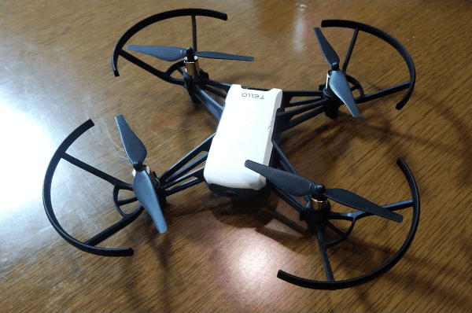
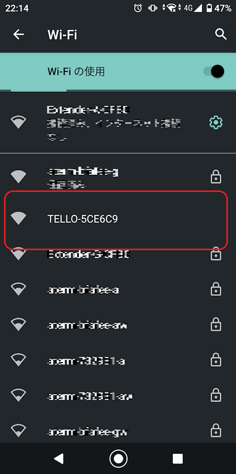
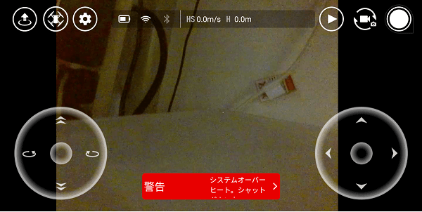
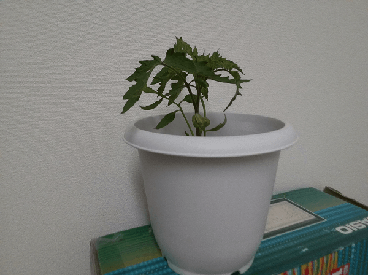
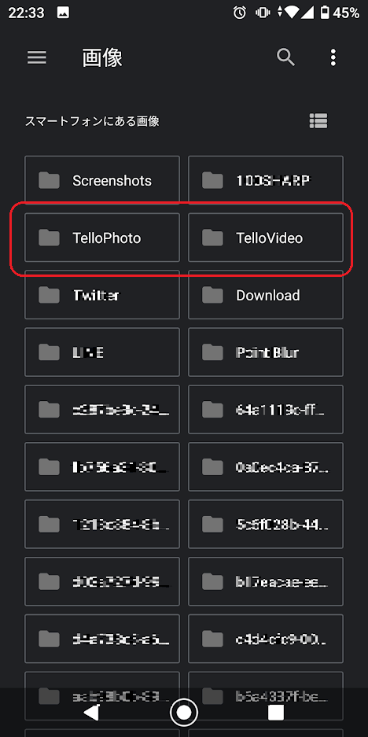
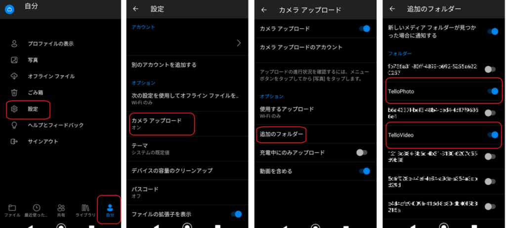
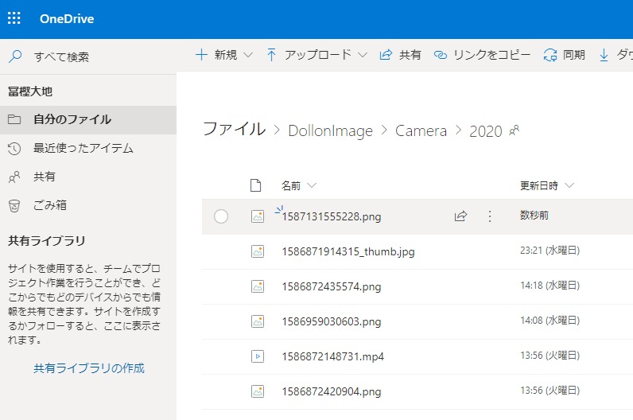

こんな時期、室内で楽しめる何かが欲しいと思いすぐにポチってしまいました。そして最高のおもちゃを入手しました。

そう、ドローンです。

[play.google.com](https://play.google.com/store/apps/details?id=com.ryzerobotics.tello&hl=ja)

https://amzn.to/2JMIoZ6

トイドローンではあるのですが、飛行中に写真や動画が撮れて更にスマホに転送さしてくれるうれしい仕様でした。  
これはもしかしてクラウドと同期したらドローンの写真を管理できるのでは、と思いせっかくなので試してみました。

# やったこと

ドローンで撮影した写真をクラウドのOneDriveへ自動転送します。

## ドローンの仕様

### 操作はアプリで

ドローン本体にはコントローラのような操作端末は付属していませんでした。  
コントローラーのアプリをスマホにダウンロードして、スマホから操作する形になります。

アプリも何種類かあるようで、プログラミングで自動操縦してくれるアプリもあるようです。  
今回は標準のアプリを使ってみました。

### ドローンがWi-Fiのアクセスポイントになっている

スマホからWi-Fiを検索するとドローンがアクセスポイントの一覧に表示されます。

コントローラで操作するときは事前にドローンに接続することになります。特に難しい設定は無く簡単に接続できました。

ただ実はちょっと厄介なことがあって、自宅の中で飛ばすためにスマホをドローンに繋ぎにいこうとするのですが、スマホが自宅のWi-Fiに優先してつなぎにいこうとしてしまいドローンとの接続に手間取ってしまうことがありました。さらに一定時間経つとドローンの電源が落ちるのでまた繋ぎなおす、みたいなもどかしさもありました。

そして同時に複数のアクセスポイントに接続できないのでドローンを飛ばしながら画像をクラウドに送信する方法を見つけられませんでした。  
今回はドローンの電源を切ってアクセスポイントを落とし自宅のアクセスポイントに繋ぎなおしに行くシナリオにしました。

### 充電は十分に

開封後、嬉しさのあまり充電をほどほどに飛ばそうとしましたがバッテリー不足ですぐに飛行を停止しシュンとなるドローン。充電は十分におこないましょう。  
充電100%にした状態で15分程度遊べます。

### オーバーヒートしやすいようだった

起動中は結構熱を発しているようで待機状態で待たせておくとすぐにオーバーヒートでシャットダウンします。飛行中はプロペラの風が当たって冷やしてくれるので問題ないようですが、テストやプログラムを組んでいるときは扇風機などで冷やしておく必要がありそうです。

## 実際に動かしてみる

左の十字キーで上昇/下降と回転、右の十字キーで前進/後退と左右への移動を行います。操作に慣れるまで大変です。思うように操作できませんでした、もう少し練習しないといけません。  
それでも動画を撮影しながら動かしてみました。

> ドローン飛ばしてみた。操作が難しすぎて安定しない。 [pic.twitter.com/JP4ydx4xAK](https://t.co/JP4ydx4xAK)
>
> — パパセンセイ (@10mikiya) [2020年4月14日](https://twitter.com/10mikiya/status/1250090327295188993?ref_src=twsrc%5Etfw)

↓写真はこちら

思っていたより画質は良かったです。トイドローンなのでもっとひどいと思って期待してませんでした。プロペラの音は、まあそうだよね、というくらいの音量です。  
それでも十分に楽しいです。壁にぶつけて落として焦るを何度繰り返したことか。

### 画像や動画はスマホに保存される

飛行中の画像はスマホにリアルタイムに送信されます。撮影ボタンを押すとスマホ内部のストレージに保存されます。  
画像と動画が「TelloPhoto」と「TelloVideo」それぞれのフォルダに保管されてます。

## クラウドに画像を送る

さて、ここからが本番です。本番と言いながらすぐに終わります。

OneDriveアプリをインストールして写真のアップロード機能を使います。

[play.google.com](https://play.google.com/store/apps/details?id=com.microsoft.skydrive&hl=ja)

[自分]-[設定]を開き[カメラアップロード]を有効にして[追加のフォルダー]にTelloPhotoとTelloVideoを登録するだけです。これだけでドローンの画像がOneDriveに格納されます。

↓

一瞬ですね。

## ということで

ドローンでの撮影からクラウドへの保存までをやってみました。画質もきれいだし簡単にクラウドに保存できるし、何より楽しいし、大変満足です。ずっと遊ぶと思います。  
ドローン自体の制御をPythonでできるようなので時間に余裕があったら取り組んでみたいと思います。

https://amzn.to/3mU8t6O
