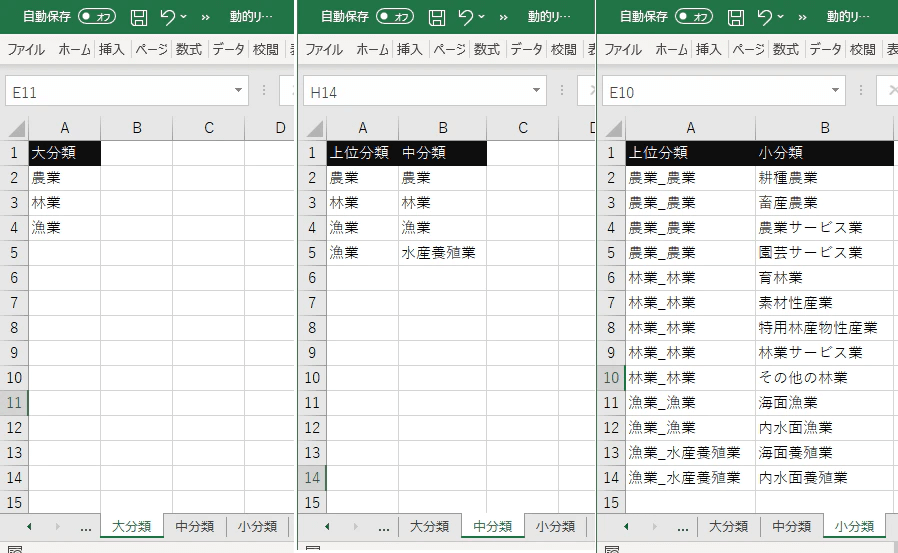
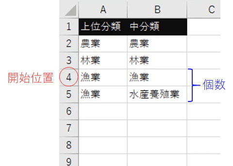
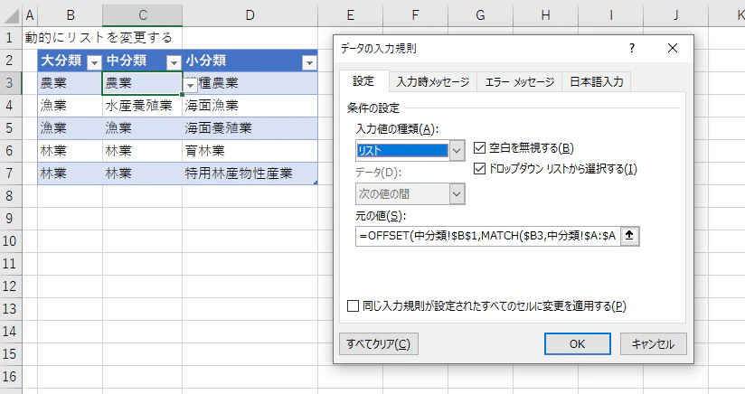

入力規則で使用できるようになるリスト機能ですが、リストの内容を動的に変更する方法はいくつか知られています。  
昔から大変お世話になってました。

https://office-hack.com/excel/pulldown-menu-interlock/

https://liginc.co.jp/177947

また、スピル機能を使えば比較的簡単に実装できます。

https://tomikiya.github.io/excel-linking-lists-spill/

しかし、作り方によって課題が含まれていたり、スピル機能を使えないバージョンがあったりするのでケースによってはそのまま使えないことがあります。  
それらの課題を回避しつつ実務的に使える形まで落とし込めたので紹介します。

これらを解決できる方法になります。

## やりたいこと

3つ以上のリスト連動させます。つまりこんなのです。

1つのリストを変更すると次のリストの中身が変わっていきます。  
また、テーブルの中でもリスト連動を使えるようにします。

## 詳細

上の例をもとに説明します。

### リストデータの準備

まずはリストとなるデータを準備します。  
大分類、中分類、小分類、それぞれでシートを分けて管理します。  
また、それぞれの項目がどの分類に属しているか判別できるようにキーとなる上位分類もセットで管理します。  
ここで重要なのは**「上位分類」で並べ替えをしておく**ことです。



### OFFSETでリストを取り出し入力規則にする

リストを取り出す方法はシンプルです。  
**開始位置と個数を計算**して**OFFSETで取得する**だけです。  
上位分類の並べ替えをしておくことで指定する分類の開始位置と指定する分類の個数を計算できるようになります。



例えば、漁業の中分類のリストが欲しい時はシート「中分類」の3個目から2個分データを取り出す形になります。

開始位置と個数はそれぞれMATCHとCOUNTIFで求められます。

```
' 中分類の開始位置
= MATCH(大分類の値,中分類!$A:$A,0)
```

```
' 中分類の個数
= COUNTIF(中分類!$A:$A,大分類の値)
```

あとはOFFSETに組み込めばよいので以下のようになります。  
注意としてOFFSETは0からカウントしますのでMATCHの結果から1を引きます。

```
' 中分類の入力規則　(C3セルで設定する)
'= OFFSET(中分類!$B$1,'開始位置'-1,0,'個数')
= OFFSET(中分類!$B$1,MATCH($B3,中分類!$A:$A,0)-1,0,COUNTIF(中分類!$A:$A,$B3))
```

↓入力規則の設定イメージ



小分類も同様に求めますが、検索する値は大分類と中分類を結合したものになります。

```
' 小分類の開始位置
= MATCH(大分類の値&"_"&中分類の値,小分類!$A:$A,0)
```

```
' 小分類の個数
= COUNTIF(小分類!$A:$A,大分類の値&"_"&中分類の値)
```

```
' 小分類の入力規則　(D3セルで設定する)
= OFFSET(小分類!$B$1,MATCH($B3&"_"&$C3,小分類!$A:$A,0)-1,0,COUNTIF(小分類!$A:$A,$B3&"_"&$C3))
```

↓イメージ


大項目のリストは通常通り大項目シートで範囲指定してください。詳細は省略します。

以上で完成です。

4つ以上のリストを連動させたい場合はシートを増やして入力規則を規則的に登録していくだけです。

## 補足

リストを連動させる方法の1つとして構造化参照を使う方法もあります。  
ただ構造化参照は入力規則に直接入力できないため名前定義を経由しなければなりません。複雑化する可能性があります。  
どちらが良いかはケースに寄るので適宜使い分けてください。

## ちょっと面倒なところ

この実装、リストデータの管理が若干煩わしくて、分類ごとにシートを作成しなければなりません。項目を追加する時もキーとなる列が必要になるので少々冗長なデータになります。本当にこの機能が必要なのか検討してから実装しましょう。

## ということで

OFFSETを使えばスピルが無くてもリストの連動は実装できます。またスピルを使ったリスト連動と異なりテーブルの中でも使えます。使う機会がありましたら試してみてください。
