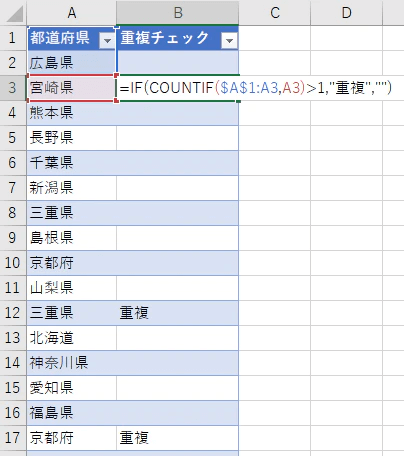
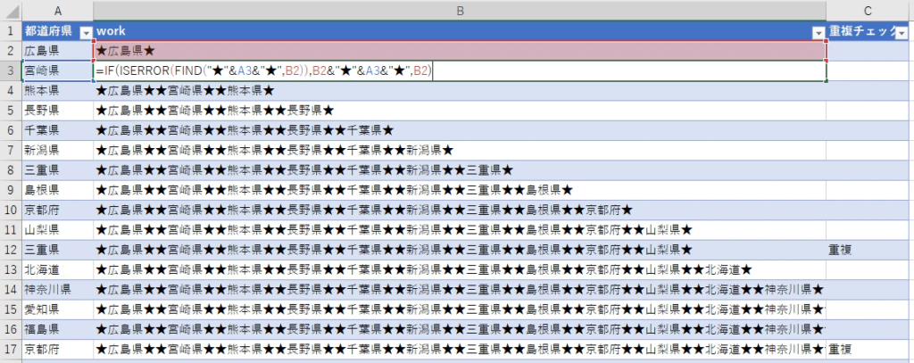
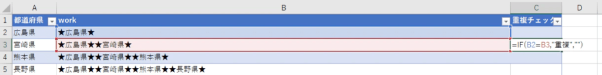
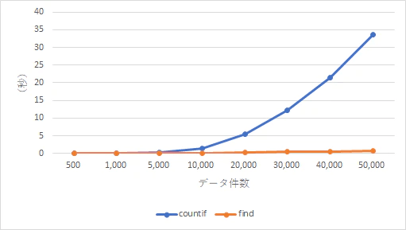

関数だけで重複チェックをする場合の手段を検討したときの話でCOUNTIFで探すよりFINDで探した方が速かったのでまとめました。

## 前提

データの並び替えは不可です。

## データ件数が少ないならCOUNTIFで十分

一覧から重複を探し出すときはCOUNTIFが扱いやすいです。

↓よく見かける式とイメージ図。

```
B3 = IF(COUNTIF($A$1:A3,A3)>1,"重複","")
```



式が簡単なのでよく使わせてもらっています。一時的な確認ならかなりお手軽です。  
ただ、データ件数が多くなると非常に重くなります。  
データ件数がN件の場合、COUNTIFの計算処理回数がN(N+1)/2回と指数的に増えていくためと思われます。  
1000件を超えるようならCOUNTIFは個人的にお勧めしません。PCの性能によってはExcelが固まりますし。

## データ件数が多いならFINDを使ってみる

出来るだけ計算処理回数が少なくなるように式を組めば全体の処理速度も改善します。  
1,000件以上5万件以下ならこちらを勧めます。それ以上ならVBAか、やり方を再検討したほうが良いと思います。

### 作り方

検索する「検索文字列(A)」が上位データに含まれているか確認するために、検索する文字列を上から順に結合した「結合文字列(B)」をwork列に生成します。  
そうすることで結合文字列(B)は長くなりますが、**FINDを使って検索文字列(A)と結合文字列(B)を比較でき、数値を返せば検索文字列(A)は重複していると判断**できます。  
FINDは1回で判定できるため、データ件数が増えても計算処理回数はN回におさまるという算段です。

また少しでも軽くするため、**結合文字列(B)を生成する際は重複する検索文字列を結合しない**ようにします。  
これにより**結合文字列(B)に変化がなければ重複しているとも判定できる**ようになります。  
また中間一致にならないように検索文字列の前後に区切り文字をつけ、区切り文字とともに検索します。下のサンプルでは★を使っています。

```
B3 = IF(ISERROR(FIND("★"&A3&"★",B2)),B2&"★"&A3&"★",B2)
C3 = IF(B2=B3,"重複","")
```

↓結合文字列(B)の式



↓重複チェック(C)の式



## どの程度違うのか計測

データ件数ごとにそれぞれ5回計測しその平均を出してみました。

再計算の処理時間（秒）

| データ件数 | COUNTIF | FIND |
| --- | --- | --- |
| 500 | **0.013** | 0.022 |
| 1,000 | **0.015** | 0.032 |
| 5,000 | 0.358 | **0.104** |
| 10,000 | 1.373 | **0.170** |
| 20,000 | 5.436 | **0.322** |
| 30,000 | 12.120 | **0.443** |
| 40,000 | 21.490 | **0.558** |
| 50,000 | 33.563 | **0.730** |



データ件数が少ないならCOUNTIFの方が速いようです。  
ちなみにFINDは10万件で1.37秒、100万件で13.22秒かかって再計算が完了しています。COUNTIFは死にました。

## ということで

大量のデータをExcelで扱わない方が良いですがどうしてもというときは試してみてください。
