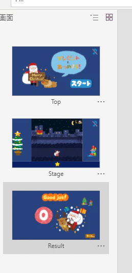
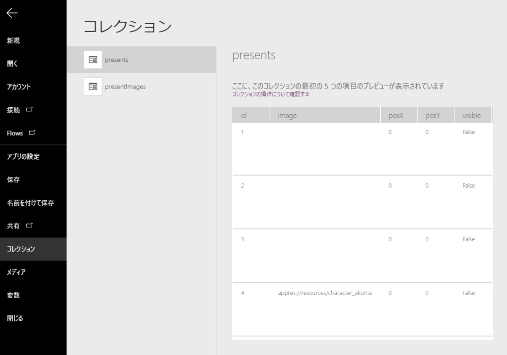
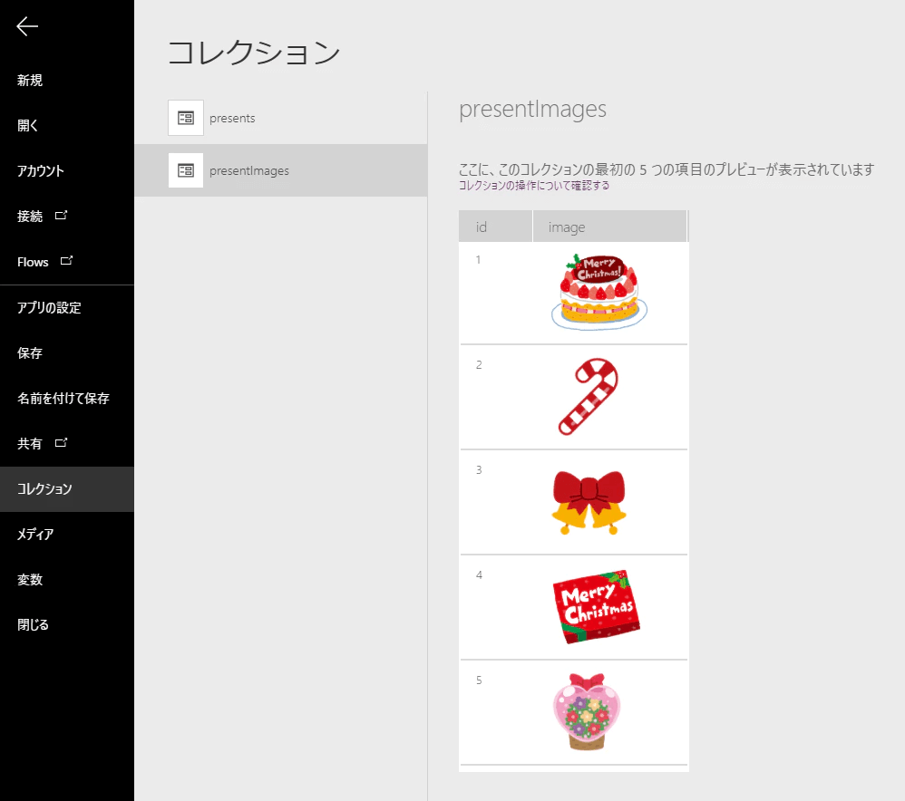
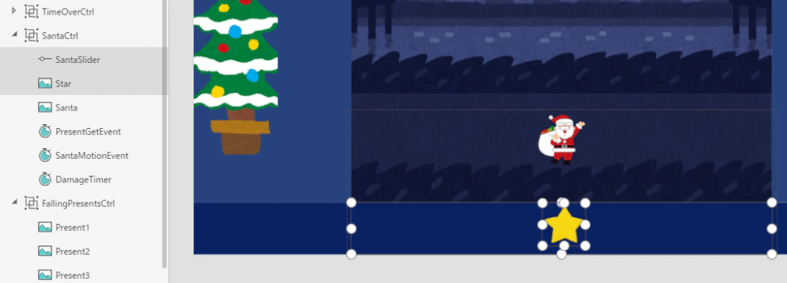
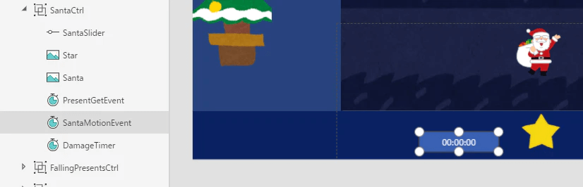
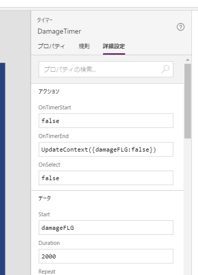
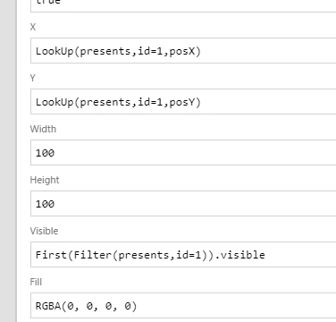
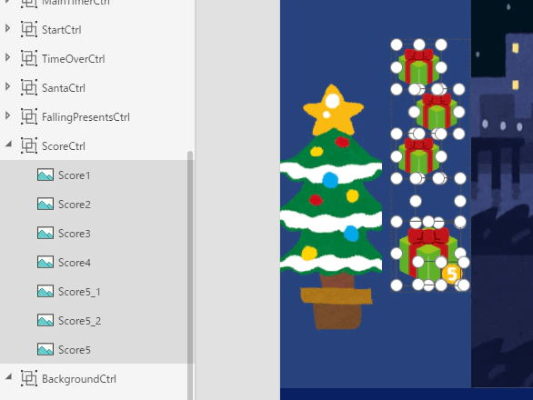

※この記事の内容は古い可能性があります。最新の仕様やUIと異なる場合は適宜読み替えてご確認ください。

## この記事の対象者

- [Power Apps](https://powerapps.microsoft.com/ja-jp/)をある程度触ったことがある方
- 一からアプリを作りたいと思っているが何から始めてよいか迷っている方

## どうしてゲーム？

Power Appsで何かを作って見たいと思っているが何を作ればよいか分からない、業務アプリだとつまらない、という方、ゲームを作って見ませんか。  
ゲームは完成系が想像しやすく「作りたいもの」が明確です。「マ〇オを作りたい」と思い浮かべればゴールが見えますよね。  
そして完成したら自分で遊べます。楽しいですね。  
何よりゲームを作っていると多くの疑問が見つかり、機能を調べる機会が数多くあります。Power Appsで何が出来るか積極的に学べます。

ということで、簡単なものからでも始めてはいかがでしょうか。

## 一応おことわり

Power Appsでゲームを作ることはExcelでゲームを作ることに似ていて、本来の目的とは異なるかもしれません。  
ある程度コツを掴んだら業務アプリを積極的に作っていきましょう。

## こんなゲームを作ってみました

サンタを操作してプレゼントを集めるゲームです。  
悪魔にプレゼントを取られます。制限時間内に多くのプレゼントを集めるゲームです。

[YouTUbeで見る](https://www.youtube.com/watch?v=ZTMoB74P7sI)

https://www.youtube.com/watch?v=ZTMoB74P7sI

## 以下、解説

ある程度大事な部分だけピックアップして説明します。

### 画面の設定

トップ画面(Top)、ステージ画面(Stage)、結果画面(Result)の3種類作成します。



### 初期設定をOnVisibleで設定する

初期値を予めどこかで宣言する必要がありましたのでScreenの**OnVisible**を使います。  
OnVisibleは画面が切り替わったときに発動するプロパティになりますので、TopからStageへ遷移してきたときに実行されるよう、Stage.OnVisibleに設定します。  
今回は以下のような変数を設けます。

```
Stage.OnVisible=
UpdateContext(
    {
        SantaPosX: 650,          // サンタのX座標
        SantaSpeed:8,            // サンタの移動スピード
        presentInterval: 5000,   // プレゼントを落下させる間隔
        score: 0,                // スコア
        tremor: 10,              // 悪魔とぶつかったときに震える幅
        countdownImage:number_3, // カウントダウンの初期画像
        countdownNum:3,          // カウントダウンの初期数値
        countdownSeFLG:false,    // カウントダウンの音を出すフラグ
        DemonSeFLG:false,        // 悪魔とぶつかったときに音を出すフラグ
        presentGetSeFLG:false,   // プレゼントを取ったときに音を出すフラグ
        timeOverSeFLG:false,     // 時間切れの時に音を出すフラグ
        gameStartFLG: false,     // ゲームを開始するときのフラグ
        damageFLG: false,        // ダメージを受けたときのフラグ
        overFLG: false,          // 時間切れの時のフラグ
        Const: {                 // 固定値
            TimeLimit: 60000,               // 制限時間
            StagePosX: 300,                 // ステージのX座標
            StageWidth: 800,                // ステージの幅
            StageHeight: 600,               // ステージの高さ
            DemonID:4,                      // 悪魔キャラのID、プレゼントを同時3つまで表示する制限としたため、4つ目を悪魔キャラのIDとした。
            PresentIntervalMin:500,         // プレゼントの落下間隔の最小値
            PresentIntervalSubtraction:500, // プレゼントの落下間隔を少しずつ縮めるための値
            PresentFallingSpeed:15          // プレゼントの落下スピード
        }
    }
);
ClearCollect(
    presentImages,
    {
        id: 1,
        image: christmas_cake
    },
    {
        id: 2,
        image: christmas_mark3_candy
    },
    {
        id: 3,
        image: christmas_mark7_bell
    },
    {
        id: 4,
        image: christmas_present
    },
    {
        id: 5,
        image: ballon_flower
    }
);
ClearCollect(
    presents,
    {
        id: 1,
        visible: false,
        posY: 0,
        posX: 0,
        image: ""
    },
    {
        id: 2,
        visible: false,
        posY: 0,
        posX: 0,
        image: ""
    },
    {
        id: 3,
        visible: false,
        posY: 0,
        posX: 0,
        image: ""
    },
    {
        id: 4,
        visible: false,
        posY: 0,
        posX: 0,
        image: character_akuma
    }
);
```

変数に関する覚書

**UpdateContext**は変数に値を代入する命令です。Power Appsでは`hoge=1`のような書き方で変数を更新できません。毎回UpdateContextを書く必要があります。

また、**Set**という命令も変数に代入する命令です。UpdateContextとの違いはVBAでいうところのPrivateとPublicになります。  
UpdateContextで指定するとPrivate扱いとなり、宣言したScreen内でしか参照できなくなります。  
Setで指定すればどのScreenからでも参照できます。

```
UpdateContext({hoge:1000}) // 中括弧でくくること。結構忘れがち。変数と値の間にはコロンを使う
UpdateContext({hoge:1000,fuga:2000}) // 複数の変数を変更したい場合はカンマで並べる
Set(hoge,1000) // 中括弧要らない、変数と値の間にはカンマを使う。複数変更できない。
```

Constのように変数にレコードを指定することもできます。  
値を取り出すときは`Const.DemonID`のように指定します。  
また値を更新するときは`UpdateContext({Const:{DemonID:1}})`のように指定します。  
便利そうですが、この書き方をするとUpdateContextの時にサジェストしてくれないので今の段階ではお勧めしません。値を変更しないConstのような使い方には便利かもしれません。

**ClearCollect**でデータソースが作れます。  
今回はプレゼントの画像のデータソースと、プレゼントの情報を管理するデータソースを作成します。

↓[ホーム]-[コレクション]を確認するとこんな感じになってます。※画像はあらかじめ[メディア]で登録済みです。





### サンタを動かすコントロールについて

コントロールのスライダー1個と、画像1個を組み合わせます。  
スライダー(SantaSlider)のValueを星マーク(Star)のX座標に指定します。するとスライダーの変更とともに星が移動するようになります。  
またスライダーは見えなくてもよいので色を透明にしておきます。  
この時の注意点としては、スライダーは星より上になるように再配置することです。  
星の下に配置するとスライダーを触れなくなります。



今回はSliderSantaのMaxとMinを10と0に設定し、11段階にしました。  
StarもSliderSantaに合わせて11段階で動くようにX座標を以下のように指定します。

```
Star.X = SantaSlider.Value * (Const.StageWidth/(SantaSlider.Max-SantaSlider.Min + 1)) + Const.StagePosX
```

### サンタの移動について

スライダーの位置によってサンタを左右に動かします。  
スライダーを右へ移動させればサンタは右へ、左へ移動させれば左へ移動し続けます。  
またスライダーの値によって移動の強弱もつくようにしました。

#### タイマーコントロールを使う

何かのタイミングで処理を実行したいことは山ほどあります。先ほど紹介したOnVisibleもそのうちの1つですね。  
Power Appsに用意されているプロパティでよく使うのは、ボタンを押したときの**OnSelect**やスライダーを変更したときの**OnChange**です。どちらもユーザが何かアクションを起こさないと発動しないプロパティになります。  
しかし、例えばサンタとプレゼントのぶつかりを判定する処理については、ユーザのアクションに関係なく、常に監視するように動いてもらわないといけません。  
今回のサンタも、スライダーを動かさないときでも移動してほしいので、OnChangeは合いません。  
そこでタイマーコントロールを使います。

タイマーコントロールについているプロパティで利用できそうなのは以下の3つです。

| プロパティ | 説明 |
| --- | --- |
| OnSelect | タイマーをクリックした時の処理 |
| **OnTimerStart** | タイマーが実行を開始した時の処理 |
| OnTimerEnd | タイマーが実行を完了した時の処理 |

さらにタイマーには実行する時間の長さを指定する**Duration**と、繰り返しを行う**Repeat**があります。  
察しの良い方ならわかると思いますが、Durationを小さくし、Repeatを有効にすると短いサイクルでOnTimerStartやOntimerEndがユーザのアクションなしに実行され続けるようになります。



サンタの動きはスライダーのValueを加算し続けるようにしたいのでタイマー(SantaMotionEvent)を1つ用意し、OnTimerStartに以下のような処理を入れます。

```
SantaMotionEvent.OnTimerStart = 
UpdateContext(
    {
        SantaPosX: Max(
            Const.StagePosX, // 画面左端の制限
            Min(
                Const.StagePosX + Const.StageWidth-Santa.Width, // 画面右端の制限
                SantaPosX + (SantaSlider.Value-(SantaSlider.Max-SantaSlider.Min)/2) * SantaSpeed // 移動のメインはここ
            )
        )
    }
)
```

Durationは10(ミリ秒)に設定しておけば十分でした。

#### サンタと悪魔がぶつかったときの動作

震えさせて固まるようにしたかったので、こちらもタイマー(DamageTimer)を用意します。  
タイマーのStartプロパティにdamageFLGをセットします。  
damageFLGが**無効から有効に切り替わったときにタイマーが動きます**。  
サンタと悪魔がぶつったときにdamageFLGを有効にすればタイマーが動き始める仕掛けになります。



OnTimerEndでdamageFLGを無効にしています。  
またタイマーが動き始めて2秒後に止まる算段です。

damageFLGが有効の間、サンタの行動を停止させたいので先ほどのSantaMotionEvent.OnTimerStartにIFを加えて以下のように更新します。

```
SantaMotionEvent.OnTimerStart = 
If(
    damageFLG,
    UpdateContext({tremor: tremor * -1});
    UpdateContext({SantaPosX: SantaPosX + tremor}),
    UpdateContext(
        {
            SantaPosX: Max(
                Const.StagePosX,
                Min(
                    Const.StagePosX + Const.StageWidth-Santa.Width,
                    SantaPosX + (SantaSlider.Value-(SantaSlider.Max-SantaSlider.Min)/2) * SantaSpeed
                )
            )
        }
    )
)
```

これでサンタが震えます。

タイマーの発動条件の覚書

タイマーのStartは**falseからtrueに切り替わったときに発動します**。  
trueからtrueに切り替えても発動しません。  
UpdateContextでtrueにしても前の状態がtrueのままだったりすることよくあります。  
タイマーが発動しない原因はだいたいこれです。  
使い終わったらすぐにfalseにしましょう。  
今回はOnTimerEndでfalseにしています。

### プレゼントを落下させる動作

#### コレクションを利用

プレゼントの情報はコレクション(presents)で管理しています。  
各項目は以下のようになります。

| プロパティ | 説明 |
| --- | --- |
| id | ユニークなID |
| image | プレゼントの画像 |
| posX | プレゼントのX座標 |
| posY | プレゼントのY座標 |
| visible | プレゼントが画面に表示されているか |

コレクションを更新すればプレゼントの位置や画像も更新されていくわけです。  
今回、画面上に同時に表示されるプレゼントを最大4個としましたので、コレクションのデータも4つになっています。  
コレクションの値は**LookUp**を使って取れます。画像のプロパティに以下のように設定しました。

```
Present1.Image = LookUp(presents,id=1,image)
Present1.X = LookUp(presents,id=1,posX)
Present1.Y = LookUp(presents,id=1,posY)
Present1.Visible = First(Filter(presents,id=1)).visible
```

※Present2 ～ Present4も同様  
※Visibleだけ取り出し方が違いますが、敢えて違う方法で取り出しただけです。LookUpで問題ありません。



#### プレゼントの動きもタイマーで管理

プレゼントのY座標を変更するタイマー(PresentFallingTimer)と、プレゼントを落とす間隔を管理するタイマー(PresentIntervalTimer)を用意しました。

PresentFallingTimerで定期的にコレクションのposYを更新します。更新には**UpdateIf**が使えます。  
画面に表示されているデータだけY座標を更新します。  
また、一番下まで落下したら非表示にします。

```
PresentFallingTimer.OnTimerStart = UpdateIf(presents,visible,{posY:posY+Const.PresentFallingSpeed})
PresentFallingTimer.OnTimerEnd = UpdateIf(presents,posY>Const.StageHeight,{visible:false})
```

プレゼントを取得したときにPresentIntervalTimerのDurationの値を徐々に小さくしていき(後述)、プレゼントを落とす間隔を速くします。  
ゲームの後半にはプレゼントがどんどん落ちてくるようになります。

```
PresentIntervalTimer.OnTimerStart = 
UpdateContext(
    {   // 非表示のプレゼントのidを探します。
        targetID: LookUp(
            presents,
            Not(visible),
            id
        ),
        // presentImageのデータソース(全5種類)から画像をランダムに取得するため、imageのidを予め決めます。
        randomImageID: RoundUp(
            Rand() * 5,
            0
        )
    }
);
UpdateContext(
    {   // プレゼントのidが4だった場合は悪魔の画像、それ以外はプレゼントの画像をセットします。
        presentImage: If(
            targetID = Const.DemonID,
            character_akuma,
            LookUp(
                presentImages,
                id = randomImageID,
                image
            )
        )
    }
);
// presentsコレクションを更新して画面にプレゼントを表示します。
UpdateIf(
    presents,
    id = targetID,
    { 
        visible: true,
        posX: Const.StagePosX + Rand() * (Const.StageWidth-Present1.Width),
        posY: 0,
        image: presentImage
    }
)
```

### プレゼントや悪魔とのぶつかり判定

ここもタイマー(PresentGetEvent)を用意します。  
サンタとぶつかっているプレゼントもしくは悪魔がないかpresentsコレクションの中から探し出します。  
コレクションから条件を指定して探すために**Filter**を使い、1つ目だけが欲しかったので**First**を使います。  
当たり判定については適宜。

```
PresentGetEvent.OnTimerStart =
// 判定
UpdateContext(
    {
        getPresentID: First(
            Filter(
                presents,
                visible,
                posY >= Santa.Y-100 && posY <= Santa.Y-100 + 50 && posX > Santa.X-Santa.Width && posX < Santa.X + Santa.Width
            )
        ).id
    }
);

If( 
    Not(IsBlank(getPresentID)),               // ぶつかるものがあった場合
    If(
        getPresentID = Const.DemonID,         // 悪魔なら1ポイントマイナス、damageFLG有効
        Reset(DemonSeAudio);
        UpdateContext(
            {
                damageFLG: true,
                addPoint: -1,
                DemonSeFLG: true
            }
        ),
        Reset(PresentGetSeAudio);             // それ以外は1ポイントプラス
        UpdateContext(
            {
                addPoint: 1,
                presentGetSeFLG: true
            }
        )
    );
    UpdateContext({score: score + addPoint}); // スコア加算
    UpdateContext(                            // 落下の間隔を速くする
        {
            presentInterval: Max(
                Const.PresentIntervalMin,
                presentInterval-Const.PresentIntervalSubtraction
            )
        }
    );
    UpdateIf(                                 // ぶつかったプレゼントを消す
        presents,
        id = getPresentID,
        {
            visible: false,
            posY: 0
        }
    )
)
```

### スコアの表示

スコアによってVisibleを変更しているだけですね。  
例えば、3個目のプレゼントのVisibleは以下のようになります。

```
Score3.Visible = If(Mod(score,5)>=3,true,false)
```



点数表示も同様にスコアによって画像を切り替えています。

```
Score5_1.Image = Switch(RoundDown(score/10,0), 1,number_1,2,number_2,3,number_3,4,number_4,5,number_5) //十の位の画像
```

### BGM,SEの追加

オーディオを使えば音楽を挿入できます。  
Startプロパティが有効になれば音が出せます。音を鳴らしたいタイミングでフラグを切り替えればよいだけです。  
ただし、タイマーのStartプロパティと異なるのは**有効の間、音楽が鳴り続ける**ことです。  
タイマーのStartは無効から有効に切り替わったときに発動しました。  
オーディオのStartは有効の間、発動します。  
同じプロパティ名でも仕様が違うため注意が必要です。

また、音楽を途中で止めて再度最初から流したいときはオーディオを**Reset**する必要があります。  
同じ効果音を続けて鳴らしたい場合に使ったりします。

以下は悪魔とぶつかったときの効果音の処理です。

```
DemonSeAudio.Start = DemonSeFLG && musicFLG
DemonSeAudio.OnEnd = UpdateContext({DemonSeFLG:false});Reset(DemonSeAudio)
```


## ということで

ゲームを作ると様々な知見を得られまます。そのまま業務アプリに使うことは無いですが、考え方を学べ応用が利くようになると思います。  
今回のゲームは外部と連携していないものになりますので、ネットワークを介したゲームも作りたいですね。

https://amzn.to/2JTCxBb
