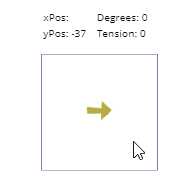
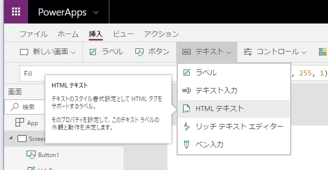
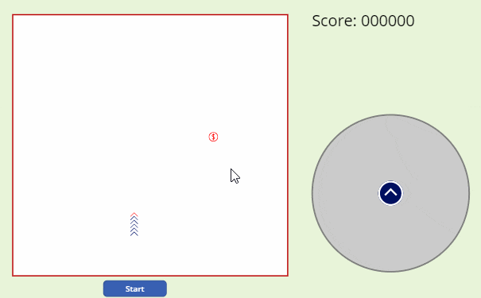

ドラッグ＆ドロップを疑似的にPowerAppsで出来たことで実現できる機能の幅が広がりました。
参考
[Power Appsでまだ利用できないドラッグ&ドロップを実装する方法](https://papasensei365.com/powerapps-drag-and-drop/)
今回はそれを応用したものです。
## 画像の回転と拡大縮小

スライダーを2本用意してそれぞれを操作することなく画像を回転させたり拡大縮小できるようになります。


## 方針

- HTMLテキストで画像を取得して、その上にスライダーを重ねてスライダーを操作します。その操作をタイマーで感知し、X座標とY座標、角度と力の大きさを取得して画像に反映します。
- 負荷がかからないよう、スライダーをドラッグしているときにだけタイマーを動かします。
- スライダーをドラッグしているときだけスライダーを大きくします

## 詳細

利用するコントロールは以下になります。

- HTMLテキスト 1つ
- タイマー 1つ
- スライダー 1つ

### スライダーのPressedを取得する

ボタンを押している状態を取得できるPressedですが、2020/4/23時点ではスライダーにありません。そこでスライダーのOnSelectとOnChangeの差からPressedを取得します。

```
Slider1.OnSelect = UpdateContext({pressed: false});UpdateContext({pressed: true})
Slider1.OnChange = UpdateContext({pressed: false})
```

### スライダーを押しているときはスライダーを大きくし、タイマーを動かす

スライダーはHTMLテキストと同じ位置・同じ大きさにしておくと便利です。ただしドラッグしているときに限りスライダーを多きくすることで動かせる領域が増え、微調整が容易になります。
今回はHTMLテキストの2倍の大きさにします。

```
Slider1.Width  = HtmlText1.Width  * If(pressed, 2, 1)
Slider1.Height = HtmlText1.Height * If(pressed, 2, 1)
Slider1.X = HtmlText1.X - If(pressed, HtmlText1.Width/2, 0)
Slider1.Y = HtmlText1.Y - If(pressed, HtmlText1.Height/2, 0)
```

スライダーの範囲は-100~100にしておきます。

```
Slider1.Min = -100
Slider1.Max =  100
Slider1.Defalut = 0
```

あとは[ドラッグ＆ドロップの記事](https://www.papasensei365.info/entry/2019/08/21/000000)で書いたロジックと同じようにX座標とY座標を取得します。

```
Timer1.Start = pressed
Timer1.Duration = 1
Timer1.Repeat = 1
Timer1.OnTimerStart = UpdateContext({isVertical: !isVertical})
Timer1.OnTimerEnd =
If( isVertical,
    If( xPos <> Slider1.Value, UpdateContext({yPos: Slider1.Value})),
    If( yPos <> Slider1.Value, UpdateContext({xPos: Slider1.Value}))
);
Slider1.Layout = If(isVertical, Layout.Vertical, Layout.Horizontal)
```

### 角度と力の大きさ取得する

X座標(xPos)とY座標(yPos)から角度(degrees)を求めるためにアークタンジェントを使います。
TimerのOnTimerEndに式を追加して角度を求めます。

```
UpdateContext({degrees: Degrees(Atan2(xPos, yPos))})
```

同様に、力の大きさ(tension)も求めて追加します。

```
UpdateContext({tension: Min(Sqrt(xPos^2+yPos^2), Slider1.Max)
```

描画がカクカクにならないようにintervalで若干の調整をします。
で、最終的に、TimerのOnTimerEndはこんな感じです。

```
Timer1.OnTimerEnd =
If( isVertical,
    If( xPos <> Slider1.Value, UpdateContext({yPos: Slider1.Value})),
    If( yPos <> Slider1.Value, UpdateContext({xPos: Slider1.Value}))
);
UpdateContext({interval: Mod(interval+1, 2)});
If(interval=0,
    UpdateContext({degrees: Degrees(Atan2(xPos, yPos))});
    UpdateContext({tension: Min(Sqrt(xPos^2+yPos^2), Slider1.Max)})
)
```

### HTMLテキストの利用

[ドラック＆ドロップの記事](https://www.papasensei365.info/entry/2019/08/21/000000)ではアイコンを移動させていました。今回これをHTMLテキストに変更します。

HtmlTextにて、先ほど求めておいた角度と力の大きさを入れることで画像が回転したり拡大縮小したりします。

```
HtmlText1.HtmlText =
"<div style='
position: absolute;
transform-origin: 0% 0%;
transform:rotate("& - degrees +90 &"deg) scale("& Max(0.3, tension/75 ) &") translateY(-50%) translateX(-50%);
top: 50%;
left: 50%'>
"
```

ちなみに私はCSSをあまり理解していません。試行錯誤を繰り返しながら作りましたので最適化されておらず余分なものが入っている可能性が大いにあります。CSSの先生は適宜変更をお願いします。
あとはスライダーを透明にすれば完成です。

## ローカルの画像は使える？

ローカルの画像への参照は見つかりませんでした。画像をOneDriveにアップしてからURLを指定する方法で回避しましょう。

## 応用

ちょっと変更すると十字キーのコントローラを作れますね。夢が広がりそうです。


## サンプル

アプリをアップしていますので気になる方はダウンロードしてみてください。
<https://powerusers.microsoft.com/t5/Community-Apps-Gallery/Rotation-controller/m-p/254895>

## ということで

ドラッグ＆ドロップの実装はやや難しいですが、理解できるといろいろと応用が出来て~~ゲーム~~業務に使えるかもしれませんね。
