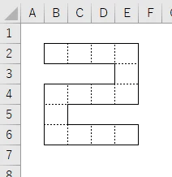
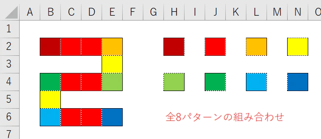
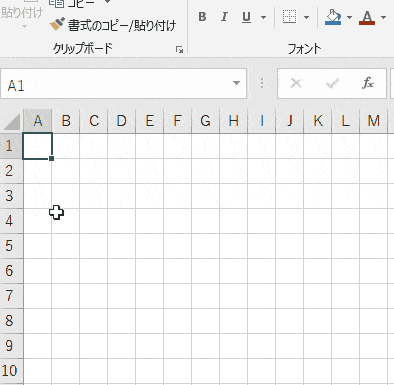
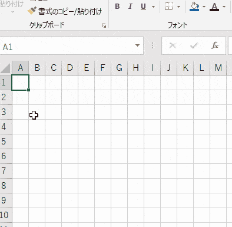
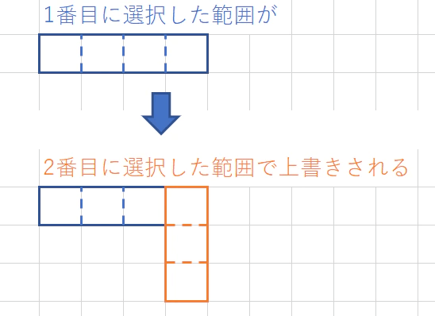
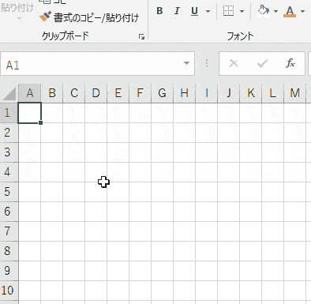
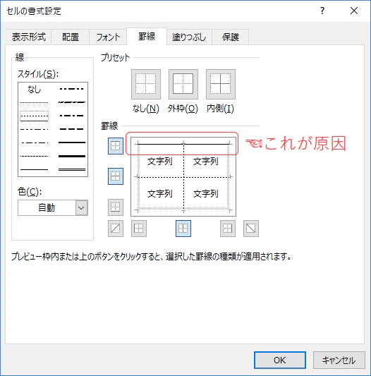
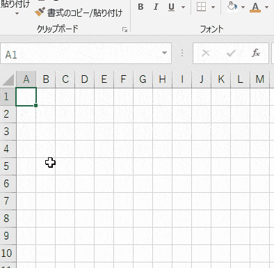
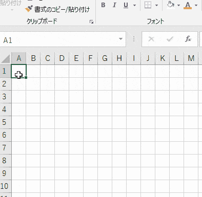

## 複雑な罫線はなぜ簡単に引けないと感じてしまうのか

Excelをある程度触ったことがある人だと罫線を引くための労力が少なくないことは知っています。  
以下のような「２」を10秒以内に書いてください、と言われたらできるかどうか不安になるはずです。

ではなぜこれが簡単ではないと感じるのでしょうか。そのあたりの原因を探りつつどうやったら効率的に書けるか考えようと思います。

## 長方形ではないから

罫線はセルを選択してから引くため、長方形の罫線なら引きやすいです。

しかし「２」のような曲がりくねった罫線を引くには長方形を複数組み合わせなければならず、選択の煩わしさがあります。

## 種類の異なる罫線が使用されているから

罫線の切り替えは書式設定を開いて切り替えなければならず、その変更の手間が発生します。

## 罫線の組み合わせが単純ではないから

「２」の外枠は実線、内側は点線なので作りは単純ですが、セル一つ一つを見てみると上下左右の罫線の組み合わせが8パターンあります。

ある程度は一括で設定できますが、そのあとは複数回繰り返し操作をしなければなりません。

これらを経験則から読み取ってしまうため、「簡単ではない」と判断してしまうのではないかと思います。

## 折角なので失敗パターンで引いてみる

それでは実際に「２」を作ってみましょう。

## 何も考えずに選択してみる

まずは「２」の形になるように選択します。そして書式設定を開きます。  
外枠が実線で内側が枠線なのですから正直にそのように設定すると・・・、

内側の一部が実線になってしまいました。  
これはセルの選択方法がよくなくて、**点線で引くべき部分が選択セルの「外枠」にあたってしまい実線になってしまっています。**

## 外枠と内側を意識して選択してみる

それでは選択のやり方を変えて、実線で引きたいところは外枠になるよう、点線で引きたいところは内側になるようにセルを選択してみます。  
なんとなくできそうですが・・・、

やはり内側に実線ができてしまいました。  
これは、**罫線が引かれる順番は選択した順になる**仕様が原因です。  
例えば今回1番目に選択した範囲に罫線が引かれた後に2番目に選択した範囲が上書きされるように引かれるため、右上角のセルの左辺が外枠扱いになり実線となってしまいました。

## 実線と点線を分けて設定してみる。

最後に、実線と点線を個別に設定してみます。

これまでより良くなったものの、内側に実線がまだ残っていますね。  
これは「[[Excel]罫線を崩さない書式変更は覚えておいてもよいかもしれない](https://qiita.com/tomikiya/items/6883219aff71a1d50293#%E6%9B%B8%E5%BC%8F%E3%82%92%E9%96%8B%E3%81%84%E3%81%A6%E3%83%97%E3%83%AC%E3%83%93%E3%83%A5%E3%83%BC%E3%81%AB%E7%B7%9A%E3%81%8C%E5%BC%95%E3%81%8B%E3%82%8C%E3%81%A6%E3%81%84%E3%81%9F%E3%82%89%E5%8D%B1%E9%99%BA)」の中の**「書式を開いてプレビューに線が引かれていたら危険」**の仕様が原因になります。

2回目の書式設定のプレビューを見ると上辺が実線になっています。点線だけを引いたつもりが上辺も実線で書き直してしまっていたということです。

## 失敗パターンをちょっと工夫すれば成功パターンに

最後の失敗が実に惜しいです。書式変更のプレビューで上辺が実線になっていることが原因なので、それを回避すればうまくいきます。

実線以外のセルも一緒に選択して上辺の「実線」を線の種類が特定できない時に表示される「**網掛けの線**」に変えてしまいましょう。

## ダミーのセルを選択する

上辺が実線でないセルを1つ以上選べばよいのでダミーのセルを追加で選択してから点線を設定してみます。

これだけでうまくできてします。

## 実は選択する順番を変えるとダミーのセルが要らない

今回の「２」のケースに限って言えば選択する順番を変えるだけで全ての線を網掛けにできます。  
真ん中の横線を先に選択すると上辺が網掛けになります。

## 複雑な形ほどダミーが要らなくなる

複雑な図形を描くと大概全てが網掛けになるのでダミーセルが要らなくなります。  
逆に少しだけ複雑な図形だと今回のように何かしらの工夫が必要になるので面倒になります。

## ショートカットを使えば更に時間短縮

「外枠を実線にする」はショートカットが用意されていて**Ctrl+Shift+6**で引けます。

## 「２＋３＝５」を効率よく作る

これまでの内容を利用すれば複雑な罫線でも効率よく引けるようになります。

手順は以下のようになります。

- 形通りに選択
- Ctrl+Shift+6で外枠を実線にする
- 書式設定を開いて「内側」を点線にする

これだけでOKです。

> RT > やっぱり単純にできました。  
> 24秒でした。（温泉に入っているときほど良案が思いつく。） [pic.twitter.com/XYe7sj5sAb](https://t.co/XYe7sj5sAb)
>
> — パパセンセイ (@10mikiya) [September 1, 2018](https://twitter.com/10mikiya/status/1035889449605914628?ref_src=twsrc%5Etfw)

## ということで

罫線の仕様を把握していればちょっとした工夫で時間短縮できることがあります。  
また、罫線がうまく引けないときに原因がよくわからずイライラする場面も減るので覚えておいて損はないと思います。

ただ「手順を考えて構想を練る時間より、手を動かした方が速く引けるからこんな仕様は知らなくてもいい！」という意見は否定できません・・・。

## 関連するお話

[[Excel]罫線を崩さない書式変更は覚えておいてもよいかもしれない](https://qiita.com/tomikiya/items/6883219aff71a1d50293)

[[Excel]イラっとする罫線の挙動、その原因と対策をまとめた](https://qiita.com/tomikiya/items/1ad69b23230d7e529987)

[[Excel]罫線の優先度を今一度整理する](https://qiita.com/tomikiya/items/37e03c8bd8dfcb1a37c3)
