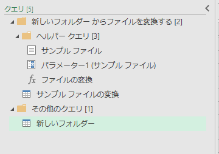
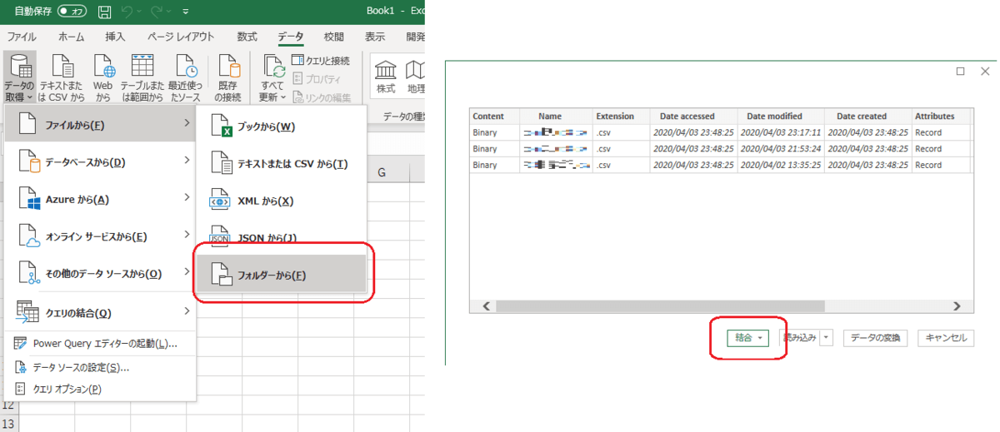
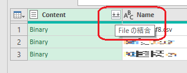
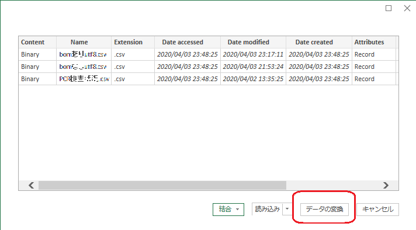
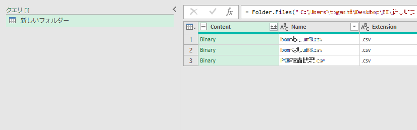
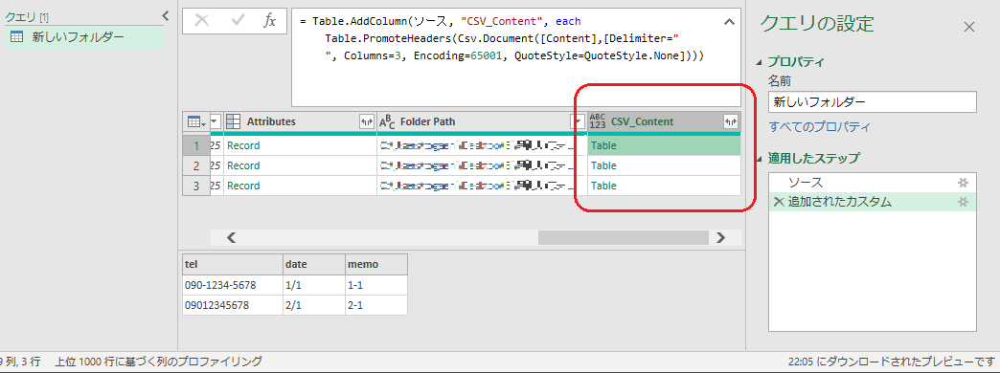
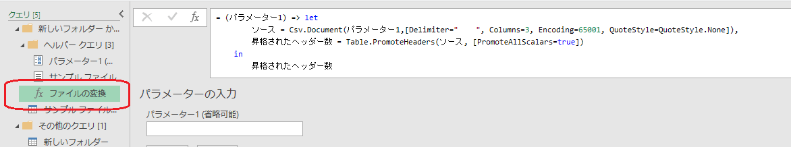

ExcelやPower BIでデータを取得するときに、「フォルダーから」を選択するケースは多いと思います。
その時に作られるクエリ「ヘルパークエリ」の話です。
## ヘルパークエリとは

作った覚えのないクエリが生成されることがあります。
↓

これがヘルパークエリです。
複数のフォルダーを取り込むとその数だけこのヘルパークエリが生成されたりするので、正直鬱陶しいと感じたことがある方も多いのではないでしょうか。
これはPower Queryがファイルの中身を解析するためのもので、ファイルに含まれるデータの列数や文字コード、見出し等を取得するために作られています。
解析した項目は、ファイルの中身を展開して結合するクエリで使われています。

## ヘルパークエリを生成するケース

ファイルを結合するクエリをPower Queryに作ってもらうと生成されます。
例えば、[データ]-[データの取得]-[ファイルから]-[フォルダーから]でフォルダーを選択し、「結合」を選ぶと生成されます。

また、見出しのボタンで「ファイルの結合」をした場合にも作られたりします。


## ヘルパークエリに頼らないで取り込むために

### フォルダーの情報を取り込む

まずはフォルダーの情報だけ取得します。ファイルの結合をしなければヘルパークエリは生成されません。
前述したクエリを生成するケースにおいて、「結合」を選ばず、「データの変換」を選ぶとヘルパークエリが生成されないことが分かります。

結合の手前、ファイルの一覧まで取り込まれます。


### Binaryを解析して中身を展開する

ヘルパークエリがやってくれていたBinaryの解析を自分で行います。
取り込みたいファイルの種類や文字コード等はほとんどの場合で取り込む前に把握しているはずですので、自分で指定できるはずです。
例えば「区切り位置がタブ」で「列数が3」、「文字コードがSHIFT-JIS」のCSVを取り込むなら以下のようにすれば解析結果の列を追加できます。

```
= Table.AddColumn(ソース, "CSV_Content", each Table.PromoteHeaders(Csv.Document([Content],[Delimiter="    ", Columns=3, Encoding=65001, QuoteStyle=QuoteStyle.None])))
```

（[Csv.Document](https://docs.microsoft.com/ja-jp/powerquery-m/csv-document)でCSVのコンテンツを取得し、[Table.PromoteHeaders](https://docs.microsoft.com/ja-jp/powerquery-m/table-promoteheaders)で1行目をヘッダとしています。）
↓

あとは不要な列を削除してtableを展開すれば完了です。

#### よく使う文字コード

shift-JISは932で、utf-8は65001です。

#### 自分で式を作れない場合は

もし、文字コードが分からなかったり、どうやって解析すればよいか見当もつかない場合はヘルパークエリを敢えて作ってみてください。
「ファイルの変換」の関数クエリで手順を確認できます。


## ということで

ヘルパークエリが煩わしくなってきたらPower Queryを理解してきている証拠だと個人的に思いますので、仕様を理解できてきたら挑戦してみてもよいかもしれません。
