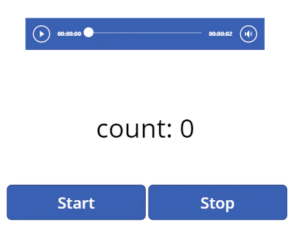
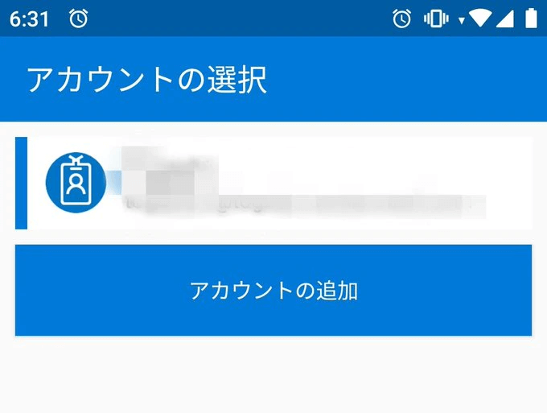

Power Appsで緯度経度を定期的に取得するときは、`Location.Latitude`と`Location.Longitude`をタイマーで取得するのがオーソドックスです。
しかし画面を消したり他のアプリを立ち上げると緯度経度が取得できなくなる現象が発生していました。このため常にPower Appsをアクティブにする必要がありました。
これまで、この現象の理由を**画面がアクティブになっていないとアプリが止まる**と思っていました。
でも**それは違いました**。今回はそんなはお話です。
## 結論から

**動かない理由はタイマーを使っているから**
どうやらタイマーは画面を消したりアプリがアクティブになっていないと止まるようです。

## ということは

タイマー以外ならバックグラウンドでも動くようです。
すべてを確かめたわけではありませんが少なくともオーディオはバックグラウンドで動く機種がありました。
「動く機種があった」という表現は、もしかしたら機種によってバックグラウンドで動かない可能性も捨てきれないためです。

## タイマーを使わないでどうやって緯度経度を取得する？

オーディオかスライダーを使います。
すでに @github129 さんが[記事](https://qiita.com/github129/items/75f5f83d9842aab89da3)にしていますがスライダーを使ってタイマーより高速にループする実装をしています。
つまりスライダーはタイマーの代わりにもなるわけです。
実際、スライダーを使って定期的に緯度経度をFlowやPatchで送れることを確認しています。
ただ、画面を消したときになぜか送信が鈍化することがありました。
私が試した限りではオーディオの方が安定するようなので以降はオーディオでの実装方法を記述します。

## 実装方法

### 用意するもの

- オーディオ(Audio1)
- Startボタン(btnStart)、Stopボタン(btnStop)
- 送信した数を表示するラベル(lblCount) ※任意



### スタートボタンとストップボタンで動かす

それぞれのボタンのOnSelectにオーディオを再生させたり止めたりするための変数の処理をいれます。
`count`はあってもなくてもよいです。何回送信したか数えるための変数です。

```
btnStart.OnSelect = UpdateContext({count:0});
UpdateContext({running:false});
UpdateContext({running:true})
btnStop.OnSelect  = UpdateContext({running:false})
```

### オーディオに音楽を登録

緯度経度を取得したい間隔と同じ長さの音源を用意して登録します。
無音の音源であるとさらに良いです。
さらに繰り返し流れるよう`Loop=True`としておきます。

```
Audio1.Media = (音源)
Audio1.Loop = True
```

### オーディオで送信処理

オーディオの`Start`に`running`を登録し、Startボタンで音楽が流れるようにします。
また`OnEnd`にFlowまたはPatchを実行する処理をいれます。
Flowや保存先はあらかじめ作っておきましょう。Excelにデータを溜めるとPower Mapsでビジュアライズできるので便利です。
また`Location`は何も対策しないと一定時間更新されません。そのため`DIsable(Location)`と`Enable(Location)`を入れて強制的に更新する処理を入れます。

```
Audio1.Start = running
Audio1.OnEnd = UpdateContext({count: count + 1});
Disable(Location);
Enable(Location);
Patch(sheet1,
{緯度:Location.Latitude,
経度:Location.Longitude,
高さ:Location.Altitude,
日時:Text(Now(),"[$-ja]yyyy/m/d hh:mm:ss")
}
)
```

### 実行回数を表示（任意）

繰り返しの回数を表示します。

```
lblCount.Text = "count: " & count
```

以上で完成です。

## 結果

他のアプリをアクティブにしていても画面を消しても音楽が繰り返し流れてそのたびにFlowやPatchが実行されます。
音楽が流れてちょっとうるさいので無音の音源が用意できるとよさそうです。音量を0にして回避もできますね。
もし短い時間の音源を用意できれば現在時刻と差分を計算して好きな間隔で送信することもできます。

## アプリが落ちてしまう現象への対策

数時間バックグラウンドで動かしているとアプリが落ちる現象が発生することがあります。

### アプリが落ちる原因

OS側が一定時間利用していないアプリを落とすのが原因と思われます。
**私が確認した機種はAndroidだけなのでiOSは不明です。**機種の問題もあるため私が改善できた範囲の方法を記しておきます。

### アプリを落ちないようにするために(Android)

以下の設定のいずれかまたは複数を設定してみてください。

- 設定の「電池の最適化」にてPowerAppsアプリを「最適化しない」に設定する
- 設定の「電池の最適化」にてMicrosoft Authenticatorアプリを「最適化しない」に設定する
- 設定の「バッテリーセーバー」をOFFに設定する
- バッテリーの減りを少なくさせるようなアプリを止める
- PowerAppsをアクティブにした状態で画面を消す

電池の最適化を行っていると、OSから使っていないとみなされた時に勝手に終了させられてしまうようです。
また Microsoft Authenticatorを入れている場合、こちらも「最適化しない」が必要です。最適化しているとアカウントの再選択画面が表示されて、Power Appsが止まってしまいます。
↓

またバッテーリーを節約するアプリやモードは使わないようにしてください。同様にアプリが終了する原因になります。
そして重要なのは**Power Appsアプリをアクティブにした状態で画面をOFF**にしないといけません。
他のアプリを起動した状態で画面をOFFにすると20分程度でアプリが終了してしまいました。
電池の消費率にどれだけ影響するか分かりませんが、私の端末では以上の設定により安定して計測してくれるようになりました。

## 折角なので、緯度経度をビジュアライズ化してみる

ExcelのPower Mapsで視覚化してみました。約5時間動かしても計測してくれました。
> [#PowerApps](https://twitter.com/hashtag/PowerApps?src=hash&ref_src=twsrc%5Etfw) バックグラウンドで緯度経度を取得してみた実家帰省の軌跡。5時間の移動でも切れずに動き続けてくれた。Wifiを切ってPowerAppsをアクティブにした状態で電源を消せば長時間動き続けてくれるようだ。それ以外だと一定時間でアプリがDestroyされたり再認証が走って止まるみたいだった。 [pic.twitter.com/GEnwNfOjHm](https://t.co/GEnwNfOjHm)
>
> — パパセンセイ (@10mikiya) [2019年8月10日](https://twitter.com/10mikiya/status/1160014984589410311?ref_src=twsrc%5Etfw)

## 今後について

今年の夏にInteractive Mapsがpublic previewされます。地図に関する機能が充実するので、もしかしたら今回のような対策をしなくてもバックグラウンドで緯度経度が計測できるようになるかもしれませんね。
<https://powerapps.microsoft.com/ja-jp/blog/new-geospatial-features-in-power-apps/>
↓ここのコメントもセットで見るとちょっと期待してしまいますね。
<https://powerusers.microsoft.com/t5/Power-Apps-Ideas/Enable-GPS-Capture-in-Background/idc-p/407986/highlight/true#M28550>

## ということで

バックグラウンドで位置情報が取得できるようになれば追跡アプリや軌跡アプリのような行動を記録するアプリが作りやすくなりそうですね。
