2020/06/01現在、Power Appsではドラッグ&ドロップができるコントロールは実装されておりません。
業務アプリを作るうえでは必要になる場面もあるかもしれませんので何とか実装できないか試してみました。
ある程度の形にはなったのでまとめます。
試行錯誤中のためまだまだブラッシュアップは出来ますがとりあえずということで。

#### 注意

Power Appsはローコーディングが売りだと思っています。今回の手法はローコーディングとは言いにくいのでくれぐれも使う場面を考えて適宜参考にしていただければと思います。
## 方針

既存のコントロールを組み合わせ疑似的にドラッグ＆ドロップしているように見せかけます。
利用するコントロールは以下です。

- スライダー 1つ
- タイマー 1つ
- アイコン 1つ

## 前提

詳細な説明の前にスライダーとタイマーの説明、そして知っておきたい特性をまとめます。

### スライダーのValueはリアルタイムに値を参照できる。

スライダーはユーザがレバーを動かして値を調整できるコントロールです。
スライダーの丸ボタンを動かすとその値をリアルタイムに取得できます。
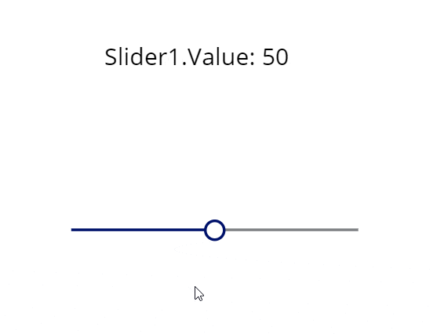
例えば上のGIFようにスライダー(Slider1）のValueをラベルのTextに登録しておくと、スライダーを動かした瞬間にラベルが更新されます。
設定は以下のような形です。

```
Label1.Text = "Slider1.Value: " & Slider1.Value
```

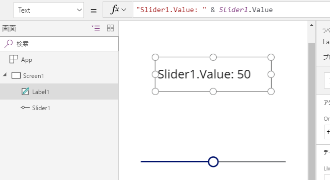

### スライダーはタップした時と変更したときにイベントを仕込める

スライダーには、OnSelectとOnChangeがあります。OnSelectにはスライダーを選択した直後に発動したいイベントを仕込めます。例えばスライダーを触ったらボタンを少し大きくするとか、スライダーを触ったら音が鳴るとかできるようになっています。また同様にOnChangeはスライダーを変更したときに発動したいイベントを仕込めます。スライダーを動かしたらデータを更新するとかできますね。
大事なのは、**OnSelectは押した直後、OnChangeは離した直後に原則発動する**ことです。
この差を利用してスライダーを「押している」状態を判定できます。
[詳細](https://qiita.com/tomikiya/items/56b5d07019f0c15e4e9d)は別記事に載せているので省きますが、スライダーではPressedを使えないため(2019/3/15時点)、上記特性を利用してPressedを取得します。
**補足:**OnChangeは離した直後に発動すると書きましたが「原則」です。OnChangeにスライダー自身をResetするような処理を書くと押している間でもOnChangeが発動します。

### タイマーの開始時と終了時にイベントを仕込める

タイマーは特定の時間を経過した後に何かしらのイベントを仕込めます。タイミングはタイマー開始時と終了時です。
また経過時間を長くしたり短くしたりでき、繰り返し処理も可能なので、間隔を短くして繰り返しさせれば他の言語でいうところのFor文やLoop文の代わりとして使えたりします。

### スライダーのValueをタイマーで取得し、変数を介して加工できる

スライダーとタイマーを組み合わせることでスライダーのValueをもとに別の値を作り出すことができます。

#### 例：

タイマー開始時の処理となるOnTimerStartにスライダーのValueを倍にして変数(alterValue)に格納します。
またDurationで1(1ミリ秒)を設定し、Repeatをtrueとしてみます。
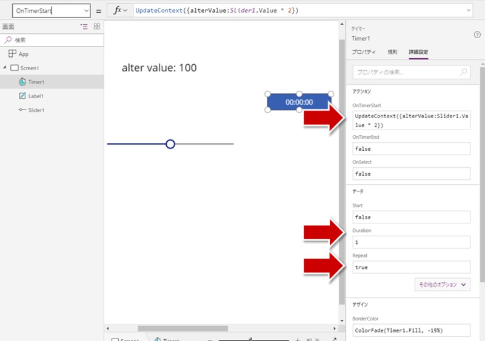

```
Label2.Text = "Alter value: " & alterValue
Timer1.OnTimerStart = UpdateContext({alterValue:Slider1.Value * 2})
Timer1.Duration = 1
Timer1.Repeat = true
```

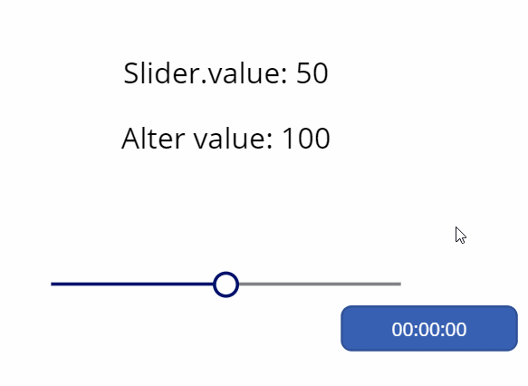
丁度2倍になってますね。
**補足**：確認するときの注意として、タイマーはプレビューモードにしないと動きません。確認は毎回画面右上の三角ボタンで再生し、タイマーボタンをタップしましょう。
また、再現は出来なかったのですが、以前、複雑にしすぎて値が反映されないことがありました。今は改善されたのかもしれません。

## 本編

それでは詳細です。

### X軸方向を作る

#### スライダーとアイコン（飛行機）をリンクさせる

[サンタゲーム](https://qiita.com/tomikiya/items/a9095bfb74c9b342bd0f)を作ったときにも使用した方法で、まずはX軸方向のドラッグアンドドロップを作ります。
アイコンまたは画像を用意し、そこに重なるようにスライサーを置きます。スライサーのValueを画像のXに設定し、スライサーを透明にすれば完成ですね。※後述の説明ではスライサーを透明にすると分かりづらくなるため表示したままにします。
あとスライダーのプロパティをちょっと調整します。

```
icon1.X = Slider1.Value
Slider1.X = 0
Slider1.Y = 0
Slider1.Width = 750
Slider1.Height = 750 //Widthと同じ値にしておくこと
Slider1.Max = 750
Slider1.Min = 0
```

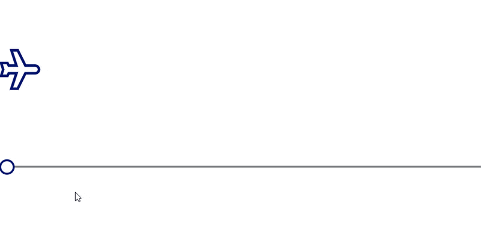
飛行機の位置が少しスライダーとずれているので式を変えます。

```
icon1.X = Slider1.Value - icon1.Width/2
```

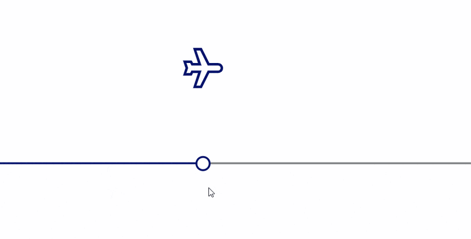

#### どこをタップしてもスライダーを押せるようにする

デフォルトのままだとスライダーの円または線を触らないと反応しないので、触れる領域を画面全体に拡大します。

```
Slider1.RailThickness = 750
Slider1.RailFill = RGBA(128, 130, 133, 0.2)  // 飛行機が見えるように透過率を忖度、あとで0にする
Slider1.ValueFill = RGBA(0, 18, 107, 0.4) // 飛行機が見えるように透過率を忖度、あとで0にする
```

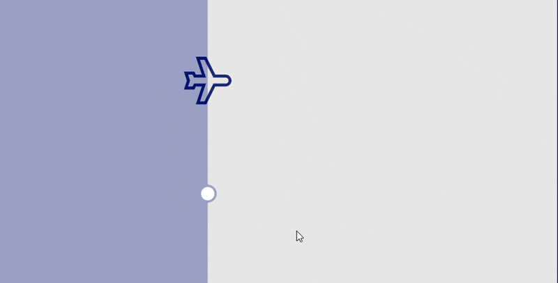
飛行機を触っても動かない場合は、飛行機がスライダーより前面に出ている可能性があります。スライダーが最前面に出るように左ペインで再配列してください。

#### タイマーを仲介してx軸を更新する

この段階では特に効果は薄いですが後々のためにタイマーを介して飛行機のx軸を更新します。
また理由は後述しますがタイマーのOnTimerEndを使います。

```
Timer1.OnTimerEnd = UpdateContext({xPos:Slider1.Value})
Timer1.Duration = 1
Timer1.Repeat = true
icon1.X = xPos - icon1.Width/2
```

X軸方向への対応は以上です。

### Y軸方向を作る

ここからが問題です。X軸方向と同様に・・・、とはいきません。
**縦方向のスライダーを用意しても、2つのスライダーを同時に押すことは出来ないからです。**
そこでX軸方向のスライダーをY軸でも使えるようにします。
ポイントは**Layout**プロパティです。

#### Layoutプロパティで垂直方向と水平方向を切り替える

Layoutを変更すればスライダーを縦方向に切り替えられます。

```
Slider1.Layout = Layout.Vertical
```

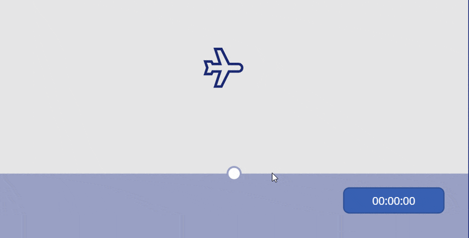

#### 垂直と水平の切り替えをタイマーに任せる

Layoutプロパティの切り替えをタイマーで行うとスライダーを触ったまま垂直と水平を切り替えられます。
繰り返す間隔が1ミリ秒なので高速でスライダーが切り替わります。
切替のために変数(isVertical)を用意し、OnTimerStartの中で制御します。

```
Timer1.OnTimerStart = UpdateContext({isVertical:!isVertical}); // True⇔False
Slider1.Layout = If(isVertical, Layout.Vertical, Layout.Horizontal)
```

↓別タブで開くと拡大表示できます（閲覧注意）
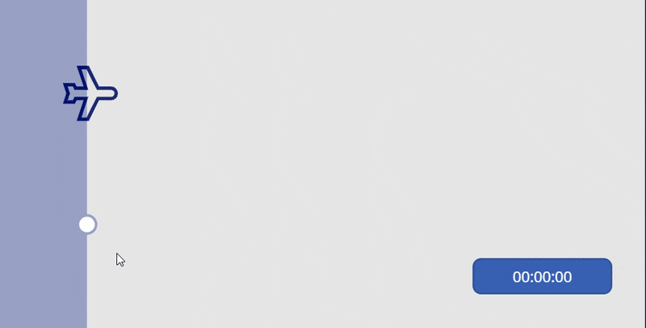
これでスライダーを触ったままX軸とY軸の座標を取れます。

#### X座標とY座標を取得する

LayoutがHorizontalの時はX座標(xPos)、Verticalの時はY座標(yPos)としてスライダーのValueの値をそれぞれの変数に格納します。
また、飛行機のY座標もそれに合わせて修正しておきます。X座標と異なりY座標は上下反転してますので式の作りが若干違います。
**補足**：Valueを取得するタイミングとLayoutを切り替えるタイミングが噛み合わないとうまく値を拾えません。いろいろ試したのですがLayoutを切り替えるのはOnTimerStartで、Valueを取得するのはOnTimerEndがよさそうでした。この順番を逆にしたりひとつにまとめて処理すると飛行機が暴れたりX座標とY座標が逆になったりしました。

```
Timer1.OnTimerEnd = If( isVertical,
UpdateContext({yPos:Slider1.Height - Slider1.Value}),
UpdateContext({xPos:Slider1.Value                 })
)
icon1.Y = yPos - icon1.Height/2
```

↓別タブで開くと拡大表示できます（閲覧注意）
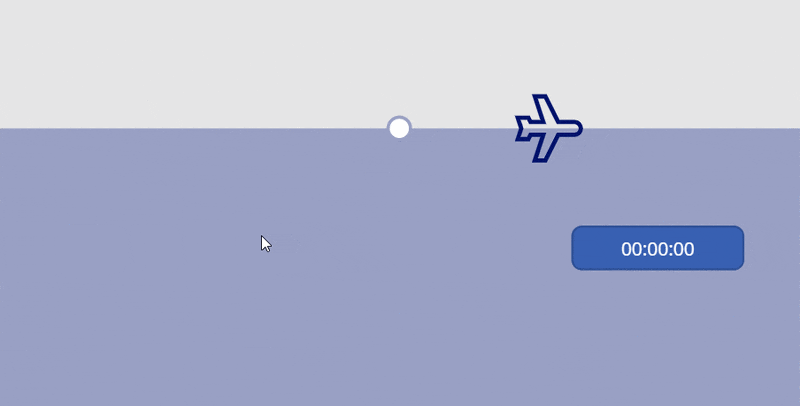
ほぼほぼ完成ですね。これでスライダーを透明にするとドラッグ＆ドロップしているように見えます。

```
Slider1.RailFill = RGBA(128, 130, 133, 0)
Slider1.ValueFill = RGBA(0, 18, 107, 0)
Slider1.BorderColor = RGBA(0, 18, 107, 0)
Slider1.ShowValue = false
```

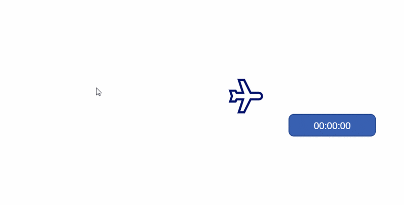

### 微調整

前述してきた手法だけでは１つ課題が残ります。
それは**飛行機が暴れる**ことがある点です。
これはスライダーの仕様が原因であるため上手に回避する必要があります。

#### 暴れる原因

スライダーをつかんだまま動きを止めるとValueもそれに伴い動きを止めます。止め続けた状態でLayoutが変わるとどうなるでしょうか。どうやら値が変わらないようです。
例えば、飛行機が画面の右下にいる場合（X軸:750、Y軸:750）、その時点のスライダーのValueは750か0の可能性があります。（※0の可能性があるのは、Y軸が上下逆なため。）、仮にLayoutが垂直方向でValueが0の状態で動きを止めたとすると、Layoutが水平に切り替わってもValueの値が0のままなため、X軸が0で保存されてしまいます。すると飛行機は画面右下から画面左下にワープしてしまいます。同様に、もしValueが750の状態で動きを止めると、Layoutが垂直に切り替わった瞬間に飛行機が画面右上にワープします。
実際に見てみた方が早いですね。切り替えの間隔を遅くして確認してみます。
前半は動かし続けている状態、後半は動きを止めた状態です。
↓別タブで開くと拡大表示できます（閲覧注意）
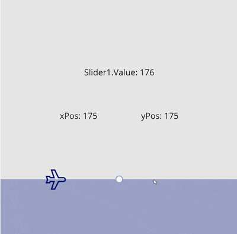
動きを止めた後に左か上にワープしています。
これが暴れる原因です。

#### 対応

ワープしそうなときはValueの値を反映しなければよいです。
ワープしそうな時、それはX軸とY軸の値が同じになりそうな時です。上のGIFを見ても分かりますがワープするときはxPosとyPosが同じ値になっています。X軸またはY軸とValueを比較し、異なる場合にだけ反映するようにします。

```
If( isVertical,
If( xPos <> Slider1.Value                 , UpdateContext({yPos: Slider1.Height - Slider1.Value})),
If( yPos <> Slider1.Height - Slider1.Value, UpdateContext({xPos: Slider1.Value                 }))
)
```

↓別タブで開くと拡大表示できます（閲覧注意）
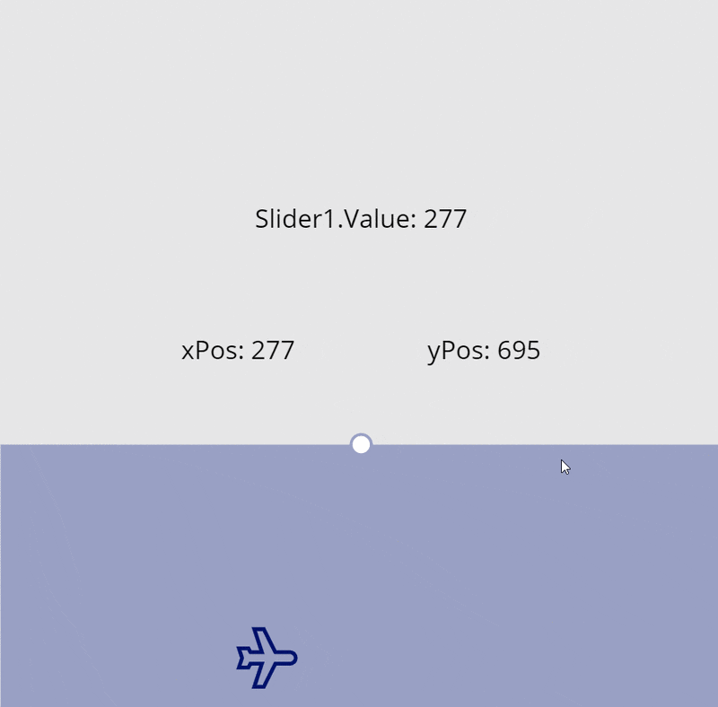
暴れなくなりましたね。スライダーを透明にしたらよりわかります。
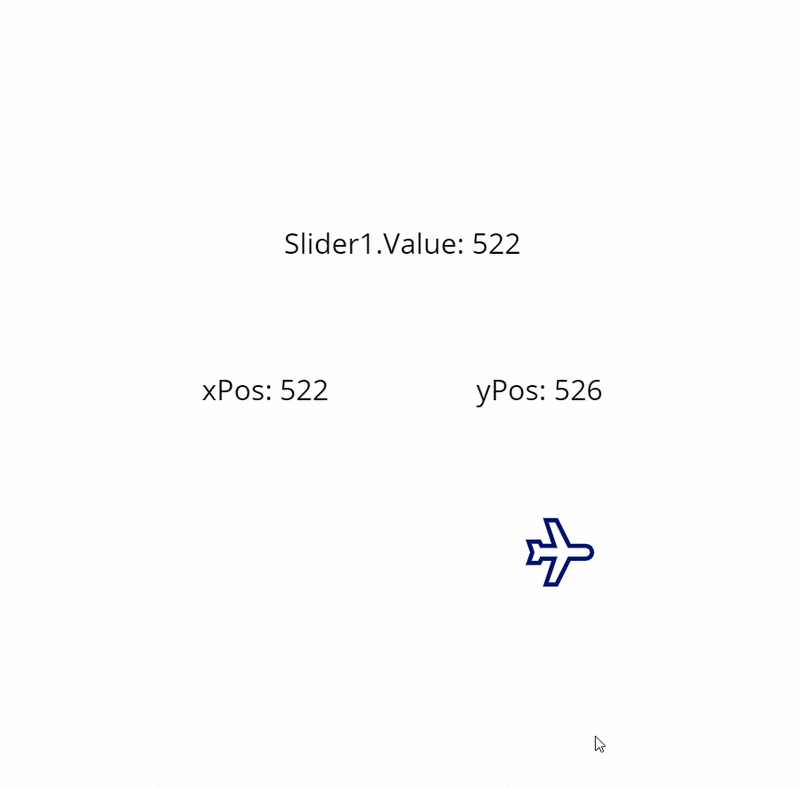
ただこれでも稀に暴れることがあって、まだ原因が分かっていません。何かわかりましたら追記します。
以上が疑似的なドラッグ＆ドロップの作り方です。

## まだ課題はある

ドラッグせずにタップされると2軸の更新ができず1軸しか更新されません。この課題は2020/6/1時点で未解決です。

## モバイル端末で動かない課題

PCではうまく動くのにモバイル端末だと動かないケースがありました。

### 原因

スライダーをモバイル端末で操作しようとすると、ハンドルをタップしないと操作できないケースがあります。
ハンドル以外のレールの部分を触って動かそうとすると、タップには反応するもののスライドしようとすると少し動いて止まる、みたいな現象が起きます。
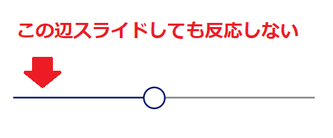
この現象によりドラッグ&ドロップができないようです。

### 回避策

#### ハンドルのサイズを大きくする

`HandleSize`を大きく設定してハンドルに触りやすくすると反応しやすいです。
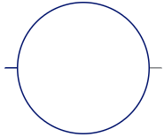

#### スライダーの領域を逆に小さくする

スライダーの領域が小さければ小さいハンドルでも触る確率が上がります。
実装によって使い分けるとよさそうです。

## 応用

当たり判定を実装すればアイコン以外の領域をクリックしても反応させないようにしたり、
ギャラリーを利用すれば複数のアイコンをドラッグ＆ドロップ出来るようになります。
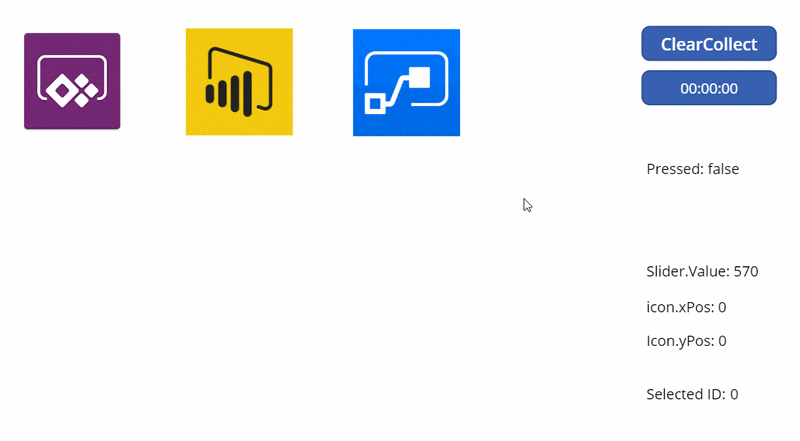
モチベーションがあれば詳細を書きます。

## ということで

そのうち標準で出来るようになると思います（なるといいな）。
それまでの代替手段としていただければと思います。
