一般的なExcel使いでしたら、VBAを覚え始めると一度はゲームを作りたいと思いますよね!!特にセルと相性が良いマインスイーパーは割と作りやすい部類だと思うので「これなら自分でも出来そう」みたいな感覚になりますよね。

そこで私も今更ながら負けじとExcelでマインスイーパーを作ってみました

**VBA無しで**。

良い感じにできたので折角ですし共有したいと思います。いろんな小技があるので業務でも（たぶん）役立つものがあるかもしれません。

## こんなの出来ました

構想1日、製作3日、モチベーションも下がらず最後まで作りくることが出来ました。

https://twitter.com/10mikiya/status/1267745678949679106

残念ながら完全再現とまではいかず、右クリックに当たるアクションは別窓で操作する形になりました。それでもそこそこ遊べる形にはなっています。

## ファイルを公開しています

実際のものを見ないとよくわらないと思いますのでファイルを公開しています。ExcelのバージョンやOSによって動かないかもしれませんが是非触ってみてください。注意として、他のExcelファイルを閉じてから開いてください。またこのファイルを開いているときに他のファイルを開かないでください。他のファイルの設定を壊す可能性があります。

https://github.com/tomikiya/excel\_game\_minesweeper

## ポイント

ゲームを作る3つのポイントになります。

・操作履歴を記録する

・操作履歴から状態を計算する

・循環参照と仲良くする

それでは作り方を解説していきます。

## VBAを使えないことでの制限

前回作成した3D迷路の時と同様にいくつか制限があります。

https://tomikiya.github.io/excel-nonvba-3d-maze/

今回も関数と機能だけでゲームを作ることになります。この制限の中でボタン操作を認識したり、ランダムに爆弾を置いたり、状態をリセットしたりと課題がいくつかあります。これまでの知識と新たな小技を組み合わせてこれらを実現することになります。

もし興味がありましたら3D迷路の作り方も見てみるとより内容を理解し面白くなるかもしれません。

## 【小技1】ボタンはフォームコントロールで作る

まずはボタンの作り方から解説します。考え方は3D迷路の時と一緒なのですが、利用するコントロールは「ラジオボタン」になります。

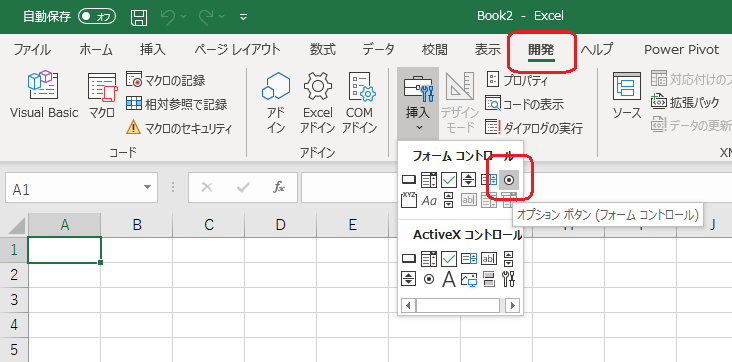

ラジオボタンはクリックイベントを拾ってくれて、セルとリンクすると値を反映できる優れものです。また複数配置することでラジオボタン同士を連携して値を変化させられます。

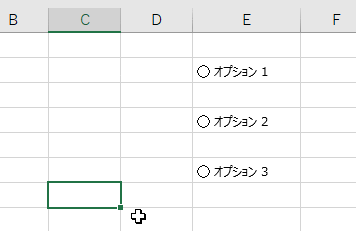

この値を元に計算できるようになります。

### グループボックスでラジオボタンをまとめる

ラジオボタンを囲うようにフォームコントロールのグループボックスを配置します。こうすることでラジオボタンにまとまりをもたせ管理することができます。今回は9×9個のセルにあたるまとまりと、「選択中の項目」をそれぞれまとめることになります。逆にグループボックスを使わないとシート全体のラジオボタンが1つのまとまりと判定され、正しい数値を読み取れなくなります。黄色い顔のリセットボタンにもラジオボタンを使いますが1つしかないのでグループボックスは使用しません。

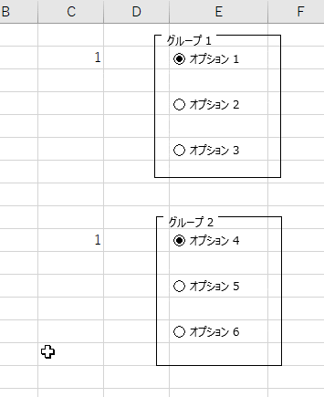

## 【小技2】81個のラジオボタンを配置し、隠す

9×9のセル1つずつにボタンが必要になるので、81個のラジオボタンをセルの上に配置します。配置前の状態はこんな感じです。背景やウィンドウは単なる賑やかしなので排除しています。

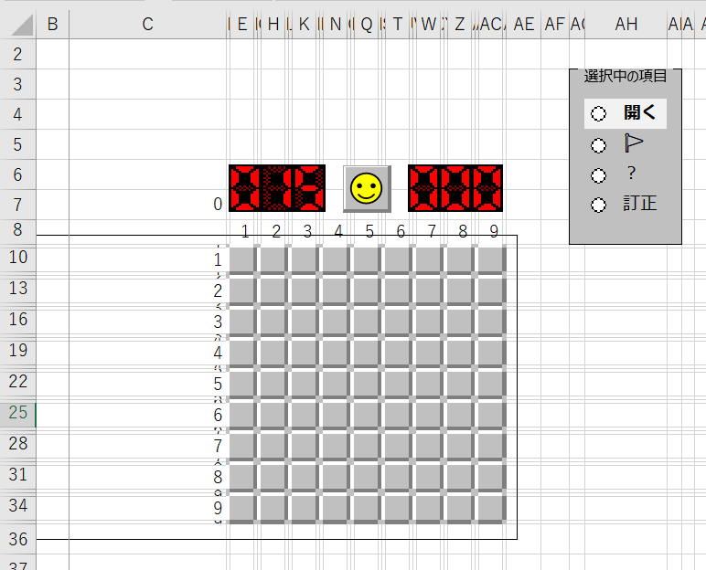

↓ここにラジオボタンを81個配置するとこうなります。

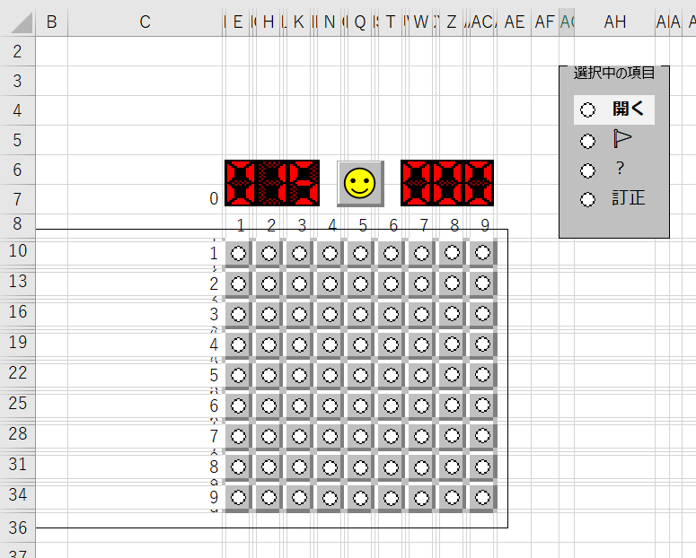

後はこの「○」を消すだけです。が、消せません。消せないので隠します。3D迷路でも使った列を固定する方法です。ボタンの部分だけA列に被るように伸ばし、C列でウィンドウを固定します。

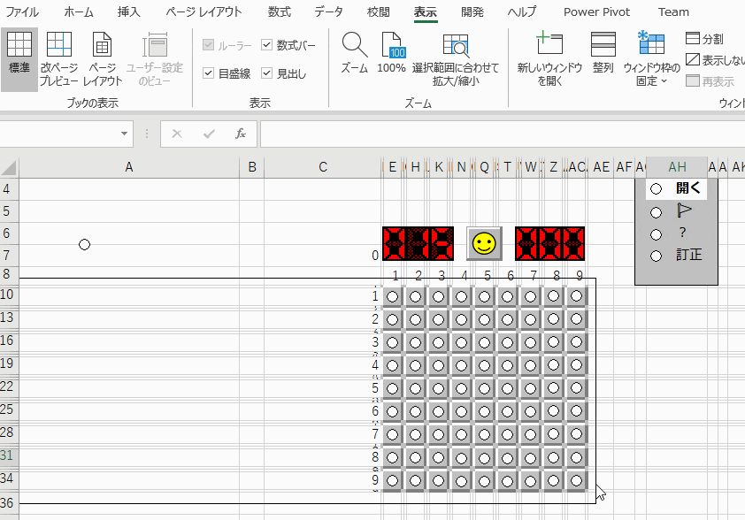

これでボタンを隠しつつ当たり判定だけ残すことが出来ました。

ここで、ラジオボタンの並び順だけ注意です。左の列が最前列、右の列が最背面になるように順序を調整します。逆だとうまく押せなくなります。

リセットボタンも同じ方法でA列に隠しています。

## 【小技3】操作履歴を残す

VBAを使わないと「今どんな形になっているか」を残すのが難しいです。またボタンを押したときに「次にどんな形になるか」を計算するのも大変です。そこで操作した順序をどうにかして覚えておいて、操作履歴全部から毎回状態を再計算するようにします。このあたりの考え方も3D迷路と変わりません。

### ラジオボタンの「リンクするセル」を動的に変える

名前定義とリンクするセルを使って、ボタンを押したときにリンクする位置を変えていきます。INDIRECT関数を使うと、ボタンを押すたびにリンクするセルの位置を1行ずつ下げることができます。

必要な操作履歴は「どのセルを押したか」「どの項目が選択されているか」「リセットが押されたか」の3つになりますので、これらそれぞれの名前定義を作成します。

```
' 名前定義
リンクするセル_押したセル   = INDIRECT("操作!$B$"&操作回数+2)
リンクするセル_選択中の項目 = INDIRECT("操作!$C$"&操作回数+2)
リンクするセル_リセット     = INDIRECT("操作!$D$"&操作回数+2)
```

そして、それぞれをラジオボタンのリンクするセルに設定します。

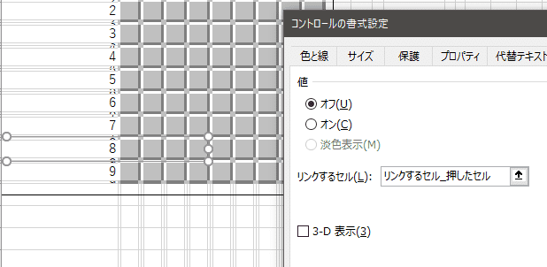

これで設定は完了です。実際にラジオボタンを押すと操作履歴のテーブル「操作」に記録が追加されていく様子が分かります。

https://youtu.be/dC0BzTw2z2o

もっと詳細を知りたい方は3D迷路の記事をご確認ください。

https://tomikiya.github.io/excel-nonvba-3d-maze/

## 【小技4】操作のタイムスタンプ取る

操作履歴にボタンを押した時刻を記録することで遊戯時間を計算できるようにします。

つまり↓ここのための布石です。

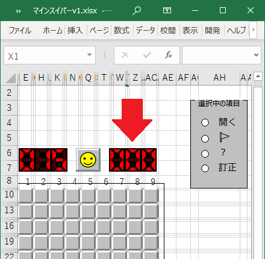

### 時刻をNOW関数で取得、自動更新しないように循環参照にする

時刻を取得するには皆さんご存知のNOW関数を使います。ただ、NOW関数は揮発性関数と呼ばれる関数で、セルを更新するたびに値が変わってしまいます。RAND関数やOFFSET関数も揮発性関数と呼ばれていて、一般的な使い方では値の自動更新を止められません。

そこで、循環参照を利用します。

#### 循環参照とは

複数のセルまたは1つのセルがそれぞれの情報を参照しあってループに落ちいる参照です。

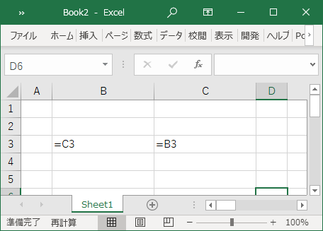

通常、循環参照が発生するとExcelは警告を出し計算を止めます。皆さんも一度はこのメッセージを見たことがあるでしょう。

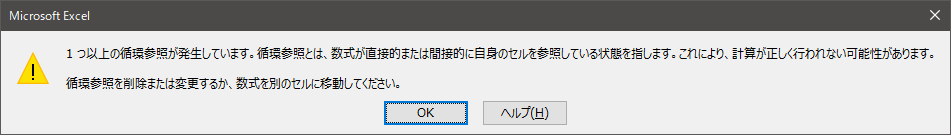

これをあえて使います。

### 操作履歴に時刻の列を追加する

操作履歴のテーブル「操作」に、「時刻」の列を追加して循環参照になるように作ります。ここの式は「自分自身が0だったら時刻を取得、それ以外は自分自身とする」という意味になっています。

```
操作[時刻] = IF([@時刻]=0,NOW(),[@時刻])
```

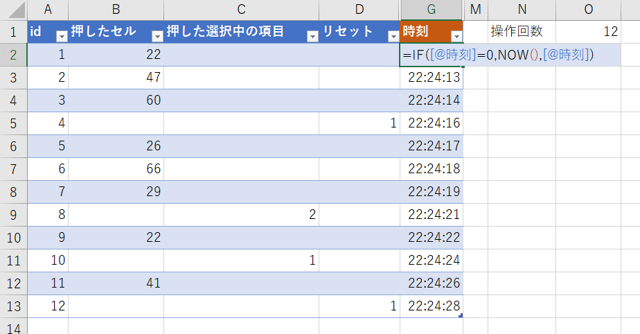

すると想定通り循環参照の警告がでて計算が止まります。しかしこのままでOKです。Excelには循環参照でも構わず計算できるオプションが備わっています。

#### 反復計算を有効にする

[ファイル]-[オプション]-[数式]-[計算方法の設定]に反復計算を行うという項目がありますので有効にします。「最大反復回数」としてデフォルト100が設定されているかもしれませんが、10くらいにしておきます。

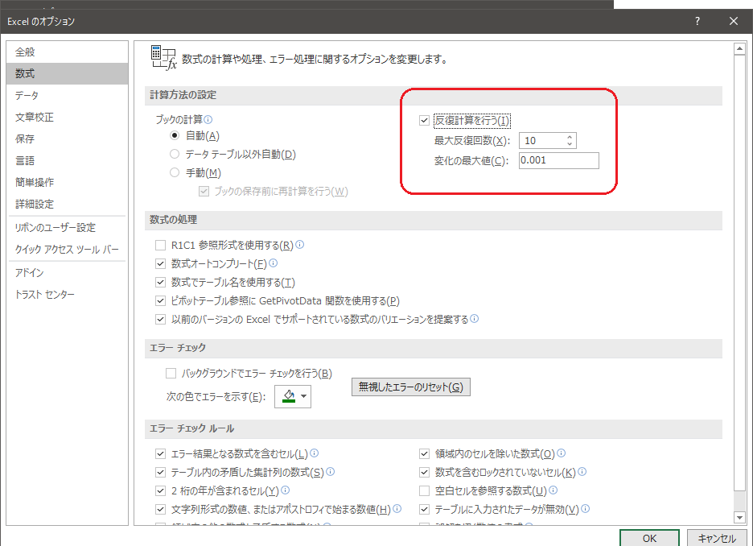

これを有効にしておくと循環参照があったとしても計算を止めずに指定した最大反復回数だけ計算をしてくれるようになります。VBAでいうところのループ処理に近いことが出来ます。

ちなみに「変化の最大値」は、計算結果の差が指定した値より小さくなったら反復を止める設定です。

イメージがつかない方もいると思いますので1つだけサンプルとして、自分自身に1を加える循環参照の式を作ってみます。最大反復回数を10としているので一度の計算で1を10回加える計算と同じ処理になるため結果が10ずつ増えていきます。

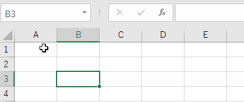

再計算するたびに10加算されているのが分かります。

#### 反復計算の詳細を見てみる

上記の反復計算を利用すると時刻の計算は以下のような処理で計算されます。

（式を再掲）

```
操作[時刻] = IF([@時刻]=0,NOW(),[@時刻])
```

- 計算1回目：セルが空(=0)なので時刻が保存される
- 計算2回目：セルが空でないので自分自身(=時刻)が保存される
- 計算3回目：セルが空でないので自分自身(=時刻)が保存される
- 2回目と3回目に差が無いため計算終了

一度でもセルに値が入るとNOW関数は呼び出されないため、自動更新されなくなるという理屈になります。

循環参照を使った小技は後述する「リセットボタンを押された時だけ爆弾の配置を再計算する」処理や「数字の入っていないセルを開けると周りのセルも開く」処理でも活躍しますので頭の片隅にでも置いておいてください。

## 【小技5】RAND関数で爆弾の位置を決める

リセットするたびに爆弾を再配置するには、RAND関数を用います。前述しましたがRANDも揮発性関数ですので、循環参照を入れてリセットフラグがTRUEの時だけ計算し、それ以外は自分自身を参照するようにします。

そして81個のセルそれぞれでRANDを実行して順位付けし、上位のセルに爆弾を配置します。また爆弾の数をパラメータとして持たせて量を調整できるようにしています。

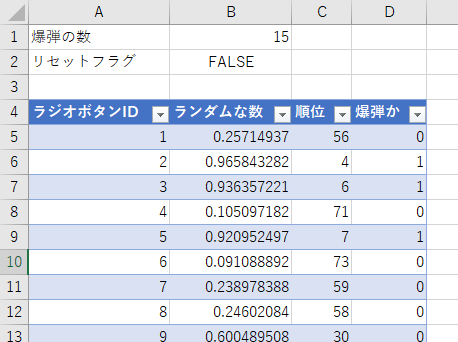

テーブルの式はこうなってます。※テーブル名は「爆弾の位置」です。

```
ラジオボタンID = ROW()-ROW(爆弾の位置[#見出し])
ランダムな数   = IF(リセットフラグ,RAND(),[@ランダムな数])
順位           = RANK([@ランダムな数],[ランダムな数])
爆弾か         = IF([@順位]<=爆弾の数,1,0)
```

## 【小技6】リセット処理で過去の操作履歴を無効にする

リセットボタンを押したときに初期化する方法ですが、リセット操作より過去の操作履歴を無効にすれば簡単に実現できます。

### 事前準備：「選択中の項目」を追加

「押した選択中の項目」の操作履歴から現在選択している項目を計算します。「押した選択中の項目」が空だったら1行上のデータを参照するだけです。

```
選択中の項目 = IFS(ROW()=2,1,[@押した選択中の項目]="",E1,TRUE,[@押した選択中の項目])
```

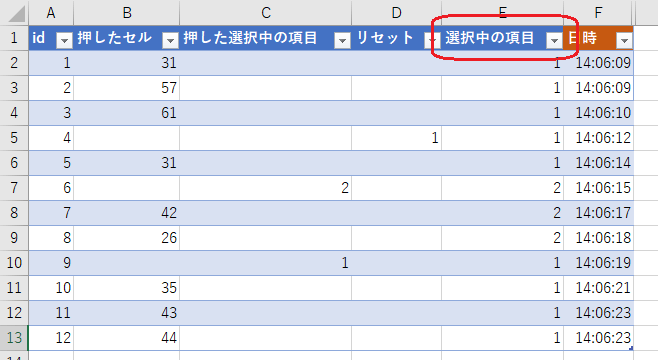

### 計算対象の行か判定する

リセットより上の行は計算の対象外となり、リセットより下の行が計算の対象になります。判定用の列を1つ追加します。

```
計算対象か = [@id]> XLOOKUP(1,[リセット],[id],0,0,-1)
```

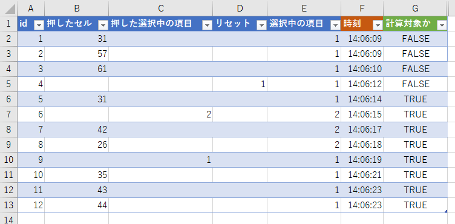

XLOOKUPは下から検索する機能がついているので式がシンプルになって本当に便利ですね。

あとは計算対象の行だけ値を取り出す作業列を追加しておきます。↓

```
対象_押したセル         = IF([@計算対象か],[@押したセル],"")
対象_押した選択中の項目 = IF([@計算対象か],[@選択中の項目],"")
対象_操作内容           = IF([@計算対象か],[@押したセル]&"-"&[@選択中の項目],"")
対象_日時               = IF([@計算対象か],[@日時],"")
```

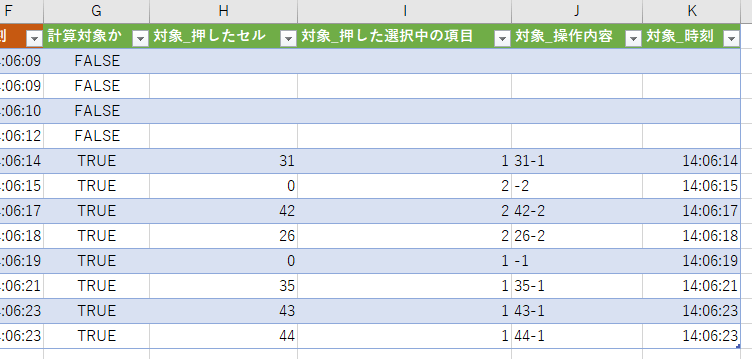

以上で、過去の操作履歴を無かったことにできます。

## 【小技7】状態を管理する

ここがメインの処理になります。操作履歴から「今どんな状態か」を計算します。

まずはテーブル「状態」の全体像です。画像が見えづらいくてすいません。画像を新しいタブで開くと少しだけ見やすくなるかもです。

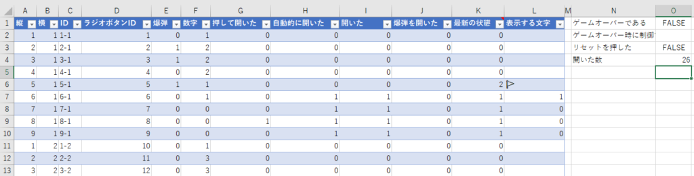

L列の「表示する文字」が欲しい情報になります。

### 項目の説明

各項目の説明です。複雑なところは別途説明していきます。

|  |  |  |
| --- | --- | --- |
| 項目 | 説明 | 式 |
| 縦 | 縦方向の座標 | 固定値 1～9 |
| 横 | 横方向の座標 | 固定値 1～9 |
| ID | 一意に識別するもの | =[@縦]&"-"&[@横] |
| ラジオボタンID | ラジオボタンの数値 | =([@横]-1)\*9+[@縦] |
| 爆弾 | 爆弾が配置されているなら1 | (後述) |
| 数字 | 表示する数字 | (後述) |
| 押して開いた | 押されたら1 | (後述) |
| 自動的に開いた | 周りのセルに影響して開いたら1 | (後述) |
| 開いた | 「押して開いた」又は「自動的に開いた」なら1 | =MIN([@押して開いた]+[@自動的に開いた],1) |
| 爆弾を開いた | 爆弾を開いたら1 | =IF(AND([@爆弾],[@開いた]),1,0) |
| 最新の状態 | 表示する状態を数値で保持  0:開いていない 1:開いている 2:フラッグ 3:はてな 4:訂正(=開いていない) 5:爆弾(=ゲームオーバー) | (後述) |
| 表示する文字 | 「最新の状態」を参照して表示する文字を計算する | =CHOOSE([@最新の状態]+1,"",[@数字],"🚩","？","","💣") |

#### 項目「爆弾」について

前述した「爆弾の位置」のテーブルからXLOOKUPで検索してきます。

```
爆弾 = XLOOKUP([@ラジオボタンID],爆弾の位置[ラジオボタンID],爆弾の位置[爆弾か],FALSE,0)
```

#### 項目「数字」について

マインスイーパの数字は周囲に潜んでいる爆弾の個数を表しています。

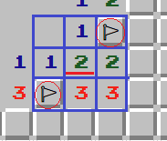

周囲にあたるセルは、状態テーブルをフィルターして探し出せます。そして爆弾の数を数えることで数値を算出できます。

周囲にあたるセルの条件は、

```
(ABS([縦]-[@縦])<=1)*(ABS([横]-[@横])<=1)
```

です。これをFILTER関数にあてはめて対象のレコードを絞り込みます。

```
FILTER(状態,(ABS([縦]-[@縦])<=1)*(ABS([横]-[@横])<=1))
```

このままだと絞り込めはするものの、すべての列の情報をもってきてしまうので、必要な「爆弾」の列だけに絞り込みます。つまりさらにFILTERする形です。

```
FILTER(FILTER(状態,(ABS([縦]-[@縦])<=1)*(ABS([横]-[@横])<=1)),状態[#見出し]="爆弾")
```

最後に、爆弾の数を数えるのでSUMで集計します。

```
数字 = SUM(FILTER(FILTER(状態,(ABS([縦]-[@縦])<=1)*(ABS([横]-[@横])<=1)),状態[#見出し]="爆弾"))
```

#### 項目「押して開いた」について

操作履歴からXLOOKUPで探し出します。開く操作はラジオボタンIDにハイフン1をつけた形で探せます。

```
=(XLOOKUP([@ラジオボタンID]&"-1",操作[対象_操作内容],操作[id],0)>0)*1
```

XLOOKUPの返り値は何でもよいので適当に操作[id]にしていますが、MATCH関数でもよかったり、最後の\*1も不要だったりします。趣味の範囲なのでかえてOKです。

#### 項目「自動的に開いた」について

マインスイーパーでは数値の無いセルを開くと一度にたくさんのセルが開きます。そのロジックをここで判定しています。

自動的に開く条件は

1. 周囲に数値の無いセルがある
2. 上記セルが開いている

になります。下の図のように周囲に数値の無いセルがありそれが開いている場合は、中心の「2」のセルが自動的に開くセルになります。

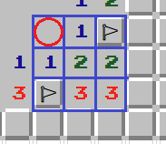

ということで、条件の式は以下になります。

```
(ABS([縦]-[@縦])<=1)*(ABS([横]-[@横])<=1)*([ID]<>[@ID])*([数字]=0)*([開いた])
```

この条件で状態テーブルをフィルターして1つでも見つかったら1とします。

```
自動的に開いた = (COUNT(FILTER(状態,(ABS([縦]-[@縦])<=1)*(ABS([横]-[@横])<=1)*([ID]<>[@ID])*([数字]=0)*([開いた])))>0)*NOT(リセットフラグ)
```

「自動的に開いた」列は「開いた」列を参照し、「開いた」列は「自動的に開いた」列を参照しています。ここも循環参照ポイントですが、反復計算を有効にしているため問題なく計算できます。

補足：本当はレコードを数えるにはROWSの方がしっくりくるのですが、循環参照をしているのが原因なのかうまく集計してくれませんでした。このためCOUNTを使っています。また、最後のNOT(リセットフラグ)については、リセットしたら問答無用で0にするためのおまじないです。

#### 項目「最新の状態」について

数字を表示したりフラグを表示したり、最新の状態がどうなっているかを数値で管理する列です。ゲームオーバーの時は全ての爆弾を表示しますので、そのための処理も入れています。

```
' 0: 開いていない
' 1: 開いている
' 2: フラッグ表示
' 3: はてな表示
' 4: 訂正(=開いていない)
' 5: 爆弾(ゲームオーバー)

最新の状態 = 
  IF(
    AND(ゲームオーバーである,[@爆弾]),
    5,
    IF(
      [@開いた],
      1,
      XLOOKUP([@ラジオボタンID],操作[対象_押したセル],操作[対象_押した選択中の項目],0,0,-1)
    )
  )
```

L列の「表示する列」は上記数値をもとに文字列を作っています。

以上が状態を作る方法です。

## 【小技8】ゲームオーバーしたときにラジオボタンを触れないようにする

細かい動きですが、ゲームオーバーしたときにそれ以上セルを押せないようにしています。

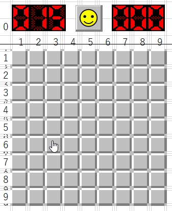

### 図形を被せる

「図形が重なっていると前面のオートシェイプしか触れない」仕様と、「塗りつぶし無しの図形は重なっていたとしても後ろのオートシェイプが触れる」仕様を利用します。

通常、オートシェイプは前面に配置されたものを優先して選択します。しかし塗りつぶしを無しにすることで後ろに隠れたオートシェイプが触れるようになります。

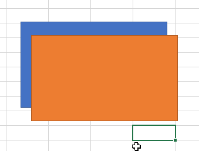

これを利用して、セルを被せるように塗りつぶし無しの四角形のオートシェイプを配置しています。↓以下は隠しているオートシェイプを選択した図です。

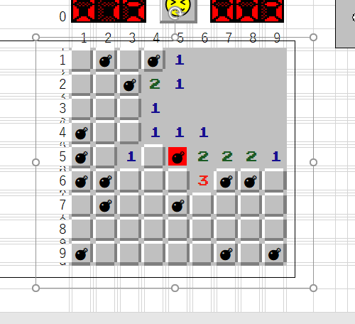

これで罫線部分に触れない限りは裏のボタンを押せます。そして色を塗るだけでボタンが押せなくなります。

しかし図形の色はVBA無しでは変えられないので、別な手段で同等の状態を作り出します。

### 図形に文字を入れる

図形に文字を入れることで、塗りつぶし無しでも触れるようになります。

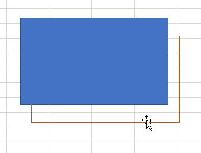

つまり「ゲームオーバーになったときに（透明な）文字を入れる」ことでボタンを触らせないようにできます。以下の式を組み込むことで実現できます。

```
ゲームオーバー文字列 = IF(ゲームオーバーである,"☠☠☠☠☠☠☠☠☠☠☠☠☠☠☠☠☠☠☠☠☠☠☠☠☠☠☠☠☠☠☠☠☠☠☠☠☠☠☠☠☠☠☠☠☠☠☠☠☠☠☠☠☠☠☠☠☠☠☠☠☠☠☠☠☠☠☠☠☠☠","")
図形のテキスト = ゲームオーバー文字列
```

図形の文字に色をつけて動きを確認するとこんな感じになってます。

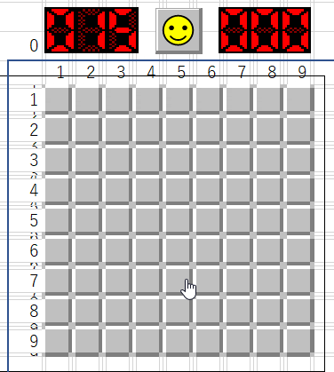

## 【小技9】条件付き書式でセグを再現したり数字に色を付けたりする

### セグについて

爆弾の残り個数とタイマーを表示しているセグの部分は、セルをドットに見立てて条件付き書式で表示しています。

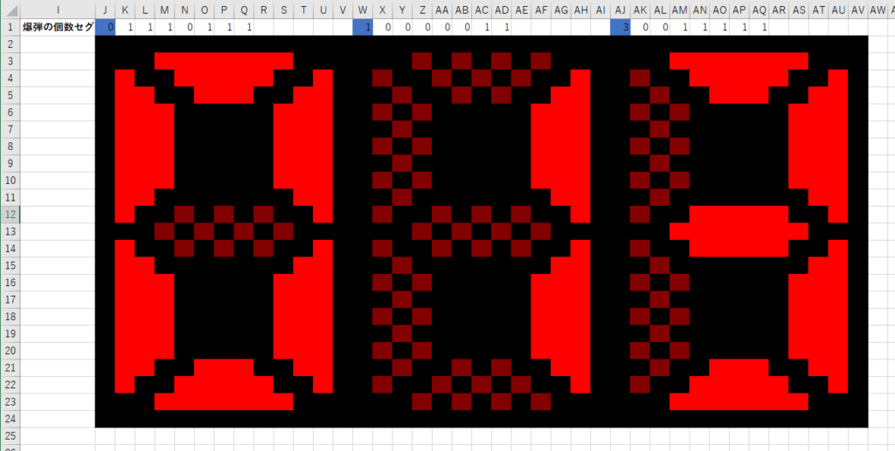

セグを生成するために1～9の数字それぞれどこが光るかデータとして持たせています。そしてスコアと時間をそれぞれ計算したあと1桁ずつ展開し、FILTERでデータを取り出して1行目（下記画像でいうところのJ1セル）に展開しています。

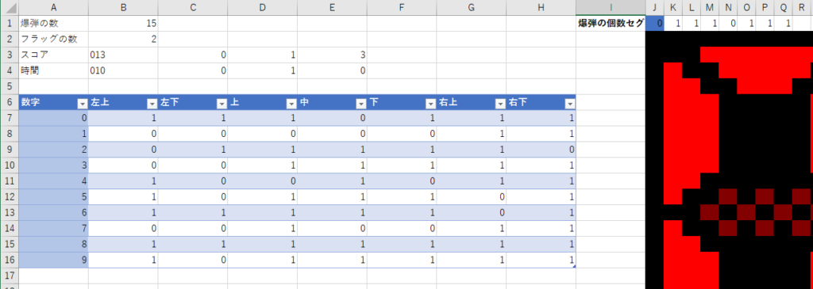

```
スコア = TEXT(MAX(爆弾の数-フラッグの数,0),"000")
時間   = TEXT(MIN((MAX(操作[対象_時刻])-MIN(操作[対象_時刻])) * 86400,999),"000")
```

あとは1行目の数値をもとにそれぞれに条件付き書式を設定しています。

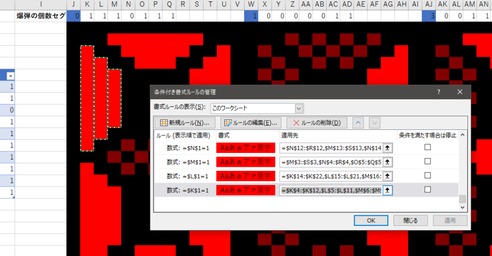

最後にセグ全体をコピーして「リンクされた図」として縮小して貼り付けます。

### 数字の色付けについて

数字も条件付き書式で色を付けます。また立体的に見えるテカリの部分も条件付き書式になっています。

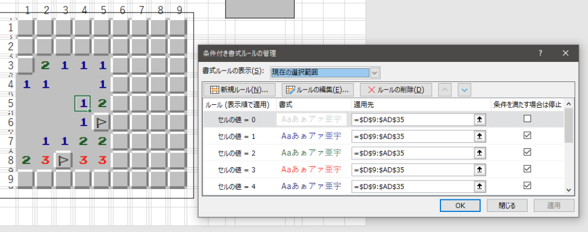

## 【小技10】背景に画像を挿入、フォントを変更する

賑やかしになりますが、セルの後ろに背景として画像を挿入できます。[ページレイアウト]-[背景]から挿入しています。

また、ファミコン風のフォントを入れることで数字に雰囲気が出ます。私はEMULOGICというフォントを入れました。フォントの変更方法は他の方のサイトが参考になりますので省略します。

<https://office-hack.com/excel/add-font/>

以上でマインスイーパーが完成します。お疲れ様でしたー。（スマイルの説明ぇ・・・）

## とうことで

今回の最大のポイントは「揮発性関数を操る」部分でした。この方法によりゲームへの応用力が格段に上がりました。今まで諦めていたジャンルのゲームも作れそうです。皆様もコーヒーブレイクとして挑戦してみても面白いかもしれません。

ちなみに身もふたもない事言いますが、VBAを使ってゲームを作った方が断然やりやすいですよ（笑）

https://amzn.to/35b2zrT

【VBAを使わないゲームシリーズ】

https://tomikiya.github.io/excel-nonvba-3d-maze/

https://tomikiya.github.io/excel-game-dq3/

https://tomikiya.github.io/excel-game-tetris/
