[English](https://tomikiya.github.io/excel-game-dq3-english/)

久しぶりにExcelでゲームを再現してみました。

ツイッターでどんなゲームを作るのが良いか募集したところ、なんと1位がドラクエ。

https://twitter.com/10mikiya/status/1307960581245341696

正直どう作って良いか見当もつかないまま見切り発車で進めましたが、なんとか形になったので公開の流れになりました。最適化されてないロジックもありますので温かい目で見守っていただけますと幸いです。

一応、再度伝えておきますが**VBAは一切使っていません**。

## どんなものが出来たか

実際にどんなものになったか、見ていただいた方が早いのでまずは結果をご覧ください。（※音声はありません）


あのイルカ

最後まで見た方が面白いですよ。

https://www.youtube.com/watch?v=xWgHHwZn6Mk

## ポイント

お忙しい方向けに、どんな技術を使っているか3行で説明します。

・地図やモンスターは散布図で表示する

・循環参照を使ってカウンタを作りF9を押しっぱなしにする

・セル上でプログラミングをする

今回のドラクエで一番課題だったのがアニメーションです。マップ上でキャラクターを定期的に歩かせたり、戦闘シーンに入る部分はVBAを使わないと不可能だと思っていました。しかし今回はそこを特定の制限を設けることで突破した形になります。

## 詳細

それでは詳細になりますが、この記事は「Excelでゲームを作る技術」の紹介になります。「ゲームを作る技術」は省略しますので細かい仕様や知りたい点があれば、他のサイトのゲームのブログを見に行くか、コメント欄にて質問してください。

### 散布図を使いたおす

散布図は2つのデータの関係を示すもので、点（マーカー）の集合であらわされるグラフです。Excelでは2つの列をデータとして指定することで散布図を表現できます。

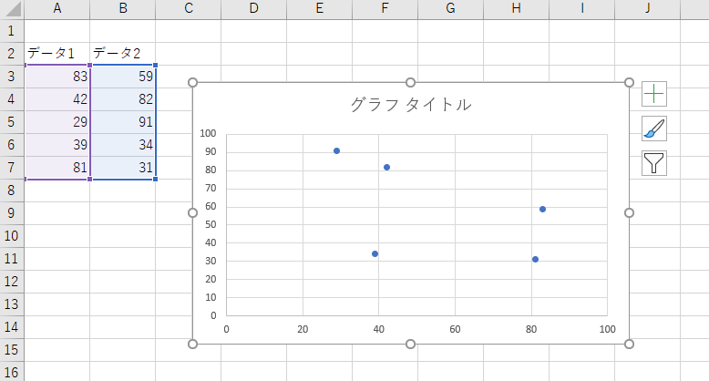

#### マーカーに画像を挿入できる

散布図は好きな位置にマーカーをプロットできる部分が非常に魅力的です。

そしてデータ系列の書式設定でマーカーのオプションから画像を指定できます。

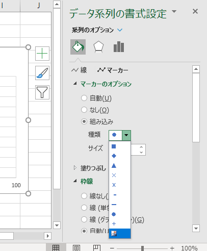

↓

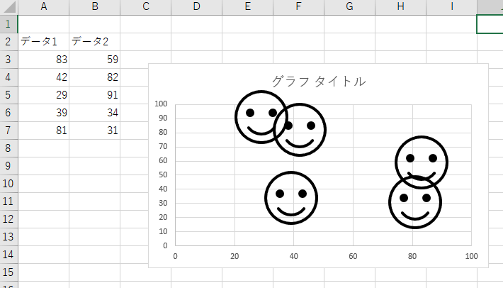

画像はそれぞれ変えられるのでマーカーごとに画像を登録しておけば好きな位置に好きなキャラクターを置けるようになります。

画像を登録する際の注意点

マーカーに挿入する画像ですが、拡大縮小ができません。このため、画像を作る時は大きさを事前に決めてから作成する必要があります。また、画像が大きいとExcelの動きが鈍くなります。適度な大きさを心掛けないといけません。

#### マーカーを動かしたり消したりできる

マーカーの数が一定数以下の場合、データの値を変えるとヌルヌル動きます。マップ移動で勇者が移動したときに後続者がついてきたり、マップが動く技術はこれを使用しています。

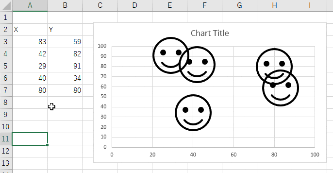

ドラクエが完成した時点ではマーカーが一定以上に達したためヌルヌル動いてくれず瞬間移動していますが、ゲーム進行上問題なかったためそのままにしています。

また、データの一部が欠けると散布図上に表示されなくなる性質を利用して表示の切り替えができます。切り替えを素早くすると歩いているように見えます。

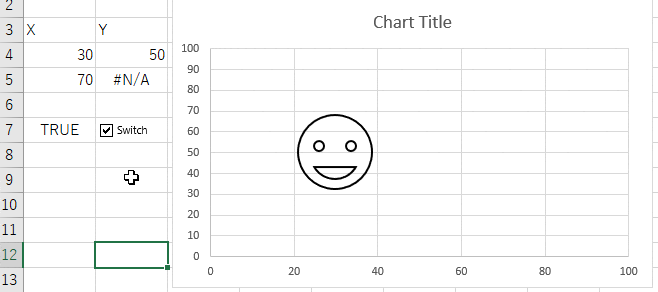

戦闘シーンへの切り替えやコマンドの表示も全てこの仕様を使っています。

#### マーカーにラベルを登録してテキストを表示する

マーカーにはラベルを設定できるので、戦闘シーンのステータスやメニューコマンド、メッセージなどは全てラベルで表現できます。

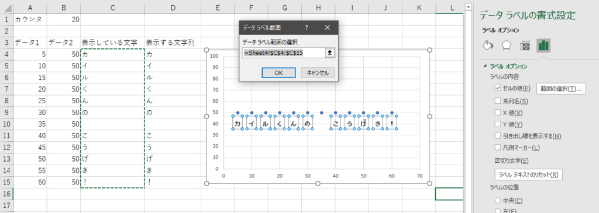

一文字ずつ表示することで滑らかなメッセージ表示が出来るようになります。またフォントをファミコンっぽいものに変えることで雰囲気が出るようになります。

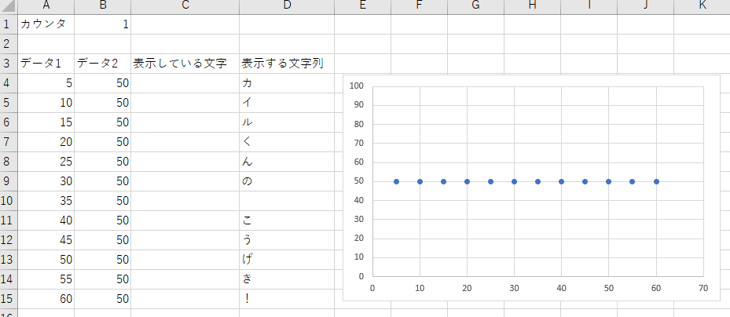

ちなみに、マーカーには表示する順番があり、一番下のデータが一番手前に表示されます。何を前面に出すかデータの順番を意識しないといけません。またこの仕様により、勇者たちの並べ替えを実装するには結構な手間が必要になりますがそれは別のお話ということで触れないでおきます。

トピック

散布図のアニメーションを利用したゲームがスライドパズルです。マーカーの数が少ないのでアニメーションしていますね。

https://twitter.com/10mikiya/status/1298282015335178240

### 循環参照を利用してセルの値を変動させる

セル上でゲームを作る時に大きな壁になるのが「ループ処理」です。関数式を並べればループもできなくはないですが、複雑なゲームになればなるほど関数では対応しづらくなり、改修も面倒になります。

そこで循環参照をあえて利用してループ処理を再現します。

#### 反復計算を有効にして循環参照を許容する

Excelのオプション設定から反復計算を有効にします。すると循環参照で警告が出なくなり指定した反復回数だけ同じ計算が実行されます。

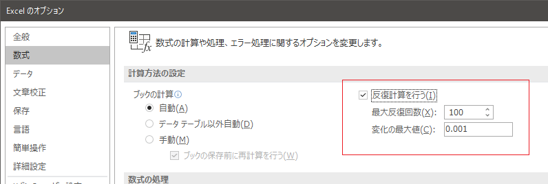

例えばA1セルに「=A1+1」と入れておけば通常循環の警告がでますが、反復を許容しているのでそのまま計算してくれます。デフォルトだと反復回数が100になっているので1を加算する処理が100回繰り返され、結果として100が返ってきます。F9で再計算をするとさらに100が加算されます。

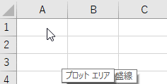

#### 反復回数を1にしてカウントアップするセルを作る

デフォルトでは100回になっている反復回数を1回に変更します。すると先ほどの加算が1ずつになるので、再計算するたびに1ずつ加算されていきます。これでカウンタが出来上がります。

#### F9を押しっぱなしでアニメーションを実現する

カウンタがあればその値を見ながら描画を切り替えられるようになります。カウンタは何も操作しないと変わらないので、（ここが最大の制約ですが）**F9を押しっぱなしにして再計算し続けることで動かします。**

先ほど、散布図の切り替えをチェックボックスで行っていましたが、カウンタを参照することで自動的に切り替えられるようになります。下のイメージではカウンタが10増えるごとにマーカーを切り替えています。

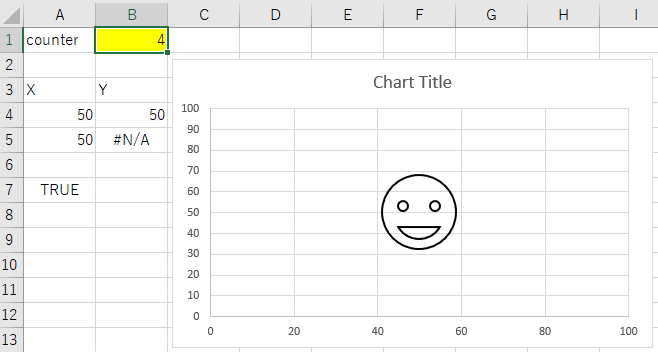

この技術で戦闘シーンへ入る時の渦巻きや、ダメージを受けたときの枠の振動を表現しています。

トピック

以前作ったマインスイーパーはこの反復を使って揮発性関数を自動計算させないようにして経過時間を計算したりしています。反復計算はいろんなところに応用できますね。（業務で使えるとは言っていません。）

https://tomikiya.github.io/excel-game-minesweeper/

### セル上で疑似的なプログラミングを実現する

一番重要なポイントがここです。

マップと戦闘の切り替え、選択したコマンドの記憶、敵の行動、メッセージの表示など、関数だけで実装するにはこれまで培ってきたノウハウだけでは難しく、やはりプログラミング的なステップを管理する必要がありました。そこで循環参照を使ってセル上で疑似的にプログラミングを作る方法を構築しました。

### 例：セル上でFizzBuzzを作ってみる

実際にどのように構築するか、簡単な例、おなじみの[FizzBuzz](https://ja.wikipedia.org/wiki/Fizz_Buzz)問題で説明します。

最終的な出来上がりはこんな感じです。

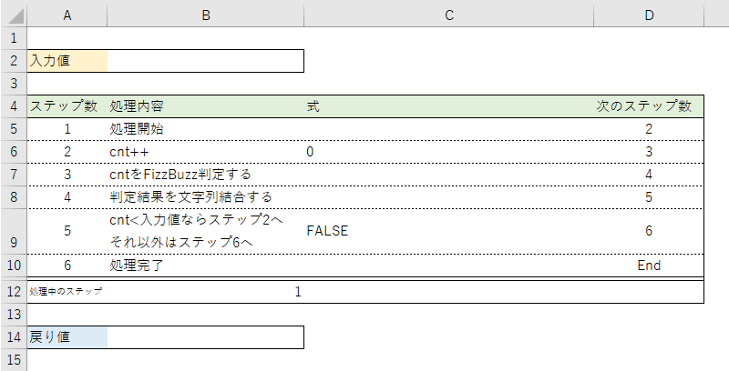

ヘッダに入力値用のセル、フッタに戻り値用のセルを設け、その間で処理をおこないます。

処理についてですが、各行にステップ数を設けています。「処理内容」はコメントみたいなものなのでその行で何を行っているか分かるようなテキストにしておきます。メインの処理は「式」です。ここに処理の内容を書きます。「次のステップ」には次に処理するステップ数を書きます。ほとんどがすぐ下の行のステップになりますね。最後に「処理中のステップ」で現在どのステップを実行しているか記憶していきます。

この形が基本です。

それではそれぞれの式について説明します。

#### 処理中のステップについて

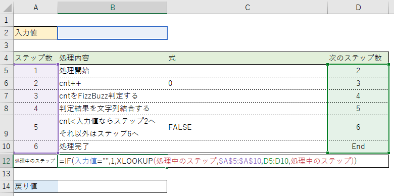

```
処理中のステップ = IF(入力値="",1,XLOOKUP(処理中のステップ,$A$5:$A$10,D5:D10,処理中のステップ))
```

入力値が空欄の間は常に1になりますが、何かしら入力値が入るとXLOOKUPが実行されます。**XLOOKUPで探すものは自分自身になります。**（反復計算が有効なのでここでエラーは起きません。）XLOOKUPでは「次のステップ数」を取得しています。こうすることで再計算が行われると処理中のステップの値が次々と変っていきます。プログラムカウンタのような役割になりますね。

#### ステップ1 処理開始

この行は直接的には何もしていません。準備運動みたいなものですぐに次のステップに入ります。（本当は意味のある行ですが、この例では何にも影響しません。詳細は後述します。）

#### ステップ2 cnt++

カウントアップです。値を1ずつ増加させてFizzBuzz判定していきます。

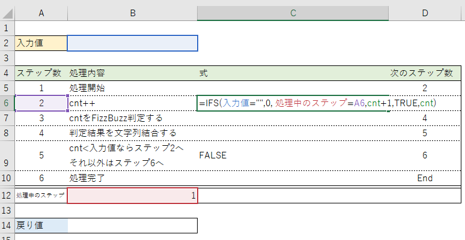

```
cnt = IFS(入力値="",0, 処理中のステップ=A6,cnt+1,TRUE,cnt)
```

入力値が空欄なら0、処理中のステップが2になったら1増加、それ以外は増加しない(=自分自身)という計算になります。つまり、cntは入力値が空欄の時に初期化され、処理ステップが2になったときだけ1増加します。VBAでいうところの`cnt=cnt+1`ですね。

#### ステップ3 FizzBuzz判定

判定処理です。ステップ2と同様、まずは入力値を見て初期化の処理と、ステップ数を見て3だったらFizzBuzz判定をします。

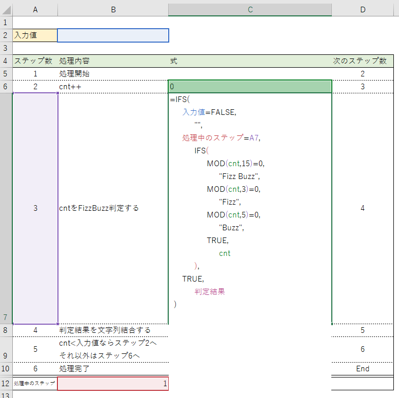

```
判定結果
=IFS(
      入力値=FALSE,
            "",
      処理中のステップ=A7,
            IFS(
                  MOD(cnt,15)=0,
                        "Fizz Buzz",
                  MOD(cnt,3)=0,
                        "Fizz",
                  MOD(cnt,5)=0,
                        "Buzz",
                  TRUE,
                        cnt
            ),
      TRUE,
            判定結果
  )
```

最後の「判定結果」は自分自身（C7）を指します。ステップ3以外の時は自分自身のになるため、判定処理されず前回の判定処理が保存されます。

#### ステップ4 判定結果を保存

判定結果を文字列として結合して保管していきます。

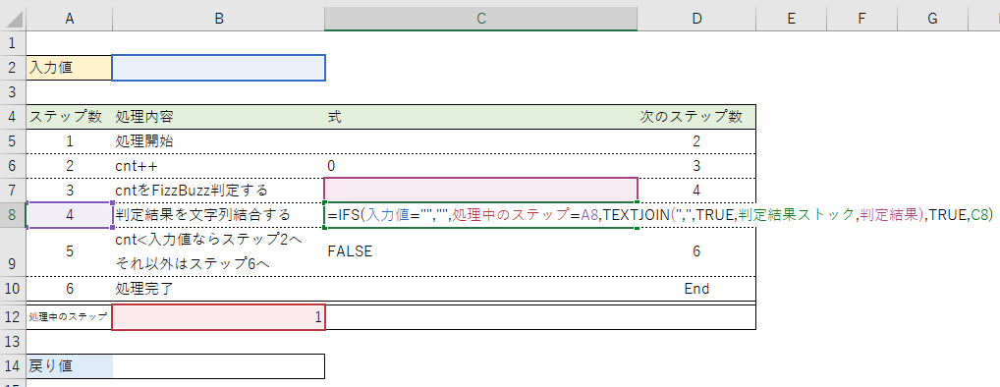

```
判定結果ストック = IFS(入力値="","",処理中のステップ=A8,TEXTJOIN(",",TRUE,判定結果ストック,判定結果),TRUE,判定結果ストック)
```

VBAでいうところの`判定結果ストック = 判定結果ストック & "," & 判定結果`になります。

#### ステップ5 ループを抜ける判定

cntが入力値未満ならステップ2に戻り、入力値以上ならステップ6に行きます。

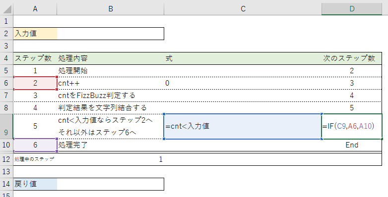

```
式 = cnt < 入力値
次のステップ数 = IF(C9,A6,A10)
```

式には判定結果を書き、「次のステップ数」が切り替わるようにしています。

#### ステップ6 処理完了

ステップ6まで来たところで「判定結果ストック」を最終結果としています。

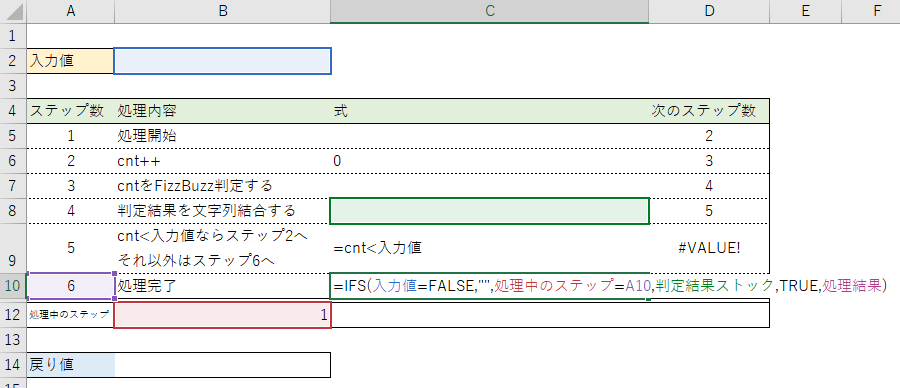

```
処理結果 = IFS(入力値=FALSE,"",処理中のステップ=A10,判定結果ストック,TRUE,処理結果)
```

#### 戻り値

ステップがEndとなったところで戻り値を反映します。これで一連の処理が完了となります。

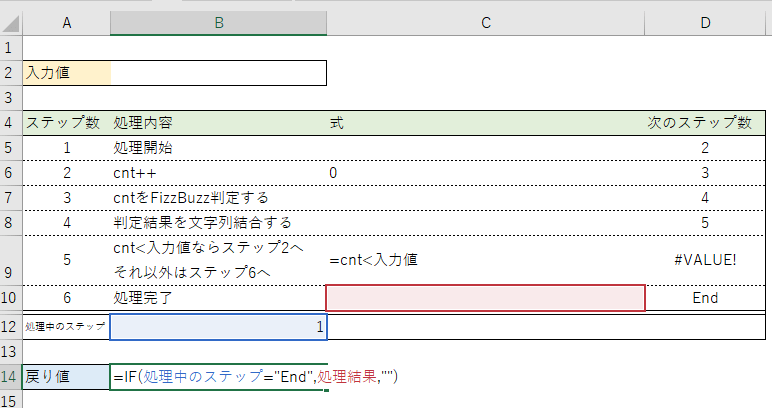

```
戻り値 = IF(処理中のステップ="End",処理結果,"")
```

#### 再計算させてみます

こんな流れになります。

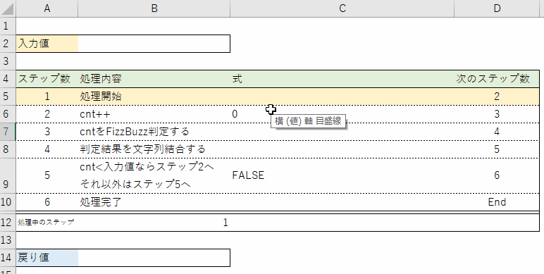

ステップごとに計算や判定がされ、プログラミングと同じような動きを再現しています。

### 関数ごとの切り分けも可能

上から下に流れるだけではなく、引数や戻り値をつなぎ合わせることで特定の処理に切り分けることもできます。VBAでいうとこころのFunctionやSubのような動きになります。

- 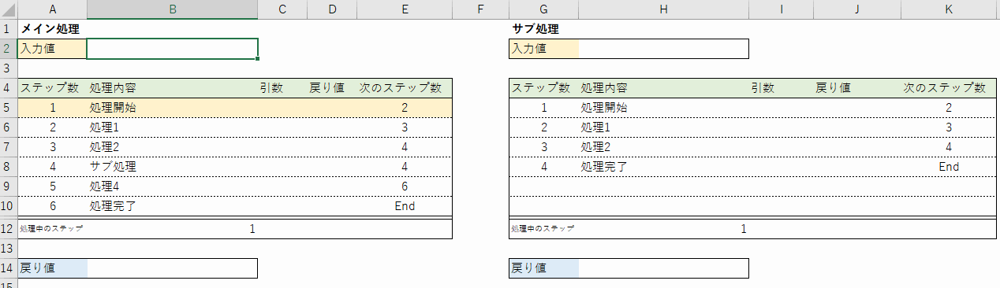

この手法で機能を切り分けて開発ができるため、複雑にならずに済みます。

以上が疑似的なプログラミングを構築する方法です。

### もうなんでも作れます

セル上でも疑似的なプログラミングが可能だということは、ほとんどのゲームが作れるということです。下のサンプルは戦闘時の処理の流れです。汚いですが普通のプログラミングですね。こんな感じのコードを大量に作って組み合わせればドラクエが完成します。

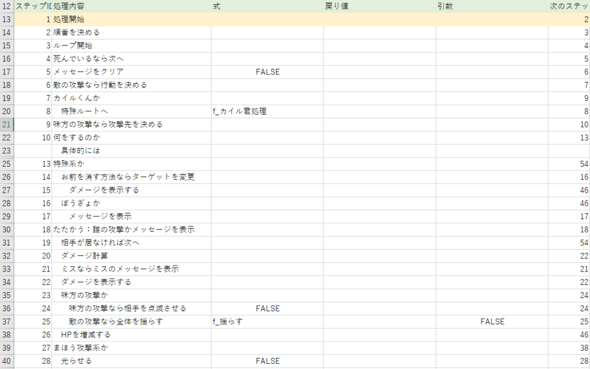

唯一出来ないのが音を出すことです。VBAを使わずに自由に音を鳴らす方法がいまだにわかりません。

### ボタン操作は過去のゲームと同じ

ボタン操作は今まで何度か作ってきたゲームの記事で説明していますので省略します。

https://tomikiya.github.io/excel-nonvba-3d-maze/

以上が、Excelでドラクエを再現する方法になります。

## その他

### 循環参照の注意点

循環参照の計算順序は意識する必要があります。

シートの左から右、上から下の順序で計算されます。つまりセルA1がセルA2を参照するとA2が計算される前にA1を計算してしまいます。具体的にどんな時に不具合が起こるかというとRAND関数とRANK関数の組み合わせの場合が分かりやすいでしょう。

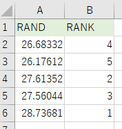

ランダムな数を順位付けする単純なもんですが、順位が重複するシーンが散見されます。通常、反復計算が無ければRANDがすべて評価されてからRANKが評価されるので重複はほぼありません。しかし循環参照があるとA2→B2→A3→B3→A4→B4...と評価されるので順位が重なる場合が発生します。このあたりは仕様なのでどうしようもできません。なるべく処理させたい順番になるように上から下へ書くようにしましょう。例えば、上記順位付けの問題を解決するならこうします。

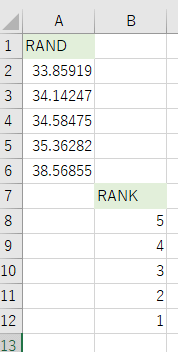

このほか、セルの位置だけではなくシートにも優先順位がついているようです。関数ごとにシートを分けると、思わぬ順番で処理が進むこともありますので注意しましょう。前述した処理の中で「ステップ1 処理開始」という何もしないステップがありましたが、これは循環参照の計算順番が狂わないようにするための休憩ポイントとして設置したものです。詳しくは解析していませんが「この行があるとなぜかうまく動く」現象が発生したポイントです。暇があれば解析したいと思います。

### 画像をどうやって用意したか

散布図では画像のサイズを拡大縮小できないので、地図やモンスターの画像サイズを統一して用意する必要がありました。期待する画像がネット上に転がっているはずもないので1から作っています。せっかくなのでExcelで作りました。

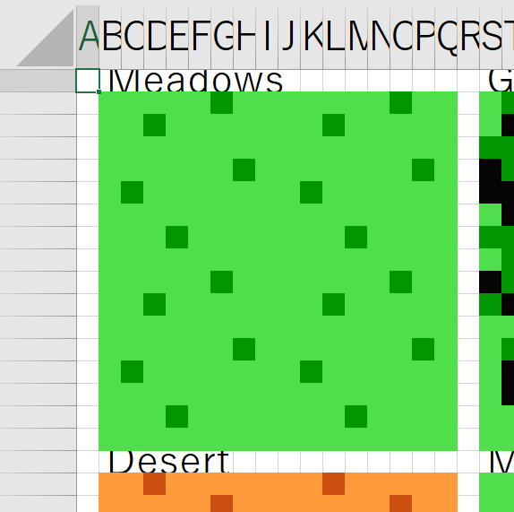

セル範囲をコピーして画像として保存することでサイズを統一できます。画像を用意するのも大変ですね。

### ファイルサイズは？

ファイルサイズは約5.2MBで、そのほとんどがMAPに使った画像になります。戦闘だけですと660KBほどになります。

## ということで

今回の成果物はまだ最適化されていない部分があったり、不安定な部分があったり、著作権とかアレなのでGitHubでの公開はしない予定です。もし興味のある方はご自身で作ってみてください。

## 最後に

これまでのゲームは1週間程度で作っていましたが今回は1か月以上かかりました。ドラクエは作るパターンが多いです。また、疑似プログラミングを構築してみたものの結局やっていることがVBAと大差なく、更にVBAより気を配る部分が多いので正直疑似プログラミングの手法も制限したい気分です。

次はテトリスですね。頑張ります。

【VBAを使わないゲームシリーズ】

https://tomikiya.github.io/excel-nonvba-3d-maze/

https://tomikiya.github.io/excel-game-minesweeper/

https://tomikiya.github.io/excel-game-tetris/

このページで利用している株式会社スクウェア・エニックスを代表とする共同著作者が権利を所有する画像の転載・配布は禁止いたします。  
© 1988 ARMOR PROJECT/BIRD STUDIO/SPIKE CHUNSOFT/SQUARE ENIX All Rights Reserved.
