[日本語](https://papasensei365.com/excel-game-dq3/)

It's been a while since I've tried to recreate a game in Excel.

I asked people on Twitter what kind of game they would like to see made, and to my surprise, Dragon Quest came out on top.

https://twitter.com/10mikiya/status/1307960581245341696

I honestly had no idea where to start with it, but I managed to get it working, so I decided to release it to the public. I hope you will give it a warm reception as there is some unoptimized logic in it.

Just to reiterate, I did not use VBA at all.

## **What did I create?**

It's quicker to see how it actually turned out, so please take a look at the results first. (\* There is no audio.)


The dolphin

You might want to watch it all the way through, it's more interesting.

https://www.youtube.com/watch?v=xWgHHwZn6Mk

## **Points**

Here is a three-line explanation of what technology I use, for those of you who don’t have a lot of time on your hands

・Maps and monsters are displayed as scatter plots.

・Using a circular reference to create a counter and holding down F9

・Programming in cells.

The biggest challenge for me in this Dragon Quest game was the animation. I thought it would be impossible to make the characters walk regularly on the map or enter battle scenes without using VBA. This time, however, I was able to break through this limitation by setting certain restrictions.

## **Details**

This article is an introduction to the technology of creating games in Excel. If you want to know more about the details, please visit other websites' gaming blogs .

### **Use scatter plots**

A scatter plot is a graph that shows the relationship between two sets of data, represented by a set of points (markers). In Excel, you can create a scatter plot by specifying two columns as data.

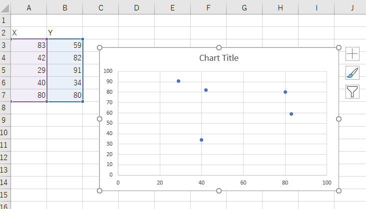

#### **Images can be inserted into markers**

The scatter plot is very appealing in that you can plot markers where you want.

You can then specify an image from the marker options in the formatting of the data series.

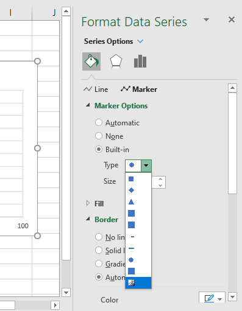

↓

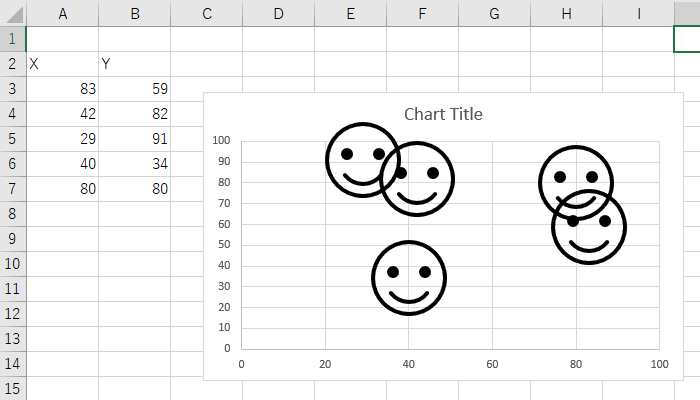

You can change the image for each marker, so if you add an image for each marker, you will be able to place the character you want at the position you want.

Points to note when adding images

The image which will be inserted into the marker cannot be scaled. For this reason, it is necessary to decide the size of the image in advance before creating it. Also, if the image is too large, it will make Excel run slowly. You need to ensure that the image is of the appropriate size.

#### **Markers can be moved and erased**

If the number of markers is less than a certain number, then the game will run smoothly when you change the value of the data. This is used for the technology that allows the map to move. For example, when the hero moves on the map, the followers follow him, and the map moves.

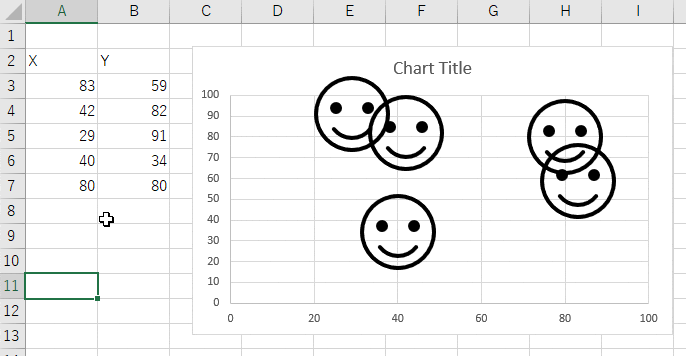

When Dragon Quest was complete, the marker reached a certain level, so it didn’t run smoothly, but it was not a problem for the game progress, so I left it as it was.

You can also switch the display by using the property that if a part of the data is missing, it will not be displayed on the scatter plot. If you switch quickly, it will look like you are walking.

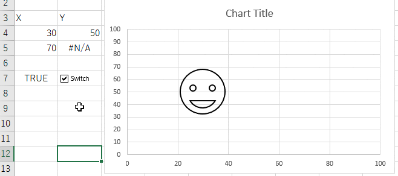

The transition to the battle scenes and the command display all use this specification.

#### **Add a label to the markers and display text**

Markers can be labeled, so status, menu commands, and messages in battle scenes can all be labeled.

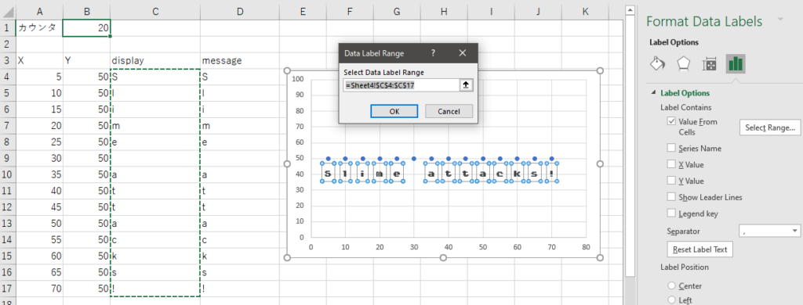

By displaying one character at a time, you can create a smooth message display. You can also change the font to something more NES-like to give it a more atmospheric feel.

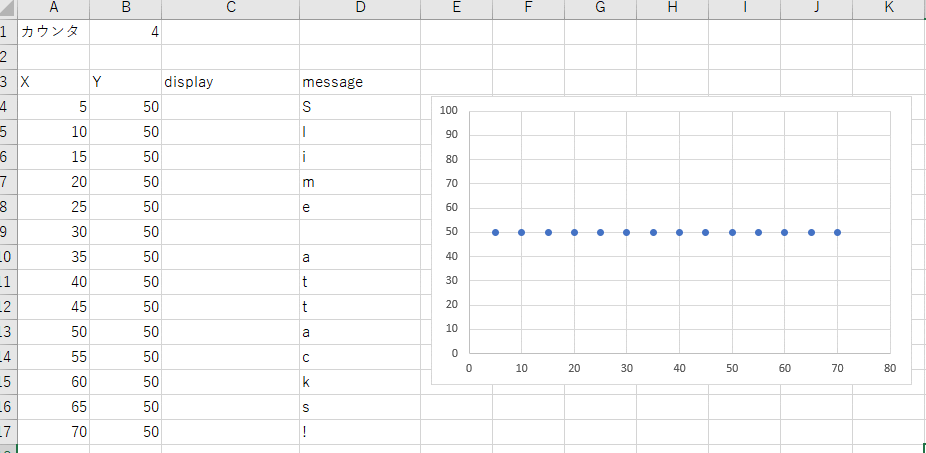

By the way, there is an order in which the markers are displayed, and the bottom data is displayed at the front. You need to be aware of the order of the data to decide what to put in the front. Also, due to this specification, it will take a lot of work to implement the reordering of the heroes. That's another story, though, so I won't mention it.

トピック

Sliding puzzles are games that uses scatter plot animation. You have a small number of markers and they are animated.

https://twitter.com/10mikiya/status/1298282015335178240

### **Using circular references to vary cell values**

Loop processing is a major obstacle when creating a game in cells. Although it is possible to create a loop by using a series of function formulas, the more complex the game becomes, the more difficult it becomes to handle with functions, and the more complicated it becomes to modify.

This is where I use circular references to recreate the loop process.

#### **Enable iterative computation and allow circular references**

Enable iterative calculations in Excel's options settings. If you do this, you will not be warned about circular references and the same calculation will be performed for the specified number of iterations.

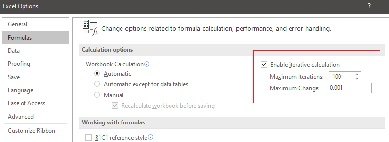

For example, if you put `=A1+1` in cell A1, you will normally get a warning about cycling, but since it allows repetition, it will calculate the value as it is. By default, the number of iterations is set to 100, so the process of adding 1 will be repeated 100 times and the result will be 100, and recalculating with F9 will add another 100.

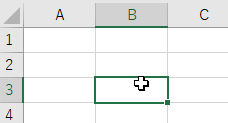

#### **Create a cell that counts up the number of iterations to 1**

Change the number of iterations, which defaults to 100, to 1. Then the previous addition will be set to 1, so each time you recalculate, 1 will be added. The counter is now ready.

#### **Press and hold F9 to create an animation**

If you have a counter, you can switch between drawings while keeping an eye on its value. The counter will not change unless you do something with it, so (and this is the biggest limitation) you have to hold down F9 and keep recalculating it.

Earlier, I used a check box to switch between scatter plots, but by referring to a counter, I can switch automatically. In the image below, the marker is switched every time the counter increases by 10.

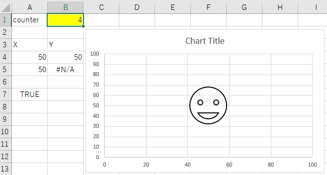

This technology is used to represent the whirlpool when entering a battle scene and the frame vibration when you take damage.

トピック

The Minesweeper I made in the past uses this iteration to avoid automatic calculation of volatile functions and to calculate elapsed time. Iteration can be applied to many things. (I'm not saying it can be used in business.)

https://papasensei365.com/excel-game-minesweeper/

### **Implement pseudo-programming on cells**

This is the most important point.

Switching between maps and battles, remembering selected commands, enemy actions, displaying messages, and so on, were difficult to implement using only functions and the know-how I had accumulated so far, and I still needed to manage the programming steps. This is why I created a method to simulate programming in cells using circular references.

### **Example: Create FizzBuzz on the cells.**

A simple example, the familiar FizzBuzz problem, will illustrate how to do this in practice.

Here's the final result.

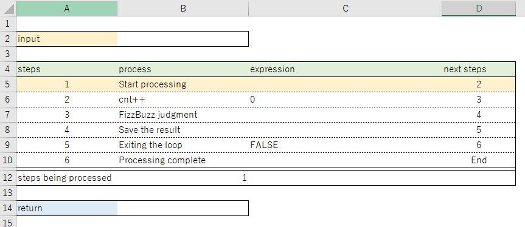

The header contains cells for input values, and the footer contains cells for return values, and the process is performed between them.

Each line has a number of steps, and the "process" is a comment, so the text should tell you what the line does. The main process is the "expression". This is where you write what you want to do. The next step is the number of steps to process. Most of the time this will be the step on the line immediately below. Finally, in "steps being processed" I store which step is currently being executed.

This is the basic form.

Let's look at each equation.

#### **About the steps in the process**

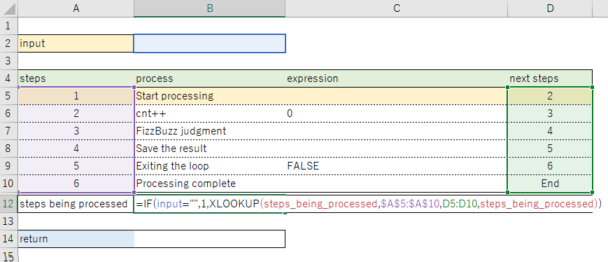

```
=IF(input="",1,XLOOKUP(steps_being_processed,$A$5:$A$10,D5:D10,steps_being_processed))
```

As long as the input is blank, the value will always be 1. The XLOOKUP will look for itself (no error here as iterations are in effect). In the XLOOKUP, I get the number of "next steps". In XLOOKUP I get the number of the next step, so that when the recalculation takes place, the value of the step being processed will change one after another. It acts like a program counter.

#### **Step 1 Start processing**

This line does not do anything directly. It's like a preparatory step, and I'll get to the next step soon. (This is actually a meaningful line, but it doesn't affect anything in this example. I'll see more details later.

#### **Step 2 cnt++**

Counting up. Increment the value by 1 to determine FizzBuzz.

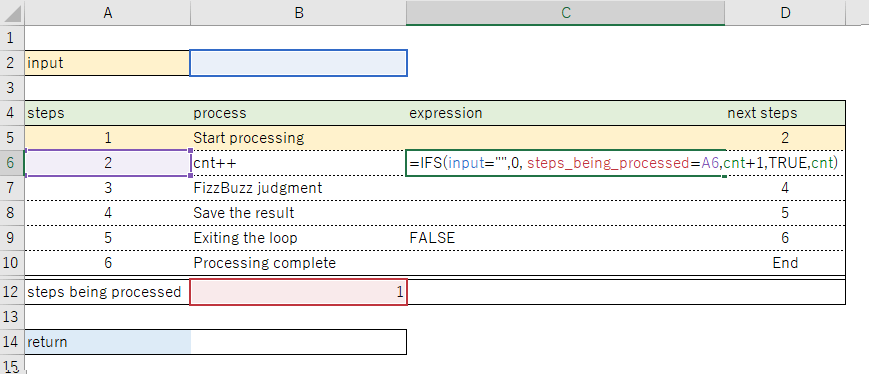

```
=IFS(input="",0, steps_being_processed=A6,cnt+1,TRUE,cnt)
```

The calculation is 0 if the input value is blank, increases by 1 if the step in the process is 2, and does not increase otherwise (=itself). In other words, cnt is initialized when the input value is blank, and increases by 1 only when the processing step becomes 2. `cnt=cnt+1` in VBA.

#### **Step 3 FizzBuzz judgment**

This is the judgment process. As in step 2, I first look at the input value and initialize it, then I look at the number of steps and if it is 3, I make a FizzBuzz judgment.

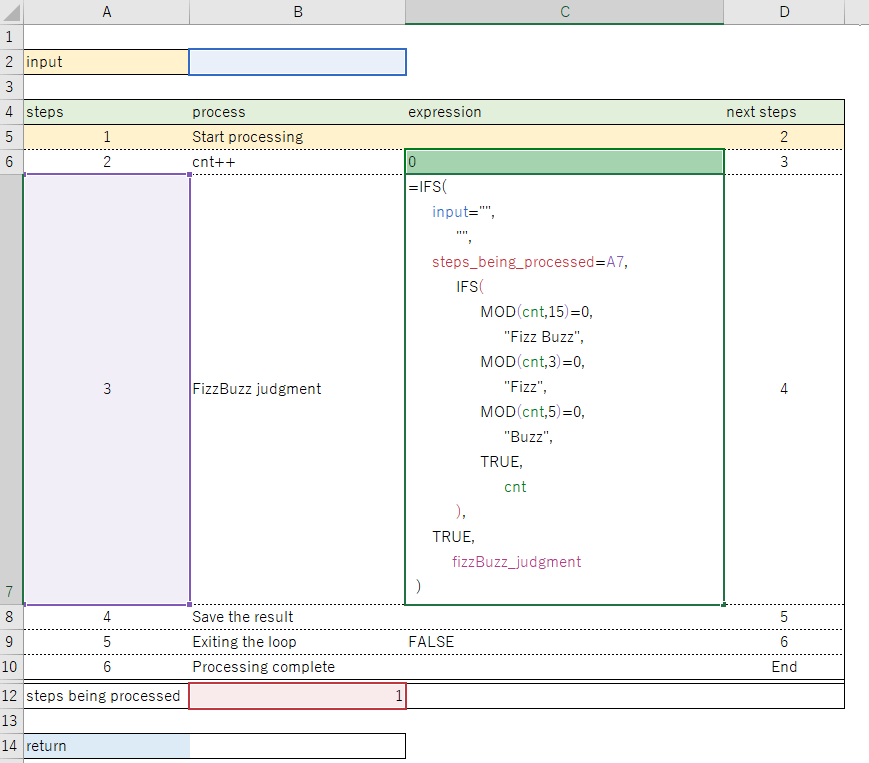

```
=IFS(
      input="",
            "",
      steps_being_processed=A7,
            IFS(
                  MOD(cnt,15)=0,
                        "Fizz Buzz",
                  MOD(cnt,3)=0,
                        "Fizz",
                  MOD(cnt,5)=0,
                        "Buzz",
                  TRUE,
                        cnt
            ),
      TRUE,
           fizzBuzz_judgment
  )
```

The last "fizzBuzz judgment" refers to yourself (C7). If you are not in step 3, the result will be your own, so the previous judgment process will be saved.

#### **Step 4 Save the result**

The results of the decision will be combined and stored as a string.

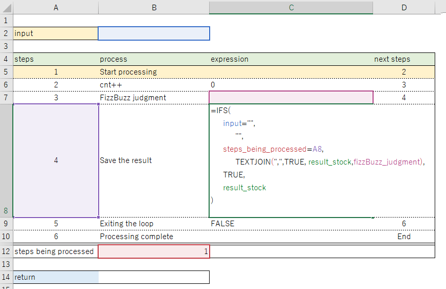

In VBA, `result_stock = result_stock & "," & result`.

#### **Step 5 Exiting the loop**

If cnt is less than the input value, return to step 2; if it is greater than the input value, go to step 6.

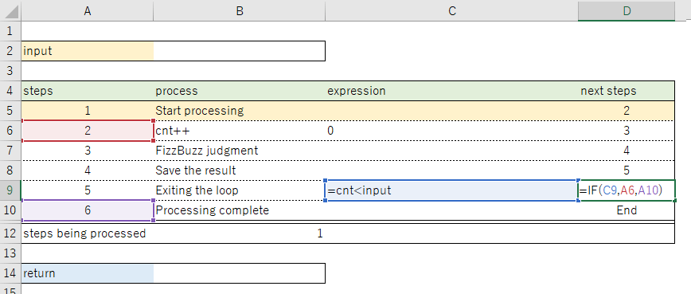

```
expression = cnt < input
```

```
next steps = IF(C9,A6,A10)
```

The result of the decision is written in the formula, so that the "next number of steps" is switched.

#### **Step 6 Processing complete**

When you get to step 6, the "result\_stock" is the final result.

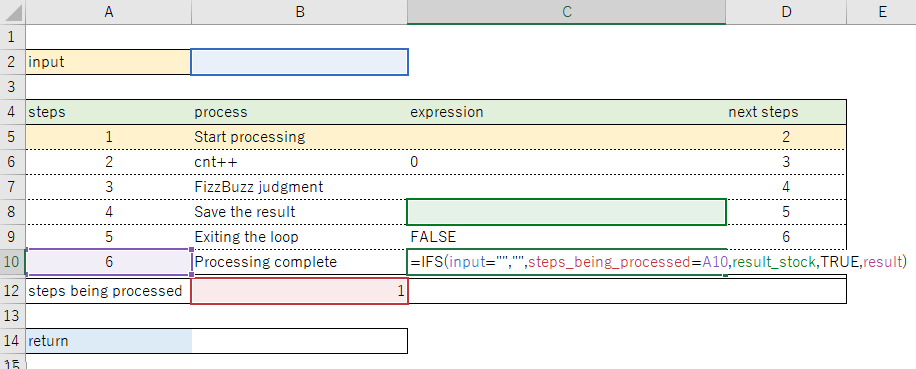

```
=IFS(input="","",steps_being_processed=A10,result_stock,TRUE,result)
```

#### **Return value**

The return value is reflected when the step reaches the end. This completes the series of processing.

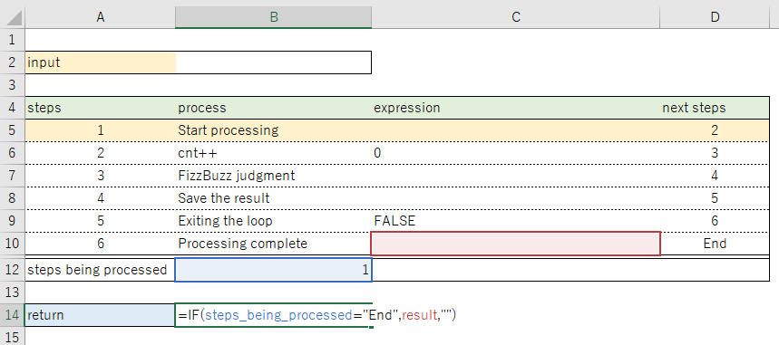

#### **Let me recalculate**

It should go like this.

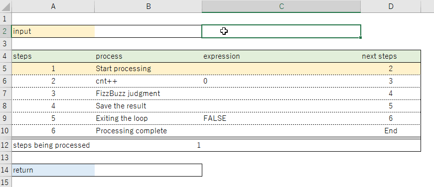

Each step is calculated and judged, reproducing the same kind of actions as in programming.

### **It is also possible to isolate each function**

In addition to flowing from the top to the bottom, it can also be separated into specific processes by connecting arguments and return values, similar to the Function and Sub functions in VBA.

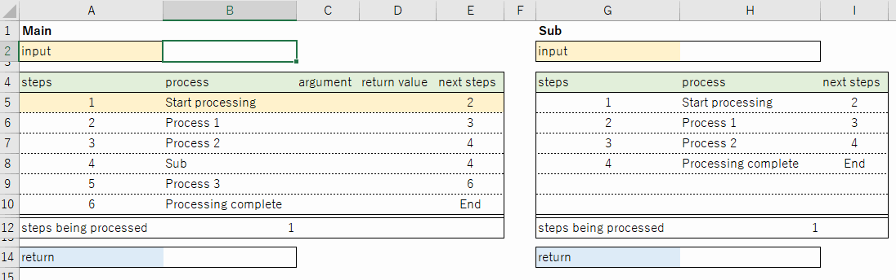

This approach allows development to be separated into separate functions, which makes it less complicated.

These are the ways to configure pseudo-programming.

### **I can make anything now**

The fact that pseudo-programming is possible even on cells means that almost any game can be created. The sample below shows the processing flow during a battle. It's messy, but it's normal programming. If you make a lot of code like this and combine it, you can complete Dragon Quest.

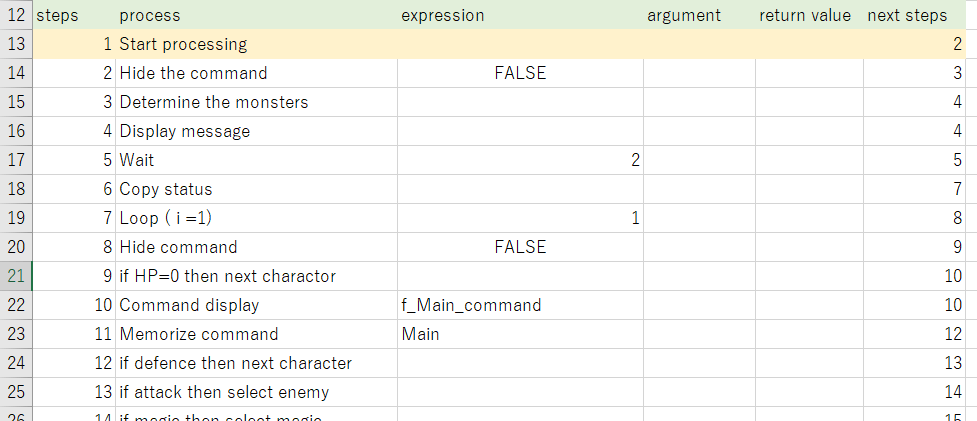

The only thing I can't do is make sounds, and I still can't figure out how to make sounds play as I like without using VBA.

### **The button controls are the same as in previous games**

The button controls have been explained in several articles on games I've made, so I'll skip that bit.

In Japanese.

https://papasensei365.com/excel-nonvba-3d-maze/#toc3

This is how you can recreate Dragon Quest in Excel.

## **Other Information**

### **Points to note about circular references**

You need to pay attention of the order in which circular references are calculated.

The calculations are done in order from left to right and top to bottom of the sheet. In other words, if cell A1 refers to cell A2, A1 will be calculated before A2 is calculated. A specific example of when the problem occurs is when the RAND function is combined with the RANK function.

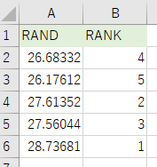

It's a simple way to rank random numbers, but there are a few scenes where the rankings overlap. Normally, if there is no iterative calculation, RANK is evaluated after all RANDs are evaluated, so there is almost no overlap. However, if there is a circular reference, the order is evaluated as A2→B2→A3→B3→A4→B4... so there are cases where the rankings overlap. There is nothing we can do about this because it is a specification. Try to write from the top to the bottom in the order you want it to be processed. For example, if you want to solve the above ranking problem, you can do this.

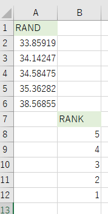

In addition to this, there seems to be a priority order to the sheets as well as the position of the cells. Please note that if you separate the sheets for each function, the process may proceed in an unexpected order. In the aforementioned process, there was a step that did nothing called "Step 1 Start processing", but this was set up as a rest point to ensure that the order of calculation of the circular reference does not deviate. I haven't analysed it in detail, but this is the point where the "why does it work when this line is present" phenomenon occurred. I'll try to analyze it when I have time.

### **How did you obtain the images?**

Since scatter plots do not allow for scaling of the image size, I had to have a standardized image size for the map and monsters. There was no way I could find the images I was looking for on the Internet, so I had to make them from scratch. I made it in Excel, because why not?

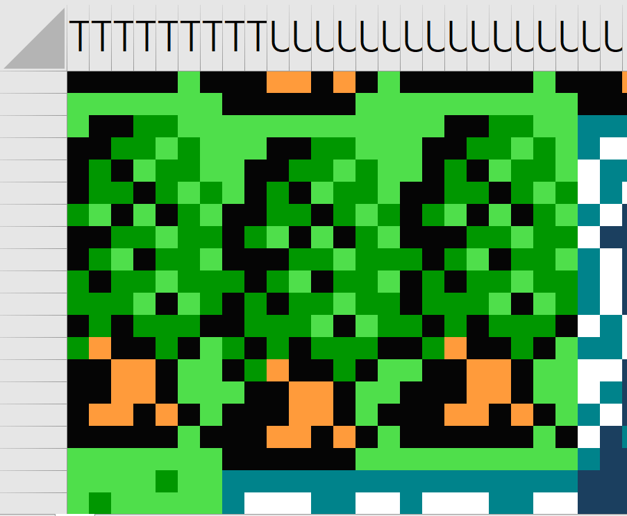

You can make the size consistent by copying the cell range and saving it as an image. It's not easy to get the image ready.

### **How big is the file?**

The file size is about 5.2MB, most of which is the image used for the map. The battles alone make up about 660KB.

## **With that said…**

I'm not going to release this work on GitHub because it is not optimized yet, some parts are unstable, and there would be some copyright issues. If you are interested, please try to make it by yourself.

## **Lastly**

My previous games took about a week to make, but this one took over a month. Dragon Quest has many different patterns to create. Also, while I tried to build a pseudo-programming system, in the end, what I am doing is not much different from VBA, and to be honest, I feel like I may want to limit the pseudo-programming method since it requires so much more effort than VBA.

I'm going to try Tetris next. I’ll keep at it.

このページで利用している株式会社スクウェア・エニックスを代表とする共同著作者が権利を所有する画像の転載・配布は禁止いたします。  
© 1988 ARMOR PROJECT/BIRD STUDIO/SPIKE CHUNSOFT/SQUARE ENIX All Rights Reserved.
