VBAを使わないでゲームを作ってみる第6弾になります。今回はテトリスを再現してみました。単純な仕様ではありますが正直ドラクエよりも難しかったです。

## こんなのできました

https://twitter.com/10mikiya/status/1349004031491010560

すぐにゲームが始まり、ボタン操作でミノを操作してテトリスが遊べます。上までミノが積み上がるとゲームオーバーになって、RESETすることで再スタートする仕様です。

## ファイルを公開します

実際に作成したファイルをGitHubに公開していますので、中身を見たい方は是非触ってみてください。Excel2010以上で動くように作ってはいますがWindowsのExcel2013とExcel2016でしか確認できていないので、もし不具合があれば教えてください。（直すかどうかはモチベーション次第）

https://github.com/tomikiya/excel\_game\_tetris

メインのシートとコントローラーのシートが別々になっていますので、ファイルを開いたら**[表示]-[ウィンドウ]-[新しいウィンドウを開く]**でシートをもう1枚表示してください。あとはF9を押し続けると動き始めます！

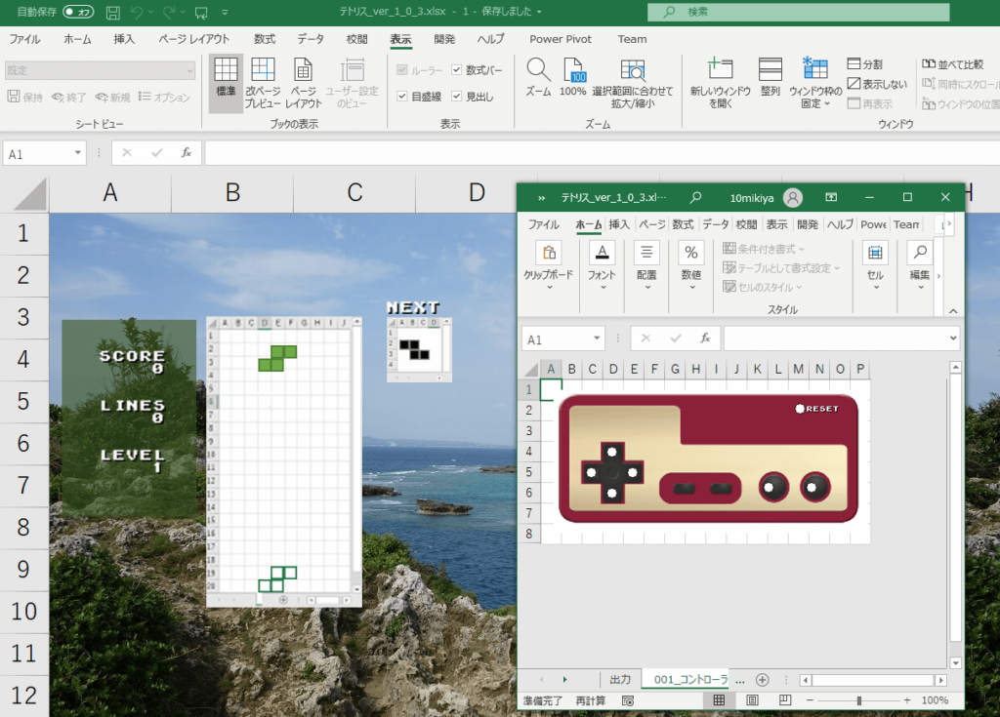

## ポイント

テトリスを構築する上でポイントになる点をまとめます

- 描画は散布図を使う
- ミノの自然落下はF9押しっぱなしで再現する
- 疑似プログラミングをなるべく使わない
- 揮発性の処理もなるべく使わない

技術的にはドラクエで使った手法とほぼ同じです。しかしテトリスはドラクエに比べアクション要素が多いので処理速度を特に気にしなくてはなりませんでした。その課題をどうクリアするかが肝になりました。

## 詳細

今回はせっかくなので細かい部分まで解説してみます。分かりにくいところがありましたらスッと読み飛ばしてください。

### コントローラーの作り方

コントローラは、テーブル機能とフォームコントロールのオプションボタンで作ります。この作り方は3D迷路やドラクエでも使っていますので、どのゲームでも応用が利きます。

#### 操作履歴テーブルの作成

まずは操作の履歴を記録するため、「操作履歴」テーブルを作ります。

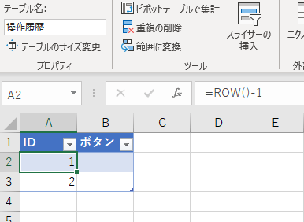

「ID」と「ボタン」の列を作り、ID列には`ROW()-1`を登録します。コントローラーを操作すると「ボタン」列に履歴が貯まる想定です。

#### オプションボタンの追加

フォームコントロールのオプションボタンを7個追加しておきます。オプションボタンは開発タブのコントロールにあります。

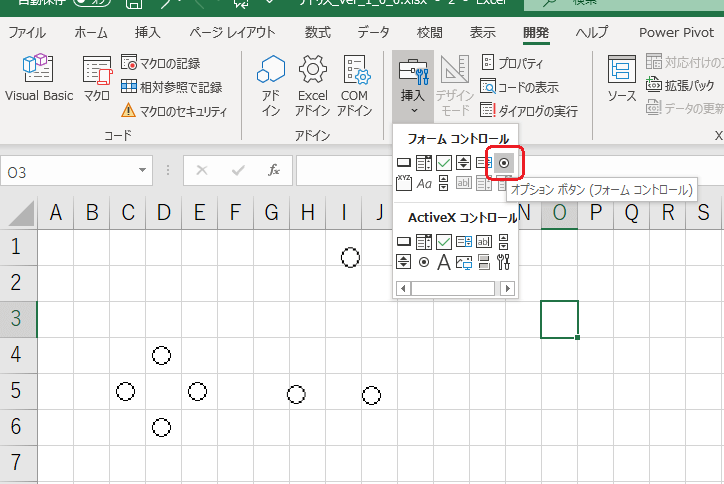

オプションボタンの書式設定には「リンクするセル」という設定があり、これをセルと紐づけておくと、ボタンを押したタイミングでその情報がセルに反映されます。この機能を利用することでボタン操作をセルに反映できるようになります。

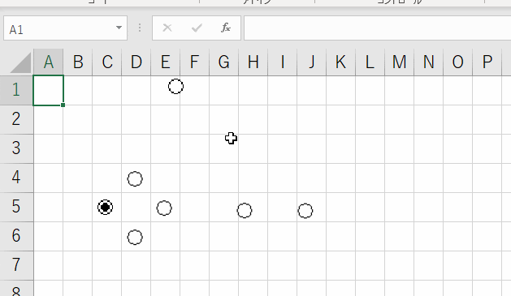

ただし、このままでは操作するたびにA1セルが更新されてしまい、履歴が残せません。

そこでリンクするセルが動的に変わるようにします。

#### 名前定義を経由してリンクするセルを動的に変更する

「リンクするセル」には式を登録できませんので、名前定義を経由します。名前定義に以下の式を登録します。名前は「ボタン操作」にしています。

```
=INDIRECT("操作履歴!$B$"&COUNTA(操作履歴!$A:$A)+1)
```

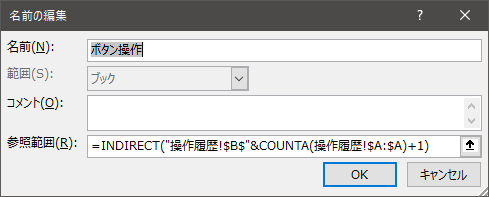

この名前定義を「リンクする」セルに登録するとボタン操作が上書きされずに記録されていきます。

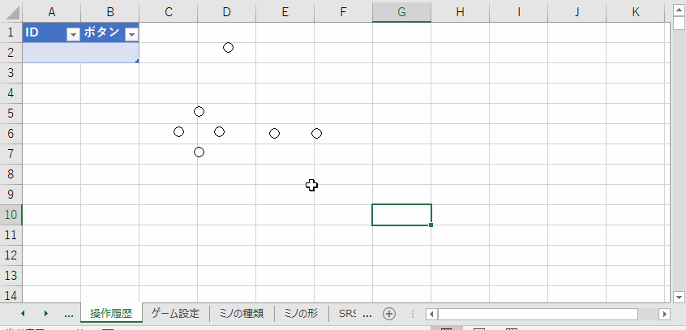

最終行が増えた時にその値を参照する仕組みを作ればボタンを押したときのイベントを拾えますね。

#### 画像を重ねて完成

それらしい画像を用意してボタンと重ねるとコントローラの完成です。

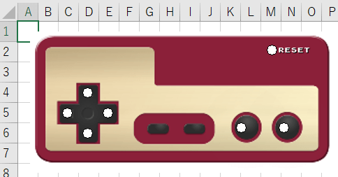

トピック

フォームコントロールは大きさを変えたり色を変えることができません。オプションボタンの「〇」が気になるかもしれませんがご愛嬌ということでそのままになります。

一応消す方法はあるにはありますがいろいろ制限があるのでテトリスではそこまで実装しません。気になる方は以下の記事をご覧ください。

https://papasensei365.com/excel-nonvba-3d-maze/

### ミノを描画する

ミノを描画する方法はいくつかあります。どれを使用するのか、それが一番の問題です。可能な限り動作の軽い描画方法を選択する必要があります。（今回はここの検証に一番時間を使いました。）

#### 描画方法を方法いくつか紹介

VBAを使わずに画像を動かす方法をいくつか試したので紹介します。一概にどれが良いかは決められません。ゲームの内容次第になります。

##### リンクされた図で表示

「リンクされた図」は、オブジェクトの式を変えることで参照する位置を変更できます。

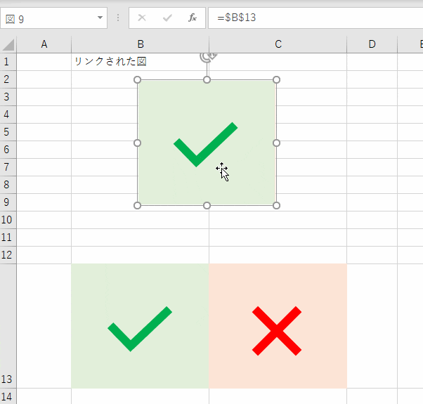

ボタン操作や時間経過とともに式を変更するように調整すれば、表示するミノを切り替えられます。

ただ、リンクされた図は負荷が高く、複数のリンクされた図を使ってしまうと反応が遅くなったりすぐに固まったり最悪メモリ不足になってExcelが落ちます。使用するなら1ファイル1枚程度に収めたいところです。

↓リンクされた図で描画してみた結果です。反応が遅いですね。

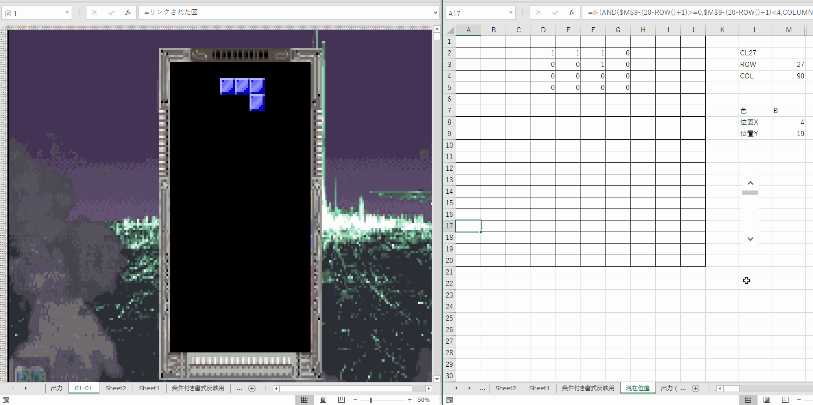

テトリスでは使用しませんでしたが、第1弾のゲームウォッチ風ゲームや3D迷路のMAP表示で使っています。

##### 条件付き書式で表示

セルの幅と高さを小さくし、ドット絵のように表示する手法です。セル1つずつに条件付き書式を設定してセルの色を適宜変更していきます。手間はかかりますが、これが1番シンプルです。

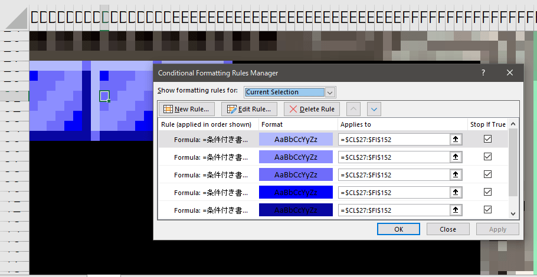

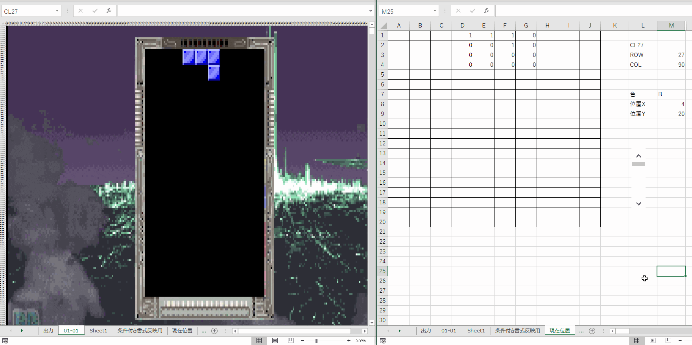

条件付き書式はシンプルに作れるものの揮発性なので毎回再計算されます。条件付き書式の種類が多いと簡単に遅くなるのが注意です。

以下のGIFは、35種類設定と6種類設定をそれぞれ比べました。明らかに速度が違います。テトリスでは不採用でしたが、使用する色が少ないゲームであればこの方法も十分活用できます。

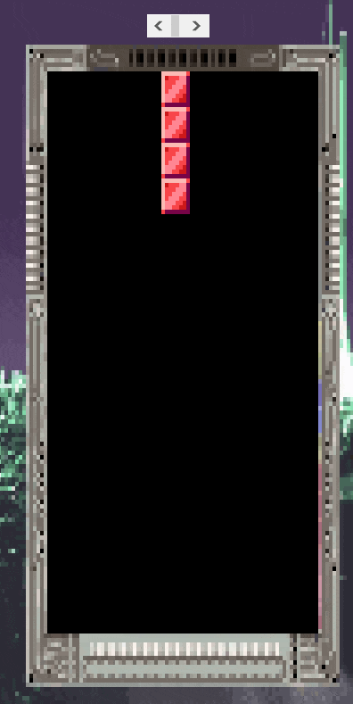

トピック

[揮発性関数](https://docs.microsoft.com/ja-jp/office/client-developer/excel/excel-recalculation#volatile-and-non-volatile-functions)は、再計算のたびにセルを更新する関数です。Now()やToday()が有名ですね。これらの関数はテトリスを作る上で非常に使いやすいのですが、他の関数で置き換えられるところは全て置き換えています。そうしないとすぐに遅くなってしまうからです。式が長くて難しいセルを見つけたら、それは揮発性関数の置き換えかもしれません。（OFFSET使いたかったです・・・。）

##### 散布図による描画方法1 マーカーをドットに見立てる

散布図のマーカーを密集させドット絵を作り、マーカーの表示を切り替える方法です。1つのブロックの大きさが8×8で、横10ブロック×縦20ブロック、7種のミノがありますのでトータル89,600個のマーカーを敷き詰めることになります。

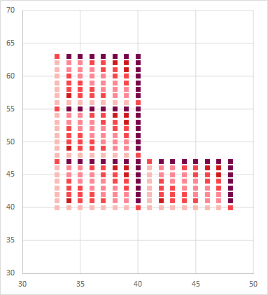

マーカーの数が多いためほとんど動かないのが残念です。

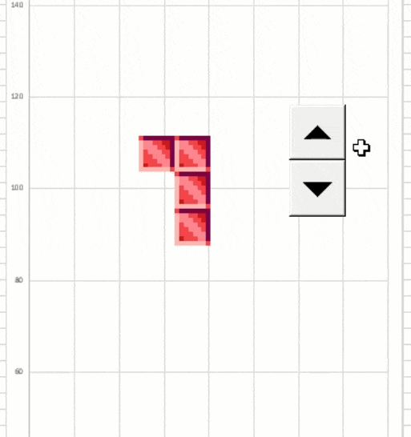

使えるゲームは限られますね。

##### 散布図による描画方法2 画像を使う

ドラクエでも利用した方法です。散布図のマーカーに画像を登録し、マーカーの表示非表示を切り替えて描画する方法です。使用する色の種類に関係なく一定の速度で表示できます。現時点ではこの方法が一番安定します。画像が大きすぎたりズーム率を下げてシートの表示領域を広げると重くなる傾向があるので、散布図はなるべく小さく作ることを心がけます。

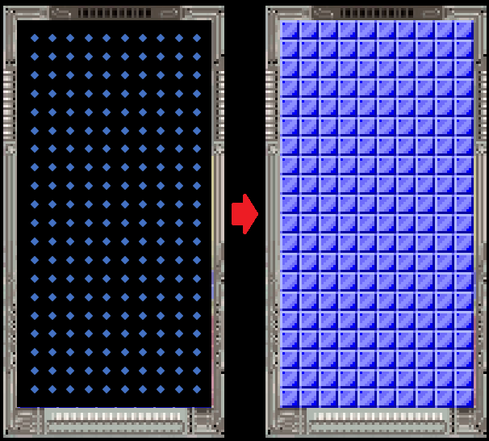

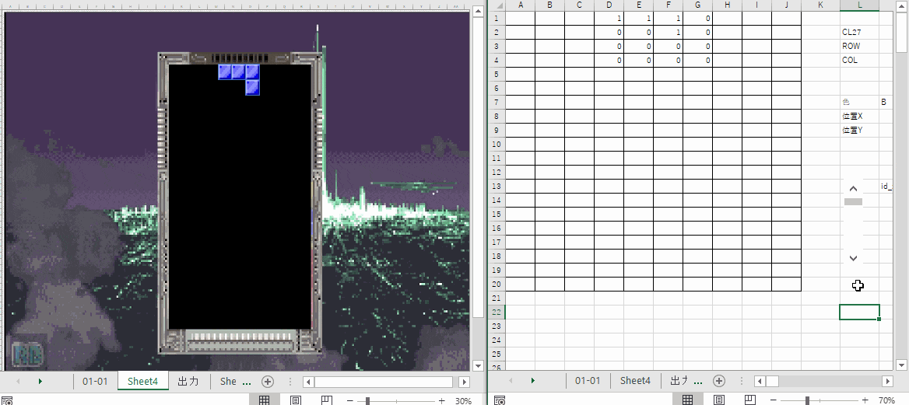

今回のテトリスはこの方法で作られています。

#### マーカーの表示と非表示を切り替える方法

散布図のマーカーはデータが欠けると表示されなくなる仕様です。表示する位置以外は常にエラーを出すように描画フラグを計算することで切り替えています。下記画像のように、散布図はviewXとviewYを参照していて、描画フラグがTRUEのマーカーだけ表示するようになっています。

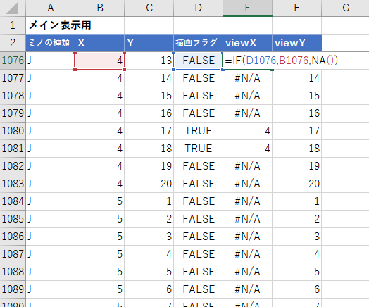

### ミノを自然落下させる

ここからは動きの実装方法を説明します。

Excelは一部例外を除きますがほとんどの場合、何も操作しないと状態を変えることが出来ず動きません。そこで、自然落下を表現するためにドラクエでも活用した「疑似プログラミング」と「F9押しっぱなし」を使います。

#### 疑似プログラミングと再計算について

疑似プログラミングはセル上でプログラミングのような動きを実装する方法です。反復計算オプションを有効にして循環参照を発生させカウンターを再現することで再計算をするたびにセルの内容を変化させることができます。

また、カウンターを動かすためには再計算が必要なのでショートカットキーとなるF9を押しっぱなしにして再計算を連続で発生させます。

詳しい話はドラクエの記事に記載していますのでここでは省略します。ご参考までにどうぞ。

https://papasensei365.com/excel-game-dq3/#toc12

#### 疑似プログラミングを使う場合の注意点

疑似プログラミングがあればほとんどのゲームが再現できますが注意点があります。

それは、**遅い**という点です。

1度の再計算で1ステップしか進みませんのでステップ数が多ければ多いほど遅くなります。これはテトリスを作るには致命的です。そのため、テトリスでは疑似プログラミングを最小限に抑えるように作ります。

#### 自然落下の疑似プログラム

自然落下は2ステップで処理しています。

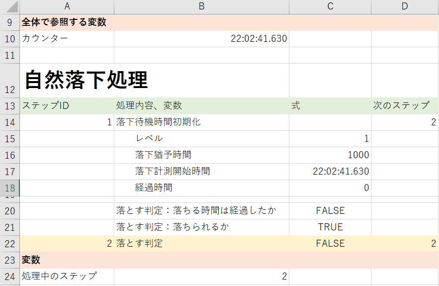

一番大事なのは、「落下計測開始時間」の保存です。この項目は落下した直後の時間を保存します。その値とカウンターの時間が一定数離れたら再度落とす処理を行うことになります。落ちた瞬間だけ値を初期化する項目なので、その時以外は値を保たないといけません。通常のExcelの関数だけではこの動きを実現することができないため、疑似プログラム（＝循環参照）を使います。

↓これが落下計測開始時間の式です。

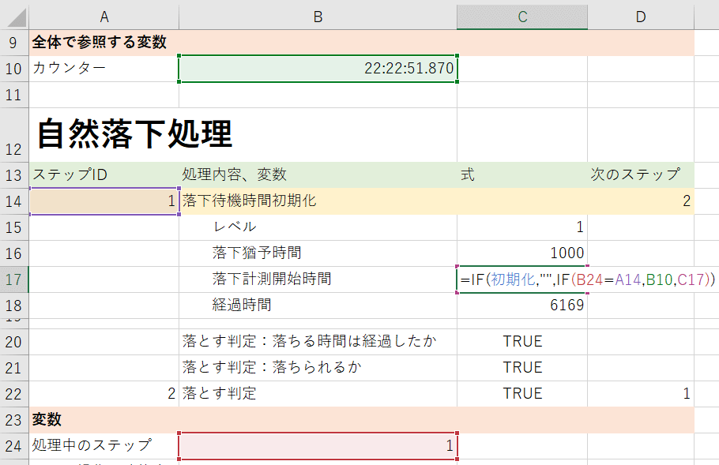

```
=IF(初期化,"",IF(B24=A14,B10,C17))
```

1つ目のIFの「初期化中なら空欄になる処理」は置いておいて、その後のIFが大事です。「処理中のステップ」が1の場合、B10の値を参照、つまりカウンターの値をコピーして計測開始時間を保存します。「処理中のステップが」1以外の場合、C17の値を参照、つまり自分自身を参照します。自分自身を参照しているときは値が変わりません。通常ですとこの式は循環参照の警告が出ますが反復計算のオプションを有効にしているため警告が出ないようになっています。ステップは1か2しかないので、ステップが2の間は計測開始時間が保存される仕組みです。

ステップ2では落とす判定を行っていて、落とさないと判定している間はステップ2をループします。

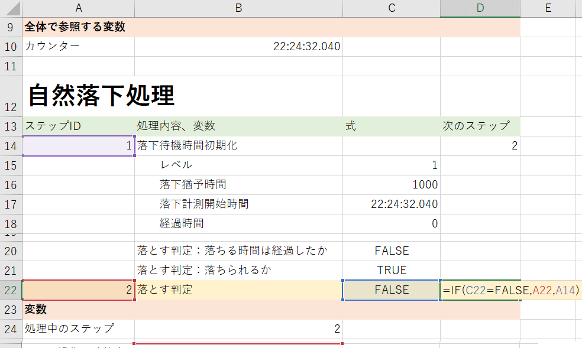

```
=IF(C22=FALSE,A22,A14)
```

落とす判定がTRUEになるのは「落ちる時間は経過したか」と「落ちられるか」がどちらもTRUEになったときだけになります。

```
落ちる時間は経過したか = 経過時間 >= 落下猶予時間
落ちられるか = NOT(接地している)
```

#### 落とす判定がTRUEになったら

ミノのY座標を計算する式の一部が以下のようになっています。落とす判定がTRUEになると座標が1だけ下に移動する形になっています。

```
Y座標 = 現在位置Y - 落とす判定    '※一部省略
```

以上の仕組みでミノが自然落下しています。

### ミノを横方向に動かす、回転させる

ボタン操作でミノの位置や状態を変更するのも自然落下と同様に疑似プログラムを使います。自然落下では時間経過とともにステップが動きましたが、今回はボタン操作でステップが動きます。

前述したコントローラーの作り方で説明しましたが、操作履歴を貯めるテーブルがありますのでそこから最新の操作履歴を取ってくるようにしています。

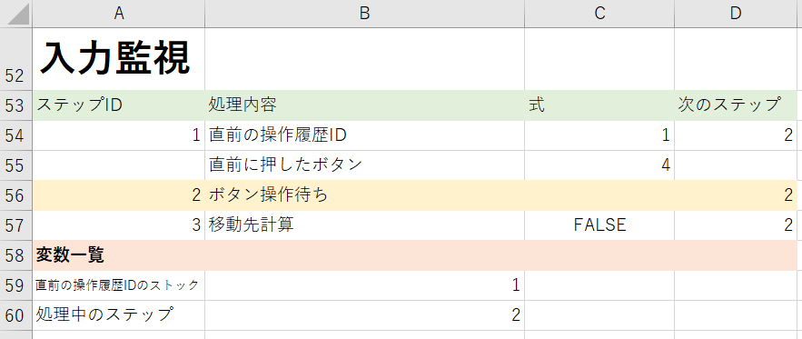

```
直前の操作履歴ID = MAX(操作履歴[ID])
直前に押したボタン = IFERROR(INDEX(操作履歴[ボタン],MATCH($C$54,操作履歴[ID],1)),"")
```

ボタン操作があるまでステップ2でループします。ボタン操作があると「直前の操作履歴ID」が更新されます。「直前の操作履歴IDのストック」と差異が出るとボタンが押されたと判定され、ステップ3へ移動します。

ステップ3に移動すると移動先を計算する処理に移ります。

#### 移動先は関数だけで計算する方針にする

可能な限り処理速度を上げるため、疑似プログラミングを使わないように移動先の計算は全て関数でおこないます。テトリスの仕様をそのままExcelの関数に変換します。

そのためにはまず「操作中のミノ」と「積み上がったミノ」の情報を管理します。

#### 操作中のミノの状況を管理する

操作中のミノの状況は、以下の情報で管理できます。

1. 種類は何か
2. どの程度回転しているか
3. どこにいるか

「どこにいるか」はX座標とY座標の2種類になりますので、実質4つのパラメーターを用意します。ミノが自然落下したりコントローラーを操作したりするときにこれらのパラメーターを更新していくことになります。

##### ミノの形はデータ化する

ミノは全部で7種類です。それらにIDを付けて数値に変換できるようにしておきます。

|  |  |
| --- | --- |
| ミノID | ミノ |
| 1 | I |
| 2 | O |
| 3 | T |
| 4 | S |
| 5 | Z |
| 6 | J |
| 7 | L |

そして回転も1から4の数値で管理します。また、すべてのミノは4×4で表現できますので形もデータにできます。

例えばTミノを右に1回転したときの形は以下のような表で考えられるので、これを変換します。

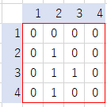

↓

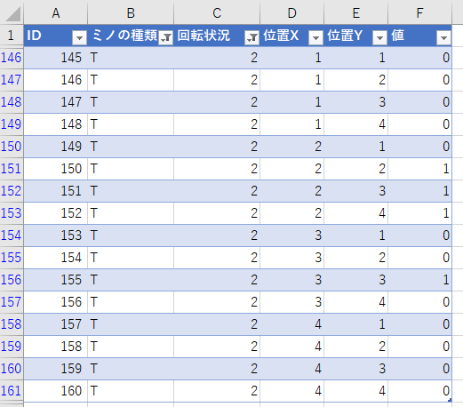

すべてのパターンをデータ化すると448レコードになります。（テーブル名は「ミノの形」としています。）

##### ミノのデータから形を再現できる

ミノの形をデータ化することでミノの種類と回転状況を与えれば形を再現できます。

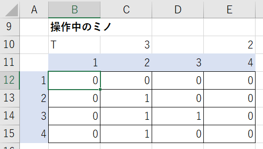

上記例はTミノ（ID:3）が右に1回転(=2)の場合の状況です。INDEXを使ってデータに直接アクセスしています。

```
セルB12 = INDEX(ミノの形[値],($C$10-1)*64+ ($E$10-1) *16 + (B$11-1)*4+$A12)
```

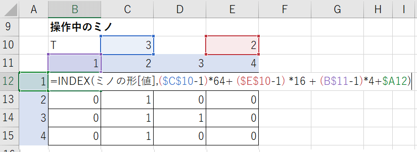

#### 積み上げたミノを管理する

操作するミノとは別に、積み上がったミノも管理する必要があります。ミノを固めるイベントごとに更新するデータになります。

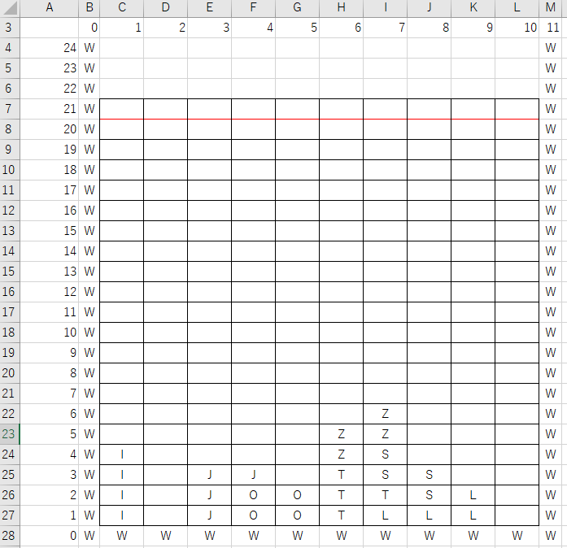

#### 移動先や回転した後の状態をシミュレーションして結果を返す

ミノはボタン操作をしたら無条件で回転したり移動は出来ません。積み上がったミノの状況で変わっていきます。隣が壁だったらそれ以上は移動できませんし、周りがミノだらけだったら回転できません。操作中のミノの状況と積み上がったミノを元に移動結果を変えていきます。

ただ、移動の判定は比較的簡単で、実際に移動してみて壁やミノがあれば移動できないと判定するだけです。回転も同様のやり方なのですがテトリス特有の仕様として[Super Rotation System](https://tetrisch.github.io/main/srs.html)(SRS)があり、それに準拠して回転させます。

まずは積み上げたミノのデータからミノ周辺の形を取得し、ミノの状態も持ってきます。

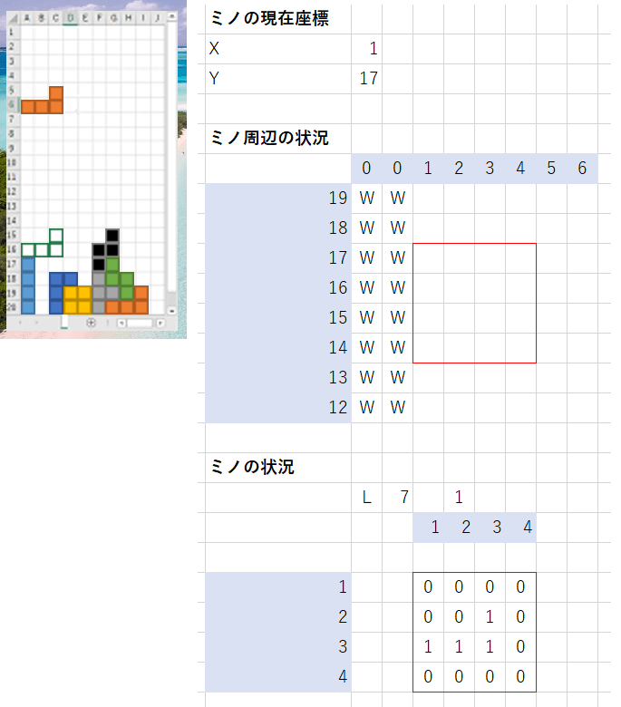

そして、例えば「左へ移動」だったら、実際に左へ移動させて「ミノ周辺の状況」と照らし合わせて判定を行い、1か所でもぶつかっていたら「移動できない」とします。

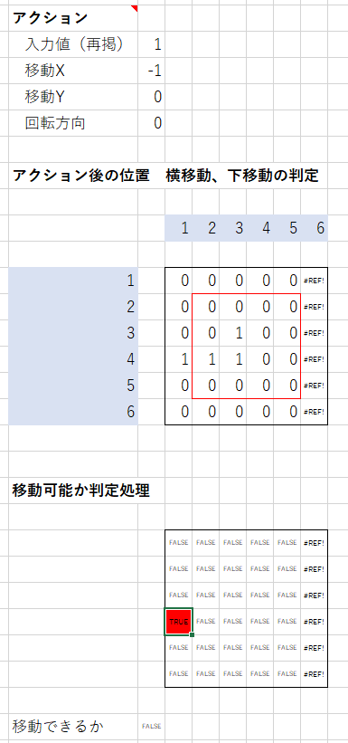

赤い位置がぶつかっています。この計算結果として返す値は「移動できない」、すなわちX移動が0、Y移動も0、回転0になります。

回転時もやることは一緒ですが、前述したようにSRSでの判定になります。

- 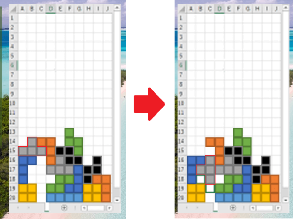

この例は俗にいうTスピンという仕様で、回転しながら移動しています。SRSは裏で5つの判定を順に行っていて、1つでも「回転できる」と判断したらその位置に移動になります。.

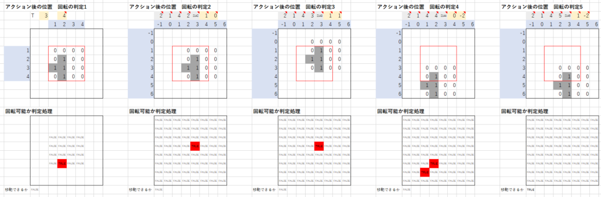

少し見づらいですが最後の判定5だけ、どのミノにもぶつからずに移動できたのでこの動きが採用されます。返す値は、X移動が1、Y移動が-2、回転が-1となります。

以上の計算で移動するための情報を返し、その値で位置や回転状況のパラメータを更新します。

### ミノを固める、消す

このあたりの動きも前述した疑似プログラミングを混ぜつつそのほとんどを関数だけで処理しています。固めるまでの遊びの時間や接地した後で数回転の回転を許容したり等、テトリスの仕様がありますのでそれらを盛り込む形となります。

作り方の方針は同じで説明も繰り返しになってしまうので、ここでは循環参照に重点を置いて説明をします。

#### 循環参照の計算順序を意識する

ドラクエの記事でも言及しましたが、循環参照は計算順序があり、左から右、上から下の順序で計算されます。何も考えずに適当な位置で式をつなげると予想外の結果になります。

例えば、処理1の計算結果をもとに処理2を求め、処理2の結果をもとに処理3を求めたい場合、左から右へ書いていれば問題は起こりません。

下の例では、自分自身にその前の処理の結果を加算するようにしています。

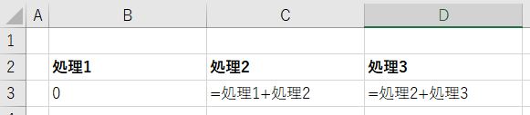

処理1の値を1に変更すると、処理2は1+0となり1へ、処理3は処理2が1になった後で計算されるので同様に1+0となり1になります。結果すべての値が1になります。

しかしセルの位置を変更して処理3を先頭にするとどうでしょう。

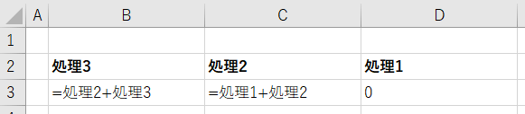

処理1の値を1に変更すると、循環参照の仕様で一番左のセル、処理3が計算されます。処理2がまだ未計算なので処理3は0+0となり結果0になります。処理2は1+0で1、結果的に処理3だけ0になります。

このように循環参照は「どの位置で計算するか」がとても重要になります。計算順序を狂わせないためにも左から右、上から下に計算の流れを書くように心がけないといけません。

積み上げ状況を管理するシートはこの計算順序を制御するため、階段状に配置されています。

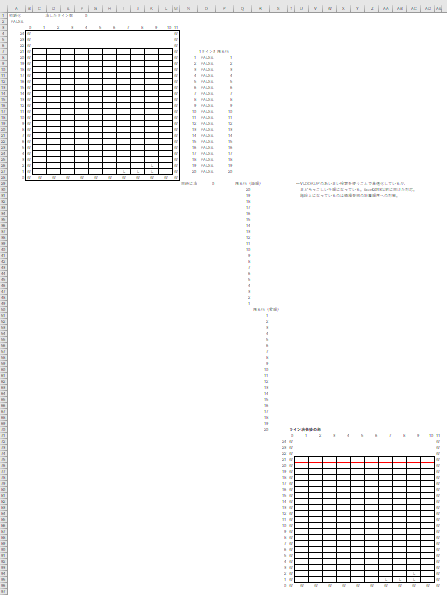

ちなみに、シート間にも計算順序があり、シート名の昇順で計算されます。シート名が「数字\_〇〇」となっているのはその順に計算してほしいからです。

#### 計算順序の仕様を活用する

テトリスでは、ミノが接地してから一定時間経過したら固定化されますが、ミノを動かし続けると固定化されない仕様があります。ただそれではボタン連打すれば永久に動かせるので、15回操作すると強制的に固定化されるようになっています。（※固定化されないバージョンもあります）

今回は15回操作したら固定化する仕様を採用しています。この実装をもとに計算順序をどう活用するか説明します。

以下が接地処理です。操作回数を記録するための「操作回数」と、操作回数をリセットするタイミングを管理する「最底値」を用意しています。「最底値」とはミノがどこまで降りたかを管理する変数で、最底値が更新されると操作回数もリセットされる仕組みです。

最底値には一時記録用の変数も用意しています。一時記録の値と最新の値が異なっていたら操作回数が0になる式が入っています。

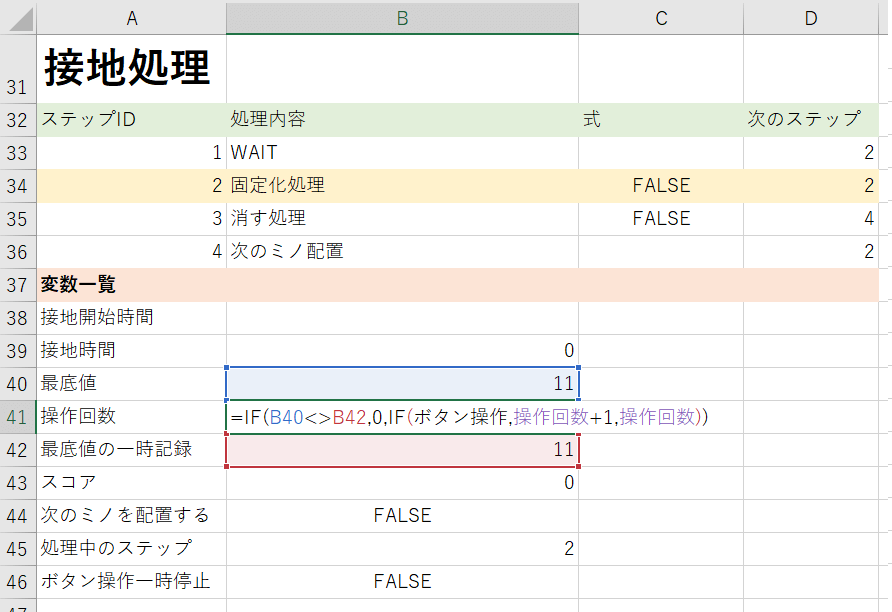

```
操作回数 = IF(B40<>B42,0,IF(ボタン操作,操作回数+1,操作回数))
```

2つ目のIFは、ボタン操作があったら操作回数をカウントアップする意味になっています。今回重要なのは1つ目のIFです。

今度は、「最底値」と「最底値の一時記録」それぞれの式を見てみましょう。

```
最底値           = IF(次のミノFLG,22,MIN(現在位置Y,最底値))
最底値の一時記録 = IF(次のミノFLG,22,IF(最底値<>最底値の一時記録,最底値,最底値の一時記録))
```

次のミノに切り替わったら22にリセットされるのはどちらも同じです。

「最底値」は現在位置Yが下がったら自身と比較し小さい方の値で更新するようになっています。「最底値の一時記録」は自身と「最底値」を比較し、異なっていたら「最底値」の値をコピーするようになっています。

これら3つの式が循環参照の計算順序通りに動くと次のように値が変わっていきます。

現在地Yが20だとし、「最底値」と「最底値の一時記録」どちらも20が入っている時に、ミノが自然落下で1段下がったとします。循環参照の計算順序通り上から下へ計算されるため、まずは「最底値」が評価されます。

1. ミノが1段下がったので「最底値」は19になります。
2. 次に「操作回数」の式が評価されます。「最底値」は19、「最底値の一時記録」は20のため、値が異なることから操作回数は0になります。
3. 最後に「最底値の一時記録」が評価されます。「最底値」が19で自身が20なので値が異なることから「最底値」の値をコピーして19になります。

結果的に「最底値」と「最底値の一時記録」がともに19、「操作回数」が0になります。同様にまたミノが下がったら19→18→17...と最底値が下がり、操作回数もそのたびに0になる仕組みです。

このように、計算順序の仕様を活かすことで、「状態の変化」を察知し別のアクションを起こせるようになります。

#### ミノを固める判定からラインを消すまでの流れ

固定化するための判定式と、ラインを消すところまで簡単に説明します。

固定化するための条件は1つの式で書いています。

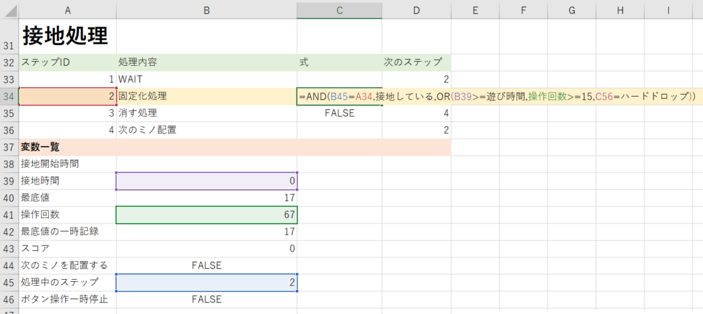

```
固定化処理 = AND(B45=A34,接地している,OR(B39>=遊び時間,操作回数>=15,C56=ハードドロップ))
```

どこかに接地していて、遊び時間を過ぎているもしくは操作回数が15以上もしくはハードドロップの場合、固定化処理がTRUEとなります。

固定化処理がTRUEになると、積み上げ状況を管理するセルでは現在位置からミノの値をコピーして固定化します。

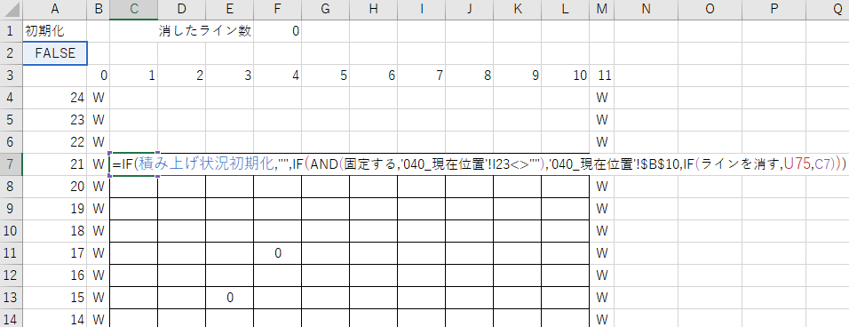

```
積み上げ状況 = IF(積み上げ状況初期化,"",IF(AND(固定する,'040_現在位置'!I23<>""),'040_現在位置'!$B$10,IF(ラインを消す,U75,C7)))
```

この式の後半を見ると分かりますがラインを消すフラグもあって、TRUEになったら予め計算しておいた「消した後の状況」をコピーします。

以上が、接地処理からラインを消すまでの流れです。一連の処理の中に独立できそうな処理が複数入っていて正直気持ち悪いのですが、性能を考慮した結果このようになっています。もしかしたら改善できるかもしれませんが今はこれで満足しています。

## ゲームオーバーとか

大体一緒なので省略します。気になる方はサンプルファイルをダウンロードして確認してみてください。

## 実装できなかったもの

今回も音楽は実装できませんでした。残念です。また、処理を増やすにつれて負荷が上がったせいなのか、長押しやアニメーションが想定通りに動きませんでした。これらも実装を断念しています。

## その他

### コントローラーはなぜ別のシートなの？

テトリスの縮尺とコントローラーの縮尺が合わないためです。テトリスは負荷を下げるため出来る限り画像を小さくするなど対策をしていますが、コントローラーはフォームコントロールを使っているため小さくできません。一緒にするとコントローラが非常に大きくなってしまうからですね。

あと、一緒に配置するとExcelが落ちやすくなります。私の端末ではコントローラーを1度でも操作するとフリーズしてメモリ不足のエラーを吐くことがありました。動作を安定させるためにも別々のシートで管理しています。

### ファイルの大きさは？

初回公開時点で487KBです。背景画像を削除すれば289KBになります。意外と小さくおさまりました。

### Excel2007で動かせないの？

「次のミノ」の計算でRANK.EQを使っているので、そこをRANKに変更すれば動くかもしれません。お試しください。

### どのくらいの期間で作ったの？

2か月かかってしまいました。その期間のほとんどは処理速度を上げるための研究になります。モチベーションが下がらなければもう少し早くできていたかもしれません。

## ということで

新しい手法はなかったですが、多くの性能問題に直面したことでどのような組み合わせが遅くなってしまうのかを把握することが出来ました。これは業務にも活かせそうです。今後の課題は滑らかなアニメーションと長押しの実装ですね。

次はマリオですが、時間があれば、ということで作るかどうかは濁しておきます。（そろそろ別のプラットフォームの勉強をしないとなので…あまり期待しないでください…）

【VBAを使わないExcelゲームシリーズ】

https://papasensei365.com/excel-game-dq3/

https://papasensei365.com/excel-game-dq3-english/

https://papasensei365.com/excel-game-minesweeper/

https://papasensei365.com/excel-nonvba-3d-maze/

VBA無しが難易度高いと感じる方はVBAでゲームを作る所から始めてもよいかもしれません。

https://amzn.to/3qXuC6e
