This is the 6th edition of making games without using VBA. I tried recreating Tetris this time. Although the specifications are simple, this was more difficult than Dragon Quest, to be honest.

## **I Made Something Like This**

https://twitter.com/10mikiya/status/1349004031491010560

The game starts right away, and you can play Tetris by controlling the pieces using buttons. When the pieces stack up all the way to the top, the game is over, and the specifications allow you to start again by resetting the game.

## **Making the File Public**

Since I have taken the file that I actually created and made it public on GitHub, please play with it by all means if you are interested in taking a look inside. Although I made it to work on Excel 2010 and newer, I have only checked it on Excel 2013 and Excel 2016 on Windows, so please let me know if there are any bugs. (Whether or not I will fix them depends on how motivated I feel.)

https://github.com/tomikiya/excel\_game\_tetris

Since the main sheet and the sheet for the controller are separate, please click on **[View]-[Window]-[New Window]** after you open the file to display another sheet. Then, it will start working if you continue to press F9!

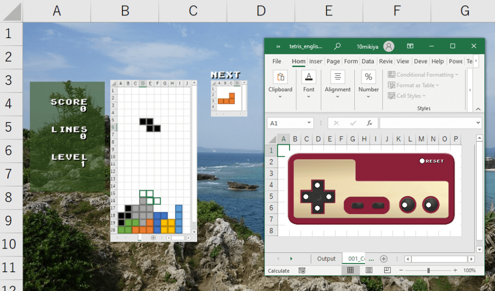

## **Key Points**

I would like to summarize the key points when building Tetris.

- Use a scatter plot for drawing
- Recreate the free fall of pieces by pressing and holding F9
- Avoid pseudocode programming as much as possible
- Also avoid volatile memory processing as much as possible

From a technical perspective, the methods I used are mostly the same as those I used for Dragon Quest. However, since Tetris has more action elements compared to Dragon Quest, I had to pay close attention to the processing speed. How to overcome this issue was the essential point.

## **Details**

I would like to take this opportunity to explain even the detailed parts this time. If there are any parts that are difficult to understand, please skip over them right away.

### **How to Make the Controller**

I made the controller using the table function and the option button under form controls. Since I also used this method for the 3D Maze and Dragon Quest, it can be applied to all kinds of games.

#### **Creating the Operation History Table**

First, I created the operation history table to record the history of the commands.

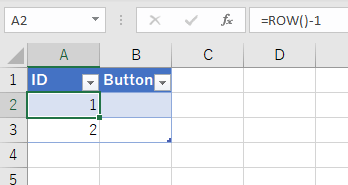

I created ID and Button columns and registered `ROW()-1` to the ID column. The idea is for history to be stored in the Button column when operating the controller.

#### **Adding Option Buttons**

I added seven option buttons under form controls. Option buttons are located under controls in the Developer tag.

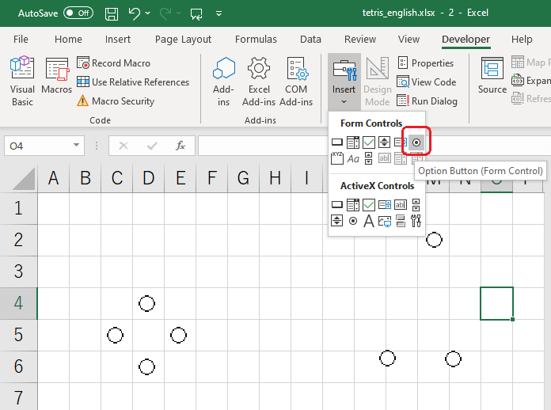

There is a setting for “Cell link” in the format settings for option buttons. If you link the button to a cell, the information is reflected to the cell when the button is pushed. By using this feature, the button operations can be reflected in the cell.

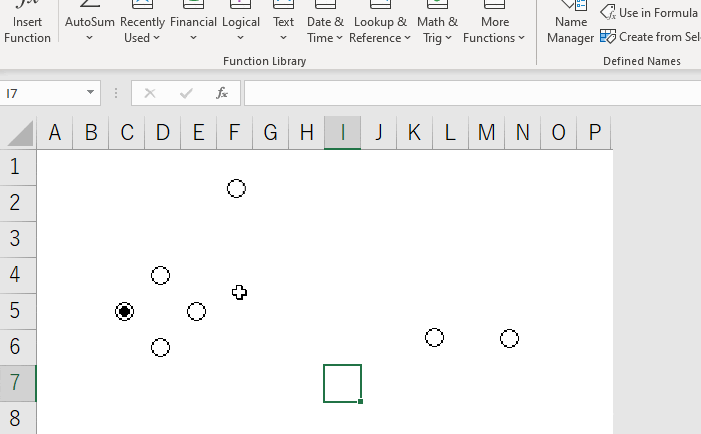

However, the A1 cell will be rewritten each time there is an operation if it is left this way, meaning that the history will not be recorded. Therefore, I set the cell link to change dynamically.

#### **Dynamically Change the Cell Link Through Defined Names**

Since formulas cannot be registered to “Cell link,” I used defined names. I registered the following formula to defined names. I set the name as “ButtonOperations.”

```
=INDIRECT("OperationHistory!$B$"&COUNTA(OperationHistory!$A:$A)+1)
```

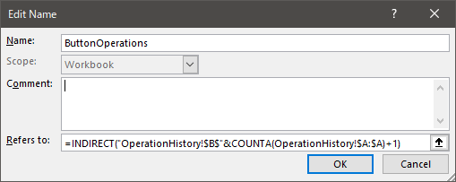

When I register this defined name to the cell link, the button operations are recorded without being overwritten.

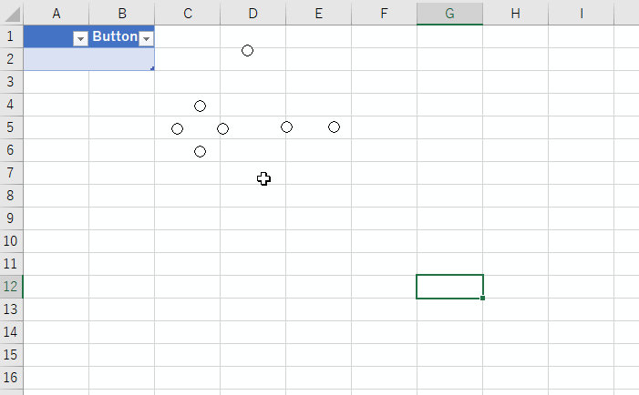

If I create a system that references the value when the final row is increased, I can pick up the event when a button is pressed.

#### **Add an Image on Top to Finish It**

The controller is finished when I prepare a suitable image and put it on top of the buttons.

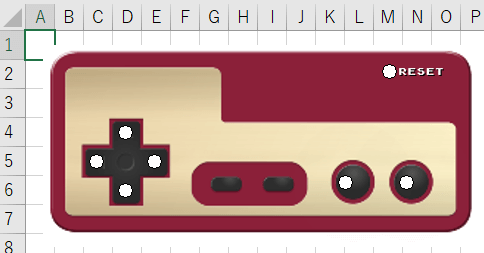

Topic

It is not possible to change the size and color for form controls. The circles for the option button may come across as annoying, but I left them as is to give it some character.

There is a way to get rid of it, but it causes various restrictions, so I did not do so for Tetris. If this interests you, please read the following article.

https://tomikiya.github.io/excel-nonvba-3d-maze/

### **Draw the Pieces**

There are several ways to draw the pieces. Which to use is the biggest question. There is a need to select the drawing method with as little activity as possible. (This time around, I spend the most time testing this.)

#### **Introducing Several Drawing Methods**

Since I tried several methods for drawing images without using VBA, I would like to introduce them. It is not possible to decide which is the best unconditionally. It depends on the content of the game.

##### **Display in a Linked Picture**

The location referenced for a “Linked Picture” can be changed by changing the formula of the object.

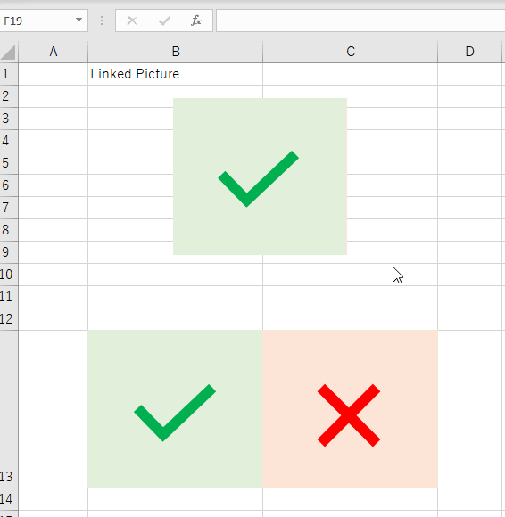

The piece to display can be toggled by adjusting the formula to change with button operations and the passing of time. However, the linked picture has a heavy load. If multiple linked pictures are used, responses become slow, freezing happens frequently, and in the worst case, Excel crashes due to a lack of memory. If there is a need to use linked pictures, it would be best to only use about one per file.

↓This is the result of using a linked picture for drawing. The response is slow.

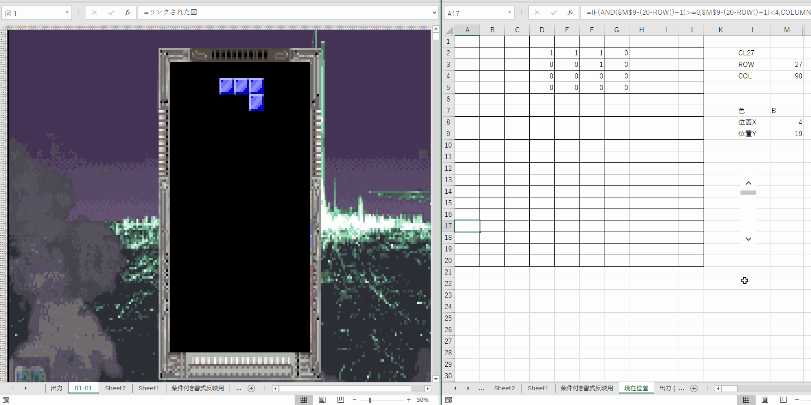

I did not use this method for Tetris, but I used it for the map display for the Game & Watch style game in the 1st edition and the 3D Maze.

##### **Display With Conditional Formatting**

In this method, I made the width and the height of the cells small for a display that looks like pixel art. I changed the color of the cells appropriately by applying conditional formatting to each cell. This takes time, but it is the most simple method.

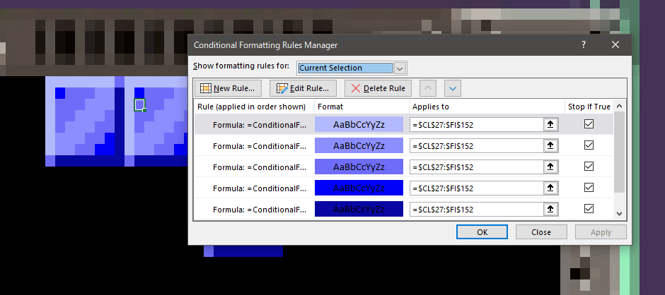

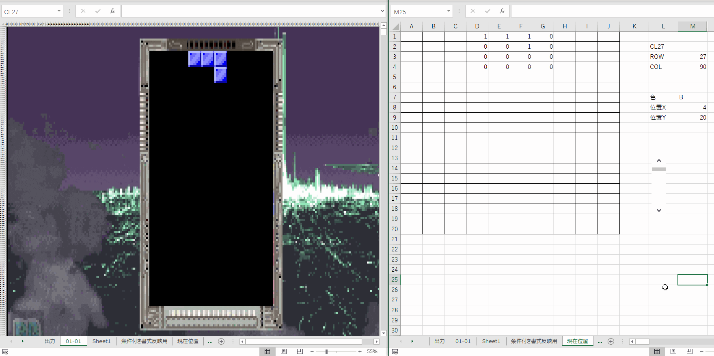

Even though conditional formatting is simple to make, it is calculated each time because it is volatile. A concern is that the use of many types of conditional formatting slows things done easily.

The following GIF compares 35 types with 6 types. The speed is clearly different. I did not use this method for Tetris, but this method is more than adequate for games with few colors.

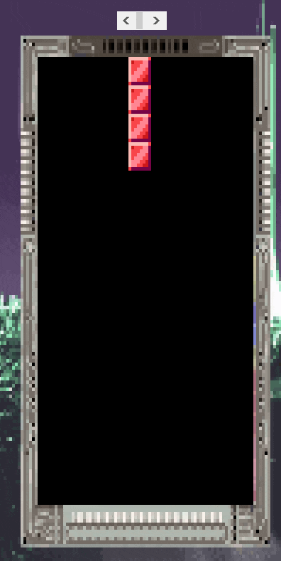

##### **Scatter Plot Drawing Method 1: Use Markers as Dots**

In this method, I clustered scatter plot markers together to make pixel art and toggled the marker displays. The size of a block is 8x8, and since there are 10 blocks horizontally, 20 blocks vertically, and seven types of pieces, I placed 89,600 markers in total.

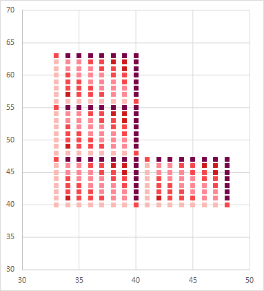

It is a shame that it hardly moved because there are many markers.

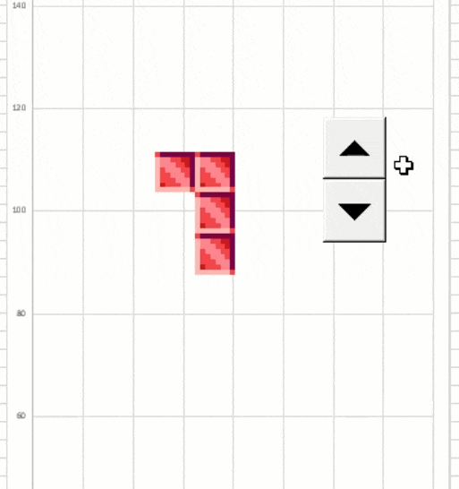

The number of games this method can be used on is limited.

##### **Scatter Plot Drawing Method 2: Use Images**

I also used this method for Dragon Quest. In this method, I registered images to the scatter plot markers and drew by toggling between displaying and not displaying the markers. The images are displayed at a certain speed regardless of the types of colors used. This method is the most stable at present. I try to make the scatter plot as small as possible, since movement tends to get heavy when the images are too large or when zooming in to display a wider portion of the sheet.

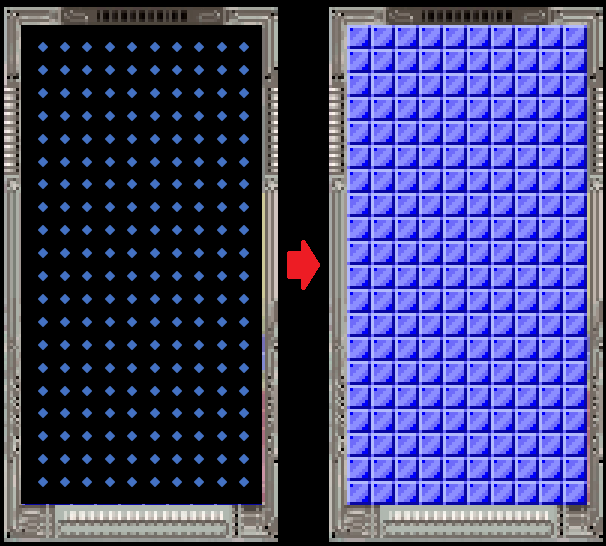

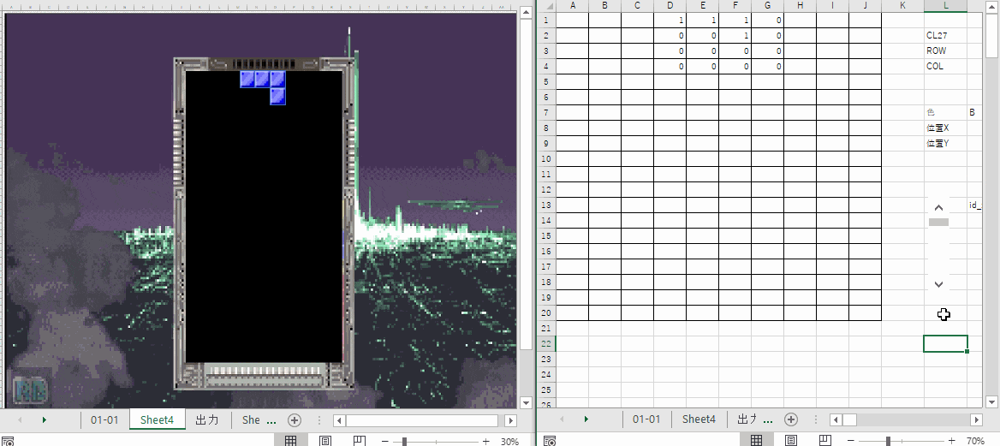

**I used this method to make Tetris this time.**

#### **I used this method to make Tetris this time.**

Based on their specifications, scatter plot markers are not displayed when there is no data. Toggling is done by calculating the drawing flags to always produce an error except for the locations to be displayed. As shown in the following image, the scatter plot references ViewX and ViewY, and only the markers that have a TRUE drawing flag are displayed.

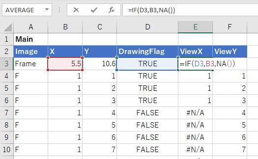

### **Make Pieces Go in Free Fall**

From here, I will explain how to implement movement.

Excluding certain exceptions, conditions cannot be changed to cause movement without an operation in Excel most of the time. Therefore, I used "pseudocode programming" and "keep pressing F9," which I also used in Dragon Quest, to depict a free fall.

#### **About Pseudocode Programming and Recalculation**

Pseudocode programming is a way to implement programming-like actions in cells. It is possible to chance the content inside cells for each recalculation by enabling iterative calculation, causing a circular reference, and recreating a counter. In addition, since recalculation is necessary to move the counter, recalculation can take place continuously by pressing and holding F9, which is the shortcut key.

I will omit this part, since I included a detailed explanation in the article about Dragon Quest. Please use it as reference by all means.

https://tomikiya.github.io/excel-game-dq3-english/

#### **Precautions When Using Pseudocode Programming**

Although most games can be recreated using pseudocode programming, there is a point to note. The point is the fact that it is slow. Since only one step advances per recalculation, the more steps there are, the slower it becomes. This is critical when making Tetris. Therefore, I limited pseudocode programming to the minimum amount when making Tetris.

#### **Pseudocode Programming for Free Fall**

I processed the free fall using two steps.

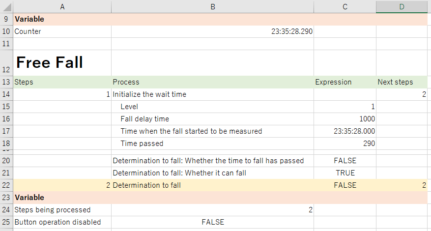

What is most important is to save the time when the fall started to be measured. This item saves the time immediately after the fall. When this value and the time on the counter become separated by a certain amount, the fall is processed again. Since this item only initializes the value at the moment of the fall, it must maintain a value outside of that moment. Since it is not possible to recreate this movement with normal Excel functions alone, I used pseudocode programming (=circular references).

↓This is the formula for the time when the fall started to be measured.

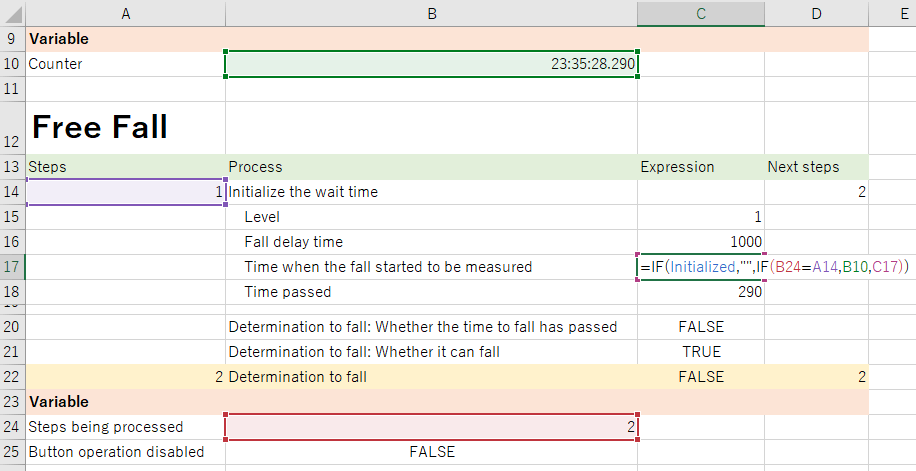

```
=IF(Initialized,"",IF(B24=A14,B10,C17))
```

Leaving aside the first IF statement of "processing to set a null value if initialized," the next IF statement is important. If the "step being processed" is 1, the value of B10 is referenced. In other words, the value of the counter is copied to save the time when the measurement started. If the "step being processed" is not 1, the value of C17 is referenced. In other words, it will reference itself. The value does not change when a cell references itself. Normally, there will be a warning about a circular reference in this formula, but since iterative calculation is enabled, a warning will not appear. Since 1 and 2 are the only options for steps, the time when the measurement started is saved while in step 2.

In step 2, the fall is being determined, and step 2 loops while the determination is to not fall.

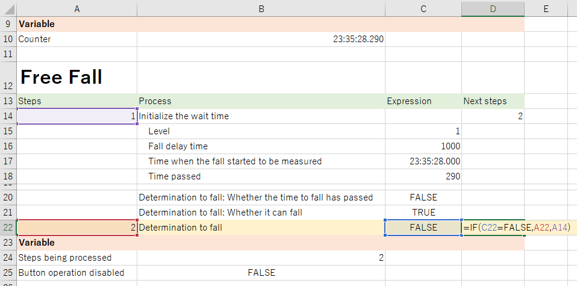

```
=IF(C22=FALSE,A22,A14)
```

The determination to fall is only TRUE when both "whether the time to fall has passed" and "whether it can fall" are TRUE.

```
Whether the time to fall has passed = Time passed >= Fall delay time
Whether it can fall = NOT(Touching the ground)
```

#### **When the Determination to Fall Becomes TRUE**

A portion of the formula to calculate the Y coordinate of the piece is the following. When the determination to fall becomes TRUE, the coordinate moves down one position.

```
Y coordinate = Y of current position - Determination to fall    '*A portion has been omitted
```

The above mechanism makes the piece go in free fall.

### **Move the Piece Sideways or Rotate It**

Pseudocode programming is also used to change the position or condition of the piece through button operations as it was for free fall. For free fall, the steps moved with the passing of time. This time, the steps move with button operations. As I explained earlier for how to create the controller, there is a table where the operation history is stored, so the latest operation history is taken from there.

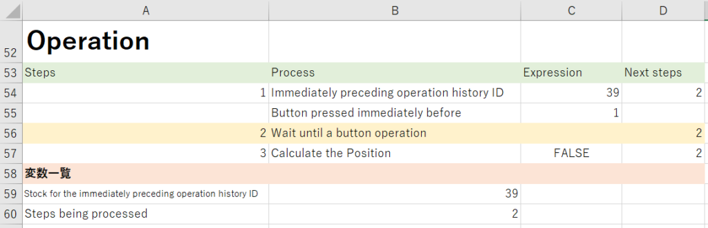

```
Immediately preceding operation history ID =MAX(OperationHistory[ID])
Button pressed immediately before = IFERROR(INDEX(OperationHistory[Button],MATCH($C$54,OperationHistory[ID],1)),"")
```

Step 2 loops until there is a button operation. When there is a button operation, the "immediately preceding operation history ID" is refreshed. If there is a difference from the "stock for the immediately preceding operation history ID," it is determined that a button is pressed, moving on to step 3.

When moving to step 3, it moves on to the process to calculate the position after the move.

#### **Calculate the Position After the Move With Functions Alone**

In order to increase the processing speed as much as possible, I calculated the position after the move with all functions so that pseudocode programming is not used. I converted the Tetris specifications into Excel functions just as they are.

In order to do so, I first managed information about the "piece being maneuvered" and the "pieces stacking up."

#### Manage the Condition of the Piece Being Maneuvered

The condition of the piece being maneuvered can be managed with the following information.

1. What is the type?
2. How much has it rotated?
3. Where is it?

For the answer to "where is it?" there are two types: the X coordinate and the Y coordinate. Therefore, four parameters are prepared in real terms. These parameters are updated when the piece is in free fall or is moved using the controller.

##### **Turn the Shapes of the Pieces Into Data**

There are seven types of pieces in total. IDs are given to each piece so that they can be converted into numerical values.

|  |  |
| --- | --- |
| ID | Type |
| 1 | I |
| 2 | O |
| 3 | T |
| 4 | S |
| 5 | Z |
| 6 | J |
| 7 | L |

Then, the rotations are also managed using numerical values of 1 through 4. Also, since all pieces can be represented in 4x4, the shapes can also be turned into data.

For example, the shape that is made when rotating the T piece to the right once can be thought of as a table such as the following. Therefore, it is converted.

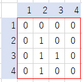

↓

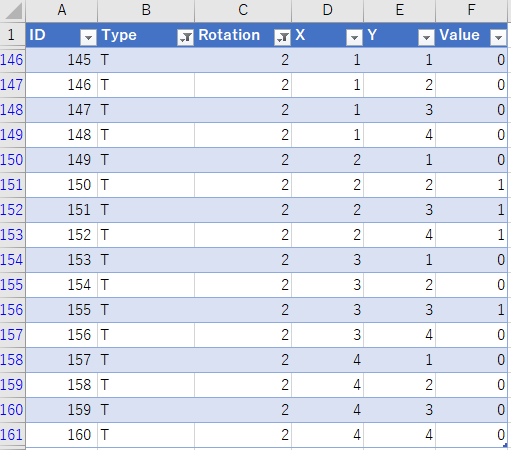

There are 448 records when converting every pattern into data. (The table name is "Shapes of pieces")

##### **Recreate the Shape from the Piece Data**

The shape can be recreated when the type of the piece and its rotation condition are provided by turning the shape of the piece into data.

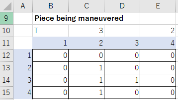

The above example is the condition when the T piece (ID: 3) is rotated once to the right (=2). The data is accessed directly using INDEX.

```
B12 = INDEX(ShapesOfPieces[Value],($C$10-1)*64+ ($E$10-1) *16 + (B$11-1)*4+$A12)
```

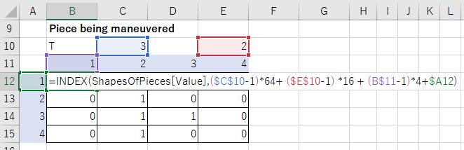

#### **Managing the Stacked Pieces**

There is also a need to manage the stacked pieces separately from the piece that is being moved. The data is updated for each event to solidify a piece.

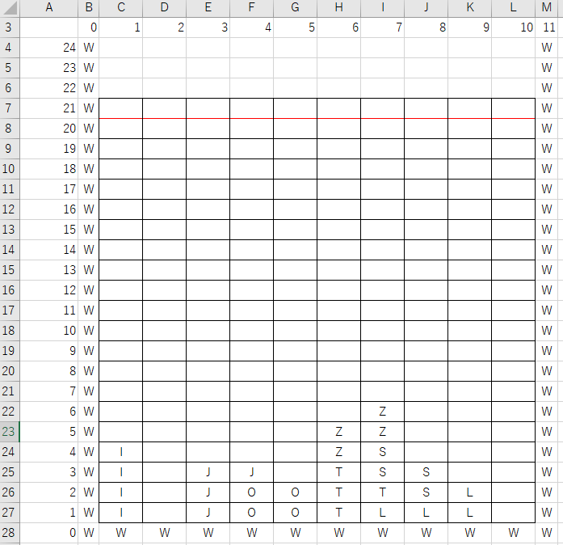

#### **Simulate the Condition After Moving or Rotating to Return the Result**

When using button operations, pieces cannot rotate or move unconditionally. This changes depending on the condition of the stacked pieces. If the piece is next to a wall, it cannot move further in that direction. If the piece is surrounded by pieces, it cannot rotate. The result of the move is returned based on the condition of the piece being moved and the stacked pieces.

However, the determination for the move is relatively easy, as it only determines if the piece cannot actually move due to a wall or other pieces. The processing for rotation is similar. Since there are specifications called the [Super Rotation System](https://tetris.fandom.com/wiki/SRS) (SRS) that are unique to Tetris, rotation is carried out according to them.

First, I acquired the shape around the piece based on the data for the stacked pieces and also called the condition of the piece.

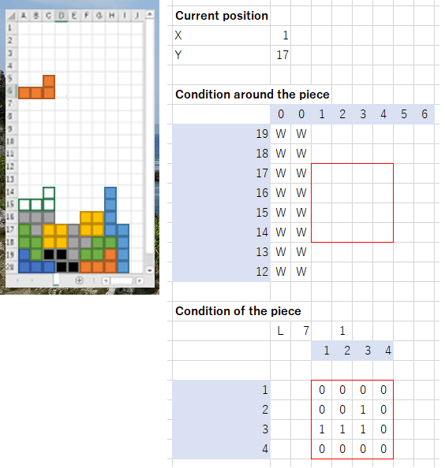

Then, for "move to the left" for example, I actually move the piece to the left and carry out a determination while comparing it to the "condition around the piece" to determine that the piece "cannot move" if it hits in at least one location.

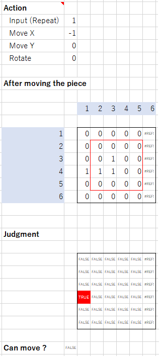

The red location is where it is hitting. The value that is returned as a result of this calculation is "cannot move." In other words, X movement is 0, Y movement is 0, and rotation is 0.

The same is processed for rotation. As mentioned earlier, the SRS is used for the determination.

- 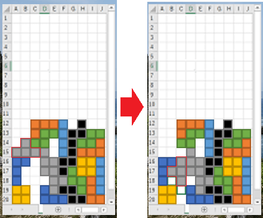

This example is a specification that is called T spin in which the piece moves while rotating. The SRS carries out 5 determinations in order on the back end, and if even one of them is determined to be "able to rotate," the piece moves to that position.

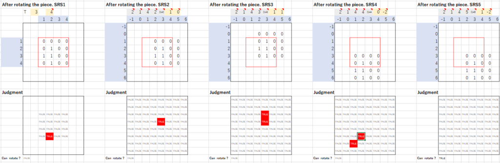

It may be a bit difficult to see, but since only the fifth and last determination was that the piece can move without hitting any of the other pieces, this movement takes place. The values to be returned are 1 for X movement, -2 for Y movement, and -1 for rotation.

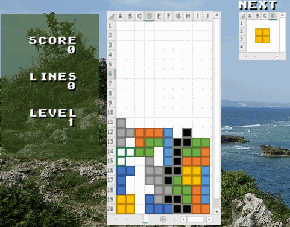

The information to move with the above calculation is returned, and the position and rotation condition parameters are updated based on these values.

### **Solidifying and Erasing Pieces**

I also process these actions using mostly functions only, while mixing in some pseudocode programming that I mentioned earlier. Since Tetris has specifications, such as time to make changes before being solidified or allowing for several rotations after touching the ground, I incorporated them.

Since the philosophy for how to make it is the same, I will emphasize circular references in this explanation to avoid a repetitive explanation.

#### **Recognize the Calculation Order for Circular References**

As I mentioned in the article about Dragon Quest, circular references have a calculation order, as they are calculated from left to right and top to bottom. If formulas are connected in random positions without thinking about anything, unexpected results will be produced.

For example, if process 2 is sought based on the calculation result of process 1 and process 3 is sought based on the calculation result of process 2, there are no issues if they are written from left to right.

In the following example, the result of the preceding process is added to the cell itself.

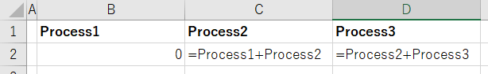

When the value of process 1 is changed to 1, process 2 becomes 1+0, which is 1. Since process 3 is calculated after process 2 became 1, it similarly is 1+0, which is 1. As a result, all of the values become 1.

However, what will happen if the positions of the cells are changed so that process 3 is brought to the front?

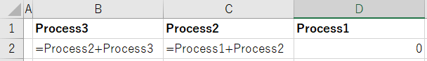

When the value of process 1 is changed to 1, the cell furthest to the left, which is process 3, is calculated first due to the specifications for circular references. Since process 2 has yet to be calculated, process 3 becomes 0+0, which is 0. Since process 2 is 1+0, which is 1, only process 3 becomes 0 as a result.

In this manner, "which position to do the calculation in" becomes very important for circular references. In order to avoid throwing off the calculation order, there is a need to bear in mind to write the flow of the calculation from left to right and top to bottom.

In order to control this calculation order, the sheet to manage the stacking condition is set up step-wise.

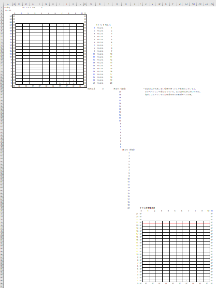

On a side note, there are also calculation orders among sheets. Calculations are processed in ascending order of sheet name. The reason why the sheet names are set as "number\_\*\*\*\*\*\*" is because that is the order for the calculations to be processed.

#### **Utilizing Specifications of the Calculation Order**

In Tetris, pieces are solidified after a certain amount of time has passed since the pieces touch the ground. However, there is a specification that the piece is not solidified if it continues to be moved. However, this would allow for endless movement by repeatedly hitting the button. Therefore, the piece is forcibly solidified after 15 operations. (\*There is also a version in which it is not solidified.)

This time, I incorporated the specification to solidify the piece after 15 operations. Based on this implementation, I will explain how to utilize the calculation order.

The following is the process for touching the ground. The "operation count" to record the count of operations and the "bottom value" to manage the timing to reset the operation count are prepared. The "bottom value" is a variable that manages how far the piece has fallen. The system involves the operation count being reset when the bottom value is updated.

A variable for temporary records is also prepared for the bottom value. The formula is set up so that the operation count becomes 0 if the temporary record value differs from the latest value.

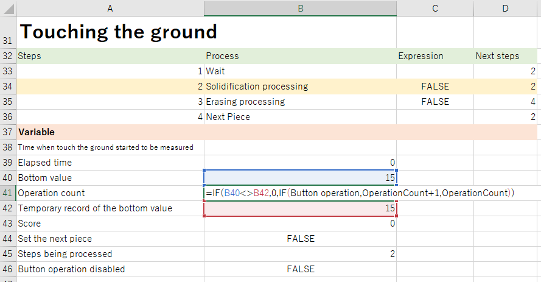

```
Operation count = IF(B40<>B42,0,IF(Button operation,OperationCount+1,OperationCount))
```

The second IF statement adds an additional operation to the count if there was a button operation. What is important here is the first IF statement.

This time, we will look at each of the formulas for "bottom value" and "temporary record of the bottom value."

```
Bottom value = IF(Next piece FLG,22,MIN(Y of current position,Bottom value)) 
Temporary record of the bottom value = IF(Next piece FLG,22,IF(Bottom value<>Temporary record of the bottom value,Bottom value,Temporary record of the bottom value))
```

In both formulas, the value is reset to 22 when switching to the next piece.

The "bottom value" is set to update to the lower value when compared to itself after the Y of the current position is lowered. The "temporary record of the bottom value" compares itself to the "bottom value" and copies the value of the "bottom value" if they differ.

When these three formulas work in the calculation order for circular references, the values change as follows.

Assuming that the Y of the current position is 20, the piece will have lowered by 1 through free fall when the "bottom value" and the "temporary record of the bottom value" are both 20. Since calculations are carried out from top to bottom according to the calculation order for circular references, the "bottom value" is evaluated first.

1. Since the piece was lowered by 1, the "bottom value" becomes 19.
2. Next, the formula for "operation count" is evaluated. Since the "bottom value" is 19, and the "temporary record of the bottom value" is 20, the operation count becomes 0 because the values differ.
3. Finally, the "temporary record of the bottom value" is evaluated. Given that the values, which are 19 for the "bottom value" and 20 for itself, differ, the value for the "bottom value" is copied to become 19.

As a result, both the "bottom value" and the "temporary record of the bottom value" become 19, while the "operation count" becomes 0. If the piece lowers again in a similar manner, the bottom value decreases from 19→18→17... The system also makes the operation count 0 each time.

By utilizing the specifications for the calculation order in this manner, the "change in condition" can be sensed to cause a different action.

#### **Flow from the Determination to Solidify the Piece to Erasing the Line**

I will provide a simple explanation about the determination formula for solidification and the steps until erasing the line.

The condition for solidification is written in a single formula.

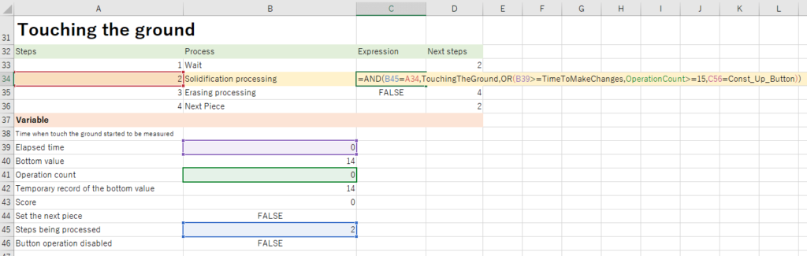

```
Solidification processing = AND(B45=A34,TouchingTheGround,OR(B39>=TimeToMakeChanges,OperationCount>=15,C56=Const_Up_Button))
```

Solidification processing becomes TRUE if the piece is touching the ground somewhere and the time to make changes has passed, there has been 15 or more operations, or the user did a hard drop.

When solidification processing becomes TRUE, the cell that manages the stacking condition copies the value of the piece from the current position and solidifies the piece.

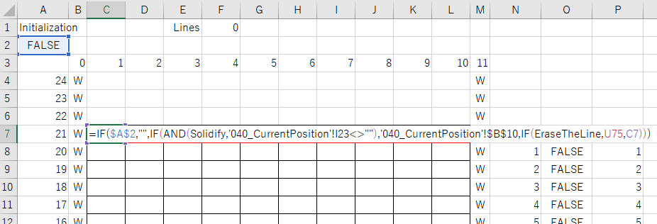

```
Stacking condition = IF($A$2,"",IF(AND(Solidify,'040_Current position'!I23<>""),'040_Current position'!$B$10,IF(EraseTheLine,U75,C7)))
```

As you can see in the second half of this formula, there is also a flag to erase the line. If this becomes TRUE, the "condition after erasing" that has been calculated beforehand is copied.

What I described above is the flow from processing the fact that the piece is touching the ground to erasing the line. To be honest, I do not like that there are multiple processes within the series of processes that I can probably separate out, but this was the outcome after considering performance. There may be a way to improve this, but I am satisfied with this for now.

## **Game Over, Etc.**

It is mostly the same, so I will omit this. If you are interested in this, please download the sample file and have a look.

## **What I Could Not Implement**

I could not implement music this time either. It is a shame. Also, perhaps because the load increased as processing increased, long pressing and animations did not work as I had imagined. I have also passed on implementing these features.

## **Other**

### **Why Is the Controller on a Different Sheet?**

This is because the scale for Tetris does not match the scale for the controller. I have put in measures to make the images as small as possible for Tetris to reduce the load, while the controller cannot be made small because it contains form controls. If I put them together, the controller would be extremely large.

Also, Excel tends to crash more frequently if they are placed together. On my device, making even a single operation on the controller caused freezing and a low memory error. I manage them on separate sheets to stabilize the actions also.

### **What is the Size of the File?**

It is 487KB as of my first time making it public. It becomes 289KB if I delete the background image. I was able to keep it smaller than I had anticipated.

### **Does It Not Work on Excel 2007?**

I used RANK.EQ for the "next piece" calculation. It may be possible to make it work by changing this to RANK. Please try it.

### **How Long Did It Take?**

It took me two months. Most of this time was spent researching how to make the processing speed faster. I may have been able to finish it a bit faster had I not lost motivation.

## **In Conclusion**

Although there were no new methods, I was able to grasp what kinds of combinations slow things down because I faced many performance issues. I could probably apply this knowledge to work also. My next tasks will be to implement smooth animations and long pressing.

Next up is Mario, but I am not sure if I can actually make it, since it depends on whether or not I have time. (Since I need to study a different platform soon... please do not get your hopes up...)

[Series of Excel Games That Do Not Use VBA]

https://tomikiya.github.io/excel-game-dq3-english/

https://tomikiya.github.io/excel-game-minesweeper/

https://tomikiya.github.io/excel-nonvba-3d-maze/

If you feel that not using VBA is very difficult, it may be best to start with making games using VBA.
