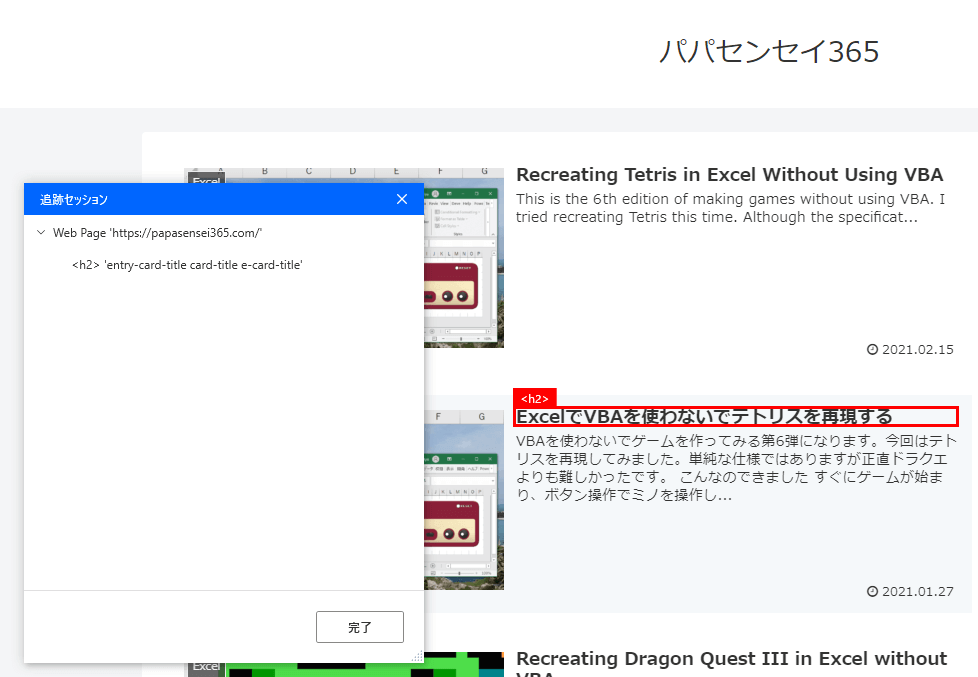
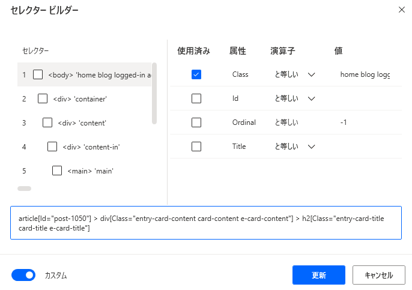
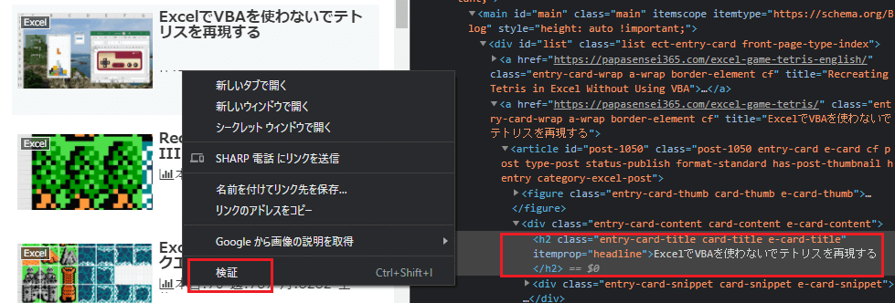
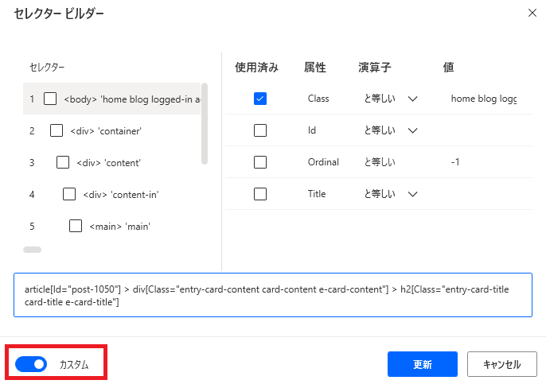

WebのUI要素を取得する最も簡単な方法はWebレコーダーを利用することです。また、右ペインのUI要素から「UI要素の追加」で取得する方法もあります。ただそれではうまく取得できないケースもあったため、文字列からUI要素を探す方法を見つけたので残しておきます。

## Webレコーダーを使うとどうなる？

Webレコーダーを使ってUI要素を取得するとボタンポチポチで簡単にセレクターを生成してくれます。自分のサイトで試してみると・・・、






セレクターはこんな感じです。

```
article[Id="post-1050"] > div[Class="entry-card-content card-content e-card-content"] > h2[Class="entry-card-title card-title e-card-title"]
```

### WebレコーダーでUI要素を取得すると困る事

自動でセレクターを定義してくれるのはありがたいのですが、UI要素が一意になるように厳密に取ってくれるのでデザインに少しでも変更があったらUI要素が見つからないエラーが出ることがあります。またセレクターが長くなって div > div >div >div >div >div >div >div みたいにどこを指定しているか分からなくなることもありますね。

## **contains**でUI要素を見つける

デザインの変更にある程度強くするために、文字列でUI要素を見つけられるように書き換えます。

まずはUI要素の場所を特定します。

### htmlを見てUI要素のタグを確認

htmlを確認するためにchromeなら取得したいUI要素を右クリックして「検証」を選択します。するとhtmlが表示されます。



欲しいUI要素はh2タグに含まれていることが分かりました。

### セレクターを書き換える

それではWebレコーダーで取得したUI要素を編集します。セレクタービルダーのカスタムを無効にしてセレクターを編集できるようにします。



そして以下のように入力して更新します。

```
h2:contains('ExcelでVBAを使わないでテトリスを再現する')
```

これで文字列で検索してUI要素を取得できます。簡単ですね。

### containsとは何ぞや

containsは、containsに指定した引数を含む要素を返します。「ExcelでVBAを使わないでテトリスを再現する」を含むh2タグは1つしかないのでUI要素を特定できたんですね。

### もし同じ文字列が複数あってcontainsでUI要素を特定できない場合は？

同じ文字列が複数の場所にあるとcontainsは複数の要素を取得しますので

```
h2:contains('Excel'):eq(0)
```

のようにeqをつけて1つに絞ることができます。

また、親の要素を特定して範囲を絞ってから見つける方法もできます。

```
div[Class='author-content'] h2:contains('Excel')
```

containsやeq、なんだかjQueryの構文に似ていますね。

<https://jquerystudy.info/reference/selectors/contains.html>

## もしかしてjQueryの構文使える？

全てを確認したわけではないですが一部の構文は使えるようです。特定の子孫要素を持つ要素を探せるhas()も使えることを確認しています。jQueryのドキュメントを見ながらPower Automate Desktopのセレクターを考えることができそうです。

例えばこんなセレクターも作れそうですね。

```
div:has(th:contains('名前') ~ td:contains('太郎')) button:contains('編集')
```

## ということで

Webレコーダーで作ったUI要素を少しデザインの変更に強くできますね。

（Power Automate Desktopによるテスト自動化が捗ります！）
