Power Automate DesktopのアクションとしてWebページでJavaScriptを実行したかったのですが、引数を渡す方法に癖があったので備忘録としてまとめます。今後改善されるかもしれませんし、このやり方が最適な方法ではないかもしれませんのでそこはご了承ください。

## WebページでJavaScript関数を実行するアクション

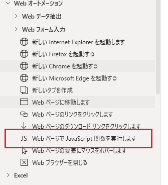

Webフォーム入力のアクションにあります。単独でも動きますが変数を使えば引数として渡すことができます。

このアクションはブラウザを事前に起動しておく必要がありますので「新しい（ブラウザ）を起動する」のアクションでブラウザを立ち上げないとエラーになります。

## 変数の型によって渡し方が異なる

Power Automate Desktopで用意されている型は以下の通りです。（※2021/5/22時点）

<https://docs.microsoft.com/ja-jp/power-automate/desktop-flows/variable-data-types>

|  |  |
| --- | --- |
| 型 | 指定方法例 |
| テキスト値 | apple |
| 数値 | 100 |
| ブール値 | True / False |
| リスト | %[1, 2, 3]% または「新しいリストの作成」と「項目をリストに追加」で指定 |
| データテーブル | %{^['id','name','value'],[1,'hoge',100],[2,'fuga',200]}% |
| データ行 | %データテーブル[0]% |
| カスタムオブジェクト | %{ 'ID': 1, 'Value': 'hello' }% |

仕様なのか不具合なのか分かりませんが、型によって渡し方が異なっていました。

## テキストの場合はシングルクオーテーションで囲む

Power Automate Desktopの変数は%%で囲うことで使用できます。これはJavaScript内でも一緒です。テキストの場合はJavaScript関数内でシングルクオーテーションで囲うことで認識してもらえます。

以下のフローは、ブラウザを起動して変数にappleをセットし、Javascriptに渡してそのままreturnしているだけです。

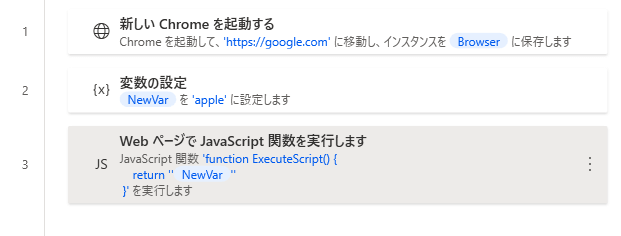

Javascriptのreturnでは`%NewVar%`を`''`で囲っています。

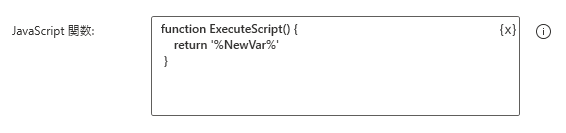

結果がそのまま返ってきているのでJavaScriptに引数を渡せたことが分かります。

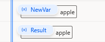

以下のコードをPower Automate Desktopにコピペすると確認できます。

```
WebAutomation.LaunchChrome Url: $'''https://google.com''' WindowState: WebAutomation.BrowserWindowState.Normal ClearCache: False ClearCookies: False Timeout: 60 BrowserInstance=> Browser
SET NewVar TO $'''apple'''
WebAutomation.ExecuteJavascript BrowserInstance: Browser Javascript: $'''function ExecuteScript() { 
    return \'%NewVar%\'
 }''' Result=> Result
```

## 数値の場合は特に何も加工しなくても渡せる

数値の場合はそのまま`%%`の記述で渡せます。

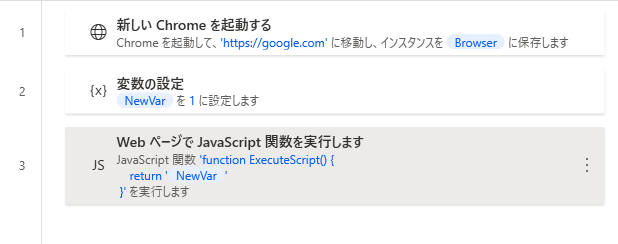

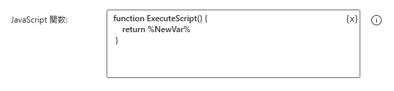

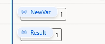

```
WebAutomation.LaunchChrome Url: $'''https://google.com''' WindowState: WebAutomation.BrowserWindowState.Normal ClearCache: False ClearCookies: False Timeout: 60 BrowserInstance=> Browser
SET NewVar TO 1
WebAutomation.ExecuteJavascript BrowserInstance: Browser Javascript: $'''function ExecuteScript() { 
    return %NewVar%
 }''' Result=> Result
```

## ブール値の場合は小文字にして渡す

Power Automate Desktopの真偽値は`True`と`False`で持っており、これをそのままJavaScriptすと`undefined`となって渡せませんでした。

しかし全て小文字にすると渡せるようなので「テキストの文字の大きさを変更」のアクションで小文字に変換してから渡します。

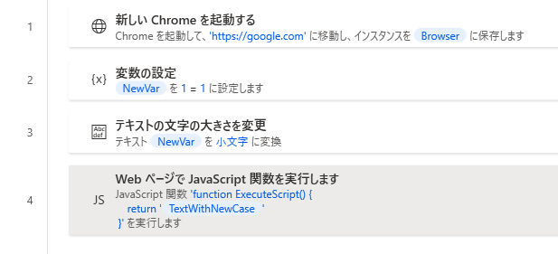

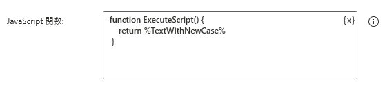

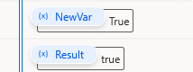

```
WebAutomation.LaunchChrome Url: $'''https://google.com''' WindowState: WebAutomation.BrowserWindowState.Normal ClearCache: False ClearCookies: False Timeout: 60 BrowserInstance=> Browser
SET NewVar TO 1 = 1
Text.ChangeCase Text: NewVar NewCase: Text.CaseOption.LowerCase Result=> TextWithNewCase
WebAutomation.ExecuteJavascript BrowserInstance: Browser Javascript: $'''function ExecuteScript() { 
    return %TextWithNewCase%
 }''' Result=> Result
```

## リストの場合は文字列結合してから渡す

リストを`%List%`のようにそのまま渡しても何故か1つ目の値しか渡せません。`%List[0]%`と同じになってしまいます。文字列にすると何故か渡せるので結合するアクションを追加します。ただし数値のリストと文字のリストでは若干異なるのが注意です。

数値だけのリストでは「テキストの結合」アクションで区切り文字を`,`とします。またJavaScript関数内では`[]`で囲みます。

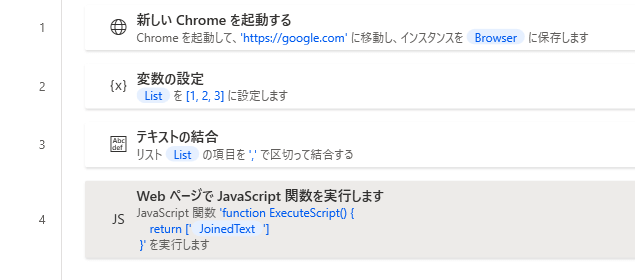

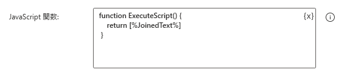

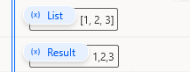

```
WebAutomation.LaunchChrome Url: $'''https://google.com''' WindowState: WebAutomation.BrowserWindowState.Normal ClearCache: False ClearCookies: False Timeout: 60 BrowserInstance=> Browser
SET List TO [1, 2, 3]
Text.JoinWithCustomDelimiter List: List CustomDelimiter: $''',''' Result=> JoinedText
WebAutomation.ExecuteJavascript BrowserInstance: Browser Javascript: $'''function ExecuteScript() { 
    return [%JoinedText%]
 }''' Result=> Result
```

文字だけのリストでは「テキストの結合」アクションでで区切り文字を`','`とします。またJavaScript関数は`['']`で囲みます。数値とは異なりシングルクオーテーションがついてます。

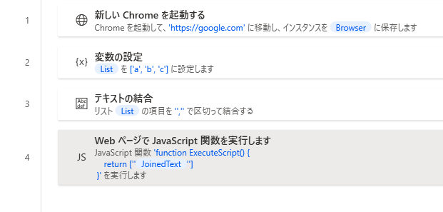

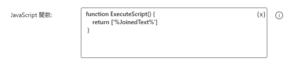

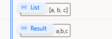

```
WebAutomation.LaunchChrome Url: $'''https://google.com''' WindowState: WebAutomation.BrowserWindowState.Normal ClearCache: False ClearCookies: False Timeout: 60 BrowserInstance=> Browser
SET List TO ['a', 'b', 'c']
Text.JoinWithCustomDelimiter List: List CustomDelimiter: $'''\',\'''' Result=> JoinedText
WebAutomation.ExecuteJavascript BrowserInstance: Browser Javascript: $'''function ExecuteScript() { 
    return [\'%JoinedText%\']
 }''' Result=> Result
```

数値と文字が混ざっているリストでは`'%List[0]%,'%List[1]%',%List[2]%'`のようにLoopなどで力技でやる方法しか見つけられませんでした。

## テーブルの場合は行方向と列方向それぞれテキスト結合する

テーブルもリストと同様に`%Table%`のように書いても反応しませんのでテキスト結合で回避します。リストと異なり2次元配列となっているため、2回テキスト結合させます。

ただ、テーブルをFor Eachでまわすと1レコードはリスト型ではなくテーブル行の型になります。テーブル行型は何故か「テキストの結合」アクションがうまく適用されず、区切り文字がすべてカンマになってしまうので数値は渡せますが文字列を渡せません。

テーブルは数字と文字が混ざる場合が多く「テキストの結合」が使いづらいです。そこで力技で回避します。

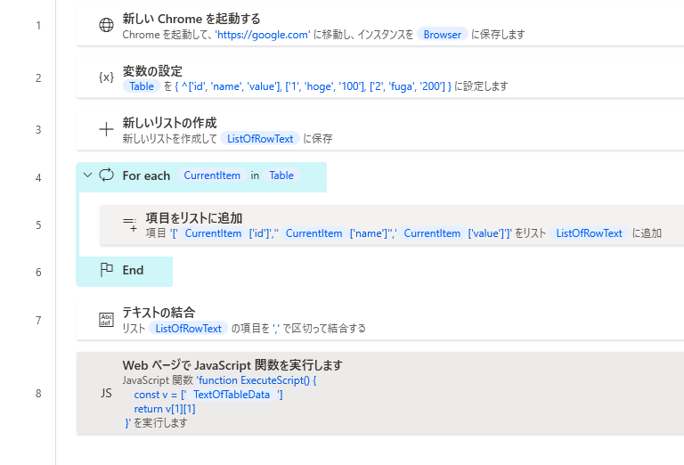

5アクション目で1行のレコードをテキスト結合するのですが、テキストはシングルクオーテーションで囲み、数値は囲まないように列ごとに調整しています。7アクション目でテキストとなったレコードを結合します。

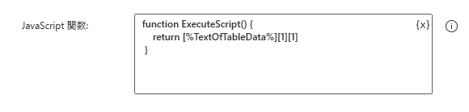

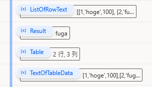

```
WebAutomation.LaunchChrome Url: $'''https://google.com''' WindowState: WebAutomation.BrowserWindowState.Normal ClearCache: False ClearCookies: False Timeout: 60 BrowserInstance=> Browser
SET Table TO { ^['id', 'name', 'value'], ['1', 'hoge', '100'], ['2', 'fuga', '200'] }
Variables.CreateNewList List=> ListOfRowText
LOOP FOREACH CurrentItem IN Table
    Variables.AddItemToList Item: $'''[%CurrentItem['id']%,\'%CurrentItem['name']%\',%CurrentItem['value']%]''' List: ListOfRowText NewList=> ListOfRowText
END
Text.JoinWithCustomDelimiter List: ListOfRowText CustomDelimiter: $''',''' Result=> TextOfTableData
WebAutomation.ExecuteJavascript BrowserInstance: Browser Javascript: $'''function ExecuteScript() { 
    return [%TextOfTableData%][1][1]
 }''' Result=> Result
```

## カスタムオブジェクトの場合はJSONテキストに変換してから渡す

カスタムオブジェクトもそのまま渡せないので「カスタムオブジェクトをJSONに変換」アクションでテキストにしてから渡します。

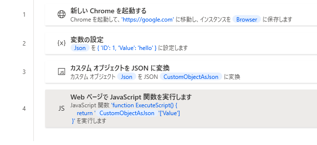

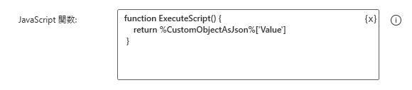

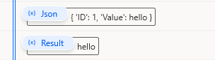

```
WebAutomation.LaunchChrome Url: $'''https://google.com''' WindowState: WebAutomation.BrowserWindowState.Normal ClearCache: False ClearCookies: False Timeout: 60 BrowserInstance=> Browser
SET Json TO { 'ID': 1, 'Value': 'hello' }
Variables.ConvertCustomObjectToJson CustomObject: Json Json=> CustomObjectAsJson
WebAutomation.ExecuteJavascript BrowserInstance: Browser Javascript: $'''function ExecuteScript() { 
    return %CustomObjectAsJson%[\'Value\']
 }''' Result=> Result
```

## ということで

型によって渡し方がここまで異なると不便極まりないので、おそらくこれらの現象は不具合だと信じたいです…。Pythonスクリプトの実行でも同じ課題がありそうですね。（未調査）
