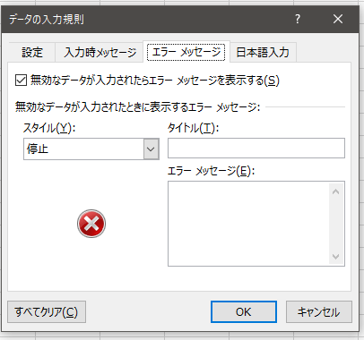
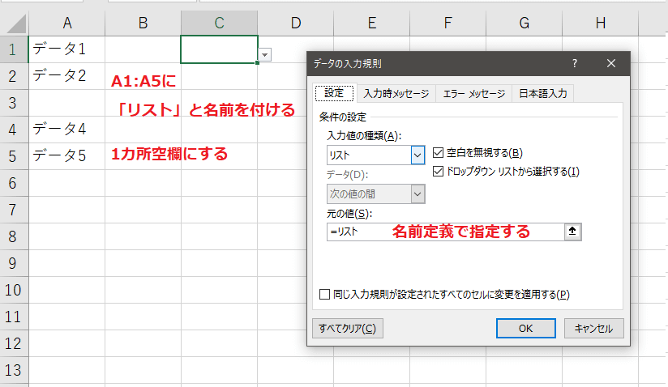
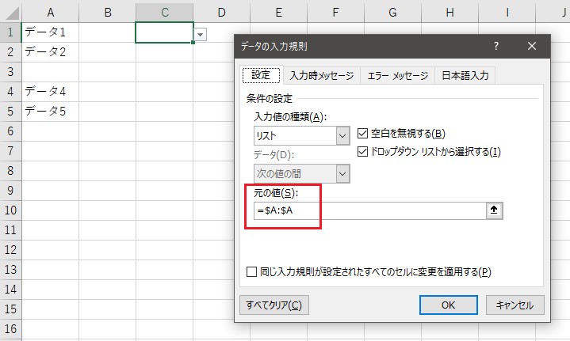

不具合なのか仕様なのか不明ですが、入力規則のリストを設定する際にとある条件で思った通りの挙動を示さないケースがあったのでまとめます。

## 何が起こったか

入力規則を設定して指定した文字だけを登録させたかったのですが、どんな文字でも登録できるケースがありました。

こんな感じです。

https://youtu.be/WF17QQ8U2U8

同じ文字を入力してもエラーメッセージが出たりでなかったりしてますね。

## エラーメッセージが表示されない条件は？

まず確認することはエラーメッセージタブの「無効なデータが入力されたらエラーメッセージを表示する」のチェックが有効になっているかです。このチェックが無効だとエラーメッセージが出ません。

今回の課題はこのチェックが有効でも発生していました。

いろいろと探ってみましたが以下の条件が重なるとエラーメッセージが出なくなるようです。

1. 入力規則の入力値の種類に「リスト」を指定する
2. セル範囲に名前定義を登録する
3. 2で登録した名前定義を「元の値」に指定する
4. 2で登録したセル範囲で1個以上空欄にする

名前定義を経由することとリストに空欄があるのが今回の問題のポイントになっています。

## どう対策すればよい？

前述したように名前定義を使わなければこのケースに巡り合うことはありません。リストの入力規則を設定する際はトリッキーなことをせず王道な方法で設定しましょう。私はテーブル化して参照するパターンが好みです、動的に適用範囲が変わりますからね。テーブルが使えないならOFFSETで頑張ります。

こちらのサイトが分かりやすいと思いました。ご参考までに。

<https://excel-design-dr.com/excel-pulldown-list/>

### 名前定義を使うなら空欄は厳禁

どうしても名前定義を使いたいなら空欄は無いようにしましょう。（正直管理できないと思うのでお勧めしません。）

## おまけ

リストの指定方法で面白かったのが、リスト専用のシートを追加して範囲に「A:A」としてもうまくいくんですよね。

式が綺麗なところもよいですし、動的に範囲も変わってくれるんですよね。テーブルが使えないバージョンで動的リストが必要になったり、サーバでExcelを生成する時にライブラリがテーブル機能を扱えなかったりするならこの方法もありかもしれません。

ただし、こちらも少々制限があって、いわゆる最後のセル（Ctrl+End）の行までリストが生成される仕様です。変に100行目のセルを編集しようものなら100個のリストが生成されるのでご注意ください。

制限と折り合いをつけながら要件に合った方法で指定しましょう。
