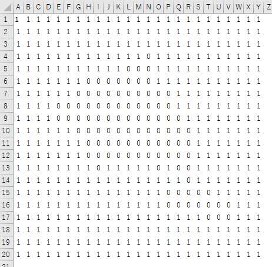

作業セルはなるべく使わない方が良いというネタツイを見てしまい、逆に1つのセルでどれだけのことができるんだろうかと思い作ってしまいました。ネタ記事なので業務で使える技術的な話は無いかもしれません。コーヒーブレイクとしてお楽しみください。

## 本当はこんなのが作りたかった

実際に完成はしたものの「1行だけの式でアニメーション」とはならなかったものがこちらです。

https://twitter.com/10mikiya/status/1449423491065790473

作れなかった理由は、1つの式は8192文字を超えて記述できないExcelの仕様があるからです。


データとして記述している文字列があるため、この制限に簡単に引っかかってしまいました。ちなみにデータは9万文字です。

## データ量を少なくすることで解決

幅と高さとアニメーションの枚数を削ることで8192文字を超えないようにデータ量を調整しました。これで1つの式でアニメーションが出来るようになります。

> 解像度とフレーム数を下げてワンライナーで書ける限界で作ってみた。これなら式をコピペしてF9を押し続けるとスピルが使えるエクセルならどこでも動くはず。  
> ※循環参照やマクロは使ってない。[#Excel](https://twitter.com/hashtag/Excel?src=hash&ref_src=twsrc%5Etfw) [#NoVBA](https://twitter.com/hashtag/NoVBA?src=hash&ref_src=twsrc%5Etfw) [pic.twitter.com/jHsC3grCEd](https://t.co/jHsC3grCEd)
>
> — パパセンセイ@Excelを眺める人 (@10mikiya) [October 17, 2021](https://twitter.com/10mikiya/status/1449540108680450048?ref_src=twsrc%5Etfw)

## デモ用のデータ

せっかくなのでデモ用の式を載せておきます。スピル関数が使えるExcelで有効です。

この式をA1セルに貼り付けてF9を押し続けると動きます。**文字を中央揃えにして、セルの幅を0.38(5ピクセル)、高さを3.75(5ピクセル)に変更しておく**とよりわかりやすいと思います。

```
=IF(MID(TEXTJOIN("",FALSE,DEC2BIN(DECIMAL(MID(MID(CONCAT("VVVVVVVVVVVVVVVVVTVVVVHVVVO1VVVG0FVU00FVU007VVG03VVO03VVO03VVTUJVVVVRVVVV0VVVV07VVVU7VVVVVVVVVVVVVVV","VVVVVVVVVVVVVVVVVTVVVVHVVVO1VVVG0FVU00FVU007VVG03VVO03VVO03VVTUJVVVVRVVVV0VVVV07VVVU7VVVVVVVVVVVVVVV","VVVVVVVVVVVVVVVVVTVVVVHVVVO1VVVG0FVU00FVU007VVG03VVO03VVO03VVTUJVVVVRVVVV0VVVV07VVVU7VVVVVVVVVVVVVVV","VVVVVVVVVVVVVVVVVTVVVVHVVVO1VVVG0FVU00FVU007VVG03VVO03VVO03VVTUJVVVVRVVVV0VVVV07VVVU7VVVVVVVVVVVVVVV","VVVVVVVVVVVVVVVVVTVVVVHVVVO1VVVG0FVU00FVU007VVG03VVO03VVO03VVTUJVVVVRVVVV0VVVV07VVVU7VVVVVVVVVVVVVVV","VVVVVVVVVVVVVVVVVTVVVVHVVVO1VVVG0FVU00FVU007VVG03VVO03VVO03VVTUJVVVVRVVVV0VVVV07VVVU7VVVVVVVVVVVVVVV","VVVVVVVVVVVVVVVVVTVVVVHVVVO1VVVG0FVU00FVU007VVG03VVO03VVO03VVTUJVVVVRVVVV0VVVV07VVVU7VVVVVVVVVVVVVVV","VVVVVVVVVVVVVVVVVTVVVVHVVVO1VVVG0FVU00FVU007VVG03VVO03VVO03VVTUJVVVVRVVVV0VVVV07VVVU7VVVVVVVVVVVVVVV","VVVVVVVVVVVVVVVVVR0FVVG67VVG7VVV07VVV07VVU07VVU03VVV03VVV07VVV07VVV07VVVV7VVVVVVVVVVVVVVVVVVVVVVVVVV","VVVVVVVVVVVVVVVVVVVVVSVRVVS03VVVG1VVVG1VVVO0VVVO0FVVO0FVVS0FVV00FVVR0FVVVGFVVVOFVVVSFVVVUFVVVVVVVVVV","VVVVVVVVVVVVVVVVVVVVVSVRVVS03VVVG1VVVG1VVVO0VVVO0FVVS0FVVS0FVV00FVVO0FVVVGFVVVOFVVVSFVVVUFVVVVVVVVVV","VVVVVVVVVVVVVVVVVVVVVSVRVVS03VVVG1VVVG1VVVO0VVVO0FVVS0FVVS0FVV00FVVO0FVVVGFVVVOFVVVSFVVVUFVVVVVVVVVV","VVVVVVVVVVVVVVVVSFVVVU0RVVVG3VVVG1VVVG1VVVO0VVVO0FVVO0FVVG0FVV00FVVS0FVVV0FVVVOFVVVUFVVVVVVVVVVVVVVV","VVVVVVVVVVVVVVVVVVVVVVUVVVVUVVVVOFVVVG0VVV01VVV03VVV03VVV03VVU01VVVTVVVVVVVVVVVVVVVVVVVVVVVVVVVVVVVV","VVVVVVVVVVVVVVVVVTVVVVHVVVO1VVVG0FVU00FVU007VVG03VVO03VVO03VVTUJVVVVRVVVV0VVVV07VVVU7VVVVVVVVVVVVVVV","VVVVVVVVVVVVVVVVVTVVVVHVVVO1VVVG0FVU00FVU007VVG03VVO03VVO03VVTUJVVVVRVVVV0VVVV07VVVU7VVVVVVVVVVVVVVV","VVVVVVVVVVVVVVVVVTVVVVHVVVO1VVVG0FVU00FVU007VVG03VVO03VVO03VVTUJVVVVRVVVV0VVVV07VVVU7VVVVVVVVVVVVVVV","VVVVVVVVVVVVVVVVVTVVVVHVVVO1VVVG0FVU00FVU007VVG03VVO03VVO03VVTUJVVVVRVVVV0VVVV07VVVU7VVVVVVVVVVVVVVV","VVVVVVVVVVVVVVVVVTVVVVHVVVO1VVVG0FVU00FVU007VVG03VVO03VVO03VVTUJVVVVRVVVV0VVVV07VVVU7VVVVVVVVVVVVVVV","VVVVVVVVVVVVVVVVVTVVVVHVVVO1VVVG0FVU00FVU007VVG03VVO03VVO03VVTUJVVVVRVVVV0VVVV07VVVU7VVVVVVVVVVVVVVV","VVVVVVVVVVVVVVVVVUFVVVGFVVU07VVU03VVS01VVO01VVG01VVQ01VVPN1VVH71VVRVPVVVVPVVVV0VVVV0FVVV47VVVVVVVVVV","VVVVVVVVVVVVVVVVVVJVVVO3VVVG1VVVG0VVVG0FVV00FVV00FV09OFU07UFSCFUVU0FSVVGU9VVVS0FVVVSFVVVVVVVVVVVVVVV","VVVVVVVVVVVVVVVVVU1VVVO1VVVG0VVV00FVKG0FVGO0FS0O0FS0FOFU07TFU0FSFU0C4VV0U0VVKVSFVVVVVVVVVVVVVVVVVVVV","VVVVVVVVVVVVVSVVVU1VVVO0VSO80FO1C07OO007OG807O0707O0FV7S07V7S0FV7V0FS7VGVSVVLVVVVVVVVVVVVVVVVVVVVVVV","VVVVVVVVVVVVVPVVVU1VVVC0VSFG0FOEG07O4G07O9S07OGD07SGVVNS0VV7U0FV7VGFG3VVVVVVVVVVVVVVVVVVVVVVVVVVVVVV","VVVVVVVVVVVVVVVVVVJVUVS3VS7O0VO7G0FO7G0FO700FO7G0FS7VEFS0VIFU0FGFVGFT3VVVVHVVVVVVVVVVVVVVVVVVVVVVVVV","VVVVVVVVVVVVVVVVVVJVVFU3VS3O1VS3G0VS3G0FS300FS300FS3O0FU1VUFU0FGFVGFG7VVVV3VVVVPVVVVVVVVVVVVVVVVVVVV","VVVVVVVVVVVVVVVVVVVVVFV3VS3O3VS1G1VS1G0VS100FS200FS300FU3Q8FU0BSFVGFUFVVVUFVVVG3VVVH1VVVVVVVVVVVVVVV","VVVVVVVVVVVVVVVVVVVVV7V7VS3S7VS3G3VO301VO200VS000VS600VU100VU07OVVGFSVVVVUVVVVO7VVVG3VVVV3VVVVVVVVVV","VVVVVVVVVVVVVVVVVVVVUFUFVS7OFVS30FVO203VO001VO001VS001VS000VU00SVVGFSVVVVG7VVVG3VVVVVVVVVVVVVVVVVVVV","VVVVVVVVVVVVVVVVVVVVUVUFVS7SFVO30FVO203VO001VO001VS400VS004VU0BG7V0FG3VTVVJVVVVVVVVVVVVVVVVVVVVVVVVV","VVVVVVVVVVVVVVVVVVVVUVUFVO7SFVO70FVO603VO401VO0007O0001S007RU0GJVV0VVVVVVVVVVVVVVVVVVVVVVVVVVVVVVVVV","VVVVVVVVVVVVVVVVVVVVUVUVVOFSVVO60VVG407VG003RO0001O801VS203VS0CFVV0FVVVVVVVVVVVVVVVVVVVVVVVVVVVVVVVV","VVVVVVVVVVVVVVVVVVVVUFSFVO7OFVO60FVO407VO400HO0003O800VS001VU0HVVV0VVVVVVVVVVVVVVVVVVVVVVVVVVVVVVVVV","VVVVVVVVVVVVVVVVVVVVUFSFVO7SFVO60FVO207VO403VO400HO0003S001VU0HVVV0VVVVVVVVVVVVVVVVVVVVVVVVVVVVVVVVV","VVVVVVVVVVVVVVVVVVVVUVUFVS7SFVO20FVO207VO003VO401VS001VS000VU0F01V0FNVVVVVVVVVVVVVVVVVVVVVVVVVVVVVVV","VVVVVVVVVVVVVVVVVVVVUFUFVS7SFVO20FVO203VO003VO001VS401VS001VU0FKVV0FO7VVVG3VVVVJVVVVVVVVVVVVVVVVVVVV","VVVVVVVVVVVVVVVVVVVVUFUFVS7SFVS30FVO203VO201VO001VS001VS000VU08SVVGFSVVVVG7VVVG3VVVVJVVVVVVVVVVVVVVV","VVVVVVVVVVVVVVVVVVVVVFV3VS3S3VS3G3VO301VO300VS200VS200VS1G0FU03OFVGFSVVTVUVVVVO7VVVG3VVVVJVVVVVVVVVV","VVVVVVVVVVVVVVVVVVVVVFV3VS3S3VS3G3VO301VO300VS200VS200VS1G0FU03OFVGFSVVTVUVVVVO7VVVG3VVVVJVVVVVVVVVV","VVVVVVVVVVVVVVVVVVVVVFV3VS3S3VS3G3VO301VO300VS200VS200VS1G0FU03OFVGFSVVTVUVVVVO7VVVG3VVVVJVVVVVVVVVV","VVVVVVVVVVVVVVVVVVVVVFV3VS3S3VS3G3VO301VO300VS200VS200VS1G0FU03OFVGFSVVTVUVVVVO7VVVG3VVVVJVVVVVVVVVV","VVVVVVVVVVVVVVVVVVVVVFV3VS3S3VS3G3VO301VO300VS200VS200VS1G0FU03OFVGFSVVTVUVVVVO7VVVG3VVVVJVVVVVVVVVV","VVVVVVVVVVVVVVVVVVVVV7V7VS3S7VS3G3VO101VO200VS000VS600VS1G0VU07OVVGFSVVVVUVVVVO7VVVG3VVVVJVVVVVVVVVV","VVVVVVVVVVVVVVVVVVVVUFUFVS3SFVS30FVO203VO001VO001VS001VS000VU00SVVGFSFVVVG7VVVG3VVVVVVVVVVVVVVVVVVVV","VVVVVVVVVVVVVVVVVVVVVFVJVS7S3VS3G3VO3G1VO300VS200VS600FS3G0FU0BOFVGFSFVTVUFVVVO7VVVO3VVVP3VVVVVVVVVV","VVVVVVVVVVVVVVVVVVVVVVVJVUVV3VSFO3VOFG0VOFG0VOF00FOF00FSV00FS4VSFV0VSFVPVUVVVVSVVVV07VVV27VVVVVVVVVV","VVVVVVVVVVVVVVVVVVVVVOHVVVS07VVO07VVS03VVV01VVV01VVU01VVUC1VVVV0VVVVO1VVVVHVVVVVVVVVVVVVVVVVVVVVVVVV","VVVVVVTVVVVSVVVVO1VVVO0VVVS07VVU0FVVU07VVU03VVT01HVTG01VSO0VVVS3VVVVVVVVVVVVVVVVVVVVVVVVVVVVVVVVVVVV","VVVVVVVVVVVJVVVVGNVVVG0FVVG0FVVO0FVVS07VVS07VVS03VVU03VVVG01VVS3VVVVVVVVVVVVVVVVVVVVVVVVVVVVVVVVVVVV","VVVVVVVVVVVVVVVVVSVVVU0VVU00VVV00FVV007VVG07VVO03VVO03VVU03VVVV1VVVVGFVVVG3VVVV3VVVVVVVVVVVVVVVVVVVV","VVVVVVVVVVVVVVVVVTVVVVHVVVO1VVVG0FVU00FVU007VVG03VVO03VVO03VVTUJVVVVRVVVV0FVVV07VVVU7VVVVVVVVVVVVVVV"),MOD(INT((NOW()-INT(NOW()))*864000),52)*100+1,100),SEQUENCE(100),1),32),5)),SEQUENCE(20,25),1)="0","■","□")
```

## 式の解説

全体像はこんな形です。

```
=IF(
    MID(
        TEXTJOIN(
            "",
            FALSE,
            DEC2BIN(
                DECIMAL(
                    MID(
                        MID(
                            データ,
                            MOD(INT((NOW()-INT(NOW()))*864000),52)*100+1,
                            100
                        ),
                        SEQUENCE(100),
                        1
                    ),
                    32
                ),
                5
            )
        ),
        SEQUENCE(20,25),
        1
    )="0",
    "■",
    "□"
)
```

```
// データ
CONCAT(
    "VVVVVVVVVVVVVVVVVTVVVVHVVVO1VVVG0FVU00FVU007VVG03VVO03VVO03VVTUJVVVVRVVVV0VVVV07VVVU7VVVVVVVVVVVVVVV",
    "VVVVVVVVVVVVVVVVVTVVVVHVVVO1VVVG0FVU00FVU007VVG03VVO03VVO03VVTUJVVVVRVVVV0VVVV07VVVU7VVVVVVVVVVVVVVV",
    "VVVVVVVVVVVVVVVVVTVVVVHVVVO1VVVG0FVU00FVU007VVG03VVO03VVO03VVTUJVVVVRVVVV0VVVV07VVVU7VVVVVVVVVVVVVVV",
    "VVVVVVVVVVVVVVVVVTVVVVHVVVO1VVVG0FVU00FVU007VVG03VVO03VVO03VVTUJVVVVRVVVV0VVVV07VVVU7VVVVVVVVVVVVVVV",
    "VVVVVVVVVVVVVVVVVTVVVVHVVVO1VVVG0FVU00FVU007VVG03VVO03VVO03VVTUJVVVVRVVVV0VVVV07VVVU7VVVVVVVVVVVVVVV",
    "VVVVVVVVVVVVVVVVVTVVVVHVVVO1VVVG0FVU00FVU007VVG03VVO03VVO03VVTUJVVVVRVVVV0VVVV07VVVU7VVVVVVVVVVVVVVV",
    "VVVVVVVVVVVVVVVVVTVVVVHVVVO1VVVG0FVU00FVU007VVG03VVO03VVO03VVTUJVVVVRVVVV0VVVV07VVVU7VVVVVVVVVVVVVVV",
    "VVVVVVVVVVVVVVVVVTVVVVHVVVO1VVVG0FVU00FVU007VVG03VVO03VVO03VVTUJVVVVRVVVV0VVVV07VVVU7VVVVVVVVVVVVVVV",
    "VVVVVVVVVVVVVVVVVR0FVVG67VVG7VVV07VVV07VVU07VVU03VVV03VVV07VVV07VVV07VVVV7VVVVVVVVVVVVVVVVVVVVVVVVVV",
    "VVVVVVVVVVVVVVVVVVVVVSVRVVS03VVVG1VVVG1VVVO0VVVO0FVVO0FVVS0FVV00FVVR0FVVVGFVVVOFVVVSFVVVUFVVVVVVVVVV",
    "VVVVVVVVVVVVVVVVVVVVVSVRVVS03VVVG1VVVG1VVVO0VVVO0FVVS0FVVS0FVV00FVVO0FVVVGFVVVOFVVVSFVVVUFVVVVVVVVVV",
    "VVVVVVVVVVVVVVVVVVVVVSVRVVS03VVVG1VVVG1VVVO0VVVO0FVVS0FVVS0FVV00FVVO0FVVVGFVVVOFVVVSFVVVUFVVVVVVVVVV",
    "VVVVVVVVVVVVVVVVSFVVVU0RVVVG3VVVG1VVVG1VVVO0VVVO0FVVO0FVVG0FVV00FVVS0FVVV0FVVVOFVVVUFVVVVVVVVVVVVVVV",
    "VVVVVVVVVVVVVVVVVVVVVVUVVVVUVVVVOFVVVG0VVV01VVV03VVV03VVV03VVU01VVVTVVVVVVVVVVVVVVVVVVVVVVVVVVVVVVVV",
    "VVVVVVVVVVVVVVVVVTVVVVHVVVO1VVVG0FVU00FVU007VVG03VVO03VVO03VVTUJVVVVRVVVV0VVVV07VVVU7VVVVVVVVVVVVVVV",
    "VVVVVVVVVVVVVVVVVTVVVVHVVVO1VVVG0FVU00FVU007VVG03VVO03VVO03VVTUJVVVVRVVVV0VVVV07VVVU7VVVVVVVVVVVVVVV",
    "VVVVVVVVVVVVVVVVVTVVVVHVVVO1VVVG0FVU00FVU007VVG03VVO03VVO03VVTUJVVVVRVVVV0VVVV07VVVU7VVVVVVVVVVVVVVV",
    "VVVVVVVVVVVVVVVVVTVVVVHVVVO1VVVG0FVU00FVU007VVG03VVO03VVO03VVTUJVVVVRVVVV0VVVV07VVVU7VVVVVVVVVVVVVVV",
    "VVVVVVVVVVVVVVVVVTVVVVHVVVO1VVVG0FVU00FVU007VVG03VVO03VVO03VVTUJVVVVRVVVV0VVVV07VVVU7VVVVVVVVVVVVVVV",
    "VVVVVVVVVVVVVVVVVTVVVVHVVVO1VVVG0FVU00FVU007VVG03VVO03VVO03VVTUJVVVVRVVVV0VVVV07VVVU7VVVVVVVVVVVVVVV",
    "VVVVVVVVVVVVVVVVVUFVVVGFVVU07VVU03VVS01VVO01VVG01VVQ01VVPN1VVH71VVRVPVVVVPVVVV0VVVV0FVVV47VVVVVVVVVV",
    "VVVVVVVVVVVVVVVVVVJVVVO3VVVG1VVVG0VVVG0FVV00FVV00FV09OFU07UFSCFUVU0FSVVGU9VVVS0FVVVSFVVVVVVVVVVVVVVV",
    "VVVVVVVVVVVVVVVVVU1VVVO1VVVG0VVV00FVKG0FVGO0FS0O0FS0FOFU07TFU0FSFU0C4VV0U0VVKVSFVVVVVVVVVVVVVVVVVVVV",
    "VVVVVVVVVVVVVSVVVU1VVVO0VSO80FO1C07OO007OG807O0707O0FV7S07V7S0FV7V0FS7VGVSVVLVVVVVVVVVVVVVVVVVVVVVVV",
    "VVVVVVVVVVVVVPVVVU1VVVC0VSFG0FOEG07O4G07O9S07OGD07SGVVNS0VV7U0FV7VGFG3VVVVVVVVVVVVVVVVVVVVVVVVVVVVVV",
    "VVVVVVVVVVVVVVVVVVJVUVS3VS7O0VO7G0FO7G0FO700FO7G0FS7VEFS0VIFU0FGFVGFT3VVVVHVVVVVVVVVVVVVVVVVVVVVVVVV",
    "VVVVVVVVVVVVVVVVVVJVVFU3VS3O1VS3G0VS3G0FS300FS300FS3O0FU1VUFU0FGFVGFG7VVVV3VVVVPVVVVVVVVVVVVVVVVVVVV",
    "VVVVVVVVVVVVVVVVVVVVVFV3VS3O3VS1G1VS1G0VS100FS200FS300FU3Q8FU0BSFVGFUFVVVUFVVVG3VVVH1VVVVVVVVVVVVVVV",
    "VVVVVVVVVVVVVVVVVVVVV7V7VS3S7VS3G3VO301VO200VS000VS600VU100VU07OVVGFSVVVVUVVVVO7VVVG3VVVV3VVVVVVVVVV",
    "VVVVVVVVVVVVVVVVVVVVUFUFVS7OFVS30FVO203VO001VO001VS001VS000VU00SVVGFSVVVVG7VVVG3VVVVVVVVVVVVVVVVVVVV",
    "VVVVVVVVVVVVVVVVVVVVUVUFVS7SFVO30FVO203VO001VO001VS400VS004VU0BG7V0FG3VTVVJVVVVVVVVVVVVVVVVVVVVVVVVV",
    "VVVVVVVVVVVVVVVVVVVVUVUFVO7SFVO70FVO603VO401VO0007O0001S007RU0GJVV0VVVVVVVVVVVVVVVVVVVVVVVVVVVVVVVVV",
    "VVVVVVVVVVVVVVVVVVVVUVUVVOFSVVO60VVG407VG003RO0001O801VS203VS0CFVV0FVVVVVVVVVVVVVVVVVVVVVVVVVVVVVVVV",
    "VVVVVVVVVVVVVVVVVVVVUFSFVO7OFVO60FVO407VO400HO0003O800VS001VU0HVVV0VVVVVVVVVVVVVVVVVVVVVVVVVVVVVVVVV",
    "VVVVVVVVVVVVVVVVVVVVUFSFVO7SFVO60FVO207VO403VO400HO0003S001VU0HVVV0VVVVVVVVVVVVVVVVVVVVVVVVVVVVVVVVV",
    "VVVVVVVVVVVVVVVVVVVVUVUFVS7SFVO20FVO207VO003VO401VS001VS000VU0F01V0FNVVVVVVVVVVVVVVVVVVVVVVVVVVVVVVV",
    "VVVVVVVVVVVVVVVVVVVVUFUFVS7SFVO20FVO203VO003VO001VS401VS001VU0FKVV0FO7VVVG3VVVVJVVVVVVVVVVVVVVVVVVVV",
    "VVVVVVVVVVVVVVVVVVVVUFUFVS7SFVS30FVO203VO201VO001VS001VS000VU08SVVGFSVVVVG7VVVG3VVVVJVVVVVVVVVVVVVVV",
    "VVVVVVVVVVVVVVVVVVVVVFV3VS3S3VS3G3VO301VO300VS200VS200VS1G0FU03OFVGFSVVTVUVVVVO7VVVG3VVVVJVVVVVVVVVV",
    "VVVVVVVVVVVVVVVVVVVVVFV3VS3S3VS3G3VO301VO300VS200VS200VS1G0FU03OFVGFSVVTVUVVVVO7VVVG3VVVVJVVVVVVVVVV",
    "VVVVVVVVVVVVVVVVVVVVVFV3VS3S3VS3G3VO301VO300VS200VS200VS1G0FU03OFVGFSVVTVUVVVVO7VVVG3VVVVJVVVVVVVVVV",
    "VVVVVVVVVVVVVVVVVVVVVFV3VS3S3VS3G3VO301VO300VS200VS200VS1G0FU03OFVGFSVVTVUVVVVO7VVVG3VVVVJVVVVVVVVVV",
    "VVVVVVVVVVVVVVVVVVVVVFV3VS3S3VS3G3VO301VO300VS200VS200VS1G0FU03OFVGFSVVTVUVVVVO7VVVG3VVVVJVVVVVVVVVV",
    "VVVVVVVVVVVVVVVVVVVVV7V7VS3S7VS3G3VO101VO200VS000VS600VS1G0VU07OVVGFSVVVVUVVVVO7VVVG3VVVVJVVVVVVVVVV",
    "VVVVVVVVVVVVVVVVVVVVUFUFVS3SFVS30FVO203VO001VO001VS001VS000VU00SVVGFSFVVVG7VVVG3VVVVVVVVVVVVVVVVVVVV",
    "VVVVVVVVVVVVVVVVVVVVVFVJVS7S3VS3G3VO3G1VO300VS200VS600FS3G0FU0BOFVGFSFVTVUFVVVO7VVVO3VVVP3VVVVVVVVVV",
    "VVVVVVVVVVVVVVVVVVVVVVVJVUVV3VSFO3VOFG0VOFG0VOF00FOF00FSV00FS4VSFV0VSFVPVUVVVVSVVVV07VVV27VVVVVVVVVV",
    "VVVVVVVVVVVVVVVVVVVVVOHVVVS07VVO07VVS03VVV01VVV01VVU01VVUC1VVVV0VVVVO1VVVVHVVVVVVVVVVVVVVVVVVVVVVVVV",
    "VVVVVVTVVVVSVVVVO1VVVO0VVVS07VVU0FVVU07VVU03VVT01HVTG01VSO0VVVS3VVVVVVVVVVVVVVVVVVVVVVVVVVVVVVVVVVVV",
    "VVVVVVVVVVVJVVVVGNVVVG0FVVG0FVVO0FVVS07VVS07VVS03VVU03VVVG01VVS3VVVVVVVVVVVVVVVVVVVVVVVVVVVVVVVVVVVV",
    "VVVVVVVVVVVVVVVVVSVVVU0VVU00VVV00FVV007VVG07VVO03VVO03VVU03VVVV1VVVVGFVVVG3VVVV3VVVVVVVVVVVVVVVVVVVV",
    "VVVVVVVVVVVVVVVVVTVVVVHVVVO1VVVG0FVU00FVU007VVG03VVO03VVO03VVTUJVVVVRVVVV0FVVV07VVVU7VVVVVVVVVVVVVVV"
)
```

### データについて

文字が意味不明に羅列している部分がデータになっています。データは32進数で、2進数に直すと1と0の並びに変換されます。この1と0を幅25、高さ20に並べることで1枚の絵となります。

```
// 32進数表記
VVVVVVVVVVVVVVVVVTVVVVHVVVO1VVVG0FVU00FVU007VVG03VVO03VVO03VVTUJVVVVRVVVV0VVVV07VVVU7VVVVVVVVVVVVVVV
```

↓

```
// 2進数表記
11111111111111111111111111111111111111111111111111111111111111111111111111111111111111110111111111111111111111100011111111111111111100000001111111111111111100000000001111111111111000000000000111111111111100000000000001111111111111100000000000011111111111111000000000001111111111111100000000000111111111111111011111010011111111111111111111111101111111111111111111111000001111111111111111111100000001111111111111111111111000111111111111111111111111111111111111111111111111111111111111111111111111111111
```

↓

```
// 幅25、縦20に整形
1111111111111111111111111
1111111111111111111111111
1111111111111111111111111
1111111111111011111111111
1111111111100011111111111
1111111000000011111111111
1111110000000000111111111
1111000000000000111111111
1111000000000000011111111
1111110000000000001111111
1111111000000000001111111
1111111000000000001111111
1111111101111101001111111
1111111111111111101111111
1111111111111110000011111
1111111111111110000000111
1111111111111111111000111
1111111111111111111111111
1111111111111111111111111
1111111111111111111111111
```

デモの式は52枚分のデータが用意されています。

2進数で保存できればシンプルなのですが、前述のように8192文字の制限がありますのでなるべくデータを圧縮して文字数を減らすために32進数へ変換しています。32進数は5個分の1と0を1文字に縮小できます。

Excelにはn進数を10進数に変換する[DECIMAL関数](https://support.microsoft.com/ja-jp/office/decimal-%E9%96%A2%E6%95%B0-ee554665-6176-46ef-82de-0a283658da2e)と、10進数を2進数に変換する[DEC2BIN関数](https://support.microsoft.com/ja-jp/office/dec2bin-%E9%96%A2%E6%95%B0-0f63dd0e-5d1a-42d8-b511-5bf5c6d43838)がありますので変換自体は容易です。

また、データに[CONCAT関数](https://support.microsoft.com/ja-jp/office/concat-%E9%96%A2%E6%95%B0-9b1a9a3f-94ff-41af-9736-694cbd6b4ca2)を使っています。1枚毎のデータに区切って可読性を上げるためという理由もありますが、数式に指定できる文字数は255文字の制限があるのでそれを回避するためでもあります。区切らず全ての文字をつなげると以下のような警告が出ます。


### NOW関数を使ってアニメーションさせる

F9を押し続けることによってアニメーションします。NOW関数を使っていて参照するデータの位置をずらすことで実現しています。

```
// 一部抜粋
MID(
    データ,
    MOD(INT((NOW()-INT(NOW()))*864000),52)*100+1,
    100
)
```

`NOW()-INT(NOW())`により、1日以下の時刻(小数表記)を取得できます。そこに86400秒\*10をかけることで0.1秒単位でカウントアップするカウンターが作れます。さらにMODを入れることで0～51を繰り返すカウンターになります。

あとは[MID関数](https://support.microsoft.com/ja-jp/office/mid-%E9%96%A2%E6%95%B0-midb-%E9%96%A2%E6%95%B0-d5f9e25c-d7d6-472e-b568-4ecb12433028)で100文字単位でデータを切り取れば、0.1秒ごとに取得するデータを変えることができます。

取得できるデータは、例えば以下のような100文字の文字列になります。

```
VVVVVVVVVVVVVVVVVTVVVVHVVVO1VVVG0FVU00FVU007VVG03VVO03VVO03VVTUJVVVVRVVVV0VVVV07VVVU7VVVVVVVVVVVVVVV
```

### 文字を1つずつ2進数に変換

```
// 一部抜粋と加工
MID(
    "VVVVVVVVVVVVVVVVVTVVVVHVVVO1VVVG0FVU00FVU007VVG03VVO03VVO03VVTUJVVVVRVVVV0VVVV07VVVU7VVVVVVVVVVVVVVV",
    SEQUENCE(100),
    1
)
```

MID関数と[SEQUENCE関数](https://support.microsoft.com/ja-jp/office/sequence-%E9%96%A2%E6%95%B0-57467a98-57e0-4817-9f14-2eb78519ca90)を組み合わせて1文字ずつ切り取れます。上記の式ですとSEQUENCE(100)で1～100の配列が生成され、それぞれがMIDで評価されます。結果的に100個の文字が返されます。

そして、それぞれの文字をDECIMALとDEC2BINで2進数に変換します。

```
// 一部抜粋と加工
DEC2BIN(
    DECIMAL(
        {"V";"V";"V";"V";"V";"V";"V";"V";"V";"V";"V";"V";"V";"V";"V";"V";"V";"T";"V";"V";"V";"V";...}, //省略
        32
    ),
    5
)
```

### 幅25×高さ20に展開

TEXTJOIN関数で一旦すべての文字列を結合したら、MIDとSEQUENCEで幅25、高さ20に展開します。

```
// 一部抜粋と加工
MID(
    TEXTJOIN(
        "",
        FALSE,
        {"00000";"00000";"00000";...} //省略
    ),
    SEQUENCE(20,25),
    1
)
```

↓



以上でほぼ完成です。あとは■や□を使って見やすくするだけになります。IFの部分で変更できます。

ちなみにIFをREPTで代替えできますが1と0の比率によって描画する量が変わり処理の負荷が不安定になることがあります。

## ということで

俗にいうワンライナーでアニメーションが出来ました。こういった遊びもたまには良いですね！！
