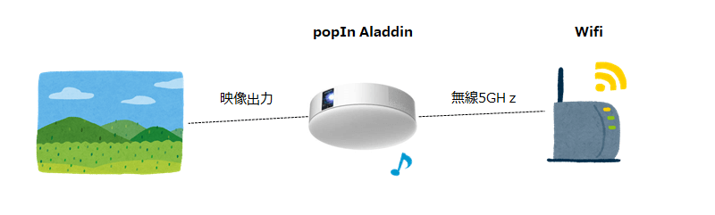
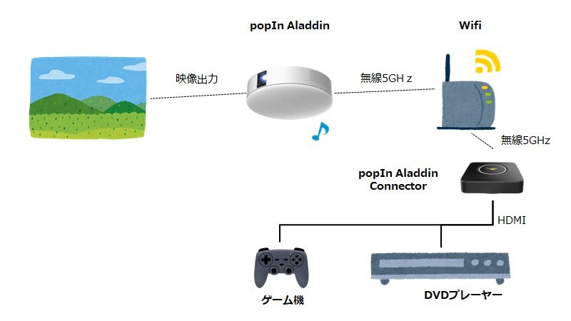
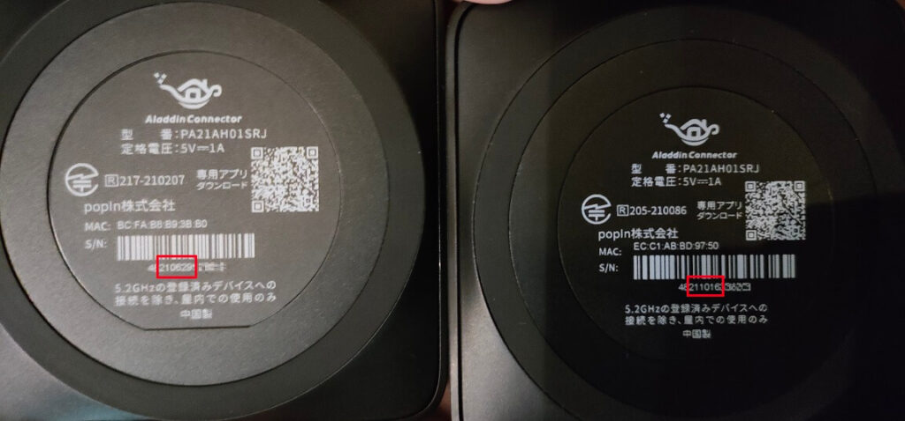
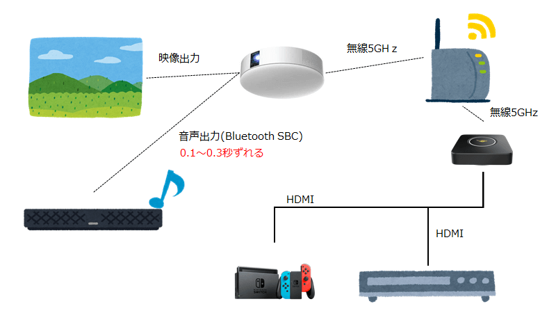
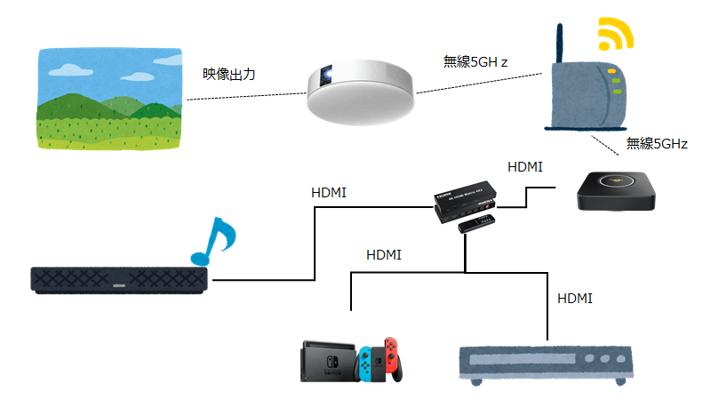

このブログのカテゴリーでは全くないのですが、同じように困っている方もいらっしゃるのではないかと思い、私が行った改善方法をまとめたいと思います。どれか1つで改善することもあれば複数実施しても改善しないこともあるかとは思います。

[popIn Aladdin](https://aladdin.popin.cc/)はとても良い商品なので音ズレだけで評価を下げられてしまうのは非常に勿体ないです。是非いろいろ試してみて改善されることを期待します。

## popIn Aladdinとは

照明とプロジェクターが一体化した製品です。照明の機能がありながら壁に映像を映し出して大画面で映画やテレビを見ることができます。私の自宅ではテレビを買い替える時期だったので大画面のテレビも検討をしていたのですが置く場所が無かったためpopIn Aladdinを採用した経緯があります。

https://amzn.to/3onRsFt

https://amzn.to/3GfiXar

今はpopIn Aladdin2とpopIn Aladdin SEがあって違いがありますので各ご家庭にあったタイプを選ぶとよさそうです。

<https://aladdin.popin.cc/pages/popin-aladdin-2-se-difference>

いずれにしても本体から映像と音声が出力されるようになっています。

※popIn Aladdinへは無線で映像を送信することになりますので無線の環境が必要です。画像はイメージです。無線は2.4GHzでも接続できます。

## popIn Aladdin Connectorとは

popIn Aladdin単体でも内蔵されたアプリでYouTubeやAmazonプライム、HuluやNetflixといったサービスを見ることができます。テレビチューナーがあればテレビも見れるようになります。これだけでも十分なのですが、単体ではプロジェクターで表示できないデバイスもあります。例えばDVDプレーヤーやゲームの映像は出力できません。接続は無線だけになっているからです。

そこでHDMIなどの有線で接続するデバイスの映像を出力するためにpopIn Aladdin Connector（以下、Aladdin Connector）を仲介させます。

https://amzn.to/3rCV5JR

Aladdin ConnectorにはHDMIの入力がありますのでHDMIでつなげるデバイスはプロジェクターに映し出せます。ただ入力は1個だけなので複数繋げたい場合は切り替えが必要です。

## Aladdin Connectorで繋ぐと音ズレが100%発生する

私の自宅の場合、本体単体での運用なら映像のカクツキは稀にあるものの、音ズレは発生しなかったのですが、Aladdin ConnectorでDVDの映像を送ったところ音ズレが100%発生しました。繋ぎ始めた直後から音ズレが始まり最悪0.3秒ほどの音ズレになりました。

そこでサポートへ問い合わせをして改善方法を教えてもらいながら色々と検証してみました。改善したものもあれば改善しなかったものもありましたので原因はいろいろとあるようです。

## 音ズレを解消するために試すこと

手軽な方法から順に記述します。

### Aladdin Connectorを再起動する

繋ぎ始めた直後が特に顕著だったのですが、映像が表示されたりされなかったり不安定な動きをしていました。初期設定の後は電源を抜いて再起動をすると安定したこともあるので、まずはAladdin Connectorの再起動を試してみてください。あとはpopIn Aladdin本体の再起動やルーターの再起動もすると改善することがあるようです。電源を10分以上抜いておくコールドブートを試すと改善することもあるようです。

私の自宅ではコールドブートで少し改善しました。5分程度で0.3秒程度のずれていたのが15分程度まで耐えるようになりました。

### Aladdin Connector同梱のHDMIケーブルを使用する

Aladdin ConnectorにはHDMIケーブルが同梱しているのでそれで繋ぐと改善することがあるようです。確かに古いタイプのHDMIで繋ぐと何が起こるか分かりませんし、popIn社で検証済みのHDMIの方が問題の切り分けができます。

私の自宅ではこの方法を使えませんでした。そもそもChrome Castを繋ぐこともあるのでpopIn社のHDMIケーブルの入る余地が無かったこともあります。

### Aladdin ConnectorやHDMI接続機器にて、HDMIケーブルの抜き差しをする

Aladdin Connectorの入力に接続しているHDMIを抜き差しすることで改善することがあります。私の自宅もこれで改善しました。

ただ最初は改善するものの、時間が経つにつれて徐々にズレ始めます。音と映像のスピードが違うような現象になります。（たまにそんなYoutube動画ありますよね）

### Aladdin Connectorの光っているボタンを2回押す

Aladdin Connectorの上部は光るようになっています（ライトリング）。黄色の時に押すと映像が表示され、青い時に押すと停止します。そのボタンを青い時に間を開けて2回押す、つまり再接続するとズレが解消されます。前述のケーブの抜き差しと同じ対応になるかと思います。

この方法も最初は改善するものの、徐々に音ズレしますので根本解決にはならないかもしれません。

### 給電不足を解消する

たこ足配線になっていると給電不足が原因になることもあるようです。直接壁から接続してみて改善するか確認してください。

### 無線の環境をpopIn Aladdinに最適化する

popIn AladdinとAladdin Connectorは無線LANで接続しますので、その環境が悪いと音ズレの原因になることがあります。私の自宅もこれに当てはまりました。

ルータが2階のクローゼットの中にあり、ドアや床の障害を経由して1階のpopIn Aladdinと接続していました。このため音ズレもそうですが映像もカクカクしていました。無線LANの通信方法も、通信速度が速い5GHz帯にしたかったのですが、壁を超えないといけないため2.4GHzを使うしかない状態でした。

そこでルータとpopIn Aladdin本体とAladdin Connecotrを同じ部屋に配置し、5GHzで接続するようにしました。すると映像のカクツキが無くなり、音ズレも若干改善しました。

あと、効果があったかは分かりませんが、他の家の無線になるべく干渉しなそうなチャンネルを手動で設定してみました。

https://aladdin.popin.cc/pages/faq#faq555817762864

### ルーターの負荷を下げる

ルーターの負荷を下げると改善する可能性があるとサポートから教えてもらいました。他の機器の接続を止めてどの程度改善するか確認するのも良いと思います。私の自宅の場合、1台のルータがルータ機能と無線機能を兼任していたので、2台のルータを用意し1台をブリッジモードにして負荷を分散しました。効果があったかは分かりません。

### 通信が混雑していない時間帯で試してみる

回線が弱いことで生じる原因かもしれないので早朝などある程度回線速度を確保できる時間帯で検証してみるのもよいと思います。

### Aladdin Connector本体の取り換え

私の場合はこれでした。サポートに問い合わせて本体を入れ替えたところ音ズレはすぐに解消しました。

機器の型番は同じだったのですがS/Nの（おそらく）製造日っぽい番号を見ると（おそらく）10月に作ったもので音ズレが発生していました。入れ替えとして送られてきた機器は（おそらく）6月に作ったもののようです。

画像左が音ズレが発生しない機器、右が音ズレが発生した機器。

型番が同じでもライトリングの光の色が違ったりしたので時期によって製造方法や材料が違っているのでしょうか。画面転送状態を表す黄色ですが、正常に動く方は黄色というよりオレンジに近い色でした。逆に音ズレする方はThe黄色と言った色で光りました。青も正常に動く方は鮮やかに光ります。

Twitterで検索したら私と同様の条件で音ズレが発生していて機器を交換したら直ったという方もいたので、色の光方やS/Nが似ている方は疑ってみてもよいかもしれません。

やることをやっても改善しない場合はサポートに問い合わせてみましょう。

## 外部スピーカーで音を出したときの音ズレ

ここからはAladdin Connectorを使わなくても発生する音ズレに対する改善方法です。現時点で「改善できない」ケースもありますがそこは妥協点を見つけるしかないかなと思います。

### popIn AladdinからBluetooth経由で外部スピーカに出力する時の音ズレ

popIn AladdinにはBluetooth出力の機能が標準でついていて外部のスピーカーで音声を流せるようにはなっています。ただ0.1秒ほどの体感できるような音ズレが発生することがあります。

私の自宅の環境では、アプリによっておこる場合と起こらない場合がありました。

|  |  |
| --- | --- |
| アプリ | 症状 |
| テレビ | 1分程度で音ズレが体感できる |
| Amazonプライム | 5分程度は音ズレなし、30分程度でズレを体感できるようになる |
| YouTube | ズレない（長い動画だとズレてくるかも） |
| Aladdin Connector | 接続後すぐに音ズレを体感できる |

アプリごとの症状

音がずれてきたとしてもチャンネルを変えたり他の動画に切り替えたりするとリセットされるので短い動画ならそこまで気になりません。テレビは30分以上見ることがあるので非常にストレスです。またAladdin Connectorは接続直後からずれます。

ちなみに私の自宅の外部スピーカーはヤマハのサウンドバーYAS-209Bです。

https://amzn.to/31nm0Ph

### BluetoothのコーデックがSBC

popIn AladdinのBluetoothのコーデック形式が、遅延の発生が多いSBCということもあり、どうしようもできない部分であります。

https://aladdin.popin.cc/pages/faq#faq388810407984

今後の本体のアップデートで改善されるかもしれませんが、現状、遅延が発生するスピーカーは正直Bluetooth接続を諦めた方が良いと思いました。私は諦め、popIn Aladdin本体のスピーカーから流すことにしました。

### Aladdin Connectorは音声だけ直接スピーカに接続することで解消できるかも

popIn Aladdin本体に内蔵されたアプリだと現時点で改善方法が見つかりませんでしたが、Aladdin Connectorの音ズレは改善する方法を見つけましたので紹介します。

それは音声だけ直接外部スピーカーに繋げる方法です。

ゲームやDVDプレーヤーの出力をAladdin Connectorに繋ぐ前に音声分配器を仲介して繋げます。映像は無線を経由して表示される一方、音声はHDMI接続のみですぐに出力されるのでズレが無くなることがあります。

私の自宅がたまたま映像と音声が一致しただけで、他の家の環境だと音声の方が速く流れてしまうかもしれないのは否定できません。

↓こちらが音ズレが発生したつなぎ方です。

音ズレが起きなくなったつなぎ方が↓こちらです。

音声分配器はこちらを購入しました。

https://amzn.to/3rC72Q7

4つの入力と2つの出力を制御できるので、DVDプレーヤーとゲーム機とChrome Castを入力に繋いで、Aladdin Connectorと外部スピーカそれぞれに出力しました。popIn Aladdinからも音が出てしまいますが音量を0にすればよいだけです。

これにより私の自宅のAladdin Connectorの音ズレは完全に解消しました。

### ちなみに

私の自宅のDVDレコーダーはBluetooth機能がついていて、外部スピーカとBluetoothで繋いだケースも検証したのですが音ズレは発生しませんでした。Aladdin Connectorを経由しない方法が取れるなら改善するかもしれません。

## ゲームの遅延はどうなの？

ゲームは音ズレというより入力から画面への反映に遅延が出るので解決は難しいかと思います。私はマリオを試したのですが、ギリジャンができなくて毎回穴に落ちました。速さを求めないパズルゲーム等なら出来るとは思いますが違和感が気になる人はやめた方が良いと思います。

遅延が出ない方法があれば知りたいです。

## ということで

popIn Aladdinは素晴らしい商品です。これまでにないUXを体験できます。冒頭に書いたように音ズレで評価を下げたり使わないのはとても勿体ないので、これまでに挙げた方法を試して改善することを祈ります。
