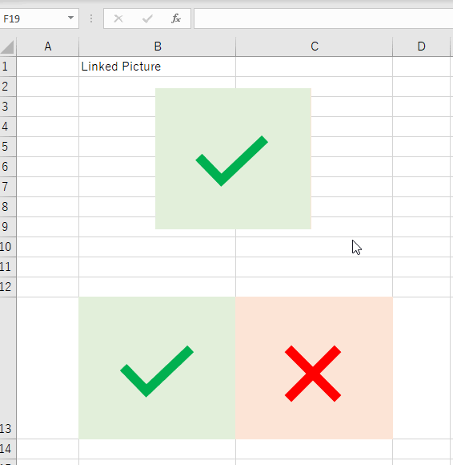
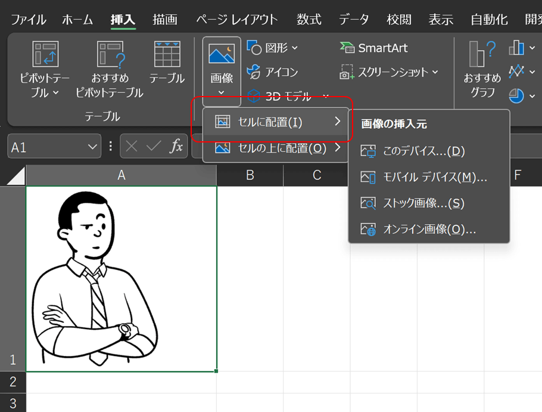
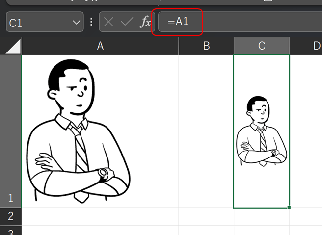
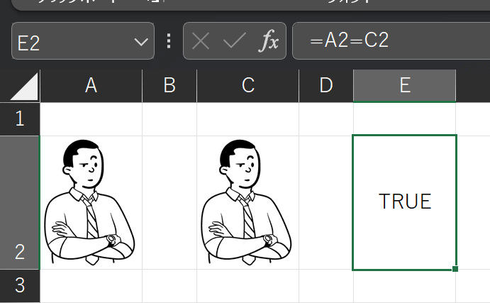
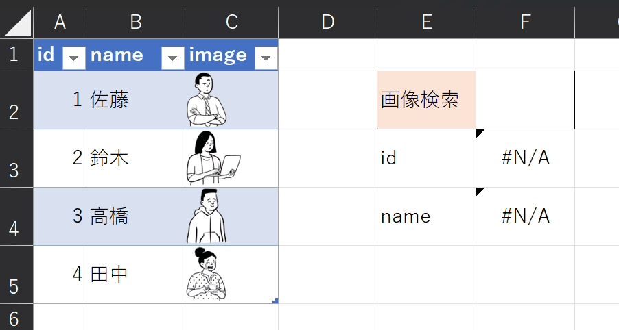
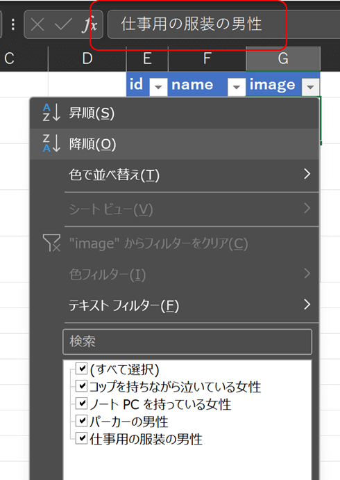
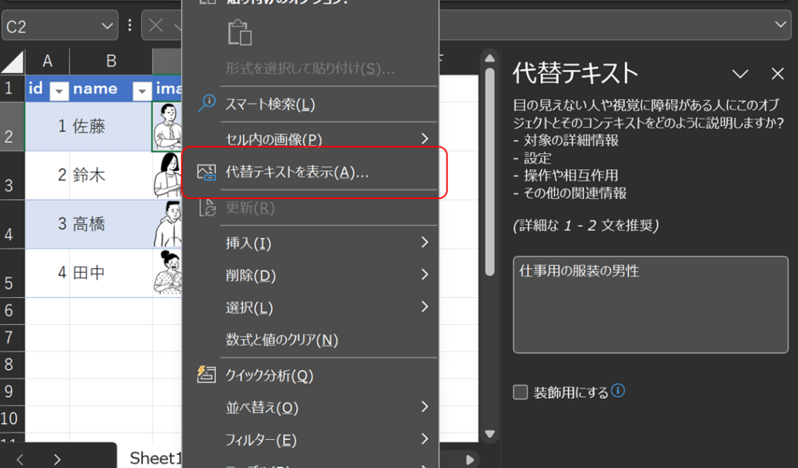
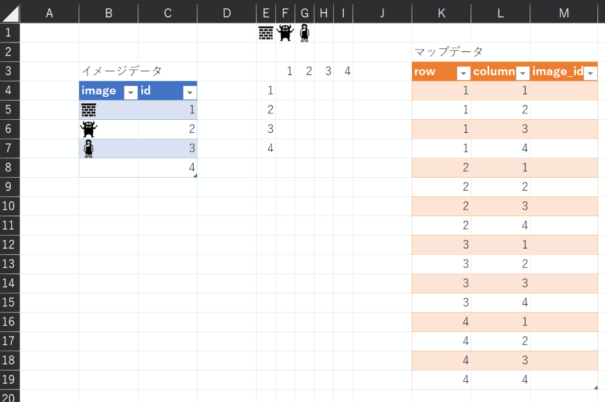
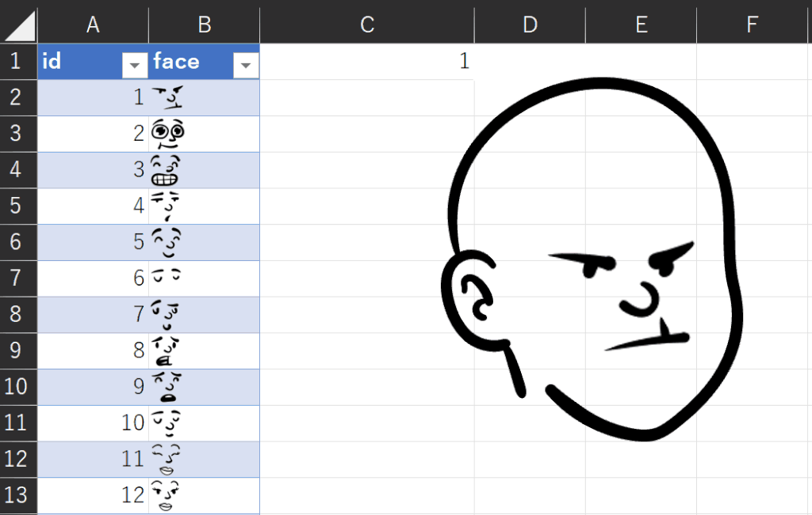

この記事は[モニクル Advent Calendar 2023](https://adventar.org/calendars/8977)の18日目の記事です。

Excelで画像をセル内に埋め込めるようになって結構経ちますが詳細を調べていなかったので触ってみました。中には表計算ソフトで画像を取り扱うことに違和感もあるかもしれませんが、せっかくできた機能ですし見てみましょう。

## セルに画像を埋め込むとは？

Excelではこれまでセルの中に画像を埋め込めませんでした。画像はセルの上に配置するだけにとどまり、データのように扱えませんでした。このため、セルの数値を参照して画像を変えるようなギミックは工夫して作らないといけませんでした。

旧来の手法である画像をセルの上に配置するのは画像の挿入でできます。セルの枠内に収まるように上手に配置してセルの中にあるように見せるやり方です。


画像を動的に切り替えるには「リンクされた図」を使ったりします。



リンクされた図は便利なのですが処理負荷が高く複数使うとExcelが固まることもあり、画像をデータとして扱いたい場合は毎回気を使います。ちなみにゲームを作る時の候補としてリンクされた図の検討をしますが処理速度の問題で大概却下されます。

https://papasensei365.com/excel-game-tetris/#toc12

画像を扱う別の方法としてIMGAGE関数がありますが、IMAGE関数はクラウド上の画像が対象なのでローカル画像を埋め込めませんでした。

そんな中、「セルに配置」という機能が追加されました。  
セルの中に画像を配置し、文字や数値と同じように取り扱えるようになりました。  
セルに配置ではローカル画像も利用できます。



## セルに画像を配置すると何ができる？

セルに画像を配置すると数字や文字と同じように扱えるので、関数を使って画像を呼び出すことができます。リンクされた図は不要です。  
例えばA1に画像を埋め込んでおいて、他のセルで=A1とすると画像を参照できます。



また、VLOOKUPのような関数を使って画像を呼び出すことができます。


```
セルE2の式 =VLOOKUP(F1,A2:C5,3,false)
```

Excelをデータベースとして利用するときに画像も取り扱えるようになったわけです。  
※Excelをデータベースとして使うことを推奨しているわけではありません。

## セル内の画像のあれこれ

### セルをコピーしたらコピー元とコピー先は同じデータの扱いになる

画像が入ったセルをコピーして別のセルに貼り付けた場合、コピー元とコピー先を比較すると等しいと判定されます。



一方、同じ画像ファイルでも別々に取り込むと別扱いになります。


### 画像で検索ができる

数値や文字と同じように使えるので画像をXLOOKUPの検索値に指定して他のデータを呼び出すこともできます。  
ただ、できるというはいうものの業務内でこの仕様で何か作る機会はあまりないと思われます...。



### 値の貼り付け、数式の貼り付けでコピーできる

コピーするときに「値の貼り付け」または「数式の貼り付け」でコピーできます。書式のコピーを省けますのでVBA等で処理するときに若干軽くできそうです。

### 画像の名前は代替えテキストから変更する

画像が含まれるセルの式を見ると「画像」という文字だったり画像の名前が入ったりしています。フィルター機能を使う場合はこの文字での検索となります。



この名前を書き換えたい場合、直接式を変更すると画像が消えてしまいますので、代替テキストで変更します。セルを右クリックして「代替テキストを表示」で書き換えられます。



### PowerQueryには読み込めない

PowerQueryに読み込むとエラーになります。ExcelのPowerQueryは厳しそうですね。PowerBIだと画像が扱えるのでできそうではあります。  
（深く調べればできるかもしれません、未調査）

## どう使う？

業務として利用できそうなシーンは、**データの一部として画像を登録して参照するようなケースには重宝します**。社員一覧で顔写真を参照するとか、植物の名前と画像のデータを作って参照するとか、そんな使い方は出来そうです。

業務としては、、、そのくらいですかね。

### この記事で一番伝えたかったこと

**ゲーム作りに使う分には大変重宝しますね！**  
マップを作る時に画像を使ってデータを生成できます。



また、動的に切り替えるような動きもセル内画像で簡単にできるようになります。



ということで、データとして画像が使えるようになったのでExcelの表現力、対応力がさらに上がりました。表計算ソフトの域はすでに脱しているので「Excelは表計算ソフト」という考えは改めて自由に使っていけるといいですね。私はこれからも自由に使わせてもらいます！
