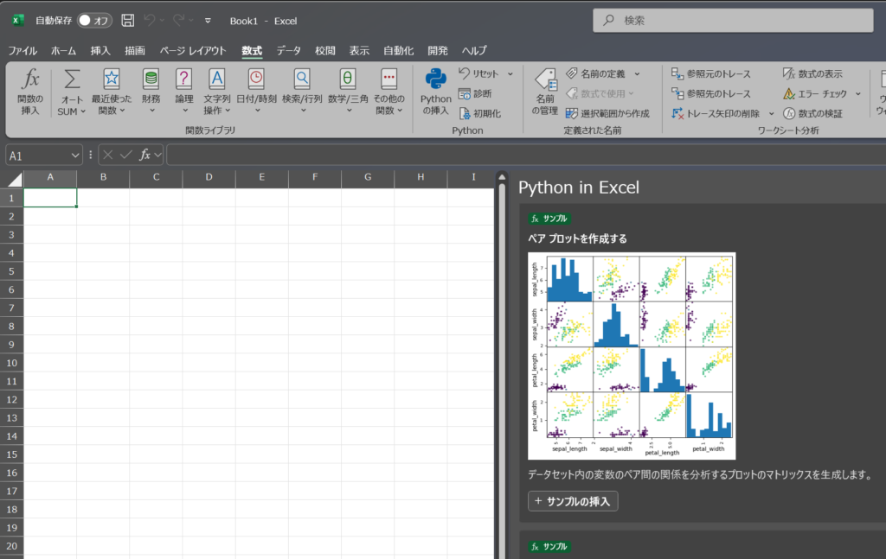

会社で「1時間でブログを書く」というイベントがあったので、勢いで近況報告を書いています！

最近、とても残念なことですがExcelをあまり触れていません。特に、LAMBDA関数が登場してから自由度が高まりすぎて、機能を探したり実現方法を模索したりするモチベーションが少し下がってしまいました。大体の機能はLAMBDAで実現できてしまうんだろうなと思うことが多くなったためです。ブログの投稿回数が減ったのもそれが原因です。

現在、データ分析をする機会が増えており、BigQueryやdbtを使ったデータ処理に取り組んでいます。さらに、ExcelでPythonが使えるようになったこともあり、今後はデータ分析に関する記事を書こうかなと考えています。月1回以上は投稿していきたいですね。

Power Platformは全然触れていません。この前、モバイルからアプリを消してしまいました、ごめんなさい。（Power BIには触れる可能性があるかもしれません。）

今回はリハビリの一環として軽い共有をしたいと思います。

ExcelでPythonが使えるようになったので、散布図行列を作れるようになりました！[数式] > [Pythonの挿入]からサンプルを挿入できるので、ぜひ試してみてください！

以上！
