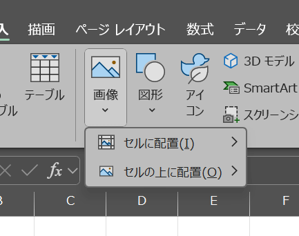
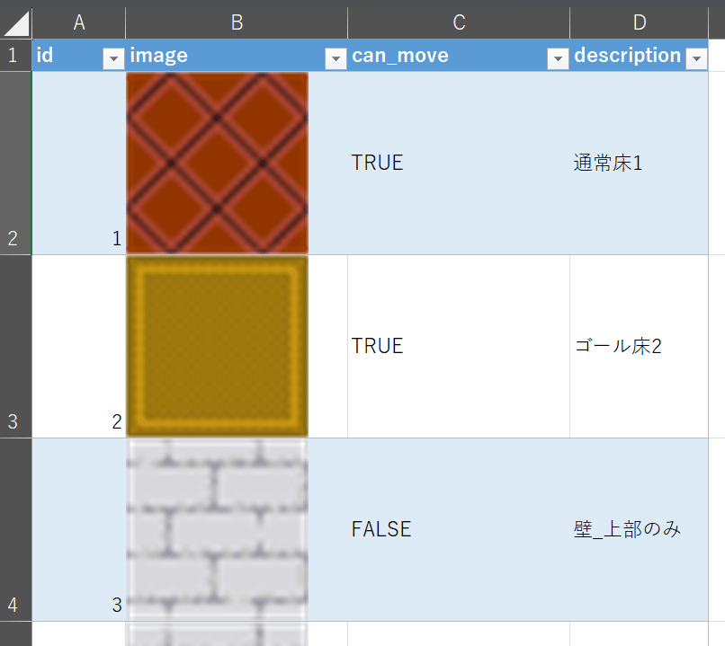
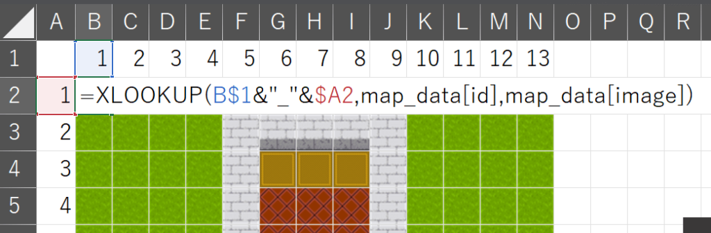
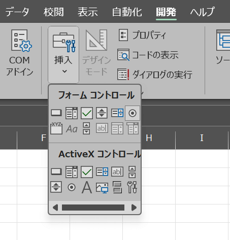
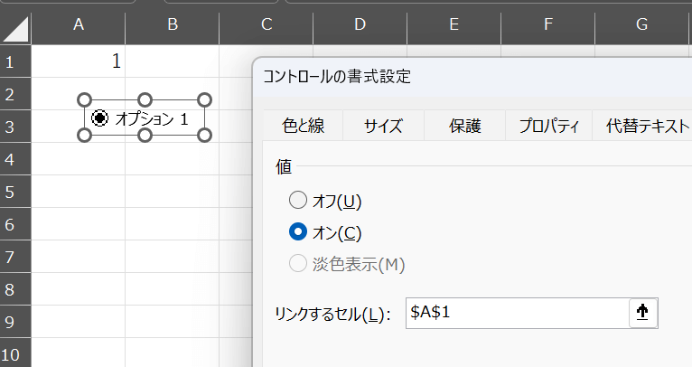
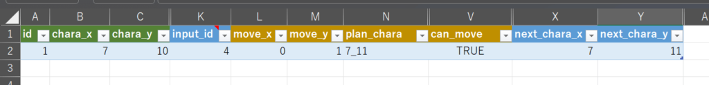
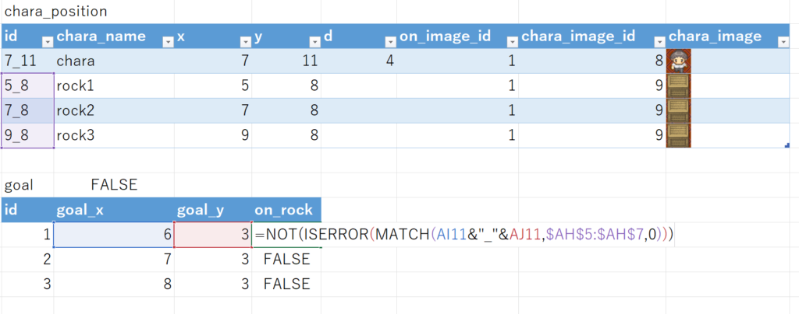

[モニクル Advent Calendar 2024](https://adventar.org/calendars/10519) 15日目の記事です。

ドラクエ3のリメイクをトロフィーコンプリートまで遊んだところ無性に作りたくなってしまったので勢いでやってしまいました。開発期間2日でとりあえずの雑な作りになっていますが大枠はできたので残しておきたいと思います。これまで作ったゲームと説明が重複する部分もありますのでご了承ください。

## この記事の対象者

- Excelをある程度知っているが更に深い使い方を知りたい方
- Excelを好きになりたい方
- Excelで遊びたい方

正直、業務で利用できる話は1割程度ですので面白半分で見てください。

## 何を作ったか

ドラクエ3のエジンベアにある岩を動かすパズルをExcelのセル上で遊べるようにしました。

https://www.youtube.com/watch?v=\_EGlyOLvw3Q

**VBA、OfficeScript、Pythonは使わず、関数とExcelの標準機能だけで**作っています。

以前作成したゲームで使用していた循環参照や散布図、F9連打などの技術は使わずシンプルな仕組みになっています。シンプルな故、エクセル感が残って良い感じに仕上がっています。Excelで初めてゲームを作るにはちょうど良いレベルです。

ファイルはGitHubに置いておきます。画像をセルに埋め込めるExcelのバージョンなら動くはずです。

なお、**ドラクエの画像をそのまま使って配布するのはよろしくないのでフリー素材の画像に差し替えています。**結果的にドラクエというか倉庫番になってしまいました。

<https://github.com/tomikiya/excel-game-dq3-puzzle>

それでは詳細です。

## 詳細

### セルに画像を埋め込む

これまでのゲーム作りではリンクされた図や散布図を使って描画していました。2024年1月のアップデートで画像をセルに埋め込めるようになりましたので検証を兼ねて使っています。

[画像]-[セルの配置]から画像を指定することでセル内に画像を埋め込めます。



セル内へ埋め込むと数値や文字と同じように扱えるため、XLOOKUPのような関数で画像を検索して取得できるようになります。詳しくは[[Excel]画像をセルに埋め込められるようになったので何ができるか調べた](https://papasensei365.com/excel-image-tips-in-cell/ "詳しい話は別記事")にまとめています。

画像は１つずつIDをつけてあとで検索して呼び出せるようにし、テーブル化しておきます。



セル内への画像埋め込みの残念な点として、複数のレイヤーを扱えません。背景が地面でキャラクターをその上に配置するような処理ができないので、背景とキャラクターを1つの画像にまとめてから配置することになります。つまり背景×キャラクター（上下左右）の組み合わせ全ての画像を用意します。今回はパターンが少なかったので全通りの画像を用意しましたが、それが難しい場合は散布図を使う方法がお勧めです。散布図を使ったゲームを詳しく知りたい場合は[ExcelでVBAを使わないでドラクエ3を再現する](https://papasensei365.com/excel-game-dq3/ "ExcelでVBAを使わないでドラクエ3を再現する")にて解説していますので確認してみてください。

### マップを作る

画像にIDを付けていますのでそのIDでマップを作れるようになります。

画像を表示しているセルには以下のような式が入っています。※分かりやすくするために重要な部分だけ抜き出して一部改変しています。



```
=XLOOKUP(B$1&"_"&$A2,map_data[id],map_data[image])
```

IDでマップを管理できますので好きなようにパズルを変更して難易度を調整したり画像データを変えたりできます。

### マウスの操作履歴を取得する

マウス操作をセルの数値に伝搬させるため、操作した履歴を取得する処理を組み込みます。今回は、フォームコントロールのオプションボタンを使います。[開発]-[挿入]-[オプションボタン]からボタンを4つ挿入します。



オプションボタンの設定には「リンクするセル」があり、これを指定するとボタンを押した時にボタンに紐づく数値がセルに書き込まれます。



**通常の使い方ではこのセルは動きませんが、通常ではない使い方でこれを動かします。**

リンクするセルには以下の式を登録します。そのままでは登録できないため、名前定義を経由します。

```
=INDIRECT("Sheet1!$A$"&COUNTA(Sheet1!$A:$A)+1)
```

この状態でオプションボタンを連続クリックするとリンクするセルの位置が毎回1セルずつ下に移動し、押した履歴を残せるようになります。

もっと詳しく知りたい場合は[ExcelでVBAを使わないでテトリスを再現する](https://papasensei365.com/excel-game-tetris/ "ExcelでVBAを使わないでテトリスを再現する")をご覧ください。

### 操作履歴をもとに移動可否を計算する

操作履歴があればキャラクターの位置を計算できるので、あとは計算ロジックを組み込むだけです。必要な情報は以下のようになります。

- キャラクターの初期位置
- 操作履歴
- 移動先候補
- 移動先候補に移動できるか
- 最終的な移動先

通常のプログラミングではこれらの処理を順番に上から下へ処理ごとに分けて記述すればできあがりますが、残念ながらこれはExcelです。

Excelでのゲーム作りでは、これらの処理を1行で書いたほうが扱いやすいです。  
話をシンプルにするためにキャラクターの移動に焦点を当てて説明します。  
セルの並びのイメージです。



まずはキャラクターの位置を座標`chara_x,chara_y`を使って表します。（キャラクターの向きもありますが説明では省略）

```
chara_x =IF([@id]=1,init_chara_x,X1)
chara_y =IF([@id]=1,init_chara_y,Y1)
```

1行目は初期位置、2行目以降は1つ上のX列とY列の値、つまり`next_chara_x,next_chara_y`を参照します。

次に「押したボタン」を管理する`input_id`をその横に付けます。このinput\_id列に上述した操作履歴を保存していきます。

そしてinput\_idの値によって移動する方向`move_x, move_y`を計算します。

```
move_x =SWITCH([@[input_id]],→,1,←,-1,0)
move_y =SWITCH([@[input_id]],↑,-1,↓,1,0)
```

キャラクターの位置と移動する方向で移動予定の座標`plan_chara`を計算します。

```
plan_chara =[@[chara_x]]+[@[move_x]]&"_"&[@[chara_y]]+[@[move_y]]
```

移動予定の座標に動けるか`can_move`を計算します。map\_dataには画像ごとにその上に動けるかどうかを判定する`can_move`が事前に登録しています。

```
can_move =XLOOKUP([@[plan_chara]],map_data[id],map_data[can_move])
```

動けるようなら移動、動けないなら元の位置の座標を計算し`next_chara_x,next_chara_y`へ保存します。ちなみに、リセットボタンの挙動もあるためその挙動も含め`IFS`で複数の条件を繋げています。

```
next_x =IFS([@reset],init_chara_x,[@[can_move]],VALUE(INDEX(TEXTSPLIT([@[plan_chara]],"_"),1)),ELSE,[@[chara_x]])

next_y =IFS([@reset],init_chara_y, [@[can_move]],VALUE(INDEX(TEXTSPLIT([@[plan_chara]],"_"),2)),ELSE,[@[chara_y]])
```

以上の処理を1行に横方向へつなげることで一連の処理を1行でまとめられます。

再度ボタンを押すと新しい行が追加され、次の行では前の行の結果をベースに再度計算します。この繰り返しで移動の履歴を計算できます。

発展的な話

このパズルでは岩が3つあるので通常だとFORやMAPで同じ処理を3回ループさせて判定しますが、Excelだとループ処理が複雑だったりテーブル上だとスピルできなかったりするため、今回は3つ分の列を作り同じ処理を3回書いてます。岩を増やしたい場合はそれだけ列が増えていくため、ここは改良の余地があります。将来的にExcelの機能が拡充して[データ型の株価](https://support.microsoft.com/ja-jp/office/excel-%E3%83%87%E3%83%BC%E3%82%BF%E5%9E%8B-%E6%A0%AA%E4%BE%A1%E3%81%A8%E5%9C%B0%E7%90%86-61a33056-9935-484f-8ac8-f1a89e210877 "データ型の株価")のように1つのセルに複数の情報を自由に持たせられるようになるか、スピルさせない指示が出せるようになればもっと簡単に記述できるようになります。

また、クリックするたびに行が増えてだんだんと重くなる課題もあります。ゴールするまでの操作回数に制限をかけるなど対策をしたほうが良いでしょう。

### 完了条件を定義する

岩を所定の位置に置いたら完了判定をします。これは単純にゴールの位置とその上に岩があるかを1つずつ判定して3つともゴールと重なっていたら完了とします。

```
=NOT(ISERROR(MATCH(AI11&"_"&AJ11,$AH$5:$AH$7,0)))
```



以上で完成です。

## まとめ

ね、冒頭に言った通り、業務に役立つ情報はなかったでしょ？コーヒーブレイクになれば幸いです。  
これでいろんなパズルが楽しめますね！

他にもゲームを作っているので興味がありましたら見てみてください。

## VBAを使わないExcelゲームシリーズ

https://papasensei365.com/excel-game-dq3/

https://papasensei365.com/excel-game-tetris/

https://papasensei365.com/excel-nonvba-3d-maze/

https://papasensei365.com/excel-game-minesweeper/

## その他

ドット絵は以下から使わせていただきました。ありがとうございました。

ぴぽや <https://pipoya.net/>

このページで利用している株式会社スクウェア・エニックスを代表とする共同著作者が権利を所有する画像の転載・配布は禁止いたします。  
© ARMOR PROJECT/BIRD STUDIO/SPIKE CHUNSOFT/SQUARE ENIX
