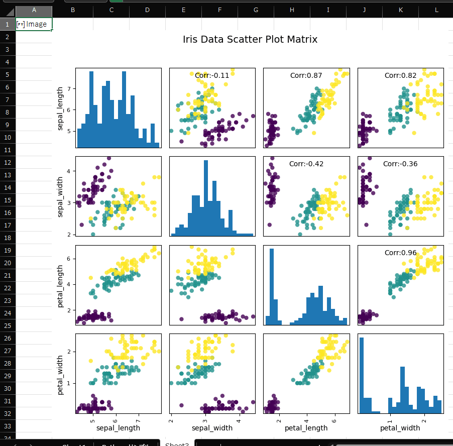

個人的なメモ

Excelの中で使えるPythonで散布図行列を作れるのでちょっと改良して相関行列も一緒に表示できるようにする。※Pythonは初心者なので当たり前のこともコメントに書いているかもしれない。

## 詳細

以下はExcelのサンプルで出力される散布図行列を元にして、相関行列を計算し上半分に相関係数を表示する。参照データを変えれば他のデータでも使える。

```
import pandas as pd
import matplotlib.pyplot as plt
import numpy as np # 数値計算とインデックス操作のために使う

from pandas.plotting import scatter_matrix

# --- 1. データと相関行列の準備 ---
# ExcelからデータセットをDataFrameに取り込む
sample_df = xl("IrisDataSet[#すべて]", headers=True)
columns_to_plot = ["sepal_length", "sepal_width", "petal_length", "petal_width"]

# 相関行列を計算 (描画対象の列のみを使う)
corr = sample_df[columns_to_plot].corr() 

# --- 2. 散布図行列を作成し、Axes配列を変数に格納 ---
categories = sample_df["species"].unique()
colors = {category: i for i, category in enumerate(categories)}

# axes_array に Axes の配列を格納 (戻り値を変数に格納することが重要)
fig = plt.figure(figsize=(8, 8))
axes_array = scatter_matrix(
    sample_df[columns_to_plot], 
    c=sample_df["species"].apply(lambda x: colors[x]), 
    marker='o', 
    hist_kwds={'bins': 20}, 
    alpha=0.8, 
    ax=fig.gca() 
)

# --- 3. 相関係数を表記 ---
# np.triu_indices_from を使って上三角部分のインデックスを取得
for i, j in zip(*np.triu_indices_from(axes_array, k=1)):
    # Axesオブジェクトに直接アノテーションを追加
    axes_array[i, j].annotate(
        f"Corr:{corr.iloc[i,j]:.2f}",
        (0.5, 0.9), # 座標 (グラフの相対位置)
        xycoords='axes fraction',
        ha='center',
        va='center',
        fontsize=10,
        color='black'
    )

# 4. グラフの装飾と表示
plt.suptitle("Iris Data Scatter Plot Matrix", fontsize=14, y=1.02)
plt.tight_layout() # レイアウトを自動調整

# 最後の行で Figure オブジェクトを返すことで、Excelセルに画像が出力されます
plt.show()
```



散布図行列と相関行列をそれぞれ別のセルで計算して結合して出そうとしたが一度セル上に展開するとうまくいかなかったので一気に実行することにした。

## 所感

Python in Excelは相関行列を作るために生まれてきたのかもしれない。

## 参考にしたブログ

データと統計学　[散布図行列(Scatter plot matrix)と相関行列(Correlation matrix)をpythonで実装する](https://df-learning.com/scatter-plot-matrixcorrelation-matrix/ "散布図行列(Scatter plot matrix)と相関行列(Correlation matrix)をpythonで実装する")
